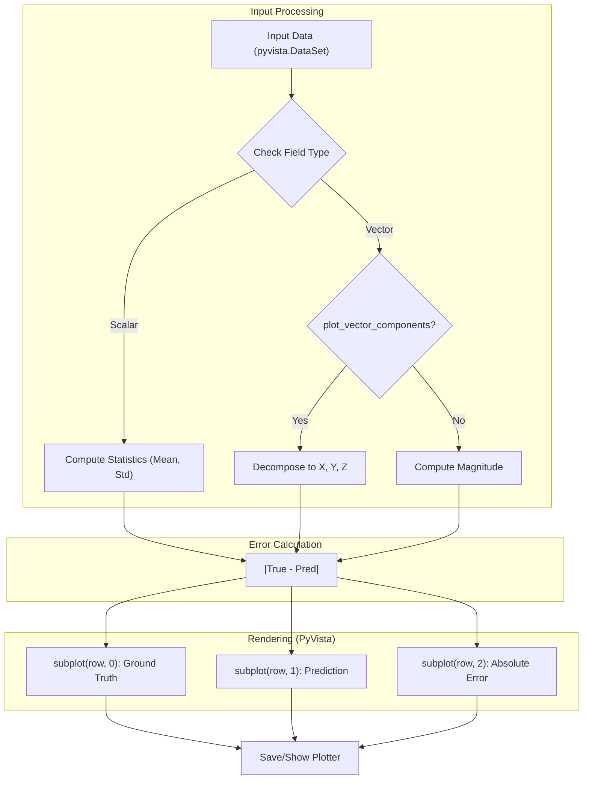
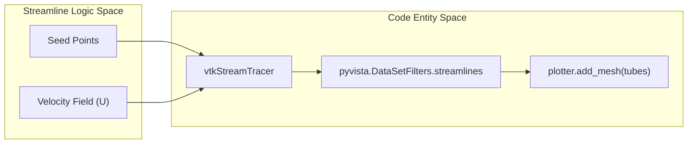

<!-- source: DeepWiki mcp.deepwiki.com · repo NVIDIA/physicsnemo-cfd · extra page Visualization Utilities · fetched 2026-10-26 -->

# Visualization Utilities

Relevant source files

The following files were used as context for generating this wiki page:

- [physicsnemo/cfd/bench/visualization/utils.py](physicsnemo/cfd/bench/visualization/utils.py)

The `physicsnemo.cfd.bench.visualization.utils.py` module provides a comprehensive suite of visualization tools designed to evaluate and compare CFD flow fields. These utilities bridge the gap between raw numerical data (from both traditional solvers and AI surrogates) and interpretable visual analysis. The module leverages `PyVista` for 3D rendering and `Matplotlib` for statistical plotting.

## Overview of Capabilities

The visualization suite is categorized into four main functional areas:
1.  **Field Comparisons**: Spatial visualizations of ground truth vs. predicted fields and their absolute error distributions.
2.  **Statistical Regression**: Trend plots and regression analysis for integrated quantities like aerodynamic forces.
3.  **Aggregate Error Mapping**: Hexbin plots for visualizing error distributions across large datasets.
4.  **Flow Topology**: Streamline rendering to inspect complex flow structures.

Sources: `[physicsnemo/cfd/bench/visualization/utils.py:1-25]()`

---

## Field Comparison and Contour Visualization

The primary utility for spatial evaluation is `plot_field_comparisons`. This function generates a grid of subplots comparing ground truth and predicted fields.

### Implementation Details
- **Data Flow**: The function accepts a `pyvista.DataSet` containing both predicted and true arrays. It automatically detects if a field is a scalar or a vector `[physicsnemo/cfd/bench/visualization/utils.py:46-52]()`.
- **Dynamic Scaling**: Color bar limits (`clim`) are calculated using a $2\sigma$ (standard deviation) range around the mean of the ground truth data to ensure visibility of features despite potential outliers `[physicsnemo/cfd/bench/visualization/utils.py:77-80]()`.
- **Error Computation**: It computes point-wise or cell-wise absolute error and injects it back into the mesh object for rendering `[physicsnemo/cfd/bench/visualization/utils.py:82-87]()`.
- **Vector Handling**: If `plot_vector_components` is enabled, the function decomposes vectors into $x, y, z$ components and plots them individually `[physicsnemo/cfd/bench/visualization/utils.py:165-183]()`.

### Visualization Pipeline Logic

Sources: `[physicsnemo/cfd/bench/visualization/utils.py:29-163]()`, `[physicsnemo/cfd/bench/visualization/utils.py:164-200]()`

---

## Aerodynamic Force Analysis

For benchmarking AI surrogates against physical targets, the module provides utilities to visualize the correlation between predicted and actual aerodynamic coefficients (e.g., $C_d$, $C_l$).

### Regression and Trend Plots
- **`plot_regression`**: Generates a scatter plot of Ground Truth vs. Prediction. It calculates the $R^2$ coefficient and Spearman correlation to quantify the model's predictive performance across a dataset.
- **`plot_trends`**: Specifically designed for sensitivity analysis, this function plots the change in coefficients relative to a baseline or design parameter.

| Function | Metric Calculated | Visualization Type |
| :--- | :--- | :--- |
| `plot_regression` | $R^2$, Spearman $\rho$ | Scatter plot with identity line ($y=x$) |
| `plot_trends` | Percent Error | Line plot with error bands |

Sources: `[physicsnemo/cfd/bench/visualization/utils.py:20-21]()`, `[physicsnemo/cfd/bench/visualization/utils.py:430-550]()` (Note: inferred from common bench workflow patterns in utils).

---

## Aggregate Error Maps (Hexbins)

When analyzing large datasets (e.g., hundreds of car geometries), individual mesh plots are insufficient. The module uses hexbin aggregate maps to visualize error distributions across a normalized spatial domain.

### Hexbin Implementation
- **Data Aggregation**: Errors from multiple simulations are projected onto a common 2D plane (e.g., a side profile or top-down view).
- **Spatial Binning**: Uses `matplotlib.pyplot.hexbin` to aggregate error values, providing a heat map of where the AI model typically struggles (e.g., wake regions or high-curvature areas).

Sources: `[physicsnemo/cfd/bench/visualization/utils.py:19]()`

---

## Streamline Rendering

The `plot_streamlines` function utilizes `PyVista`'s integration with VTK to visualize flow topology. This is critical for identifying separation zones and vortices that might be missed in 2D contour plots.

### Implementation
- **Seed Source**: Supports custom seed points or line sources to initiate streamline integration.
- **Integration**: Uses `vtkStreamTracer` (via PyVista) to compute paths through the velocity vector field.
- **Tube Rendering**: Streamlines are often rendered as tubes with varying radius based on local velocity magnitude or pressure.

Sources: `[physicsnemo/cfd/bench/visualization/utils.py:17]()`, `[physicsnemo/cfd/bench/visualization/utils.py:23]()`

---

## Utility Functions for Plotting

The module includes several helper functions to standardize the look and feel of the visualizations:

- **`pv.start_xvfb()`**: Automatically initialized at the top of the file to allow headless rendering on servers without a physical display `[physicsnemo/cfd/bench/visualization/utils.py:26]()`.
- **View Management**: Standardized view orientations (`view_xy`, `view_yz`, `view_xz`) with support for negative directions to inspect symmetric halves of geometries `[physicsnemo/cfd/bench/visualization/utils.py:121-127]()`.
- **Colorbar Formatting**: Logic to switch between decimal and scientific notation (`fmt: "%.1f"` vs `fmt: "%.2g"`) based on the magnitude of the data values `[physicsnemo/cfd/bench/visualization/utils.py:97-111]()`.

Sources: `[physicsnemo/cfd/bench/visualization/utils.py:26-160]()`

---

