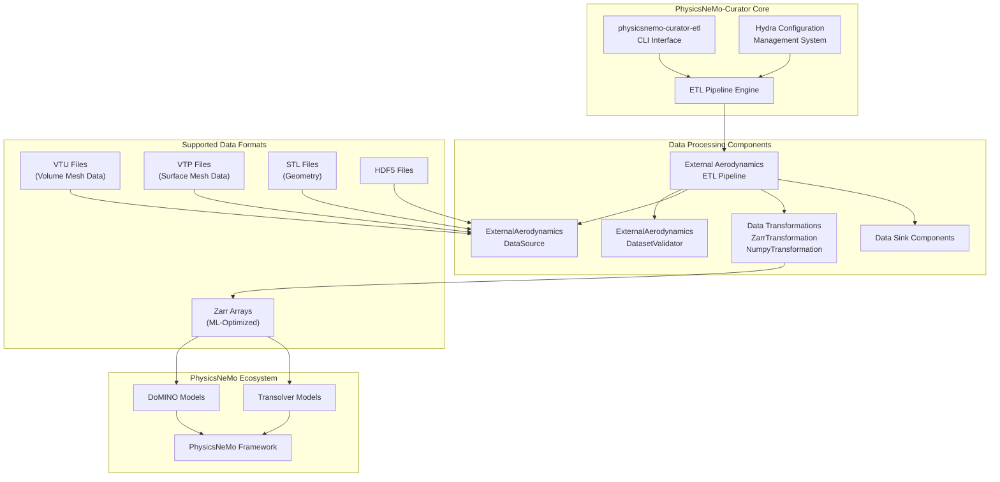
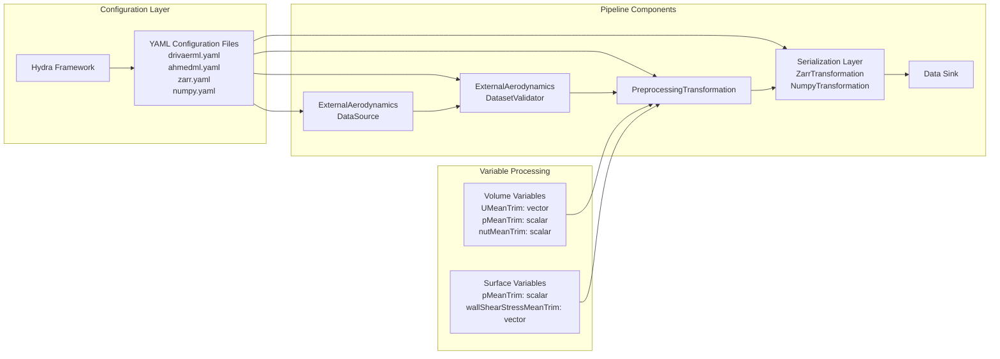
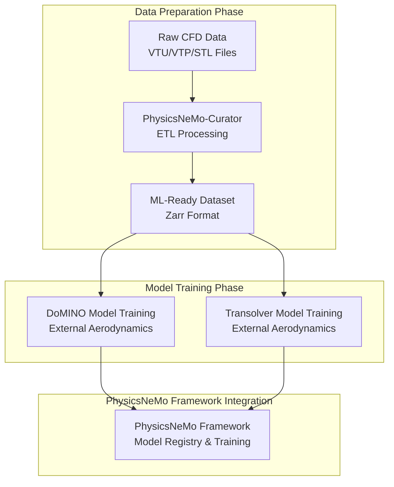

<!-- source: DeepWiki mcp.deepwiki.com · repo NVIDIA/physicsnemo-curator · page 1 Overview · fetched 2026-10-26 -->

# Overview

Relevant source files

The following files were used as context for generating this wiki page:

- [README.md](README.md)

## Purpose and Scope

This document provides a high-level architectural overview of PhysicsNeMo-Curator, a GPU-accelerated data curation system designed for processing engineering and scientific datasets at scale. PhysicsNeMo-Curator serves as a specialized ETL (Extract, Transform, Load) framework within the broader PhysicsNeMo ecosystem, focusing on preparing computational fluid dynamics (CFD) and other physics simulation data for machine learning training and inference.

For detailed information about the ETL pipeline configuration and data processing workflows, see [ETL Pipeline System](#2). For CI/CD infrastructure and development workflows, see [CI/CD Infrastructure](#3). For installation instructions and development setup, see [Developer Guide](#4).

Sources: [README.md:14-27]()

## System Architecture

PhysicsNeMo-Curator operates as a modular data curation engine that bridges raw simulation data with ML-ready formats for physics-informed neural networks.

### High-Level System Components

Sources: [README.md:16-26](), [README.md:75-85]()

### Core ETL Pipeline Architecture

Sources: [README.md:61-67](), [README.md:82-84]()

## Core Framework Components

PhysicsNeMo-Curator implements a modular architecture with the following key components:

| Component | Purpose | Key Classes/Functions |
|-----------|---------|----------------------|
| **CLI Interface** | Command-line entry point for ETL operations | `physicsnemo-curator-etl` |
| **Configuration Management** | Hydra-based declarative pipeline configuration | YAML configuration files |
| **Data Validation** | Schema validation and data integrity checks | `ExternalAerodynamics.DatasetValidator` |
| **Data Sources** | Pluggable data readers for various formats | `ExternalAerodynamics.DataSource` |
| **Transformations** | Data processing and format conversion | `ZarrTransformation`, `NumpyTransformation` |
| **Data Sinks** | Output writers for ML-ready formats | Data sink components |

Sources: [README.md:21-24](), [README.md:82-84]()

## Supported Data Formats and Processing

### Input Formats

PhysicsNeMo-Curator supports the following input data formats commonly used in CFD simulations:

- **VTU Files**: Unstructured volume mesh data from VTK format
- **VTP Files**: Polygonal surface mesh data from VTK format  
- **STL Files**: Stereolithography geometry files
- **HDF5 Files**: Hierarchical data format for scientific datasets

### Output Formats

The framework produces ML-optimized data formats:

- **Zarr Arrays**: Chunked, compressed array storage optimized for parallel I/O
- **NumPy Arrays**: Standard NumPy serialization format

Sources: [README.md:75-79](), [README.md:92-94]()

## Integration with PhysicsNeMo Ecosystem

PhysicsNeMo-Curator serves as the data preparation component within the broader PhysicsNeMo framework:

The framework specifically targets automotive aerodynamics applications, producing datasets compatible with DoMINO and Transolver models for external aerodynamics simulation.

Sources: [README.md:85-87](), [README.md:26]()

## Key Features

### GPU-Accelerated Processing
PhysicsNeMo-Curator leverages GPU acceleration to process large-scale scientific datasets efficiently, enabling faster data curation workflows compared to CPU-only approaches.

### Modular ETL Architecture
The framework implements a pluggable ETL architecture where users can customize data sources, transformations, and output sinks through configuration rather than code modification.

### Declarative Configuration
Using Hydra framework, the system supports declarative pipeline configuration through YAML files, enabling reproducible data processing workflows.

### Format Flexibility
The framework supports both compressed Zarr arrays for large-scale parallel processing and NumPy arrays for smaller datasets, with configurable compression and chunking strategies.

Sources: [README.md:17-19](), [README.md:21-22](), [README.md:61-67]()

---

