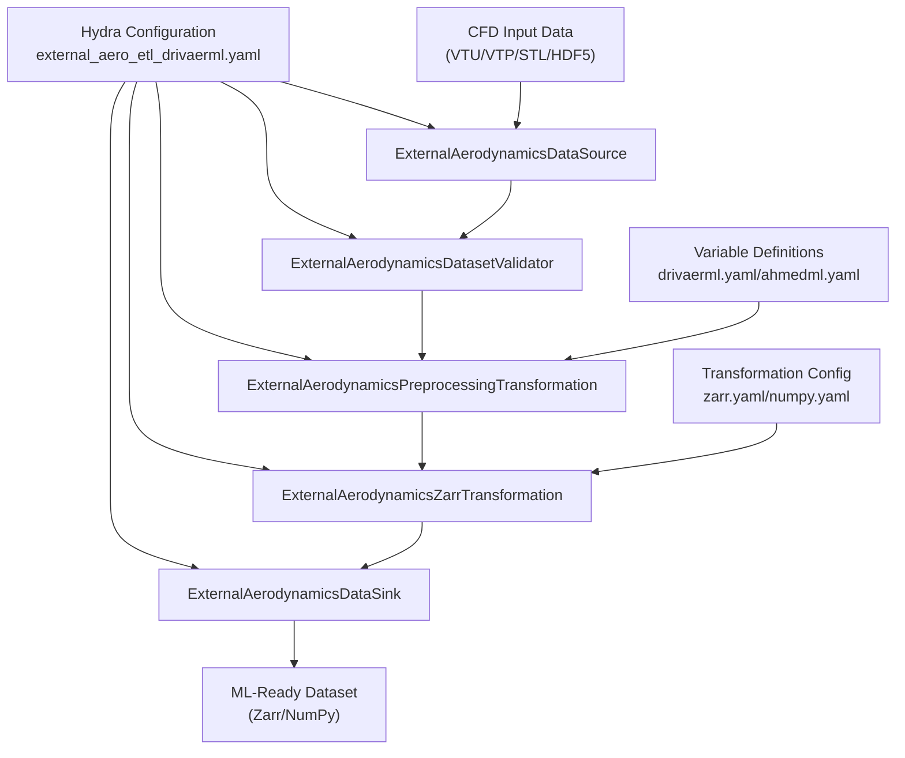
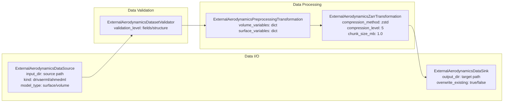
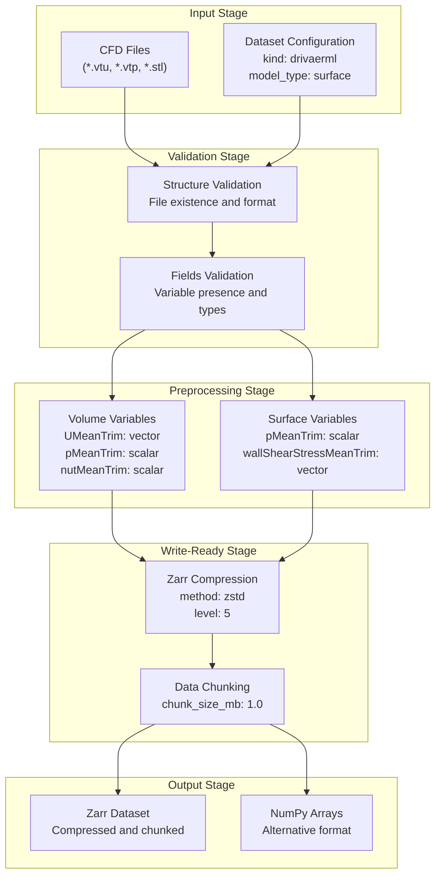

<!-- source: DeepWiki mcp.deepwiki.com · repo NVIDIA/physicsnemo-curator · page 2 ETL Pipeline System · fetched 2026-10-26 -->

# ETL Pipeline System

<details>
<summary>Relevant source files</summary>

The following files were used as context for generating this wiki page:

- [README.md](README.md)
- [tests/test_examples/test_config.py](tests/test_examples/test_config.py)

</details>


## Purpose and Scope

The ETL Pipeline System is the core data processing engine of PhysicsNeMo-Curator, responsible for extracting, transforming, and loading computational fluid dynamics (CFD) data into machine learning-ready formats. This system specifically handles external aerodynamics datasets and converts them from various input formats (VTU, VTP, STL, HDF5) into optimized output formats (Zarr, NumPy) suitable for training DoMINO and Transolver models.

This page covers the pipeline architecture, core components, data flow, and configuration system. For detailed configuration syntax and examples, see [Pipeline Configuration](#2.1). For specific transformation implementations, see [Data Transformations](#2.2). For variable definitions and dataset schemas, see [Dataset Variables](#2.3).

## Architecture Overview

The ETL Pipeline System follows a modular, configuration-driven architecture that separates concerns into distinct processing stages. Each stage is configurable through Hydra and can be independently modified or extended.

### Core Pipeline Architecture



Sources: [tests/test_examples/test_config.py:24-28](), [tests/test_examples/test_config.py:41-118]()

## Core Components

The pipeline consists of five primary components that handle different aspects of data processing. Each component is instantiated through Hydra configuration and implements specific interfaces.

### Component Architecture



Sources: [tests/test_examples/test_config.py:63-117]()

### Component Responsibilities

| Component | Class Name | Primary Function | Configuration Section |
|-----------|------------|------------------|----------------------|
| Validator | `ExternalAerodynamicsDatasetValidator` | Schema and data integrity validation | `etl.validator` |
| Source | `ExternalAerodynamicsDataSource` | Data loading and initial parsing | `etl.source` |
| Preprocessing | `ExternalAerodynamicsPreprocessingTransformation` | Variable extraction and type conversion | `etl.transformations.preprocessing` |
| Write-Ready | `ExternalAerodynamicsZarrTransformation` | Format optimization and serialization | `etl.transformations.write_ready_transformation` |
| Sink | `ExternalAerodynamicsDataSink` | Output writing and persistence | `etl.sink` |

Sources: [tests/test_examples/test_config.py:74-115]()

## Data Flow and Processing

The pipeline processes data through a sequential series of transformations, with each stage performing specific operations on the dataset.

### Processing Pipeline Flow



Sources: [tests/test_examples/test_config.py:81-89](), [tests/test_examples/test_config.py:102-108]()

## Configuration System

The ETL pipeline is entirely configuration-driven through Hydra, allowing for flexible customization without code changes. Configuration files define component instantiation, processing parameters, and data schemas.

### Configuration Hierarchy

| Configuration File | Purpose | Key Settings |
|-------------------|---------|--------------|
| `external_aero_etl_drivaerml.yaml` | Main pipeline configuration | Component instantiation, processing parameters |
| `drivaerml.yaml` | Dataset-specific variables | Volume and surface variable definitions |
| `ahmedml.yaml` | Alternative dataset variables | Alternative variable schema |
| `zarr.yaml` | Zarr transformation settings | Compression, chunking parameters |
| `numpy.yaml` | NumPy transformation settings | Array serialization options |

### Key Configuration Parameters

The pipeline supports extensive configuration through structured YAML files:

```yaml
etl:
  common:
    kind: drivaerml              # Dataset type: drivaerml/ahmedml
    model_type: surface          # Model type: surface/volume
  
  processing:
    num_processes: 12            # Parallel processing workers
    args: {}                     # Additional processing arguments
  
  validator:
    validation_level: fields     # Validation depth: structure/fields
  
  source:
    kind: drivaerml             # Must match common.kind
    model_type: surface         # Must match common.model_type
    input_dir: /path/to/input   # Source data directory
  
  sink:
    output_dir: /path/to/output # Target output directory
    overwrite_existing: true    # Overwrite behavior
```

Sources: [tests/test_examples/test_config.py:55-61](), [tests/test_examples/test_config.py:71-80](), [tests/test_examples/test_config.py:111-117]()

## Variable Processing

The pipeline handles two distinct categories of physical variables, each with specific data types and processing requirements.

### Variable Categories and Types

The system processes CFD variables according to their physical nature and dimensionality:

| Variable Category | Variable Name | Data Type | Physical Meaning |
|------------------|---------------|-----------|------------------|
| Volume | `UMeanTrim` | vector | Mean velocity field |
| Volume | `pMeanTrim` | scalar | Mean pressure field |
| Volume | `nutMeanTrim` | scalar | Turbulent viscosity |
| Surface | `pMeanTrim` | scalar | Surface pressure |
| Surface | `wallShearStressMeanTrim` | vector | Wall shear stress |

### Type System

The pipeline enforces strict typing for physical variables:

- **Vector variables**: 3D arrays representing directional quantities (velocity, stress)
- **Scalar variables**: Single-value fields representing magnitude quantities (pressure, viscosity)

This typing system ensures data consistency and enables proper tensor operations in downstream ML models.

Sources: [tests/test_examples/test_config.py:81-89]()

---

