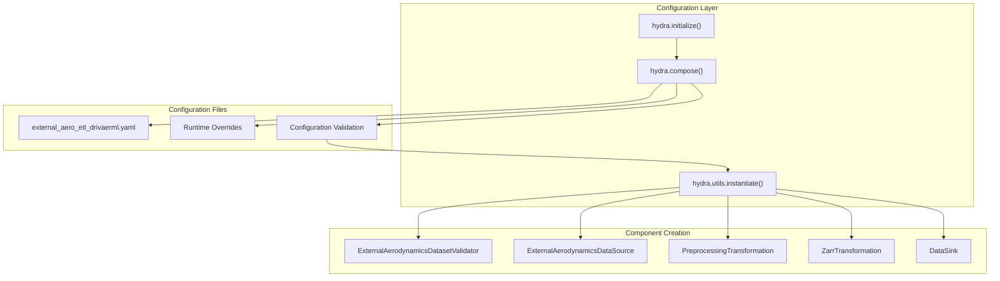
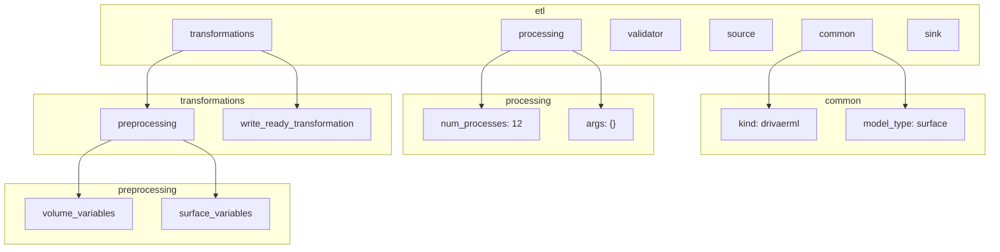
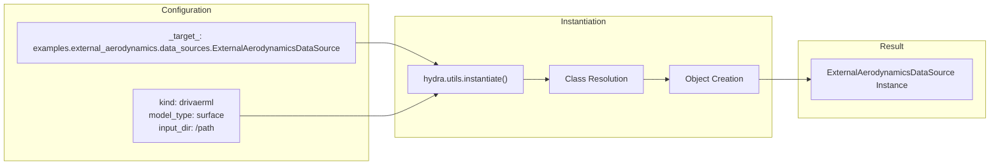
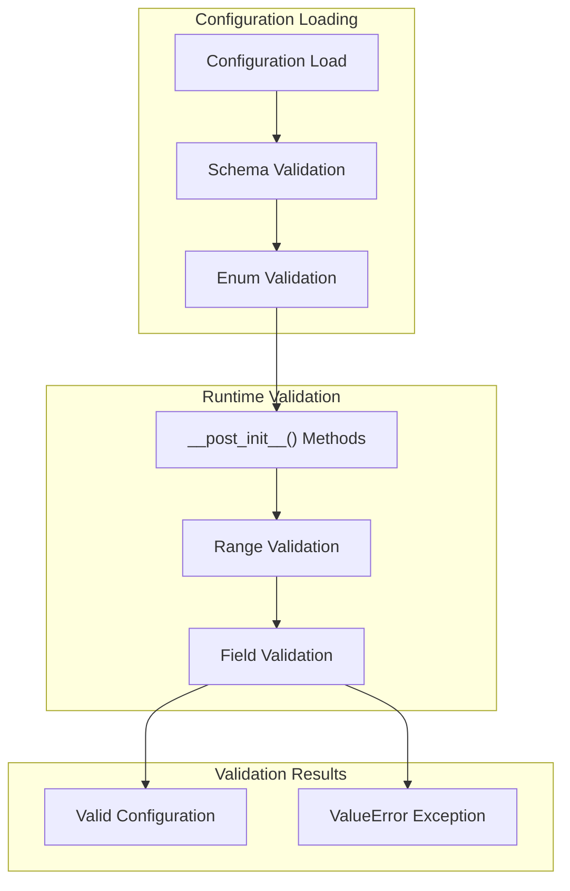
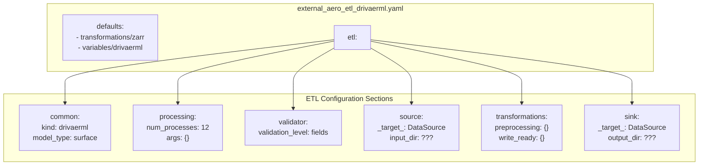

<!-- source: DeepWiki mcp.deepwiki.com · repo NVIDIA/physicsnemo-curator · page 2.1 Pipeline Configuration · fetched 2026-10-26 -->

# Pipeline Configuration

<details>
<summary>Relevant source files</summary>

The following files were used as context for generating this wiki page:

- [physicsnemo_curator/etl/processing_config.py](physicsnemo_curator/etl/processing_config.py)
- [tests/test_etl/test_processing_config.py](tests/test_etl/test_processing_config.py)
- [tests/test_examples/test_config.py](tests/test_examples/test_config.py)

</details>


## Purpose and Scope

This document covers the configuration system for ETL pipelines in PhysicsNeMo-Curator, focusing on how Hydra configuration management enables declarative pipeline definition and component instantiation. For specific data transformation configurations, see [Data Transformations](#2.2). For dataset variable definitions, see [Dataset Variables](#2.3).

The configuration system provides a declarative approach to defining ETL pipelines, enabling flexible component composition, validation, and runtime parameter overrides without code changes.

## Configuration Architecture

The pipeline configuration system is built on Hydra framework, providing hierarchical configuration management with automatic component instantiation and validation.

### Configuration Flow Diagram



Sources: [tests/test_examples/test_config.py:21-22](), [tests/test_examples/test_config.py:44-52](), [tests/test_examples/test_config.py:63-69]()

## Configuration Structure

The ETL pipeline configuration follows a hierarchical structure with distinct sections for different pipeline components.

### Pipeline Component Hierarchy



Sources: [tests/test_examples/test_config.py:55-61](), [tests/test_examples/test_config.py:79-89]()

### Processing Configuration

The `ProcessingConfig` class defines the structure for processing-related settings:

| Parameter | Type | Description | Validation |
|-----------|------|-------------|------------|
| `num_processes` | `int` | Number of parallel processes | Must be positive |
| `args` | `dict[str, Any]` | Additional processing arguments | Optional, defaults to empty dict |

Sources: [physicsnemo_curator/etl/processing_config.py:21-34]()

## Component Instantiation

Hydra's `instantiate()` function creates actual component instances from configuration specifications using the `_target_` parameter to specify the class to instantiate.

### Instantiation Process



Example component instantiation patterns:

| Component Type | Configuration Key | Target Class |
|----------------|-------------------|--------------|
| Validator | `etl.validator` | `ExternalAerodynamicsDatasetValidator` |
| Data Source | `etl.source` | `ExternalAerodynamicsDataSource` |
| Preprocessing | `etl.transformations.preprocessing` | `ExternalAerodynamicsPreprocessingTransformation` |
| Write Ready | `etl.transformations.write_ready_transformation` | `ExternalAerodynamicsZarrTransformation` |
| Data Sink | `etl.sink` | `ExternalAerodynamicsDataSource` |

Sources: [tests/test_examples/test_config.py:63-69](), [tests/test_examples/test_config.py:74-78](), [tests/test_examples/test_config.py:93-108]()

## Configuration Validation

The system provides multiple levels of configuration validation to ensure pipeline integrity and catch errors early.

### Validation Levels

| Validation Type | Scope | Implementation |
|-----------------|-------|----------------|
| Schema Validation | Configuration structure | Hydra structured configs |
| Enum Validation | Valid values | `DatasetKind`, `ModelType` enums |
| Range Validation | Numeric constraints | `ProcessingConfig.__post_init__()` |
| Field Validation | Component settings | `validation_level` parameter |

### Validation Implementation



Sources: [tests/test_examples/test_config.py:120-135](), [physicsnemo_curator/etl/processing_config.py:28-33](), [tests/test_etl/test_processing_config.py:29-35]()

## Configuration Overrides

Runtime configuration overrides allow flexible pipeline parameterization without modifying configuration files.

### Override Mechanisms

Configuration parameters can be overridden at runtime using Hydra's override syntax:

```
etl.source.input_dir=/path/to/input/dataset
etl.sink.output_dir=/path/to/output/directory
etl.processing.num_processes=4
```

### Override Categories

| Override Type | Example | Purpose |
|---------------|---------|---------|
| Path Override | `etl.source.input_dir=/new/path` | Runtime path specification |
| Processing Override | `etl.processing.num_processes=8` | Resource allocation tuning |
| Component Override | `etl.common.kind=ahmedml` | Dataset type switching |
| Validation Override | `etl.validator.validation_level=structure` | Validation level control |

Sources: [tests/test_examples/test_config.py:48-51](), [tests/test_examples/test_config.py:159-176]()

## Configuration File Structure

The configuration system uses YAML files with Hydra defaults and structured inheritance.

### Base Configuration Structure

The primary configuration file `external_aero_etl_drivaerml.yaml` defines the complete pipeline structure:



### Required Configuration Parameters

| Parameter | Type | Required | Default | Validation |
|-----------|------|----------|---------|------------|
| `etl.source.input_dir` | `str` | Yes | `???` | Must be absolute path |
| `etl.sink.output_dir` | `str` | Yes | `???` | Must be absolute path |
| `etl.common.kind` | `str` | Yes | `drivaerml` | Must be valid `DatasetKind` |
| `etl.common.model_type` | `str` | Yes | `surface` | Must be valid `ModelType` |
| `etl.processing.num_processes` | `int` | Yes | `12` | Must be positive |

Sources: [tests/test_examples/test_config.py:41-52](), [tests/test_examples/test_config.py:137-156]()

---

