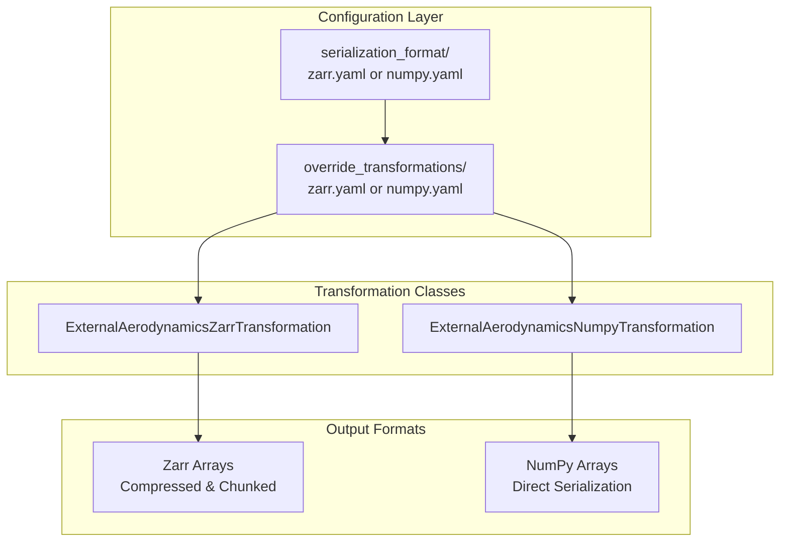
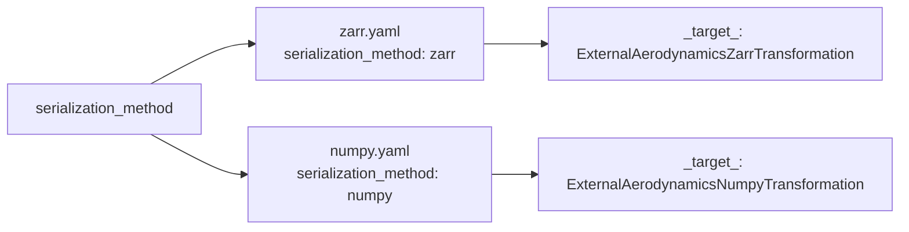
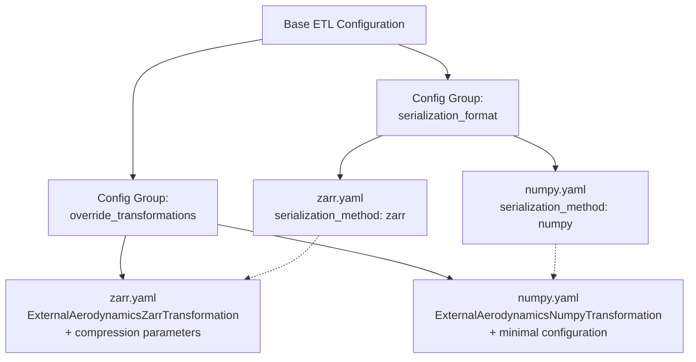

<!-- source: DeepWiki mcp.deepwiki.com · repo NVIDIA/physicsnemo-curator · page 2.2 Data Transformations · fetched 2026-10-26 -->

# Data Transformations

<details>
<summary>Relevant source files</summary>

The following files were used as context for generating this wiki page:

- [examples/config/override_transformations/numpy.yaml](examples/config/override_transformations/numpy.yaml)
- [examples/config/override_transformations/zarr.yaml](examples/config/override_transformations/zarr.yaml)
- [examples/config/serialization_format/numpy.yaml](examples/config/serialization_format/numpy.yaml)
- [examples/config/serialization_format/zarr.yaml](examples/config/serialization_format/zarr.yaml)

</details>


## Purpose and Scope

This document covers the configuration and usage of data transformation components within the PhysicsNeMo-Curator ETL pipeline system. Data transformations are responsible for converting processed CFD datasets into machine learning-ready formats using either Zarr or NumPy serialization methods. The transformations handle compression, chunking, and format-specific optimizations to prepare data for downstream ML model training.

For information about pipeline configuration and component instantiation, see [Pipeline Configuration](#2.1). For details about dataset variable definitions, see [Dataset Variables](#2.3).

## Transformation Architecture

The data transformation system provides two primary serialization paths for ML-ready data output: Zarr and NumPy formats. Each format is optimized for different use cases, with Zarr providing advanced compression and chunking capabilities for large-scale datasets, while NumPy offers simpler, direct array serialization.



**Sources:** [examples/config/override_transformations/zarr.yaml:18](), [examples/config/override_transformations/numpy.yaml:18](), [examples/config/serialization_format/zarr.yaml:17](), [examples/config/serialization_format/numpy.yaml:17]()

## Serialization Format Selection

The serialization format is controlled through configuration files that set the `serialization_method` parameter. This parameter determines which transformation class is instantiated during pipeline execution.

| Format | Configuration File | Target Class | Use Case |
|--------|-------------------|--------------|----------|
| Zarr | `serialization_format/zarr.yaml` | `ExternalAerodynamicsZarrTransformation` | Large datasets requiring compression |
| NumPy | `serialization_format/numpy.yaml` | `ExternalAerodynamicsNumpyTransformation` | Simple array serialization |



**Sources:** [examples/config/serialization_format/zarr.yaml:17](), [examples/config/serialization_format/numpy.yaml:17]()

## Zarr Transformation Configuration

The Zarr transformation provides advanced compression and chunking capabilities optimized for large-scale scientific datasets. The configuration is defined in the `override_transformations/zarr.yaml` file.

### Configuration Parameters

| Parameter | Default Value | Description |
|-----------|---------------|-------------|
| `compression_method` | `"zstd"` | Compression algorithm for Zarr arrays |
| `compression_level` | `5` | Compression level (1-22 for zstd) |
| `chunk_size_mb` | `1.0` | Target chunk size in megabytes |

### Configuration Structure

The Zarr transformation configuration follows this structure:

```yaml
write_ready_transformation:
  _target_: examples.external_aerodynamics.data_transformations.ExternalAerodynamicsZarrTransformation
  _convert_: all
  compression_method: "zstd"
  compression_level: 5
  chunk_size_mb: 1.0
```

The `_target_` parameter specifies the exact class to instantiate, while `_convert_: all` ensures proper Hydra configuration conversion. The compression parameters control the balance between storage efficiency and access performance.

**Sources:** [examples/config/override_transformations/zarr.yaml:17-22]()

## NumPy Transformation Configuration

The NumPy transformation provides straightforward array serialization without additional compression or chunking optimizations. This format is suitable for smaller datasets or when direct array access is preferred.

### Configuration Structure

The NumPy transformation requires minimal configuration:

```yaml
write_ready_transformation:
  _target_: examples.external_aerodynamics.data_transformations.ExternalAerodynamicsNumpyTransformation
  _convert_: all
```

The configuration only specifies the target class and conversion behavior, with no additional parameters required for basic NumPy serialization functionality.

**Sources:** [examples/config/override_transformations/numpy.yaml:17-19]()

## Configuration Integration

The transformation configurations integrate with the broader Hydra configuration system through override mechanisms. The pipeline selects the appropriate transformation based on the `serialization_format` configuration group, which then applies the corresponding `override_transformations` settings.



**Sources:** [examples/config/serialization_format/zarr.yaml:17](), [examples/config/serialization_format/numpy.yaml:17](), [examples/config/override_transformations/zarr.yaml:17-22](), [examples/config/override_transformations/numpy.yaml:17-19]()

---

