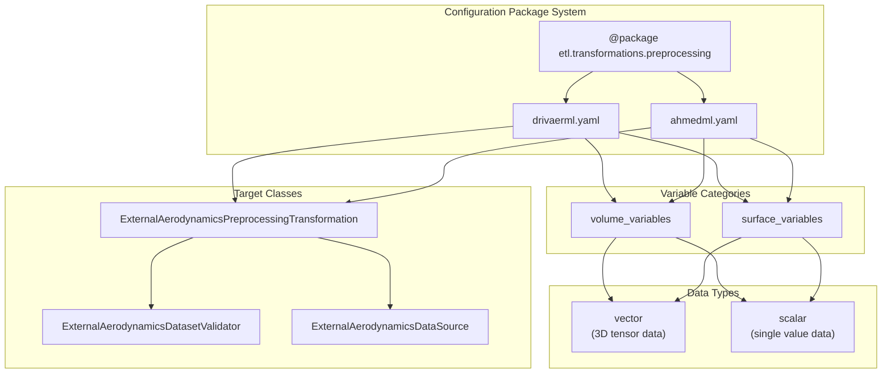
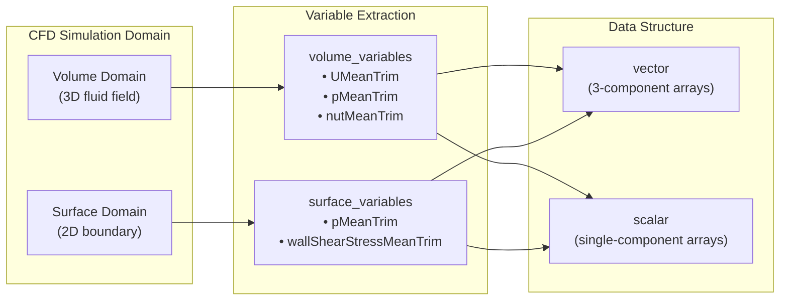
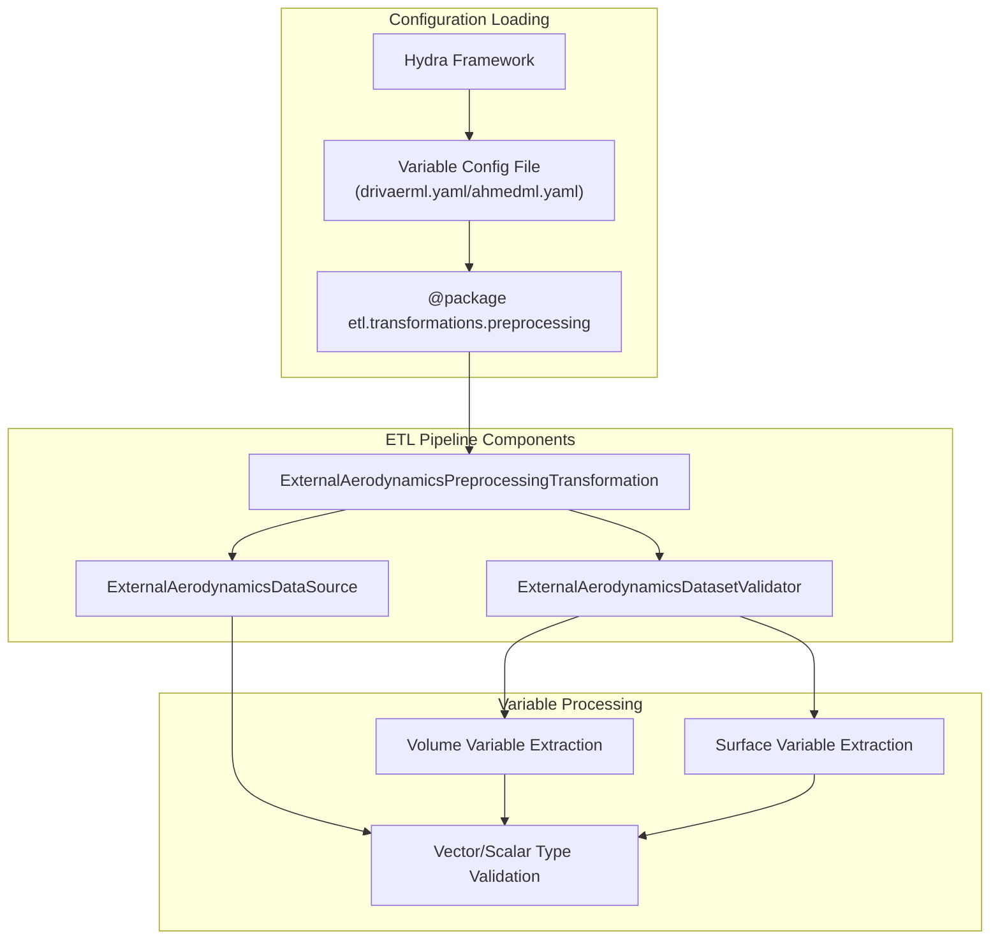

<!-- source: DeepWiki mcp.deepwiki.com · repo NVIDIA/physicsnemo-curator · page 2.3 Dataset Variables · fetched 2026-10-26 -->

# Dataset Variables

<details>
<summary>Relevant source files</summary>

The following files were used as context for generating this wiki page:

- [examples/config/variables/ahmedml.yaml](examples/config/variables/ahmedml.yaml)
- [examples/config/variables/drivaerml.yaml](examples/config/variables/drivaerml.yaml)

</details>


## Purpose and Scope

This document covers the definition and configuration of volume and surface variables for different CFD dataset types within the PhysicsNeMo-Curator ETL pipeline. Dataset variables define the physical quantities extracted from computational fluid dynamics simulations and specify their mathematical types (vector or scalar) and spatial domains (volume or surface).

For information about configuring the broader ETL pipeline components, see [Pipeline Configuration](#2.1). For details on data transformation implementations, see [Data Transformations](#2.2).

## Variable Configuration Structure

Dataset variables are defined in YAML configuration files that specify the physical quantities to extract from CFD simulation data. These configurations integrate with the Hydra framework to provide type-safe variable definitions for preprocessing transformations.

### Configuration File Architecture



**Sources:** [examples/config/variables/drivaerml.yaml:1-26](), [examples/config/variables/ahmedml.yaml:1-26]()

## Dataset Types

The system supports multiple CFD dataset types, each with specific variable configurations tailored to different aerodynamic simulation scenarios.

### DrivaerML Dataset Variables

The `drivaerml` configuration defines variables for automotive aerodynamics simulations with time-averaged ("Trim") field data.

| Variable Category | Variable Name | Type | Description |
|-------------------|---------------|------|-------------|
| Volume | `UMeanTrim` | vector | Time-averaged velocity field |
| Volume | `pMeanTrim` | scalar | Time-averaged pressure field |
| Volume | `nutMeanTrim` | scalar | Time-averaged turbulent viscosity |
| Surface | `pMeanTrim` | scalar | Time-averaged surface pressure |
| Surface | `wallShearStressMeanTrim` | vector | Time-averaged wall shear stress |

### Ahmed Body Dataset Variables

The `ahmedml` configuration defines variables for simplified automotive body simulations without time-averaging prefixes.

| Variable Category | Variable Name | Type | Description |
|-------------------|---------------|------|-------------|
| Volume | `UMean` | vector | Mean velocity field |
| Volume | `pMean` | scalar | Mean pressure field |
| Volume | `nutMean` | scalar | Mean turbulent viscosity |
| Surface | `pMean` | scalar | Mean surface pressure |
| Surface | `wallShearStressMean` | vector | Mean wall shear stress |

**Sources:** [examples/config/variables/drivaerml.yaml:18-25](), [examples/config/variables/ahmedml.yaml:18-25]()

## Variable Types and Domains

The variable configuration system enforces strict typing to ensure data consistency throughout the ETL pipeline.

### Spatial Domains



**Sources:** [examples/config/variables/drivaerml.yaml:18-25](), [examples/config/variables/ahmedml.yaml:18-25]()

#### Volume Variables

Volume variables represent physical quantities defined throughout the 3D fluid domain:
- **Vector variables**: Multi-component fields like velocity (`UMeanTrim`) and store 3D vector data
- **Scalar variables**: Single-component fields like pressure (`pMeanTrim`) and turbulent viscosity (`nutMeanTrim`)

#### Surface Variables

Surface variables represent physical quantities defined on 2D boundary surfaces:
- **Vector variables**: Surface-based vector fields like wall shear stress (`wallShearStressMeanTrim`)
- **Scalar variables**: Surface-based scalar fields like surface pressure (`pMeanTrim`)

## Integration with ETL Pipeline

Dataset variable configurations integrate with the broader ETL pipeline through the Hydra configuration system and preprocessing transformations.

### Configuration Package Integration

The `@package etl.transformations.preprocessing` directive at the top of each configuration file [examples/config/variables/drivaerml.yaml:1]() specifies that these variables configure the preprocessing transformation component within the ETL pipeline.

### Runtime Variable Resolution



**Sources:** [examples/config/variables/drivaerml.yaml:1](), [examples/config/variables/ahmedml.yaml:1]()

## Configuration Examples

### Basic Variable Definition

Both dataset types follow the same YAML structure with two main sections:

```yaml
volume_variables:
  UMeanTrim: vector    # 3D velocity field
  pMeanTrim: scalar    # Pressure field
  nutMeanTrim: scalar  # Turbulent viscosity

surface_variables:
  pMeanTrim: scalar                    # Surface pressure
  wallShearStressMeanTrim: vector     # Wall shear stress
```

### Variable Naming Conventions

The variable names correspond directly to field names in the source CFD simulation files:
- **DrivaerML**: Uses "Trim" suffix for time-averaged quantities ([examples/config/variables/drivaerml.yaml:19-25]())
- **Ahmed Body**: Uses "Mean" suffix for averaged quantities ([examples/config/variables/ahmedml.yaml:19-25]())

Both configurations maintain consistent physical variable types across datasets while adapting naming conventions to match their respective simulation methodologies.

**Sources:** [examples/config/variables/drivaerml.yaml:18-25](), [examples/config/variables/ahmedml.yaml:18-25]()

---

