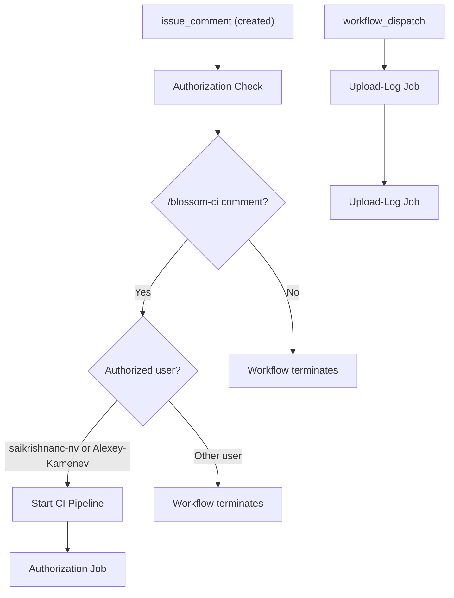
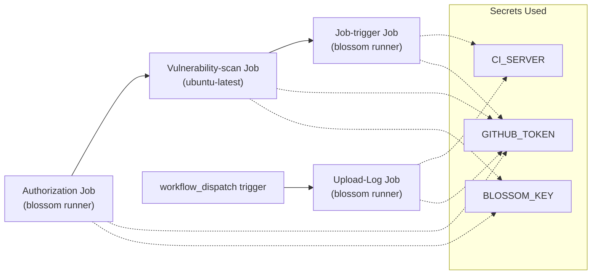
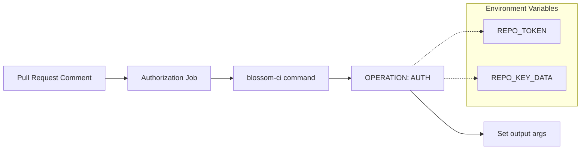

<!-- source: DeepWiki mcp.deepwiki.com · repo NVIDIA/physicsnemo-curator · page 3 CI/CD Infrastructure · fetched 2026-10-26 -->

# CI/CD Infrastructure

<details>
<summary>Relevant source files</summary>

The following files were used as context for generating this wiki page:

- [.github/workflows/blossom-ci.yml](.github/workflows/blossom-ci.yml)

</details>


This document covers the sophisticated CI/CD infrastructure used by PhysicsNeMo-Curator, which implements a hybrid approach combining GitHub Actions with external CI servers through the Blossom-CI system. This infrastructure enables secure, automated testing and deployment workflows across distributed computing environments.

For information about code quality tools and testing procedures, see [Code Quality and Testing](#3.2). For development workflow guidance, see [Development Workflow](#4.2).

## Overview

PhysicsNeMo-Curator uses a hybrid CI/CD infrastructure called Blossom-CI that orchestrates workflows across multiple environments. The system is designed to handle the unique requirements of machine learning and scientific computing workloads, providing secure access to specialized hardware while maintaining integration with standard GitHub development workflows.

The CI/CD system is primarily defined in [.github/workflows/blossom-ci.yml:1-91]() and implements a multi-stage pipeline that includes authorization, vulnerability scanning, job triggering, and log management.

Sources: [.github/workflows/blossom-ci.yml:15-16]()

## Blossom-CI Workflow Architecture

The Blossom-CI system implements a four-stage pipeline with distinct responsibilities and execution environments:

### Workflow Trigger Mechanism



The workflow supports two trigger mechanisms:
- **Issue Comment Trigger**: Activated when users comment `/blossom-ci` on pull requests
- **Workflow Dispatch**: Manual trigger for direct log upload operations

Sources: [.github/workflows/blossom-ci.yml:17-27](), [.github/workflows/blossom-ci.yml:36-37]()

### Job Dependency Chain



Each job in the pipeline has specific responsibilities and runs in different environments to ensure security and performance isolation.

Sources: [.github/workflows/blossom-ci.yml:29-91]()

## Job Components

### Authorization Job

The `Authorization` job serves as the security gateway for the CI/CD pipeline:

| Property | Value |
|----------|-------|
| Runner | `blossom` |
| Trigger Condition | Comment body equals `/blossom-ci` AND actor is authorized |
| Operation | `AUTH` |
| Primary Function | User authorization and argument extraction |



The job extracts and validates arguments that are passed to subsequent jobs through the `args` output parameter.

Sources: [.github/workflows/blossom-ci.yml:29-44]()

### Vulnerability Scan Job

The `Vulnerability-scan` job performs security analysis using NVIDIA's specialized action:

| Property | Value |
|----------|-------|
| Runner | `ubuntu-latest` |
| Dependencies | `Authorization` job |
| Action Used | `NVIDIA/blossom-action@main` |
| Repository Handling | Supports LFS and dynamic repository/ref selection |

This job checks out the code with Git LFS support and runs comprehensive vulnerability scanning before proceeding to CI execution.

Sources: [.github/workflows/blossom-ci.yml:46-66]()

### Job Trigger

The `Job-trigger` job initiates the actual CI execution on external infrastructure:

| Property | Value |
|----------|-------|
| Runner | `blossom` |
| Dependencies | `Vulnerability-scan` job |
| Operation | `START-CI-JOB` |
| External Integration | Uses `CI_SERVER` secret |

This job communicates with external CI infrastructure to begin the actual build and test processes.

Sources: [.github/workflows/blossom-ci.yml:68-78]()

### Upload Log Job

The `Upload-Log` job handles log aggregation and reporting:

| Property | Value |
|----------|-------|
| Runner | `blossom` |
| Trigger | `workflow_dispatch` only |
| Operation | `POST-PROCESSING` |
| Function | Provides Jenkins log links for pull requests |

Sources: [.github/workflows/blossom-ci.yml:80-90]()

## Security and Authorization

### User Access Control

The system implements strict user authorization through hardcoded user validation:

```yaml
github.actor == 'saikrishnanc-nv' || github.actor == 'Alexey-Kamenev'
```

Only these two users can trigger CI workflows through pull request comments.

### Secret Management

The workflow utilizes three GitHub secrets:

| Secret | Usage | Jobs |
|--------|-------|------|
| `GITHUB_TOKEN` | Repository access and API operations | Authorization, Vulnerability-scan, Job-trigger, Upload-Log |
| `BLOSSOM_KEY` | Blossom infrastructure authentication | Authorization, Vulnerability-scan |
| `CI_SERVER` | External CI server connection | Job-trigger, Upload-Log |

Sources: [.github/workflows/blossom-ci.yml:36-37](), [.github/workflows/blossom-ci.yml:42-44](), [.github/workflows/blossom-ci.yml:77-78]()

## External System Integration

### Blossom Infrastructure

The CI/CD system integrates with the Blossom infrastructure through:

- **Blossom Runners**: Self-hosted runners identified by the `blossom` label
- **blossom-ci Command**: Command-line tool that handles different operations based on the `OPERATION` environment variable
- **NVIDIA Blossom Action**: Specialized GitHub Action for vulnerability scanning

### CI Server Communication

The system communicates with external CI servers (likely Jenkins) through:

- The `CI_SERVER` secret containing connection information
- Operations for starting CI jobs and post-processing
- Log upload and linking functionality for pull request reporting

Sources: [.github/workflows/blossom-ci.yml:77](), [.github/workflows/blossom-ci.yml:89]()

## Operation Modes

The `blossom-ci` command supports three distinct operation modes controlled by the `OPERATION` environment variable:

| Operation | Purpose | Usage Context |
|-----------|---------|---------------|
| `AUTH` | User authorization and argument parsing | Authorization job |
| `START-CI-JOB` | Trigger external CI execution | Job-trigger job |
| `POST-PROCESSING` | Log upload and reporting | Upload-Log job |

This modular approach allows the same command-line tool to handle different phases of the CI/CD pipeline while maintaining consistent authentication and configuration management.

Sources: [.github/workflows/blossom-ci.yml:42](), [.github/workflows/blossom-ci.yml:76](), [.github/workflows/blossom-ci.yml:88]()

---

