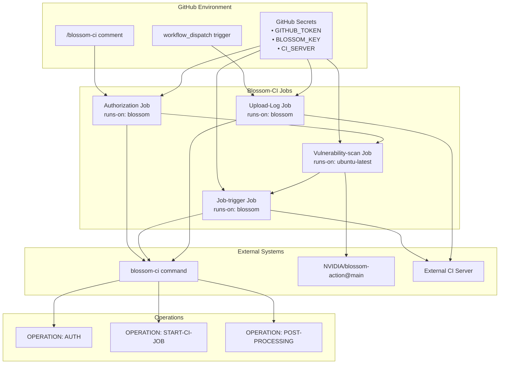
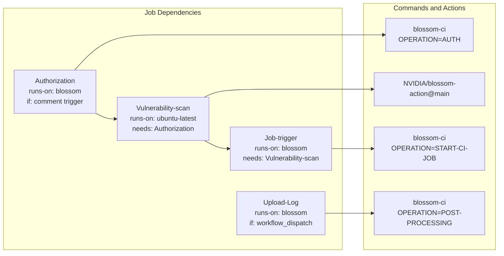

<!-- source: DeepWiki mcp.deepwiki.com · repo NVIDIA/physicsnemo-curator · page 3.1 Blossom-CI Workflow · fetched 2026-10-26 -->

# Blossom-CI Workflow

Relevant source files

The following files were used as context for generating this wiki page:

- [.github/workflows/blossom-ci.yml](.github/workflows/blossom-ci.yml)

## Purpose and Scope

This document explains the Blossom-CI workflow system, a hybrid CI/CD infrastructure that integrates GitHub Actions with external CI servers through NVIDIA's Blossom platform. The workflow provides secure, authorized triggering of comprehensive testing and validation processes for PhysicsNeMo-Curator.

For information about the broader CI/CD infrastructure and quality control processes, see [CI/CD Infrastructure](#3). For details about code quality tools and testing procedures, see [Code Quality and Testing](#3.2).

## Architecture Overview

The Blossom-CI system implements a multi-stage workflow that bridges GitHub's hosted runners with external CI infrastructure:

Sources: [.github/workflows/blossom-ci.yml:1-91]()

## Workflow Triggers

The Blossom-CI workflow supports two distinct trigger mechanisms:

### Comment-Based Triggering

The primary trigger is through pull request comments containing the exact string `/blossom-ci`:

| Trigger Event | Condition | Action |
|---------------|-----------|--------|
| `issue_comment.created` | Comment body equals `/blossom-ci` | Initiates full CI pipeline |
| Authorization check | Actor must be `saikrishnanc-nv` or `Alexey-Kamenev` | Proceeds to vulnerability scan |

### Manual Workflow Dispatch

The workflow also supports manual triggering with optional parameters:

| Parameter | Description | Required |
|-----------|-------------|----------|
| `platform` | Specifies `runs-on` argument | No |
| `args` | Additional arguments for CI execution | No |

Sources: [.github/workflows/blossom-ci.yml:17-27](), [.github/workflows/blossom-ci.yml:36-37]()

## Job Execution Flow

The workflow implements a sequential job dependency chain with specific runner requirements:

Sources: [.github/workflows/blossom-ci.yml:29-91]()

### Authorization Job

The `Authorization` job validates user permissions and prepares workflow arguments:

- **Runner**: `blossom` (custom runner)
- **Condition**: Comment-triggered workflows only
- **Command**: `blossom-ci` with `OPERATION: 'AUTH'`
- **Secrets**: `GITHUB_TOKEN`, `BLOSSOM_KEY`
- **Output**: `args` environment variable for downstream jobs

Sources: [.github/workflows/blossom-ci.yml:29-44]()

### Vulnerability Scan Job

The `Vulnerability-scan` job performs security validation using NVIDIA's action:

- **Runner**: `ubuntu-latest` (GitHub-hosted)
- **Dependencies**: Requires successful `Authorization`
- **Action**: `NVIDIA/blossom-action@main`
- **Repository**: Checks out code with LFS support
- **Arguments**: Passes `args1`, `args2`, `args3` from authorization output

Sources: [.github/workflows/blossom-ci.yml:46-66]()

### Job Trigger

The `Job-trigger` job initiates the external CI process:

- **Runner**: `blossom` (custom runner)
- **Dependencies**: Requires successful `Vulnerability-scan`
- **Command**: `blossom-ci` with `OPERATION: 'START-CI-JOB'`
- **Secrets**: `CI_SERVER`, `GITHUB_TOKEN`

Sources: [.github/workflows/blossom-ci.yml:68-78]()

### Upload Log Job

The `Upload-Log` job handles post-processing for manual workflows:

- **Runner**: `blossom` (custom runner)
- **Condition**: `workflow_dispatch` events only
- **Command**: `blossom-ci` with `OPERATION: 'POST-PROCESSING'`
- **Purpose**: Provides Jenkins log access for pull requests

Sources: [.github/workflows/blossom-ci.yml:80-90]()

## Security and Authorization

The workflow implements multi-layered security controls:

### User Authorization

Access is restricted to specific GitHub actors:
- `saikrishnanc-nv`
- `Alexey-Kamenev`

The authorization check occurs in the conditional statement: `github.actor == 'saikrishnanc-nv' || github.actor == 'Alexey-Kamenev'`

### Secret Management

The workflow uses three GitHub secrets:

| Secret | Purpose | Jobs Using |
|--------|---------|------------|
| `GITHUB_TOKEN` | Repository access and API operations | All jobs |
| `BLOSSOM_KEY` | Blossom platform authentication | Authorization, Vulnerability-scan |
| `CI_SERVER` | External CI server configuration | Job-trigger, Upload-Log |

### Vulnerability Scanning

The NVIDIA Blossom Action performs security validation before triggering external CI, ensuring that only verified code reaches the external infrastructure.

Sources: [.github/workflows/blossom-ci.yml:36-44](), [.github/workflows/blossom-ci.yml:58-66]()

## Integration with External Systems

The workflow integrates with multiple external systems through the `blossom-ci` command:

### Blossom Platform Integration

The `blossom-ci` command provides the primary interface to NVIDIA's Blossom platform, supporting three operations:

- **AUTH**: User authentication and workflow preparation
- **START-CI-JOB**: Triggering external CI execution
- **POST-PROCESSING**: Log retrieval and result processing

### External CI Server Communication

The workflow communicates with external CI infrastructure through the `CI_SERVER` secret, enabling hybrid execution across GitHub and external systems.

### Repository Integration

The workflow supports repository checkout with LFS (Large File System) support, accommodating the large data files common in physics simulation datasets.

Sources: [.github/workflows/blossom-ci.yml:40-43](), [.github/workflows/blossom-ci.yml:74-77](), [.github/workflows/blossom-ci.yml:86-89]()

---

