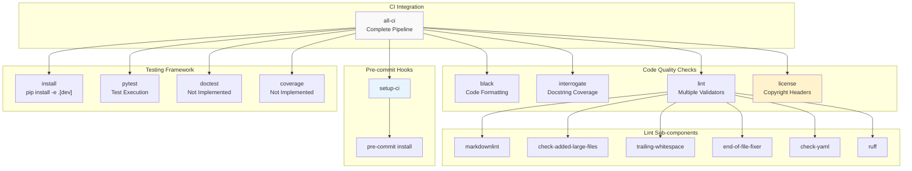
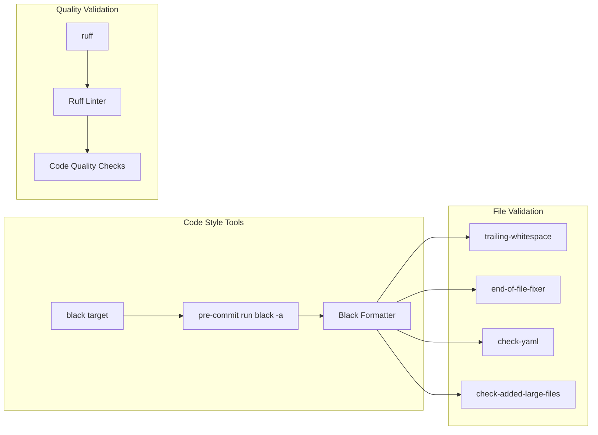
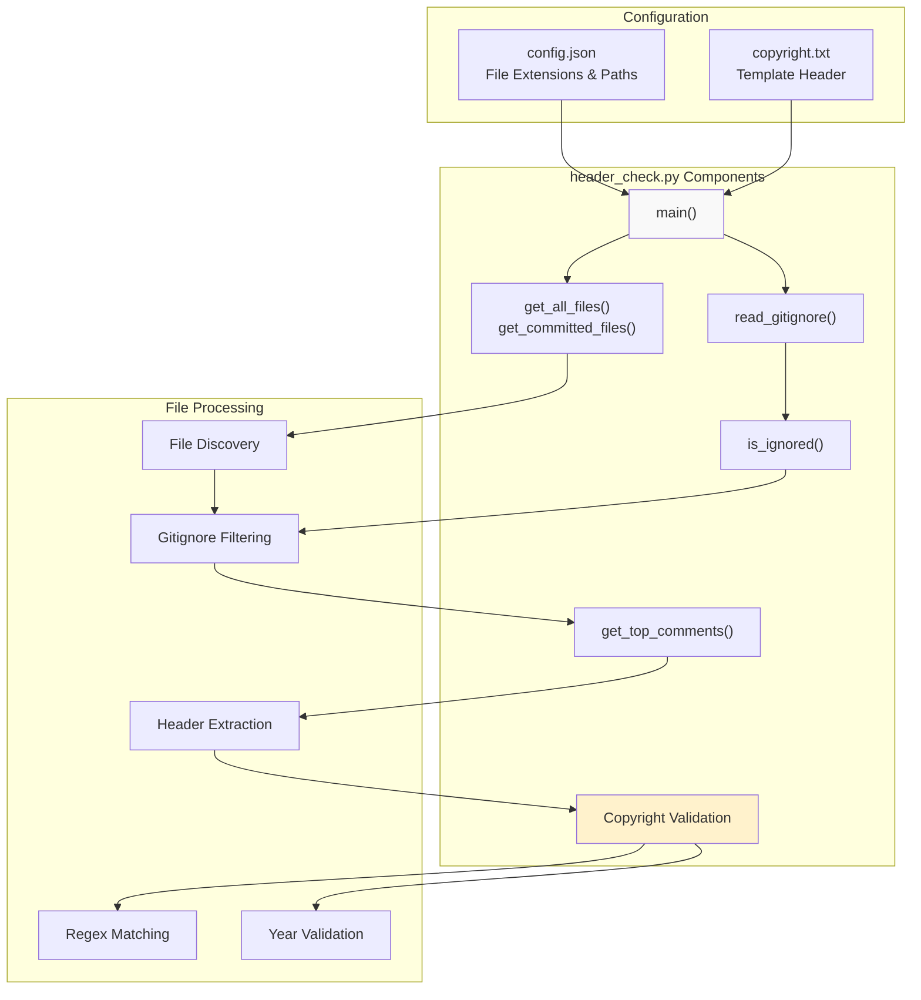

<!-- source: DeepWiki mcp.deepwiki.com · repo NVIDIA/physicsnemo-curator · page 3.2 Code Quality and Testing · fetched 2026-10-26 -->

# Code Quality and Testing

<details>
<summary>Relevant source files</summary>

The following files were used as context for generating this wiki page:

- [Makefile](Makefile)
- [tests/ci_tests/config.json](tests/ci_tests/config.json)
- [tests/ci_tests/copyright.txt](tests/ci_tests/copyright.txt)
- [tests/ci_tests/header_check.py](tests/ci_tests/header_check.py)

</details>


This document covers the code quality assurance and testing infrastructure for PhysicsNeMo-Curator. It details the automated tools, validation scripts, and testing frameworks that ensure code consistency, license compliance, and functional correctness throughout the development lifecycle.

For information about the broader CI/CD workflow orchestration, see [Blossom-CI Workflow](#3.1). For development setup and build processes, see [Development Workflow](#4.2).

## Quality Assurance Pipeline

The code quality system is built around a comprehensive set of automated checks that validate code formatting, licensing, documentation, and functionality. The main entry point is the `all-ci` target in the Makefile.

### Testing and Quality Pipeline Flow



**Sources:** [Makefile:1-41]()

## Code Formatting and Linting

### Automated Code Formatting

The `black` formatter ensures consistent Python code style across the codebase. The formatting process is integrated into the pre-commit workflow and can be executed manually via the Makefile.



**Sources:** [Makefile:13-25]()

### Linting Configuration

The linting pipeline combines multiple validation tools:

| Tool | Purpose | Execution Command |
|------|---------|-------------------|
| `markdownlint` | Markdown file validation | `pre-commit run markdownlint -a` |
| `check-added-large-files` | File size validation | `pre-commit run check-added-large-files -a` |
| `trailing-whitespace` | Whitespace cleanup | `pre-commit run trailing-whitespace -a` |
| `end-of-file-fixer` | EOF normalization | `pre-commit run end-of-file-fixer -a` |
| `check-yaml` | YAML syntax validation | `pre-commit run check-yaml -a` |
| `ruff` | Python code analysis | `pre-commit run ruff -a` |

**Sources:** [Makefile:19-25]()

## License and Copyright Validation

### Copyright Header Enforcement

The license validation system uses a dedicated Python script to ensure all source files contain proper NVIDIA copyright headers. The system is configured through a JSON configuration file and validates against a standard copyright template.

### Header Validation Architecture



**Sources:** [tests/ci_tests/header_check.py:123-237](), [tests/ci_tests/config.json:1-16]()

### Header Validation Process

The `header_check.py` script implements a comprehensive validation workflow:

1. **File Discovery**: The `get_all_files()` function [tests/ci_tests/header_check.py:113-121]() identifies target files based on configured extensions
2. **Gitignore Filtering**: The `is_ignored()` function [tests/ci_tests/header_check.py:43-75]() applies gitignore patterns to exclude irrelevant files
3. **Comment Extraction**: The `get_top_comments()` function [tests/ci_tests/header_check.py:78-99]() extracts header comments before import statements
4. **Copyright Validation**: Regex matching against the pattern `Copyright.*NVIDIA.*` [tests/ci_tests/header_check.py:181]()
5. **Year Validation**: Validates copyright years from 2024 to current year [tests/ci_tests/header_check.py:185-196]()

### License Configuration

The validation system is configured through `config.json`:

```json
{
    "copyright_file": "copyright.txt",
    "dir": "../../",
    "include-ext": [".py", ".yaml", ".ci", ".release", "Dockerfile"]
}
```

**Sources:** [tests/ci_tests/config.json:2-15]()

### Standard Copyright Template

The required copyright header template is defined in `copyright.txt`:

```
# SPDX-FileCopyrightText: Copyright (c) 2025 NVIDIA CORPORATION & AFFILIATES.
# SPDX-FileCopyrightText: All rights reserved.
# SPDX-License-Identifier: Apache-2.0
```

**Sources:** [tests/ci_tests/copyright.txt:1-15]()

## Testing Framework

### Test Execution

The testing system is built around pytest with development dependencies installed through the editable installation mode. The `pytest` target in the Makefile handles the complete test setup and execution.

| Command | Purpose | Implementation |
|---------|---------|----------------|
| `make pytest` | Execute test suite | `pip install -e ".[dev]" && pytest` |
| `make doctest` | Documentation tests | Not implemented |
| `make coverage` | Code coverage analysis | Not implemented |

**Sources:** [Makefile:33-38]()

### Installation Modes

The system supports multiple installation modes for development:

- **Standard Installation**: `make install` - Standard pip installation with dev dependencies [Makefile:1-3]()
- **Editable Installation**: `make editable-install` - Strict editable mode for active development [Makefile:5-7]()

## Documentation Quality

### Docstring Coverage

The `interrogate` tool validates docstring coverage across the Python codebase. This ensures that all public functions, classes, and modules have appropriate documentation.

```bash
make interrogate  # Executes: pre-commit run interrogate -a
```

**Sources:** [Makefile:16-17]()

## Integration with Development Workflow

The complete quality assurance pipeline is executed through the `all-ci` target, which orchestrates all validation steps in the proper sequence:

```bash
make all-ci  # Executes: setup-ci black interrogate lint license install pytest doctest coverage
```

This target ensures that all code quality checks, license validation, formatting, linting, and testing are performed before code integration.

**Sources:** [Makefile:40]()

---

