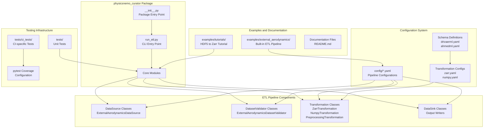
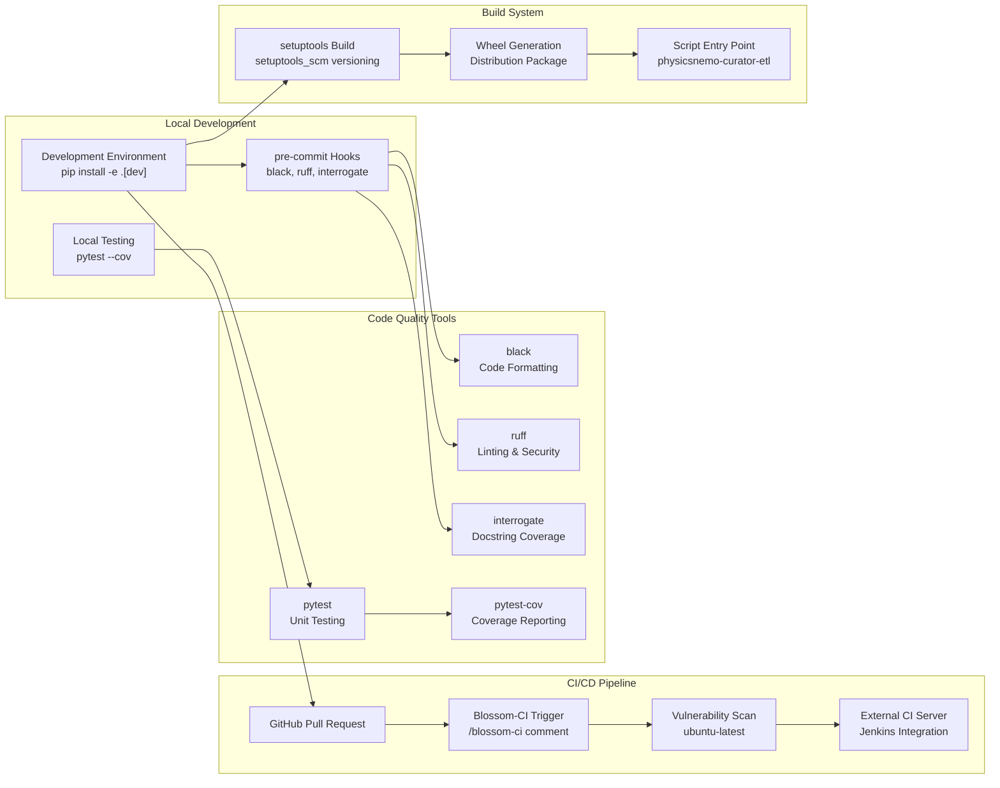

<!-- source: DeepWiki mcp.deepwiki.com · repo NVIDIA/physicsnemo-curator · page 4 Developer Guide · fetched 2026-10-26 -->

# Developer Guide

<details>
<summary>Relevant source files</summary>

The following files were used as context for generating this wiki page:

- [README.md](README.md)
- [pyproject.toml](pyproject.toml)

</details>


## Purpose and Scope

This guide provides comprehensive information for developers working with and contributing to PhysicsNeMo-Curator. It covers development environment setup, project architecture, testing procedures, and contribution workflows.

For installation instructions and environment setup details, see [Installation and Setup](#4.1). For specific development workflows including build systems and dependency management, see [Development Workflow](#4.2). For understanding the package organization and module structure, see [Project Structure](#4.3).

For information about configuring and using the ETL pipeline system, see [ETL Pipeline System](#2). For details about the CI/CD infrastructure, see [CI/CD Infrastructure](#3).

## Development Environment Overview

PhysicsNeMo-Curator is designed as a Python package that integrates with the broader PhysicsNeMo ecosystem. The development environment supports both containerized and source-based installation approaches, with emphasis on GPU-accelerated data processing workflows.

### Development Stack

| Component | Technology | Purpose |
|-----------|------------|---------|
| Package Management | setuptools, pip | Python package distribution |
| Configuration | Hydra | Declarative pipeline configuration |
| Data Processing | NumPy, PyVista, VTK | Scientific data manipulation |
| Storage | Zarr, HDF5 | Optimized data serialization |
| Testing | pytest, pytest-cov | Test execution and coverage |
| Code Quality | black, ruff, pre-commit | Formatting and linting |
| CI/CD | Blossom-CI, GitHub Actions | Automated testing and validation |

Sources: [pyproject.toml:1-62](), [README.md:28-54]()

## Project Architecture

### Core Package Structure



Sources: [pyproject.toml:41-43](), [pyproject.toml:60-61](), [README.md:23-24](), [README.md:82-84]()

### Development Workflow Architecture



Sources: [pyproject.toml:25-36](), [pyproject.toml:45-53](), [pyproject.toml:55-58](), [README.md:52-53]()

## Core Development Workflows

### Package Dependencies and Build System

The project uses modern Python packaging standards with `setuptools` and `setuptools_scm` for version management. Core dependencies are minimal and focused on scientific computing:

**Core Runtime Dependencies:**
- `numpy>=1.26.4` - Numerical computing foundation
- `pyvista>=0.44.2` - 3D visualization and mesh processing
- `vtk>=9.3.1` - Visualization toolkit for scientific data
- `hydra-core>=1.3` - Configuration management framework
- `zarr~=2.18` - Chunked, compressed array storage
- `numcodecs>=0.13.1` - Compression codecs for Zarr
- `tqdm>=4.67.1` - Progress bars for long-running operations

**Development Dependencies:**
The `dev` optional dependency group includes comprehensive tooling for code quality, testing, and debugging.

Sources: [pyproject.toml:14-22](), [pyproject.toml:25-36]()

### Code Quality Standards

The project enforces strict code quality standards through automated tooling:

| Tool | Configuration | Purpose |
|------|--------------|---------|
| `ruff` | E, F, S, I, PERF rules | Linting, security, imports, performance |
| `black` | Default formatting | Code style consistency |
| `interrogate` | Docstring coverage | Documentation completeness |
| `pytest` | Coverage reporting | Test execution and metrics |

The `ruff` configuration specifically ignores line length (`E501`) but enforces security (`S`), imports (`I`), and performance (`PERF`) checks.

Sources: [pyproject.toml:45-53](), [pyproject.toml:55-58]()

### Testing Framework

Testing is configured with `pytest` and includes:
- Automatic test discovery (`test_*.py` pattern)
- Coverage reporting with `pytest-cov`
- Parallel test execution with `pytest-xdist`
- Mock support with `pytest-mock`

Test configuration enforces coverage reporting on the `physicsnemo_curator` package with term-missing output for detailed coverage analysis.

Sources: [pyproject.toml:55-58]()

### Command-Line Interface

The package provides a CLI entry point `physicsnemo-curator-etl` that maps to `physicsnemo_curator:run_etl.main`. This enables users to execute ETL pipelines directly from the command line using Hydra configuration files.

Sources: [pyproject.toml:60-61]()

## Development Environment Setup

### Container-Based Development (Recommended)

The recommended development approach uses the PhysicsNeMo Docker container, which provides a pre-configured environment with all necessary dependencies:

```bash
docker pull nvcr.io/nvidia/physicsnemo/physicsnemo:25.06
```

This approach ensures consistency across development environments and provides GPU acceleration capabilities required for large-scale data processing.

### Source Installation

For development work, install the package in editable mode with development dependencies:

```bash
pip install -e ".[dev]"
pre-commit install
```

This setup enables live code changes and installs all development tools including linters, formatters, and testing frameworks.

Sources: [README.md:39-54]()

## Testing and Quality Assurance

### Automated Quality Checks

The project uses a comprehensive quality assurance pipeline that includes:

1. **Pre-commit Hooks** - Automatic code formatting and linting before commits
2. **Vulnerability Scanning** - Security analysis using GitHub Actions
3. **External CI Integration** - Advanced testing on dedicated CI infrastructure via Blossom-CI
4. **Coverage Reporting** - Comprehensive test coverage analysis

### CI/CD Integration

The project uses a hybrid CI/CD approach combining GitHub Actions with external CI infrastructure through the Blossom-CI system. This enables scalable testing on specialized hardware while maintaining standard GitHub workflow integration.

Sources: [README.md:52-53](), [pyproject.toml:55-58]()

## Contributing to the Project

### Contribution Workflow

PhysicsNeMo-Curator follows open-source collaboration principles. The contribution process emphasizes:

1. **Community-Driven Development** - Success rooted in community contributions to advance Physics-ML field
2. **Comprehensive Documentation** - Detailed contributing guidelines and examples
3. **Multi-Channel Communication** - GitHub Discussions, Issues, and PhysicsNeMo Forum support

### Communication Channels

| Channel | Purpose |
|---------|---------|
| GitHub Discussions | New data formats, transformations, Physics-ML research |
| GitHub Issues | Bug reports, feature requests, installation issues |
| PhysicsNeMo Forum | General chat, collaboration, user support |

### Licensing and Citation

The project is licensed under Apache License 2.0, enabling broad commercial and academic use. Contributors should follow established citation guidelines when referencing the framework in research publications.

Sources: [README.md:104-131]()

## Getting Started with Development

### For New Contributors

Begin with the comprehensive tutorial that demonstrates building a complete ETL pipeline from scratch. The tutorial covers:
- Data schema definition
- Schema validation implementation
- Data source and transformation development
- HDF5 to Zarr conversion workflows
- Parallel processing pipeline configuration

### For CFD Data Processing

The framework provides built-in support for common CFD data formats (VTU, VTP, STL) through the External Aerodynamics ETL pipeline. This pipeline produces datasets compatible with DoMINO and Transolver models in PhysicsNeMo.

Sources: [README.md:58-102]()

---

