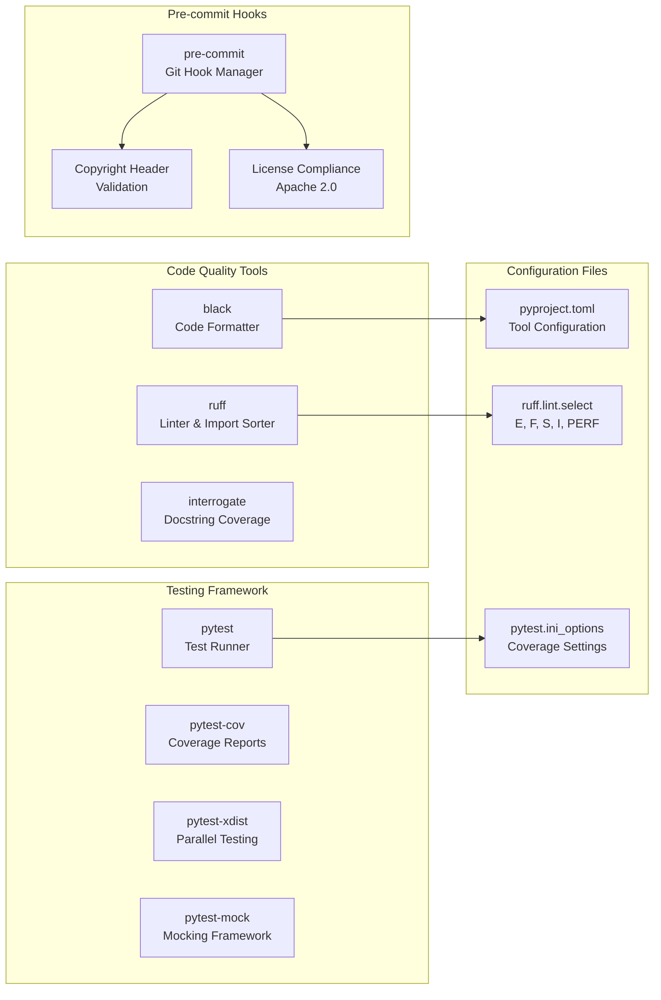

<!-- source: DeepWiki mcp.deepwiki.com · repo NVIDIA/physicsnemo-curator · page 4.1 Installation and Setup · fetched 2026-10-26 -->

# Installation and Setup

<details>
<summary>Relevant source files</summary>

The following files were used as context for generating this wiki page:

- [README.md](README.md)
- [pyproject.toml](pyproject.toml)

</details>


This document provides comprehensive installation instructions for PhysicsNeMo-Curator, including both production and development environments. It covers Docker-based installation (recommended), source installation, and development environment configuration.

For information about configuring ETL pipelines after installation, see [Pipeline Configuration](#2.1). For details about the development workflow and contribution process, see [Development Workflow](#4.2).

## System Requirements

PhysicsNeMo-Curator has specific system and software requirements that must be met before installation.

### Platform Support

| Platform | Support Status | Notes |
|----------|----------------|-------|
| Linux AMD64 | ✅ Supported | Primary development platform |
| Linux ARM64 | ❌ Not supported | Currently not available |
| Windows | ❌ Not supported | Use WSL2 with Linux container |
| macOS | ❌ Not supported | Use Docker with Linux container |

### Software Requirements

| Component | Version | Required For |
|-----------|---------|--------------|
| Python | >=3.10 | All installations |
| Docker | Latest | Container-based installation |
| Git | Latest | Source installation and development |
| NVIDIA Container Toolkit | Latest | GPU acceleration (optional) |

**Installation Dependencies**

The core dependencies are automatically installed during setup:

- `numpy>=1.26.4` - Numerical computing
- `pyvista>=0.44.2` - 3D visualization and mesh processing  
- `vtk>=9.3.1` - Visualization toolkit for scientific data
- `hydra-core>=1.3` - Configuration management framework
- `zarr~=2.18` - Chunked, compressed array storage
- `numcodecs>=0.13.1` - Compression codecs for zarr
- `tqdm>=4.67.1` - Progress bars

Sources: [pyproject.toml:12-22](), [README.md:35-37]()

## Docker Installation (Recommended)

The Docker-based installation provides a pre-configured environment with all dependencies and is the recommended approach for most users.

### Installation Workflow

```mermaid
flowchart TD
    START["Start Installation"] --> PULL["docker pull nvcr.io/nvidia/physicsnemo/physicsnemo:25.06"]
    PULL --> CLONE["git clone git@github.com:NVIDIA/physicsnemo-curator.git"]
    CLONE --> CD["cd physicsnemo-curator"]
    CD --> CONTAINER["docker run -it physicsnemo:25.06"]
    CONTAINER --> PIP_UPGRADE["pip install --upgrade pip"]
    PIP_UPGRADE --> INSTALL["pip install -e \".[dev]\""]
    INSTALL --> PRECOMMIT["pre-commit install"]
    PRECOMMIT --> VERIFY["physicsnemo-curator-etl --help"]
    VERIFY --> SUCCESS["Installation Complete"]
    
    subgraph "Docker Environment"
        PULL
        CONTAINER
    end
    
    subgraph "Source Installation"
        CLONE
        CD
        PIP_UPGRADE
        INSTALL
    end
    
    subgraph "Development Setup"
        PRECOMMIT
        VERIFY
    end
```

### Step-by-Step Installation

**1. Pull the PhysicsNeMo Docker Image**

```bash
docker pull nvcr.io/nvidia/physicsnemo/physicsnemo:25.06
```

**2. Clone the Repository**

```bash
git clone git@github.com:NVIDIA/physicsnemo-curator.git
cd physicsnemo-curator
```

**3. Start the Container**

```bash
docker run -it --gpus all -v $(pwd):/workspace nvcr.io/nvidia/physicsnemo/physicsnemo:25.06
```

**4. Install PhysicsNeMo-Curator**

```bash
pip install --upgrade pip
pip install -e ".[dev]"
```

**5. Configure Development Environment**

```bash
pre-commit install
```

Sources: [README.md:43-54]()

## Source Installation

Source installation provides more control over the environment and is required for development work outside of containers.

### Development Environment Setup

```mermaid
graph TB
    subgraph "Environment Setup"
        PYTHON["python>=3.10"] --> VENV["python -m venv venv"]
        VENV --> ACTIVATE["source venv/bin/activate"]
    end
    
    subgraph "Source Installation"
        ACTIVATE --> CLONE["git clone physicsnemo-curator"]
        CLONE --> CD["cd physicsnemo-curator"]
        CD --> PIP["pip install -e \".[dev]\""]
    end
    
    subgraph "Development Tools"
        PIP --> PRECOMMIT["pre-commit install"]
        PRECOMMIT --> BLACK["black --check ."]
        BLACK --> RUFF["ruff check ."]
        RUFF --> PYTEST["pytest tests/"]
    end
    
    subgraph "CLI Registration"
        PIP --> CLI["physicsnemo-curator-etl"]
        CLI --> HYDRA["hydra-based configuration"]
    end
```

### Installation Steps

**1. Create Python Environment**

```bash
python -m venv physicsnemo-curator-env
source physicsnemo-curator-env/bin/activate  # Linux/macOS
# or
physicsnemo-curator-env\Scripts\activate     # Windows
```

**2. Clone and Install**

```bash
git clone https://github.com/NVIDIA/physicsnemo-curator.git
cd physicsnemo-curator
pip install --upgrade pip
pip install -e ".[dev]"
```

**3. Verify Installation**

```bash
physicsnemo-curator-etl --help
python -c "import physicsnemo_curator; print(physicsnemo_curator.__version__)"
```

Sources: [pyproject.toml:60-61](), [pyproject.toml:25-36]()

## Development Environment Configuration

The development environment includes code quality tools, testing frameworks, and pre-commit hooks that maintain code standards.

### Development Tools Configuration



### Tool Configuration Details

**Ruff Linting Configuration**
- Selected rules: `E` (pycodestyle errors), `F` (pyflakes), `S` (bandit security), `I` (isort imports), `PERF` (performance)
- Auto-fixable: Import sorting
- Ignored: Line length (`E501`), specific security warnings

**Pytest Configuration** 
- Coverage target: `physicsnemo_curator` package
- Test discovery: `test_*.py` files in `tests/` directory
- Coverage reporting: Terminal with missing lines

**Pre-commit Hooks**
- Code formatting with `black`
- Linting with `ruff` 
- Copyright header validation
- License compliance checking

Sources: [pyproject.toml:45-53](), [pyproject.toml:55-58]()

## Installation Verification

After completing the installation, verify that all components are working correctly.

### Verification Checklist

| Component | Verification Command | Expected Result |
|-----------|---------------------|-----------------|
| CLI Tool | `physicsnemo-curator-etl --help` | Usage information displayed |
| Python Import | `python -c "import physicsnemo_curator"` | No import errors |
| Dependencies | `python -c "import pyvista, vtk, hydra, zarr"` | All imports successful |
| Development Tools | `black --version && ruff --version` | Version numbers displayed |

### Testing Installation

**Run Unit Tests**
```bash
pytest tests/ -v
```

**Check Code Quality**
```bash
black --check .
ruff check .
```

**Validate Pre-commit Setup**
```bash
pre-commit run --all-files
```

Sources: [pyproject.toml:55-58]()

## Common Installation Issues

### Docker-Related Issues

**Issue**: Container fails to start with GPU support
**Solution**: Ensure NVIDIA Container Toolkit is installed and Docker daemon is configured for GPU access

**Issue**: Permission denied when mounting volumes
**Solution**: Use appropriate user mapping: `docker run --user $(id -u):$(id -g)`

### Source Installation Issues

**Issue**: VTK installation fails on some systems
**Solution**: Install system dependencies:
```bash
# Ubuntu/Debian
sudo apt-get install libgl1-mesa-glx libxrender1 libfontconfig1

# CentOS/RHEL
sudo yum install mesa-libGL libXrender fontconfig
```

**Issue**: Hydra configuration errors
**Solution**: Verify Python version >= 3.10 and reinstall with `--no-cache-dir` flag

Sources: [pyproject.toml:12](), [pyproject.toml:14-22]()

## Next Steps

After successful installation, you can proceed with:

1. **Learn the Framework**: Start with the comprehensive [Tutorial](./examples/tutorials/etl_hdf5_to_zarr/hdf5_to_zarr.ipynb) to understand ETL pipeline concepts

2. **Configure Pipelines**: Set up your first ETL pipeline using [Pipeline Configuration](#2.1)

3. **Process CFD Data**: Use the [External Aerodynamics ETL pipeline](./examples/external_aerodynamics/README.md) for automotive aerodynamics datasets

4. **Development**: Review the [Development Workflow](#4.2) for contributing to the project

Sources: [README.md:58-102]()

---

