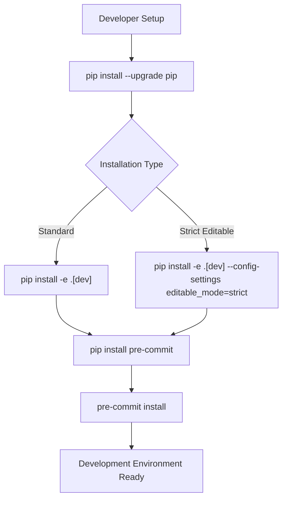
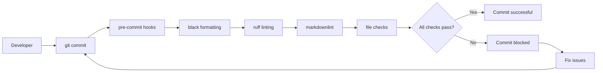
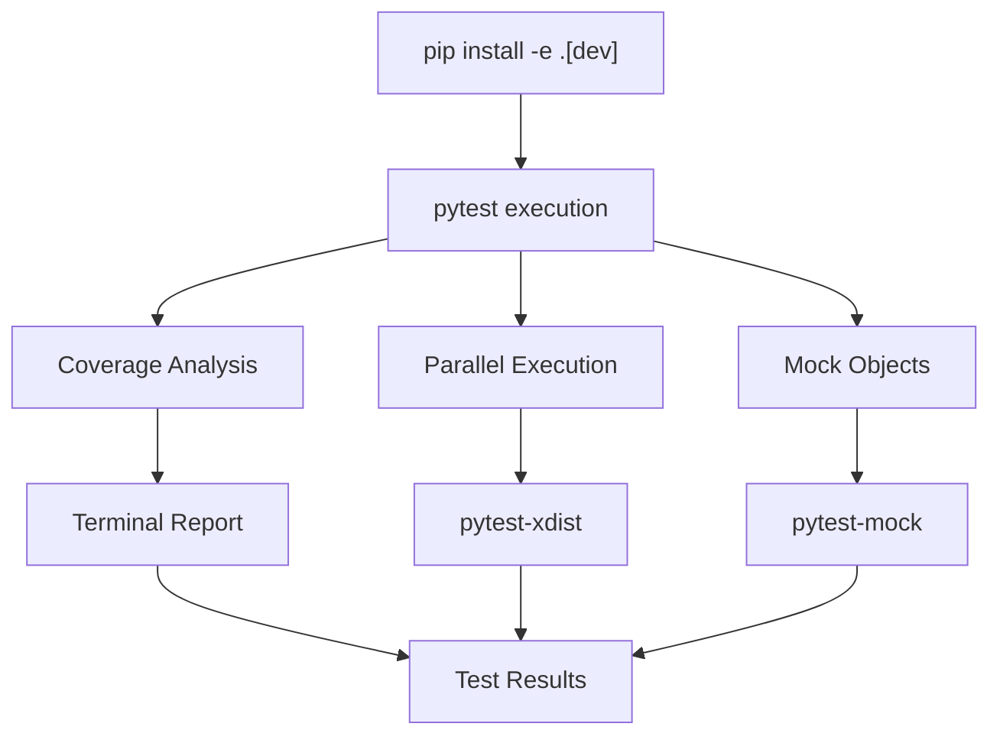
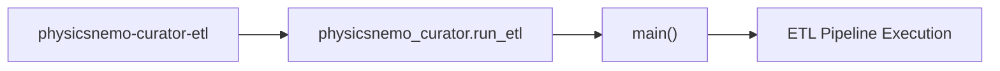

<!-- source: DeepWiki mcp.deepwiki.com · repo NVIDIA/physicsnemo-curator · page 4.2 Development Workflow · fetched 2026-10-26 -->

# Development Workflow

<details>
<summary>Relevant source files</summary>

The following files were used as context for generating this wiki page:

- [Makefile](Makefile)
- [pyproject.toml](pyproject.toml)

</details>


This document covers the development workflow for PhysicsNeMo-Curator, including installation, environment setup, code quality enforcement, testing procedures, and build processes. It provides guidance on the tools and processes developers should use when contributing to the codebase.

For information about the overall project structure and module organization, see [Project Structure](#4.3). For installation instructions for end users, see [Installation and Setup](#4.1).

## Development Environment Setup

PhysicsNeMo-Curator uses a modern Python development stack with automated code quality enforcement and comprehensive testing. The development workflow is designed around the build system defined in `pyproject.toml` and automated through Make targets.

### Installation Workflow

The development installation process supports both standard and editable installs:



**Standard Development Install**
The `install` target in the Makefile performs a development installation with all development dependencies:

```bash
make install
```

**Strict Editable Install**
For stricter development environments, the `editable-install` target uses setuptools strict editable mode:

```bash
make editable-install
```

Sources: [Makefile:1-7](), [pyproject.toml:25-36]()

### Dependency Management

The project uses a two-tier dependency structure defined in `pyproject.toml`:

| Dependency Category | Purpose | Key Components |
|-------------------|---------|----------------|
| Core Dependencies | Runtime requirements | `numpy`, `pyvista`, `vtk`, `hydra-core`, `zarr` |
| Development Dependencies | Development tools | `pre-commit`, `black`, `ruff`, `pytest` |

**Core Dependencies**
- `numpy>=1.26.4`: Numerical computing foundation
- `pyvista>=0.44.2`: 3D visualization and mesh processing  
- `vtk>=9.3.1`: Visualization toolkit for scientific data
- `hydra-core>=1.3`: Configuration management framework
- `zarr~=2.18`: Array storage format
- `numcodecs>=0.13.1`: Compression codecs for zarr

**Development Dependencies**
- `pre-commit`: Git hook management
- `black`: Code formatting
- `ruff`: Fast Python linter
- `interrogate`: Docstring coverage
- `pytest`: Testing framework with coverage and mocking support

Sources: [pyproject.toml:14-36]()

## Code Quality Workflow

The project enforces code quality through multiple automated tools integrated with pre-commit hooks and Make targets:



### Code Formatting and Linting

**Black Formatting**
Code formatting is enforced using `black` with pre-commit integration:

```bash
make black
```

**Ruff Linting**
The project uses `ruff` for fast Python linting with specific rule configurations:

- **Selected Rules**: `E` (pycodestyle errors), `F` (pyflakes), `S` (bandit security), `I` (isort imports), `PERF` (performance)
- **Fixable Rules**: Import sorting (`I`)
- **Ignored Rules**: Line length (`E501`), specific security warnings (`S311`, `S603`, `S607`)

```bash
make lint
```

**Per-File Ignore Patterns**
- `__init__.py`: Unused imports (`F401`)
- `test/*.py`: Assert statements (`S101`)
- `tests/ci_tests/header_check.py`: Subprocess security warnings

Sources: [pyproject.toml:45-53](), [Makefile:13-25]()

### License and Documentation Enforcement

**License Header Validation**
All source files must include proper Apache 2.0 license headers, enforced through:

```bash
make license
```

This runs the `header_check.py` script to validate license compliance.

**Documentation Coverage**
Docstring coverage is monitored using `interrogate`:

```bash
make interrogate
```

Sources: [Makefile:27-28](), [Makefile:16-17]()

## Testing Workflow

The testing infrastructure uses `pytest` with coverage reporting and parallel execution support:



### Test Configuration

The pytest configuration is defined in `pyproject.toml` with the following settings:

- **Test Discovery**: `test_*.py` files in the `tests` directory
- **Coverage**: Automatic coverage reporting for the `physicsnemo_curator` package
- **Reporting**: Verbose output with missing line reporting
- **Addopts**: `-v --cov=physicsnemo_curator --cov-report=term-missing`

### Running Tests

**Standard Test Execution**
```bash
make pytest
```

This command:
1. Installs the package in development mode
2. Runs the full test suite with coverage

**Development Dependencies for Testing**
- `pytest`: Core testing framework
- `pytest-cov`: Coverage reporting
- `pytest-mock`: Mocking utilities  
- `pytest-xdist`: Parallel test execution
- `debugpy<1.9.0`: Debug support with version constraint

Sources: [pyproject.toml:55-58](), [Makefile:33-35]()

## Build and Entry Points

### Package Configuration

The package uses `setuptools` with dynamic versioning through `setuptools_scm`:

- **Build Backend**: `setuptools.build_meta`
- **Version Management**: Dynamic versioning from `physicsnemo_curator.__version__`
- **Package Discovery**: Automatic discovery of `physicsnemo_curator` and subpackages

### Command Line Interface

The project provides a CLI entry point for the ETL pipeline:



**Entry Point Configuration**
- **Script Name**: `physicsnemo-curator-etl`
- **Module**: `physicsnemo_curator.run_etl`
- **Function**: `main`

This allows users to execute ETL pipelines directly from the command line after installation.

Sources: [pyproject.toml:1-3](), [pyproject.toml:38-39](), [pyproject.toml:60-61]()

## Comprehensive Development Workflow

The complete development workflow integrates all quality assurance steps:

```bash
make all-ci
```

This target executes the full development pipeline:

1. **setup-ci**: Install and configure pre-commit hooks
2. **black**: Format all Python code
3. **interrogate**: Check docstring coverage
4. **lint**: Run comprehensive linting checks
5. **license**: Validate license headers
6. **install**: Install development dependencies
7. **pytest**: Execute test suite with coverage
8. **doctest**: Run doctests (placeholder for future implementation)
9. **coverage**: Generate coverage reports (placeholder for future implementation)

This comprehensive workflow ensures code quality, proper documentation, license compliance, and test coverage before contributions are integrated.

Sources: [Makefile:40](), [Makefile:9-38]()

---

