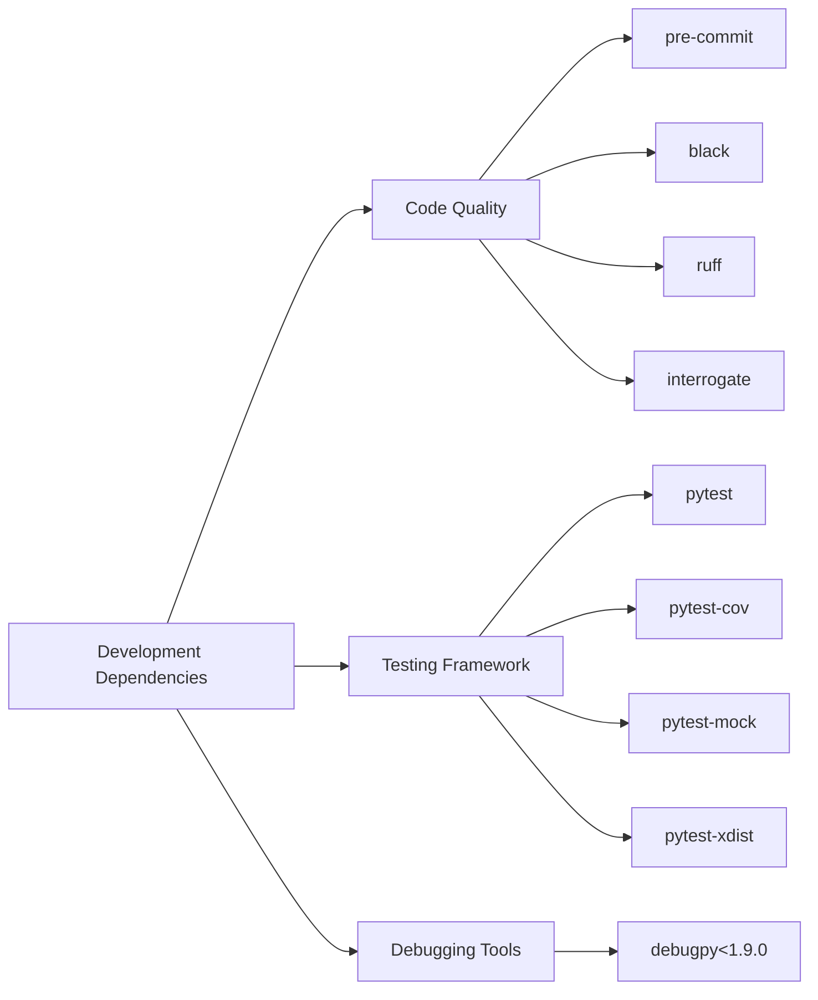
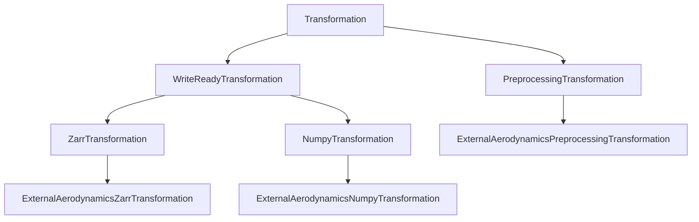
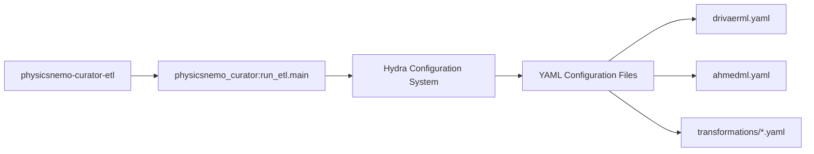

<!-- source: DeepWiki mcp.deepwiki.com · repo NVIDIA/physicsnemo-curator · page 4.3 Project Structure · fetched 2026-10-26 -->

# Project Structure

<details>
<summary>Relevant source files</summary>

The following files were used as context for generating this wiki page:

- [physicsnemo_curator/__init__.py](physicsnemo_curator/__init__.py)
- [pyproject.toml](pyproject.toml)

</details>


This document provides an overview of the package organization and module structure within PhysicsNeMo-Curator. It covers the main package layout, dependencies, entry points, and how different components are organized within the codebase.

For detailed information about configuring ETL pipelines, see [Pipeline Configuration](#2.1). For CI/CD infrastructure details, see [Blossom-CI Workflow](#3.1). For installation procedures, see [Installation and Setup](#4.1).

## Package Layout

PhysicsNeMo-Curator is organized as a Python package with a modular structure that supports ETL pipelines, data transformations, and scientific data curation capabilities.

### Package Hierarchy

```mermaid
graph TD
    ROOT["physicsnemo_curator/"]
    
    INIT["__init__.py"]
    RUN_ETL["run_etl.py"]
    
    ETL_MODULE["etl/"]
    ETL_INIT["etl/__init__.py"]
    ETL_PIPELINE["etl/pipeline.py"]
    ETL_COMPONENTS["etl/components/"]
    
    TRANSFORMS_MODULE["transforms/"]
    TRANSFORMS_INIT["transforms/__init__.py"]
    ZARR_TRANSFORM["transforms/zarr.py"]
    NUMPY_TRANSFORM["transforms/numpy.py"]
    
    EXTERNAL_AERO["external_aerodynamics/"]
    AERO_INIT["external_aerodynamics/__init__.py"]
    AERO_DATASET["external_aerodynamics/dataset.py"]
    AERO_TRANSFORMS["external_aerodynamics/transforms/"]
    
    CONFIG_DIR["configs/"]
    BASE_CONFIGS["configs/external_aero_etl/"]
    TRANSFORM_CONFIGS["configs/transformations/"]
    
    TESTS_DIR["tests/"]
    CI_TESTS["tests/ci_tests/"]
    UNIT_TESTS["tests/unit/"]
    
    ROOT --> INIT
    ROOT --> RUN_ETL
    ROOT --> ETL_MODULE
    ROOT --> TRANSFORMS_MODULE
    ROOT --> EXTERNAL_AERO
    ROOT --> CONFIG_DIR
    ROOT --> TESTS_DIR
    
    ETL_MODULE --> ETL_INIT
    ETL_MODULE --> ETL_PIPELINE
    ETL_MODULE --> ETL_COMPONENTS
    
    TRANSFORMS_MODULE --> TRANSFORMS_INIT
    TRANSFORMS_MODULE --> ZARR_TRANSFORM
    TRANSFORMS_MODULE --> NUMPY_TRANSFORM
    
    EXTERNAL_AERO --> AERO_INIT
    EXTERNAL_AERO --> AERO_DATASET
    EXTERNAL_AERO --> AERO_TRANSFORMS
    
    CONFIG_DIR --> BASE_CONFIGS
    CONFIG_DIR --> TRANSFORM_CONFIGS
    
    TESTS_DIR --> CI_TESTS
    TESTS_DIR --> UNIT_TESTS
```



**Sources:** [pyproject.toml:41-43](), [physicsnemo_curator/__init__.py:1-20]()

## Core Dependencies

The project is built on a foundation of scientific computing and data processing libraries, configured for Python 3.10+ environments.

| Dependency Category | Package | Version | Purpose |
|-------------------|---------|---------|---------|
| **Core Runtime** | `numpy` | >=1.26.4 | Numerical computing foundation |
| | `pyvista` | >=0.44.2 | 3D mesh processing and visualization |
| | `vtk` | >=9.3.1 | Visualization toolkit for scientific data |
| **Configuration** | `hydra-core` | >=1.3 | Configuration management system |
| **Data Storage** | `zarr` | ~=2.18 | Chunked, compressed array storage |
| | `numcodecs` | >=0.13.1 | Compression codecs for zarr |
| **User Interface** | `tqdm` | >=4.67.1 | Progress bar functionality |

**Sources:** [pyproject.toml:14-22]()

### Development Dependencies

The development environment includes comprehensive tooling for code quality, testing, and debugging:



**Sources:** [pyproject.toml:25-36]()

## Module Structure

The codebase is organized into specialized modules that handle different aspects of the data curation pipeline.

### Core Modules

| Module | Primary Classes/Functions | Purpose |
|--------|--------------------------|---------|
| `run_etl` | `main()` | CLI entry point for ETL operations |
| `etl.pipeline` | `Pipeline`, `DataSource`, `DataSink` | Core ETL pipeline infrastructure |
| `etl.components` | `DatasetValidator`, `Transformation` | Reusable pipeline components |
| `transforms` | `ZarrTransformation`, `NumpyTransformation` | Data serialization transforms |
| `external_aerodynamics` | `ExternalAerodynamicsDataset` | CFD-specific data processing |

### Transformation Architecture



**Sources:** [pyproject.toml:41-43]()

## Entry Points and CLI

The package provides a command-line interface through the `physicsnemo-curator-etl` script, which serves as the primary entry point for ETL operations.

### CLI Configuration



**Sources:** [pyproject.toml:60-61]()

## Configuration Management

The project uses Hydra for hierarchical configuration management, enabling flexible pipeline composition and parameter overrides.

### Configuration Hierarchy

| Configuration Type | Files | Purpose |
|-------------------|-------|---------|
| **Base Pipelines** | `external_aero_etl_*.yaml` | Top-level pipeline definitions |
| **Dataset Variables** | `drivaerml.yaml`, `ahmedml.yaml` | Variable specifications for different datasets |
| **Transformations** | `zarr.yaml`, `numpy.yaml` | Serialization format configurations |
| **Components** | Individual component configs | Specific component parameters |

**Sources:** [pyproject.toml:18]()

## Development Structure

The project follows standard Python packaging conventions with additional tooling for scientific computing environments.

### Build System Configuration

The build system uses modern Python packaging standards with setuptools and dynamic versioning:

```python
# Build backend configuration
[build-system]
requires = ["setuptools>=45", "wheel", "setuptools_scm>=6.2"]
build-backend = "setuptools.build_meta"

# Dynamic version from package attribute
[tool.setuptools.dynamic]
version = {attr = "physicsnemo_curator.__version__"}
```

### Code Quality Tools

| Tool | Configuration | Purpose |
|------|--------------|---------|
| **ruff** | E, F, S, I, PERF rules | Linting and import sorting |
| **black** | Default settings | Code formatting |
| **pytest** | Coverage reporting enabled | Unit testing framework |
| **interrogate** | Docstring coverage | Documentation quality |

**Sources:** [pyproject.toml:45-58]()

### Package Version Management

The package version is managed through the `__version__` attribute in the main package `__init__.py`, currently set to `"0.0.1"`. This follows semantic versioning conventions and integrates with setuptools_scm for automated version management.

**Sources:** [physicsnemo_curator/__init__.py:19](), [pyproject.toml:38-39]()