# Page: Overview

# Overview

<details>
<summary>Relevant source files</summary>

The following files were used as context for generating this wiki page:

- [README.md](README.md)

</details>


## Purpose and Scope

This document provides a high-level architectural overview of PhysicsNeMo-Curator, a GPU-accelerated data curation system designed for processing engineering and scientific datasets at scale. PhysicsNeMo-Curator serves as a specialized ETL (Extract, Transform, Load) framework within the broader PhysicsNeMo ecosystem, focusing on preparing computational fluid dynamics (CFD) and other physics simulation data for machine learning training and inference.

For detailed information about the ETL pipeline configuration and data processing workflows, see [ETL Pipeline System](#2). For CI/CD infrastructure and development workflows, see [CI/CD Infrastructure](#3). For installation instructions and development setup, see [Developer Guide](#4).

Sources: [README.md:14-27]()

## System Architecture

PhysicsNeMo-Curator operates as a modular data curation engine that bridges raw simulation data with ML-ready formats for physics-informed neural networks.

### High-Level System Components

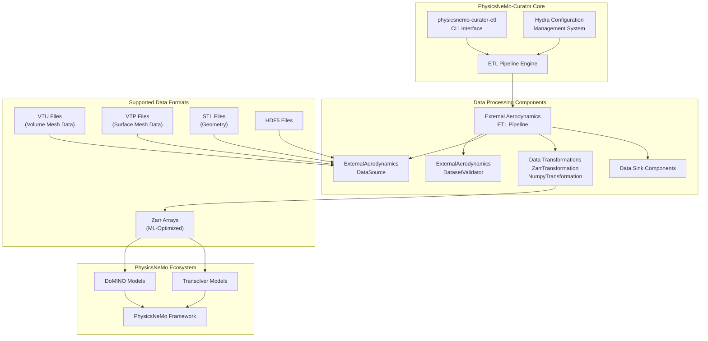

Sources: [README.md:16-26](), [README.md:75-85]()

### Core ETL Pipeline Architecture

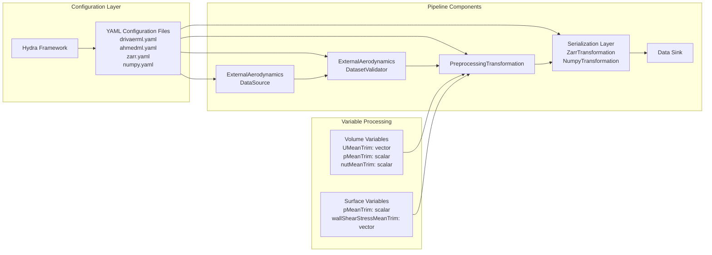

Sources: [README.md:61-67](), [README.md:82-84]()

## Core Framework Components

PhysicsNeMo-Curator implements a modular architecture with the following key components:

| Component | Purpose | Key Classes/Functions |
|-----------|---------|----------------------|
| **CLI Interface** | Command-line entry point for ETL operations | `physicsnemo-curator-etl` |
| **Configuration Management** | Hydra-based declarative pipeline configuration | YAML configuration files |
| **Data Validation** | Schema validation and data integrity checks | `ExternalAerodynamics.DatasetValidator` |
| **Data Sources** | Pluggable data readers for various formats | `ExternalAerodynamics.DataSource` |
| **Transformations** | Data processing and format conversion | `ZarrTransformation`, `NumpyTransformation` |
| **Data Sinks** | Output writers for ML-ready formats | Data sink components |

Sources: [README.md:21-24](), [README.md:82-84]()

## Supported Data Formats and Processing

### Input Formats

PhysicsNeMo-Curator supports the following input data formats commonly used in CFD simulations:

- **VTU Files**: Unstructured volume mesh data from VTK format
- **VTP Files**: Polygonal surface mesh data from VTK format  
- **STL Files**: Stereolithography geometry files
- **HDF5 Files**: Hierarchical data format for scientific datasets

### Output Formats

The framework produces ML-optimized data formats:

- **Zarr Arrays**: Chunked, compressed array storage optimized for parallel I/O
- **NumPy Arrays**: Standard NumPy serialization format

Sources: [README.md:75-79](), [README.md:92-94]()

## Integration with PhysicsNeMo Ecosystem

PhysicsNeMo-Curator serves as the data preparation component within the broader PhysicsNeMo framework:

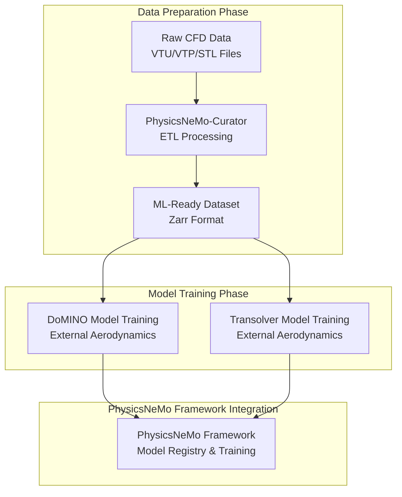

The framework specifically targets automotive aerodynamics applications, producing datasets compatible with DoMINO and Transolver models for external aerodynamics simulation.

Sources: [README.md:85-87](), [README.md:26]()

## Key Features

### GPU-Accelerated Processing
PhysicsNeMo-Curator leverages GPU acceleration to process large-scale scientific datasets efficiently, enabling faster data curation workflows compared to CPU-only approaches.

### Modular ETL Architecture
The framework implements a pluggable ETL architecture where users can customize data sources, transformations, and output sinks through configuration rather than code modification.

### Declarative Configuration
Using Hydra framework, the system supports declarative pipeline configuration through YAML files, enabling reproducible data processing workflows.

### Format Flexibility
The framework supports both compressed Zarr arrays for large-scale parallel processing and NumPy arrays for smaller datasets, with configurable compression and chunking strategies.

Sources: [README.md:17-19](), [README.md:21-22](), [README.md:61-67]()

---

# Page: ETL Pipeline System

# ETL Pipeline System

<details>
<summary>Relevant source files</summary>

The following files were used as context for generating this wiki page:

- [README.md](README.md)
- [tests/test_examples/test_config.py](tests/test_examples/test_config.py)

</details>


## Purpose and Scope

The ETL Pipeline System is the core data processing engine of PhysicsNeMo-Curator, responsible for extracting, transforming, and loading computational fluid dynamics (CFD) data into machine learning-ready formats. This system specifically handles external aerodynamics datasets and converts them from various input formats (VTU, VTP, STL, HDF5) into optimized output formats (Zarr, NumPy) suitable for training DoMINO and Transolver models.

This page covers the pipeline architecture, core components, data flow, and configuration system. For detailed configuration syntax and examples, see [Pipeline Configuration](#2.1). For specific transformation implementations, see [Data Transformations](#2.2). For variable definitions and dataset schemas, see [Dataset Variables](#2.3).

## Architecture Overview

The ETL Pipeline System follows a modular, configuration-driven architecture that separates concerns into distinct processing stages. Each stage is configurable through Hydra and can be independently modified or extended.

### Core Pipeline Architecture

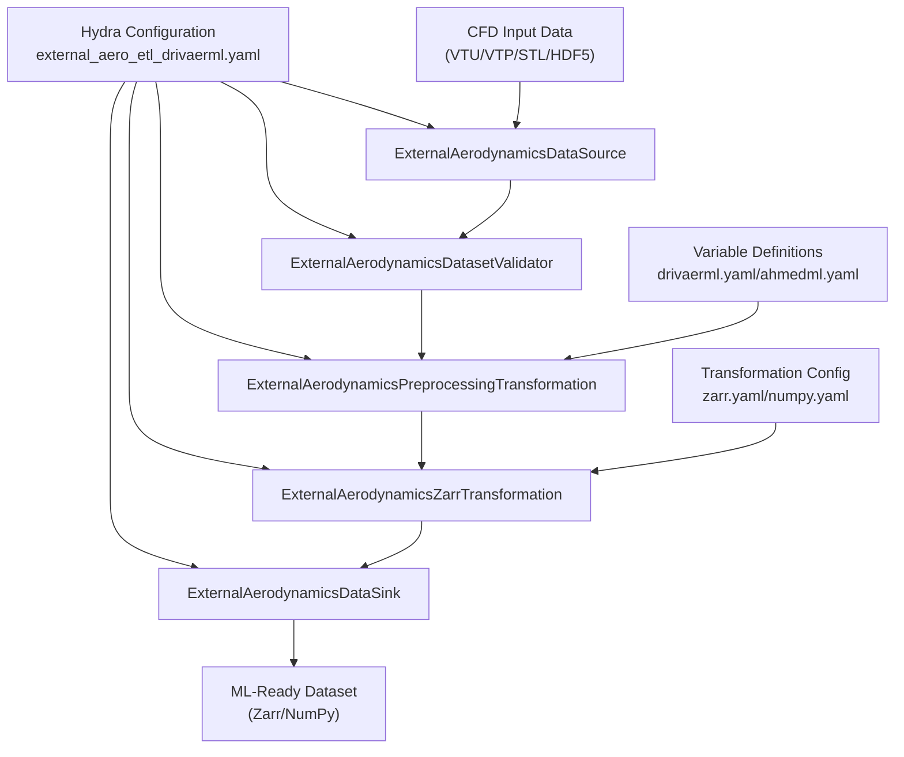

Sources: [tests/test_examples/test_config.py:24-28](), [tests/test_examples/test_config.py:41-118]()

## Core Components

The pipeline consists of five primary components that handle different aspects of data processing. Each component is instantiated through Hydra configuration and implements specific interfaces.

### Component Architecture

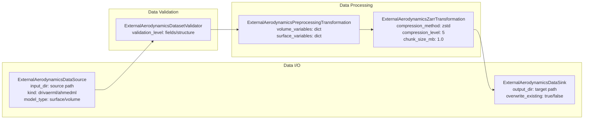

Sources: [tests/test_examples/test_config.py:63-117]()

### Component Responsibilities

| Component | Class Name | Primary Function | Configuration Section |
|-----------|------------|------------------|----------------------|
| Validator | `ExternalAerodynamicsDatasetValidator` | Schema and data integrity validation | `etl.validator` |
| Source | `ExternalAerodynamicsDataSource` | Data loading and initial parsing | `etl.source` |
| Preprocessing | `ExternalAerodynamicsPreprocessingTransformation` | Variable extraction and type conversion | `etl.transformations.preprocessing` |
| Write-Ready | `ExternalAerodynamicsZarrTransformation` | Format optimization and serialization | `etl.transformations.write_ready_transformation` |
| Sink | `ExternalAerodynamicsDataSink` | Output writing and persistence | `etl.sink` |

Sources: [tests/test_examples/test_config.py:74-115]()

## Data Flow and Processing

The pipeline processes data through a sequential series of transformations, with each stage performing specific operations on the dataset.

### Processing Pipeline Flow

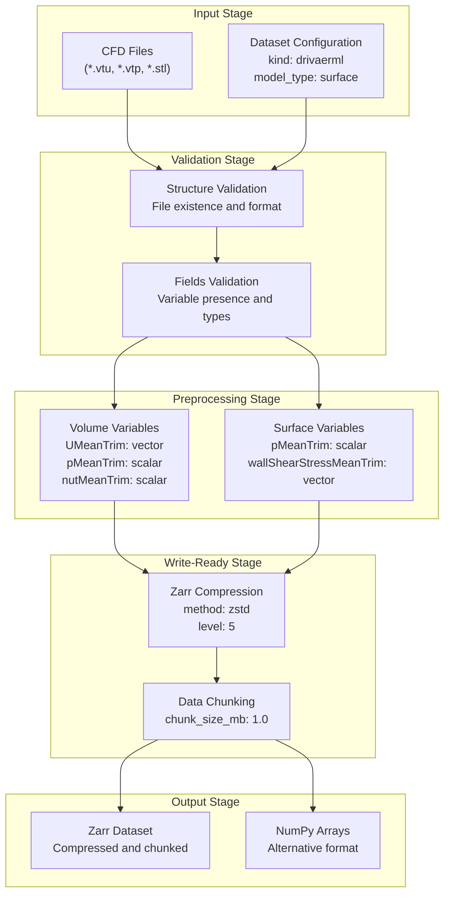

Sources: [tests/test_examples/test_config.py:81-89](), [tests/test_examples/test_config.py:102-108]()

## Configuration System

The ETL pipeline is entirely configuration-driven through Hydra, allowing for flexible customization without code changes. Configuration files define component instantiation, processing parameters, and data schemas.

### Configuration Hierarchy

| Configuration File | Purpose | Key Settings |
|-------------------|---------|--------------|
| `external_aero_etl_drivaerml.yaml` | Main pipeline configuration | Component instantiation, processing parameters |
| `drivaerml.yaml` | Dataset-specific variables | Volume and surface variable definitions |
| `ahmedml.yaml` | Alternative dataset variables | Alternative variable schema |
| `zarr.yaml` | Zarr transformation settings | Compression, chunking parameters |
| `numpy.yaml` | NumPy transformation settings | Array serialization options |

### Key Configuration Parameters

The pipeline supports extensive configuration through structured YAML files:

```yaml
etl:
  common:
    kind: drivaerml              # Dataset type: drivaerml/ahmedml
    model_type: surface          # Model type: surface/volume
  
  processing:
    num_processes: 12            # Parallel processing workers
    args: {}                     # Additional processing arguments
  
  validator:
    validation_level: fields     # Validation depth: structure/fields
  
  source:
    kind: drivaerml             # Must match common.kind
    model_type: surface         # Must match common.model_type
    input_dir: /path/to/input   # Source data directory
  
  sink:
    output_dir: /path/to/output # Target output directory
    overwrite_existing: true    # Overwrite behavior
```

Sources: [tests/test_examples/test_config.py:55-61](), [tests/test_examples/test_config.py:71-80](), [tests/test_examples/test_config.py:111-117]()

## Variable Processing

The pipeline handles two distinct categories of physical variables, each with specific data types and processing requirements.

### Variable Categories and Types

The system processes CFD variables according to their physical nature and dimensionality:

| Variable Category | Variable Name | Data Type | Physical Meaning |
|------------------|---------------|-----------|------------------|
| Volume | `UMeanTrim` | vector | Mean velocity field |
| Volume | `pMeanTrim` | scalar | Mean pressure field |
| Volume | `nutMeanTrim` | scalar | Turbulent viscosity |
| Surface | `pMeanTrim` | scalar | Surface pressure |
| Surface | `wallShearStressMeanTrim` | vector | Wall shear stress |

### Type System

The pipeline enforces strict typing for physical variables:

- **Vector variables**: 3D arrays representing directional quantities (velocity, stress)
- **Scalar variables**: Single-value fields representing magnitude quantities (pressure, viscosity)

This typing system ensures data consistency and enables proper tensor operations in downstream ML models.

Sources: [tests/test_examples/test_config.py:81-89]()

---

# Page: Pipeline Configuration

# Pipeline Configuration

<details>
<summary>Relevant source files</summary>

The following files were used as context for generating this wiki page:

- [physicsnemo_curator/etl/processing_config.py](physicsnemo_curator/etl/processing_config.py)
- [tests/test_etl/test_processing_config.py](tests/test_etl/test_processing_config.py)
- [tests/test_examples/test_config.py](tests/test_examples/test_config.py)

</details>


## Purpose and Scope

This document covers the configuration system for ETL pipelines in PhysicsNeMo-Curator, focusing on how Hydra configuration management enables declarative pipeline definition and component instantiation. For specific data transformation configurations, see [Data Transformations](#2.2). For dataset variable definitions, see [Dataset Variables](#2.3).

The configuration system provides a declarative approach to defining ETL pipelines, enabling flexible component composition, validation, and runtime parameter overrides without code changes.

## Configuration Architecture

The pipeline configuration system is built on Hydra framework, providing hierarchical configuration management with automatic component instantiation and validation.

### Configuration Flow Diagram

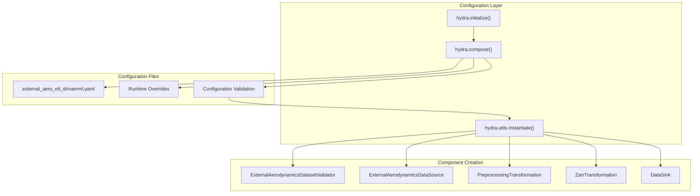

Sources: [tests/test_examples/test_config.py:21-22](), [tests/test_examples/test_config.py:44-52](), [tests/test_examples/test_config.py:63-69]()

## Configuration Structure

The ETL pipeline configuration follows a hierarchical structure with distinct sections for different pipeline components.

### Pipeline Component Hierarchy

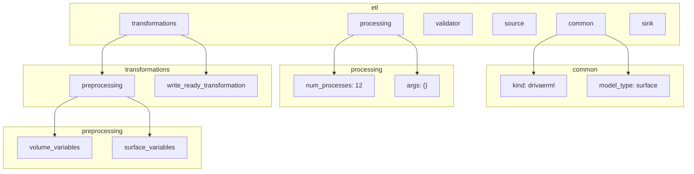

Sources: [tests/test_examples/test_config.py:55-61](), [tests/test_examples/test_config.py:79-89]()

### Processing Configuration

The `ProcessingConfig` class defines the structure for processing-related settings:

| Parameter | Type | Description | Validation |
|-----------|------|-------------|------------|
| `num_processes` | `int` | Number of parallel processes | Must be positive |
| `args` | `dict[str, Any]` | Additional processing arguments | Optional, defaults to empty dict |

Sources: [physicsnemo_curator/etl/processing_config.py:21-34]()

## Component Instantiation

Hydra's `instantiate()` function creates actual component instances from configuration specifications using the `_target_` parameter to specify the class to instantiate.

### Instantiation Process

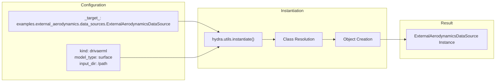

Example component instantiation patterns:

| Component Type | Configuration Key | Target Class |
|----------------|-------------------|--------------|
| Validator | `etl.validator` | `ExternalAerodynamicsDatasetValidator` |
| Data Source | `etl.source` | `ExternalAerodynamicsDataSource` |
| Preprocessing | `etl.transformations.preprocessing` | `ExternalAerodynamicsPreprocessingTransformation` |
| Write Ready | `etl.transformations.write_ready_transformation` | `ExternalAerodynamicsZarrTransformation` |
| Data Sink | `etl.sink` | `ExternalAerodynamicsDataSource` |

Sources: [tests/test_examples/test_config.py:63-69](), [tests/test_examples/test_config.py:74-78](), [tests/test_examples/test_config.py:93-108]()

## Configuration Validation

The system provides multiple levels of configuration validation to ensure pipeline integrity and catch errors early.

### Validation Levels

| Validation Type | Scope | Implementation |
|-----------------|-------|----------------|
| Schema Validation | Configuration structure | Hydra structured configs |
| Enum Validation | Valid values | `DatasetKind`, `ModelType` enums |
| Range Validation | Numeric constraints | `ProcessingConfig.__post_init__()` |
| Field Validation | Component settings | `validation_level` parameter |

### Validation Implementation

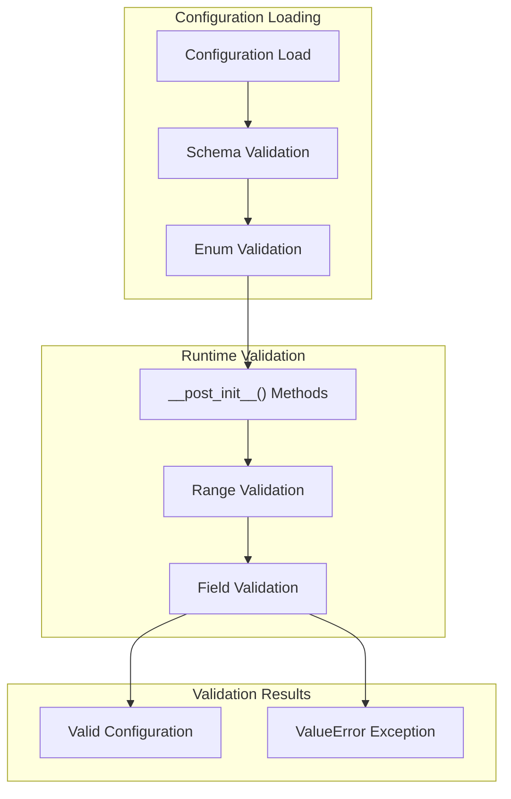

Sources: [tests/test_examples/test_config.py:120-135](), [physicsnemo_curator/etl/processing_config.py:28-33](), [tests/test_etl/test_processing_config.py:29-35]()

## Configuration Overrides

Runtime configuration overrides allow flexible pipeline parameterization without modifying configuration files.

### Override Mechanisms

Configuration parameters can be overridden at runtime using Hydra's override syntax:

```
etl.source.input_dir=/path/to/input/dataset
etl.sink.output_dir=/path/to/output/directory
etl.processing.num_processes=4
```

### Override Categories

| Override Type | Example | Purpose |
|---------------|---------|---------|
| Path Override | `etl.source.input_dir=/new/path` | Runtime path specification |
| Processing Override | `etl.processing.num_processes=8` | Resource allocation tuning |
| Component Override | `etl.common.kind=ahmedml` | Dataset type switching |
| Validation Override | `etl.validator.validation_level=structure` | Validation level control |

Sources: [tests/test_examples/test_config.py:48-51](), [tests/test_examples/test_config.py:159-176]()

## Configuration File Structure

The configuration system uses YAML files with Hydra defaults and structured inheritance.

### Base Configuration Structure

The primary configuration file `external_aero_etl_drivaerml.yaml` defines the complete pipeline structure:

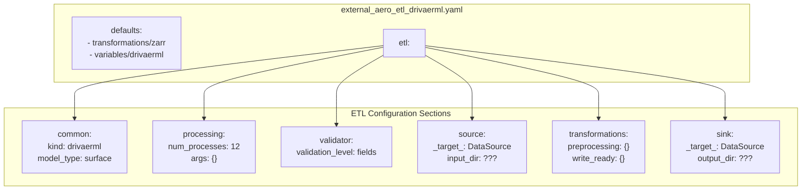

### Required Configuration Parameters

| Parameter | Type | Required | Default | Validation |
|-----------|------|----------|---------|------------|
| `etl.source.input_dir` | `str` | Yes | `???` | Must be absolute path |
| `etl.sink.output_dir` | `str` | Yes | `???` | Must be absolute path |
| `etl.common.kind` | `str` | Yes | `drivaerml` | Must be valid `DatasetKind` |
| `etl.common.model_type` | `str` | Yes | `surface` | Must be valid `ModelType` |
| `etl.processing.num_processes` | `int` | Yes | `12` | Must be positive |

Sources: [tests/test_examples/test_config.py:41-52](), [tests/test_examples/test_config.py:137-156]()

---

# Page: Data Transformations

# Data Transformations

<details>
<summary>Relevant source files</summary>

The following files were used as context for generating this wiki page:

- [examples/config/override_transformations/numpy.yaml](examples/config/override_transformations/numpy.yaml)
- [examples/config/override_transformations/zarr.yaml](examples/config/override_transformations/zarr.yaml)
- [examples/config/serialization_format/numpy.yaml](examples/config/serialization_format/numpy.yaml)
- [examples/config/serialization_format/zarr.yaml](examples/config/serialization_format/zarr.yaml)

</details>


## Purpose and Scope

This document covers the configuration and usage of data transformation components within the PhysicsNeMo-Curator ETL pipeline system. Data transformations are responsible for converting processed CFD datasets into machine learning-ready formats using either Zarr or NumPy serialization methods. The transformations handle compression, chunking, and format-specific optimizations to prepare data for downstream ML model training.

For information about pipeline configuration and component instantiation, see [Pipeline Configuration](#2.1). For details about dataset variable definitions, see [Dataset Variables](#2.3).

## Transformation Architecture

The data transformation system provides two primary serialization paths for ML-ready data output: Zarr and NumPy formats. Each format is optimized for different use cases, with Zarr providing advanced compression and chunking capabilities for large-scale datasets, while NumPy offers simpler, direct array serialization.

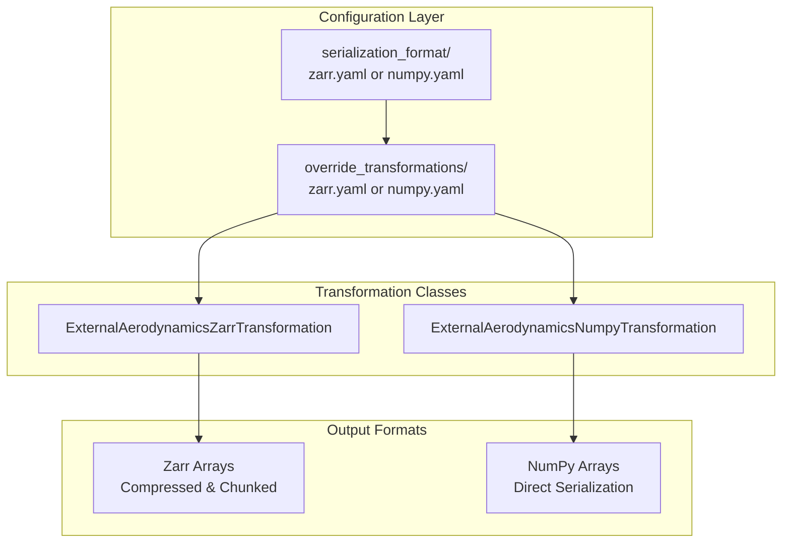

**Sources:** [examples/config/override_transformations/zarr.yaml:18](), [examples/config/override_transformations/numpy.yaml:18](), [examples/config/serialization_format/zarr.yaml:17](), [examples/config/serialization_format/numpy.yaml:17]()

## Serialization Format Selection

The serialization format is controlled through configuration files that set the `serialization_method` parameter. This parameter determines which transformation class is instantiated during pipeline execution.

| Format | Configuration File | Target Class | Use Case |
|--------|-------------------|--------------|----------|
| Zarr | `serialization_format/zarr.yaml` | `ExternalAerodynamicsZarrTransformation` | Large datasets requiring compression |
| NumPy | `serialization_format/numpy.yaml` | `ExternalAerodynamicsNumpyTransformation` | Simple array serialization |

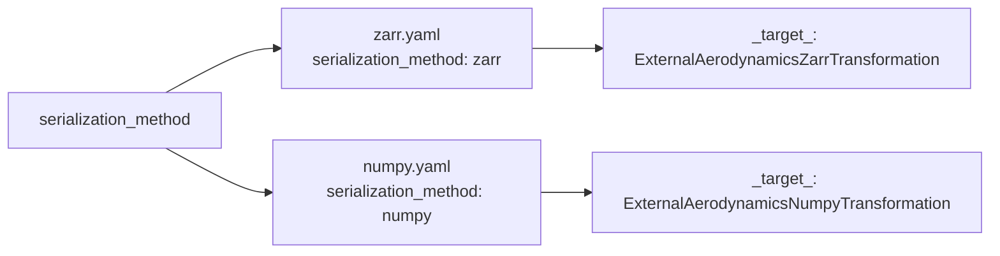

**Sources:** [examples/config/serialization_format/zarr.yaml:17](), [examples/config/serialization_format/numpy.yaml:17]()

## Zarr Transformation Configuration

The Zarr transformation provides advanced compression and chunking capabilities optimized for large-scale scientific datasets. The configuration is defined in the `override_transformations/zarr.yaml` file.

### Configuration Parameters

| Parameter | Default Value | Description |
|-----------|---------------|-------------|
| `compression_method` | `"zstd"` | Compression algorithm for Zarr arrays |
| `compression_level` | `5` | Compression level (1-22 for zstd) |
| `chunk_size_mb` | `1.0` | Target chunk size in megabytes |

### Configuration Structure

The Zarr transformation configuration follows this structure:

```yaml
write_ready_transformation:
  _target_: examples.external_aerodynamics.data_transformations.ExternalAerodynamicsZarrTransformation
  _convert_: all
  compression_method: "zstd"
  compression_level: 5
  chunk_size_mb: 1.0
```

The `_target_` parameter specifies the exact class to instantiate, while `_convert_: all` ensures proper Hydra configuration conversion. The compression parameters control the balance between storage efficiency and access performance.

**Sources:** [examples/config/override_transformations/zarr.yaml:17-22]()

## NumPy Transformation Configuration

The NumPy transformation provides straightforward array serialization without additional compression or chunking optimizations. This format is suitable for smaller datasets or when direct array access is preferred.

### Configuration Structure

The NumPy transformation requires minimal configuration:

```yaml
write_ready_transformation:
  _target_: examples.external_aerodynamics.data_transformations.ExternalAerodynamicsNumpyTransformation
  _convert_: all
```

The configuration only specifies the target class and conversion behavior, with no additional parameters required for basic NumPy serialization functionality.

**Sources:** [examples/config/override_transformations/numpy.yaml:17-19]()

## Configuration Integration

The transformation configurations integrate with the broader Hydra configuration system through override mechanisms. The pipeline selects the appropriate transformation based on the `serialization_format` configuration group, which then applies the corresponding `override_transformations` settings.

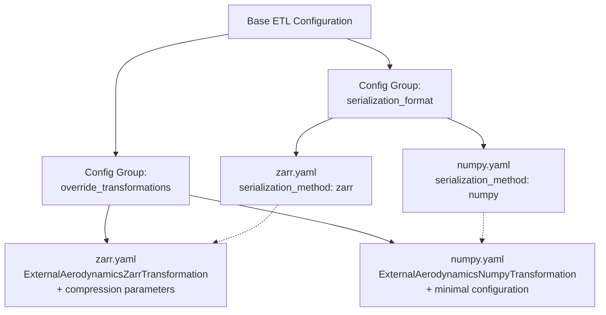

**Sources:** [examples/config/serialization_format/zarr.yaml:17](), [examples/config/serialization_format/numpy.yaml:17](), [examples/config/override_transformations/zarr.yaml:17-22](), [examples/config/override_transformations/numpy.yaml:17-19]()

---

# Page: Dataset Variables

# Dataset Variables

<details>
<summary>Relevant source files</summary>

The following files were used as context for generating this wiki page:

- [examples/config/variables/ahmedml.yaml](examples/config/variables/ahmedml.yaml)
- [examples/config/variables/drivaerml.yaml](examples/config/variables/drivaerml.yaml)

</details>


## Purpose and Scope

This document covers the definition and configuration of volume and surface variables for different CFD dataset types within the PhysicsNeMo-Curator ETL pipeline. Dataset variables define the physical quantities extracted from computational fluid dynamics simulations and specify their mathematical types (vector or scalar) and spatial domains (volume or surface).

For information about configuring the broader ETL pipeline components, see [Pipeline Configuration](#2.1). For details on data transformation implementations, see [Data Transformations](#2.2).

## Variable Configuration Structure

Dataset variables are defined in YAML configuration files that specify the physical quantities to extract from CFD simulation data. These configurations integrate with the Hydra framework to provide type-safe variable definitions for preprocessing transformations.

### Configuration File Architecture

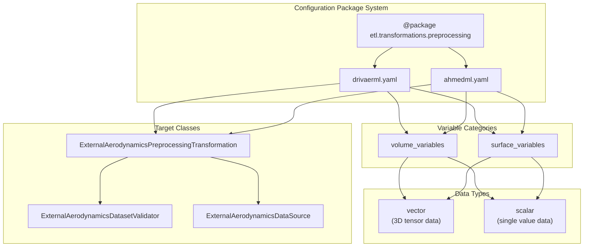

**Sources:** [examples/config/variables/drivaerml.yaml:1-26](), [examples/config/variables/ahmedml.yaml:1-26]()

## Dataset Types

The system supports multiple CFD dataset types, each with specific variable configurations tailored to different aerodynamic simulation scenarios.

### DrivaerML Dataset Variables

The `drivaerml` configuration defines variables for automotive aerodynamics simulations with time-averaged ("Trim") field data.

| Variable Category | Variable Name | Type | Description |
|-------------------|---------------|------|-------------|
| Volume | `UMeanTrim` | vector | Time-averaged velocity field |
| Volume | `pMeanTrim` | scalar | Time-averaged pressure field |
| Volume | `nutMeanTrim` | scalar | Time-averaged turbulent viscosity |
| Surface | `pMeanTrim` | scalar | Time-averaged surface pressure |
| Surface | `wallShearStressMeanTrim` | vector | Time-averaged wall shear stress |

### Ahmed Body Dataset Variables

The `ahmedml` configuration defines variables for simplified automotive body simulations without time-averaging prefixes.

| Variable Category | Variable Name | Type | Description |
|-------------------|---------------|------|-------------|
| Volume | `UMean` | vector | Mean velocity field |
| Volume | `pMean` | scalar | Mean pressure field |
| Volume | `nutMean` | scalar | Mean turbulent viscosity |
| Surface | `pMean` | scalar | Mean surface pressure |
| Surface | `wallShearStressMean` | vector | Mean wall shear stress |

**Sources:** [examples/config/variables/drivaerml.yaml:18-25](), [examples/config/variables/ahmedml.yaml:18-25]()

## Variable Types and Domains

The variable configuration system enforces strict typing to ensure data consistency throughout the ETL pipeline.

### Spatial Domains

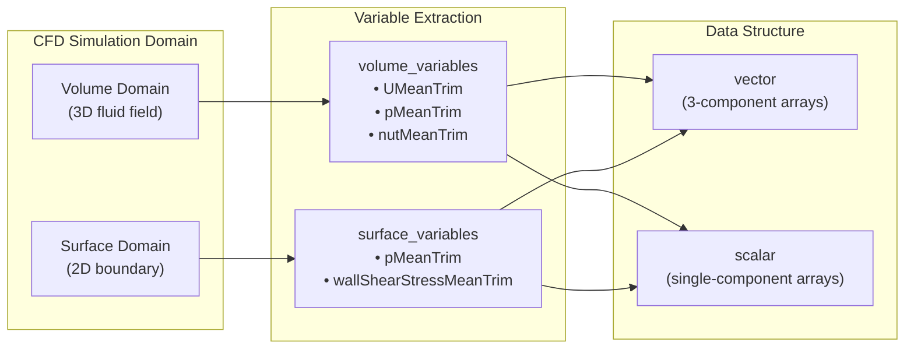

**Sources:** [examples/config/variables/drivaerml.yaml:18-25](), [examples/config/variables/ahmedml.yaml:18-25]()

#### Volume Variables

Volume variables represent physical quantities defined throughout the 3D fluid domain:
- **Vector variables**: Multi-component fields like velocity (`UMeanTrim`) and store 3D vector data
- **Scalar variables**: Single-component fields like pressure (`pMeanTrim`) and turbulent viscosity (`nutMeanTrim`)

#### Surface Variables

Surface variables represent physical quantities defined on 2D boundary surfaces:
- **Vector variables**: Surface-based vector fields like wall shear stress (`wallShearStressMeanTrim`)
- **Scalar variables**: Surface-based scalar fields like surface pressure (`pMeanTrim`)

## Integration with ETL Pipeline

Dataset variable configurations integrate with the broader ETL pipeline through the Hydra configuration system and preprocessing transformations.

### Configuration Package Integration

The `@package etl.transformations.preprocessing` directive at the top of each configuration file [examples/config/variables/drivaerml.yaml:1]() specifies that these variables configure the preprocessing transformation component within the ETL pipeline.

### Runtime Variable Resolution

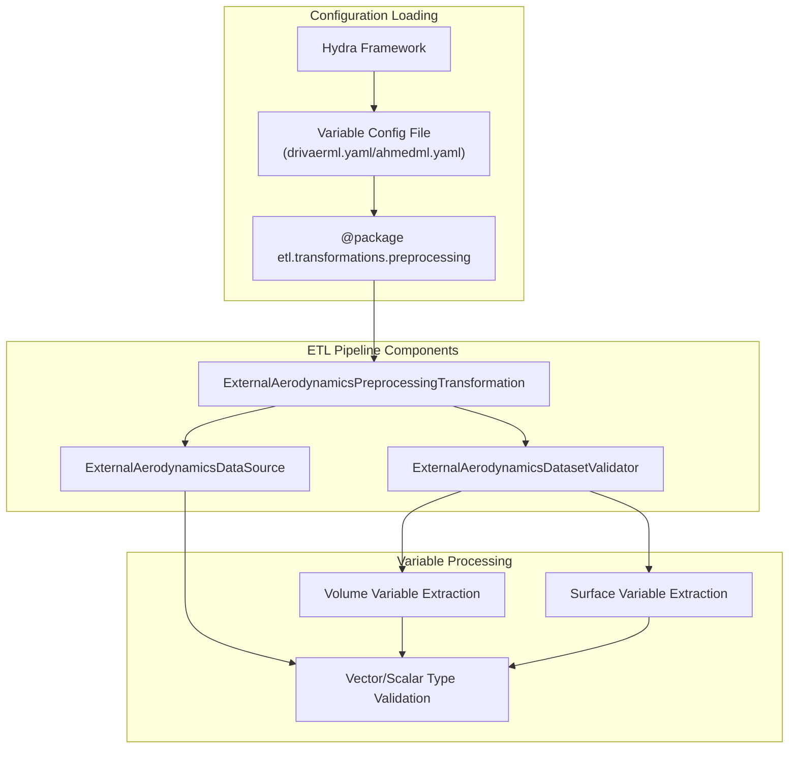

**Sources:** [examples/config/variables/drivaerml.yaml:1](), [examples/config/variables/ahmedml.yaml:1]()

## Configuration Examples

### Basic Variable Definition

Both dataset types follow the same YAML structure with two main sections:

```yaml
volume_variables:
  UMeanTrim: vector    # 3D velocity field
  pMeanTrim: scalar    # Pressure field
  nutMeanTrim: scalar  # Turbulent viscosity

surface_variables:
  pMeanTrim: scalar                    # Surface pressure
  wallShearStressMeanTrim: vector     # Wall shear stress
```

### Variable Naming Conventions

The variable names correspond directly to field names in the source CFD simulation files:
- **DrivaerML**: Uses "Trim" suffix for time-averaged quantities ([examples/config/variables/drivaerml.yaml:19-25]())
- **Ahmed Body**: Uses "Mean" suffix for averaged quantities ([examples/config/variables/ahmedml.yaml:19-25]())

Both configurations maintain consistent physical variable types across datasets while adapting naming conventions to match their respective simulation methodologies.

**Sources:** [examples/config/variables/drivaerml.yaml:18-25](), [examples/config/variables/ahmedml.yaml:18-25]()

---

# Page: CI/CD Infrastructure

# CI/CD Infrastructure

<details>
<summary>Relevant source files</summary>

The following files were used as context for generating this wiki page:

- [.github/workflows/blossom-ci.yml](.github/workflows/blossom-ci.yml)

</details>


This document covers the sophisticated CI/CD infrastructure used by PhysicsNeMo-Curator, which implements a hybrid approach combining GitHub Actions with external CI servers through the Blossom-CI system. This infrastructure enables secure, automated testing and deployment workflows across distributed computing environments.

For information about code quality tools and testing procedures, see [Code Quality and Testing](#3.2). For development workflow guidance, see [Development Workflow](#4.2).

## Overview

PhysicsNeMo-Curator uses a hybrid CI/CD infrastructure called Blossom-CI that orchestrates workflows across multiple environments. The system is designed to handle the unique requirements of machine learning and scientific computing workloads, providing secure access to specialized hardware while maintaining integration with standard GitHub development workflows.

The CI/CD system is primarily defined in [.github/workflows/blossom-ci.yml:1-91]() and implements a multi-stage pipeline that includes authorization, vulnerability scanning, job triggering, and log management.

Sources: [.github/workflows/blossom-ci.yml:15-16]()

## Blossom-CI Workflow Architecture

The Blossom-CI system implements a four-stage pipeline with distinct responsibilities and execution environments:

### Workflow Trigger Mechanism

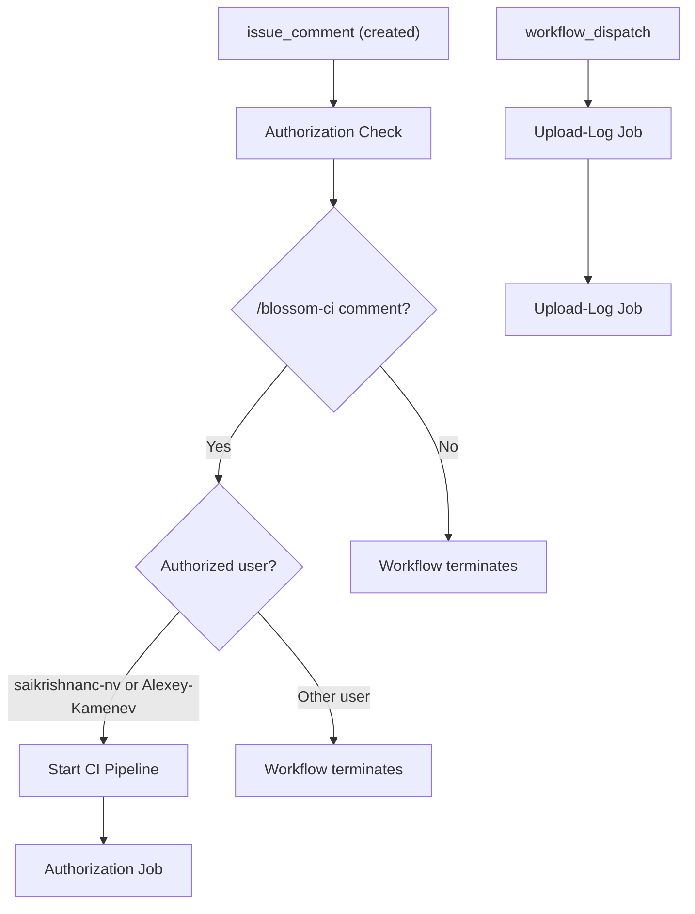

The workflow supports two trigger mechanisms:
- **Issue Comment Trigger**: Activated when users comment `/blossom-ci` on pull requests
- **Workflow Dispatch**: Manual trigger for direct log upload operations

Sources: [.github/workflows/blossom-ci.yml:17-27](), [.github/workflows/blossom-ci.yml:36-37]()

### Job Dependency Chain

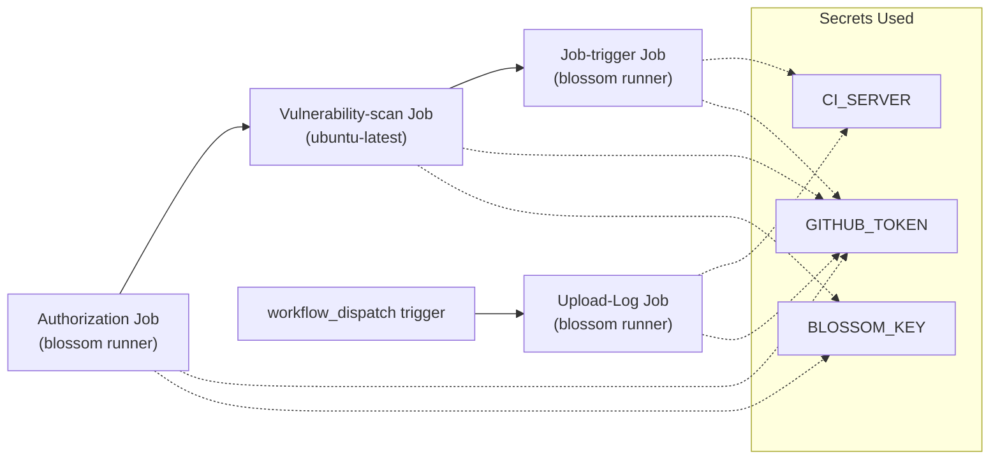

Each job in the pipeline has specific responsibilities and runs in different environments to ensure security and performance isolation.

Sources: [.github/workflows/blossom-ci.yml:29-91]()

## Job Components

### Authorization Job

The `Authorization` job serves as the security gateway for the CI/CD pipeline:

| Property | Value |
|----------|-------|
| Runner | `blossom` |
| Trigger Condition | Comment body equals `/blossom-ci` AND actor is authorized |
| Operation | `AUTH` |
| Primary Function | User authorization and argument extraction |

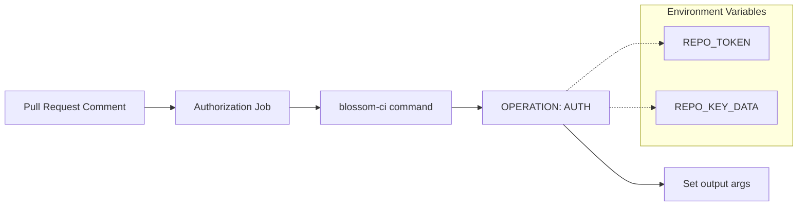

The job extracts and validates arguments that are passed to subsequent jobs through the `args` output parameter.

Sources: [.github/workflows/blossom-ci.yml:29-44]()

### Vulnerability Scan Job

The `Vulnerability-scan` job performs security analysis using NVIDIA's specialized action:

| Property | Value |
|----------|-------|
| Runner | `ubuntu-latest` |
| Dependencies | `Authorization` job |
| Action Used | `NVIDIA/blossom-action@main` |
| Repository Handling | Supports LFS and dynamic repository/ref selection |

This job checks out the code with Git LFS support and runs comprehensive vulnerability scanning before proceeding to CI execution.

Sources: [.github/workflows/blossom-ci.yml:46-66]()

### Job Trigger

The `Job-trigger` job initiates the actual CI execution on external infrastructure:

| Property | Value |
|----------|-------|
| Runner | `blossom` |
| Dependencies | `Vulnerability-scan` job |
| Operation | `START-CI-JOB` |
| External Integration | Uses `CI_SERVER` secret |

This job communicates with external CI infrastructure to begin the actual build and test processes.

Sources: [.github/workflows/blossom-ci.yml:68-78]()

### Upload Log Job

The `Upload-Log` job handles log aggregation and reporting:

| Property | Value |
|----------|-------|
| Runner | `blossom` |
| Trigger | `workflow_dispatch` only |
| Operation | `POST-PROCESSING` |
| Function | Provides Jenkins log links for pull requests |

Sources: [.github/workflows/blossom-ci.yml:80-90]()

## Security and Authorization

### User Access Control

The system implements strict user authorization through hardcoded user validation:

```yaml
github.actor == 'saikrishnanc-nv' || github.actor == 'Alexey-Kamenev'
```

Only these two users can trigger CI workflows through pull request comments.

### Secret Management

The workflow utilizes three GitHub secrets:

| Secret | Usage | Jobs |
|--------|-------|------|
| `GITHUB_TOKEN` | Repository access and API operations | Authorization, Vulnerability-scan, Job-trigger, Upload-Log |
| `BLOSSOM_KEY` | Blossom infrastructure authentication | Authorization, Vulnerability-scan |
| `CI_SERVER` | External CI server connection | Job-trigger, Upload-Log |

Sources: [.github/workflows/blossom-ci.yml:36-37](), [.github/workflows/blossom-ci.yml:42-44](), [.github/workflows/blossom-ci.yml:77-78]()

## External System Integration

### Blossom Infrastructure

The CI/CD system integrates with the Blossom infrastructure through:

- **Blossom Runners**: Self-hosted runners identified by the `blossom` label
- **blossom-ci Command**: Command-line tool that handles different operations based on the `OPERATION` environment variable
- **NVIDIA Blossom Action**: Specialized GitHub Action for vulnerability scanning

### CI Server Communication

The system communicates with external CI servers (likely Jenkins) through:

- The `CI_SERVER` secret containing connection information
- Operations for starting CI jobs and post-processing
- Log upload and linking functionality for pull request reporting

Sources: [.github/workflows/blossom-ci.yml:77](), [.github/workflows/blossom-ci.yml:89]()

## Operation Modes

The `blossom-ci` command supports three distinct operation modes controlled by the `OPERATION` environment variable:

| Operation | Purpose | Usage Context |
|-----------|---------|---------------|
| `AUTH` | User authorization and argument parsing | Authorization job |
| `START-CI-JOB` | Trigger external CI execution | Job-trigger job |
| `POST-PROCESSING` | Log upload and reporting | Upload-Log job |

This modular approach allows the same command-line tool to handle different phases of the CI/CD pipeline while maintaining consistent authentication and configuration management.

Sources: [.github/workflows/blossom-ci.yml:42](), [.github/workflows/blossom-ci.yml:76](), [.github/workflows/blossom-ci.yml:88]()

---

# Page: Blossom-CI Workflow

# Blossom-CI Workflow

<details>
<summary>Relevant source files</summary>

The following files were used as context for generating this wiki page:

- [.github/workflows/blossom-ci.yml](.github/workflows/blossom-ci.yml)

</details>


## Purpose and Scope

This document explains the Blossom-CI workflow system, a hybrid CI/CD infrastructure that integrates GitHub Actions with external CI servers through NVIDIA's Blossom platform. The workflow provides secure, authorized triggering of comprehensive testing and validation processes for PhysicsNeMo-Curator.

For information about the broader CI/CD infrastructure and quality control processes, see [CI/CD Infrastructure](#3). For details about code quality tools and testing procedures, see [Code Quality and Testing](#3.2).

## Architecture Overview

The Blossom-CI system implements a multi-stage workflow that bridges GitHub's hosted runners with external CI infrastructure:

```mermaid
graph TD
    subgraph "GitHub Environment"
        PR_COMMENT["/blossom-ci comment"]
        WORKFLOW_DISPATCH["workflow_dispatch trigger"]
        GH_SECRETS["GitHub Secrets<br/>• GITHUB_TOKEN<br/>• BLOSSOM_KEY<br/>• CI_SERVER"]
    end
    
    subgraph "Blossom-CI Jobs"
        AUTH_JOB["Authorization Job<br/>runs-on: blossom"]
        VULN_JOB["Vulnerability-scan Job<br/>runs-on: ubuntu-latest"]
        TRIGGER_JOB["Job-trigger Job<br/>runs-on: blossom"]
        UPLOAD_JOB["Upload-Log Job<br/>runs-on: blossom"]
    end
    
    subgraph "External Systems"
        BLOSSOM_CMD["blossom-ci command"]
        NVIDIA_ACTION["NVIDIA/blossom-action@main"]
        CI_SERVER["External CI Server"]
    end
    
    subgraph "Operations"
        AUTH_OP["OPERATION: AUTH"]
        START_OP["OPERATION: START-CI-JOB"]
        POST_OP["OPERATION: POST-PROCESSING"]
    end
    
    PR_COMMENT --> AUTH_JOB
    WORKFLOW_DISPATCH --> UPLOAD_JOB
    GH_SECRETS --> AUTH_JOB
    GH_SECRETS --> VULN_JOB
    GH_SECRETS --> TRIGGER_JOB
    GH_SECRETS --> UPLOAD_JOB
    
    AUTH_JOB --> VULN_JOB
    VULN_JOB --> TRIGGER_JOB
    
    AUTH_JOB --> BLOSSOM_CMD
    VULN_JOB --> NVIDIA_ACTION
    TRIGGER_JOB --> BLOSSOM_CMD
    UPLOAD_JOB --> BLOSSOM_CMD
    
    BLOSSOM_CMD --> AUTH_OP
    BLOSSOM_CMD --> START_OP
    BLOSSOM_CMD --> POST_OP
    
    TRIGGER_JOB --> CI_SERVER
    UPLOAD_JOB --> CI_SERVER
```

Sources: [.github/workflows/blossom-ci.yml:1-91]()

## Workflow Triggers

The Blossom-CI workflow supports two distinct trigger mechanisms:

### Comment-Based Triggering

The primary trigger is through pull request comments containing the exact string `/blossom-ci`:

| Trigger Event | Condition | Action |
|---------------|-----------|--------|
| `issue_comment.created` | Comment body equals `/blossom-ci` | Initiates full CI pipeline |
| Authorization check | Actor must be `saikrishnanc-nv` or `Alexey-Kamenev` | Proceeds to vulnerability scan |

### Manual Workflow Dispatch

The workflow also supports manual triggering with optional parameters:

| Parameter | Description | Required |
|-----------|-------------|----------|
| `platform` | Specifies `runs-on` argument | No |
| `args` | Additional arguments for CI execution | No |

Sources: [.github/workflows/blossom-ci.yml:17-27](), [.github/workflows/blossom-ci.yml:36-37]()

## Job Execution Flow

The workflow implements a sequential job dependency chain with specific runner requirements:

```mermaid
graph LR
    subgraph "Job Dependencies"
        AUTH["Authorization<br/>runs-on: blossom<br/>if: comment trigger"]
        VULN["Vulnerability-scan<br/>runs-on: ubuntu-latest<br/>needs: Authorization"]
        TRIGGER["Job-trigger<br/>runs-on: blossom<br/>needs: Vulnerability-scan"]
        UPLOAD["Upload-Log<br/>runs-on: blossom<br/>if: workflow_dispatch"]
    end
    
    subgraph "Commands and Actions"
        BLOSSOM_AUTH["blossom-ci<br/>OPERATION=AUTH"]
        NVIDIA_SCAN["NVIDIA/blossom-action@main"]
        BLOSSOM_START["blossom-ci<br/>OPERATION=START-CI-JOB"]
        BLOSSOM_POST["blossom-ci<br/>OPERATION=POST-PROCESSING"]
    end
    
    AUTH --> VULN
    VULN --> TRIGGER
    
    AUTH --> BLOSSOM_AUTH
    VULN --> NVIDIA_SCAN
    TRIGGER --> BLOSSOM_START
    UPLOAD --> BLOSSOM_POST
```

Sources: [.github/workflows/blossom-ci.yml:29-91]()

### Authorization Job

The `Authorization` job validates user permissions and prepares workflow arguments:

- **Runner**: `blossom` (custom runner)
- **Condition**: Comment-triggered workflows only
- **Command**: `blossom-ci` with `OPERATION: 'AUTH'`
- **Secrets**: `GITHUB_TOKEN`, `BLOSSOM_KEY`
- **Output**: `args` environment variable for downstream jobs

Sources: [.github/workflows/blossom-ci.yml:29-44]()

### Vulnerability Scan Job

The `Vulnerability-scan` job performs security validation using NVIDIA's action:

- **Runner**: `ubuntu-latest` (GitHub-hosted)
- **Dependencies**: Requires successful `Authorization`
- **Action**: `NVIDIA/blossom-action@main`
- **Repository**: Checks out code with LFS support
- **Arguments**: Passes `args1`, `args2`, `args3` from authorization output

Sources: [.github/workflows/blossom-ci.yml:46-66]()

### Job Trigger

The `Job-trigger` job initiates the external CI process:

- **Runner**: `blossom` (custom runner)
- **Dependencies**: Requires successful `Vulnerability-scan`
- **Command**: `blossom-ci` with `OPERATION: 'START-CI-JOB'`
- **Secrets**: `CI_SERVER`, `GITHUB_TOKEN`

Sources: [.github/workflows/blossom-ci.yml:68-78]()

### Upload Log Job

The `Upload-Log` job handles post-processing for manual workflows:

- **Runner**: `blossom` (custom runner)
- **Condition**: `workflow_dispatch` events only
- **Command**: `blossom-ci` with `OPERATION: 'POST-PROCESSING'`
- **Purpose**: Provides Jenkins log access for pull requests

Sources: [.github/workflows/blossom-ci.yml:80-90]()

## Security and Authorization

The workflow implements multi-layered security controls:

### User Authorization

Access is restricted to specific GitHub actors:
- `saikrishnanc-nv`
- `Alexey-Kamenev`

The authorization check occurs in the conditional statement: `github.actor == 'saikrishnanc-nv' || github.actor == 'Alexey-Kamenev'`

### Secret Management

The workflow uses three GitHub secrets:

| Secret | Purpose | Jobs Using |
|--------|---------|------------|
| `GITHUB_TOKEN` | Repository access and API operations | All jobs |
| `BLOSSOM_KEY` | Blossom platform authentication | Authorization, Vulnerability-scan |
| `CI_SERVER` | External CI server configuration | Job-trigger, Upload-Log |

### Vulnerability Scanning

The NVIDIA Blossom Action performs security validation before triggering external CI, ensuring that only verified code reaches the external infrastructure.

Sources: [.github/workflows/blossom-ci.yml:36-44](), [.github/workflows/blossom-ci.yml:58-66]()

## Integration with External Systems

The workflow integrates with multiple external systems through the `blossom-ci` command:

### Blossom Platform Integration

The `blossom-ci` command provides the primary interface to NVIDIA's Blossom platform, supporting three operations:

- **AUTH**: User authentication and workflow preparation
- **START-CI-JOB**: Triggering external CI execution
- **POST-PROCESSING**: Log retrieval and result processing

### External CI Server Communication

The workflow communicates with external CI infrastructure through the `CI_SERVER` secret, enabling hybrid execution across GitHub and external systems.

### Repository Integration

The workflow supports repository checkout with LFS (Large File System) support, accommodating the large data files common in physics simulation datasets.

Sources: [.github/workflows/blossom-ci.yml:40-43](), [.github/workflows/blossom-ci.yml:74-77](), [.github/workflows/blossom-ci.yml:86-89]()

---

# Page: Code Quality and Testing

# Code Quality and Testing

<details>
<summary>Relevant source files</summary>

The following files were used as context for generating this wiki page:

- [Makefile](Makefile)
- [tests/ci_tests/config.json](tests/ci_tests/config.json)
- [tests/ci_tests/copyright.txt](tests/ci_tests/copyright.txt)
- [tests/ci_tests/header_check.py](tests/ci_tests/header_check.py)

</details>


This document covers the code quality assurance and testing infrastructure for PhysicsNeMo-Curator. It details the automated tools, validation scripts, and testing frameworks that ensure code consistency, license compliance, and functional correctness throughout the development lifecycle.

For information about the broader CI/CD workflow orchestration, see [Blossom-CI Workflow](#3.1). For development setup and build processes, see [Development Workflow](#4.2).

## Quality Assurance Pipeline

The code quality system is built around a comprehensive set of automated checks that validate code formatting, licensing, documentation, and functionality. The main entry point is the `all-ci` target in the Makefile.

### Testing and Quality Pipeline Flow

```mermaid
graph TD
    subgraph "Pre-commit Hooks"
        SETUP["setup-ci"]
        PRECOMMIT["pre-commit install"]
    end
    
    subgraph "Code Quality Checks"
        BLACK["black<br/>Code Formatting"]
        INTERROGATE["interrogate<br/>Docstring Coverage"]
        LINT["lint<br/>Multiple Validators"]
        LICENSE["license<br/>Copyright Headers"]
    end
    
    subgraph "Lint Sub-components"
        MARKDOWN["markdownlint"]
        LARGE_FILES["check-added-large-files"]
        WHITESPACE["trailing-whitespace"]
        EOF["end-of-file-fixer"]
        YAML["check-yaml"]
        RUFF["ruff"]
    end
    
    subgraph "Testing Framework"
        INSTALL["install<br/>pip install -e .[dev]"]
        PYTEST["pytest<br/>Test Execution"]
        DOCTEST["doctest<br/>Not Implemented"]
        COVERAGE["coverage<br/>Not Implemented"]
    end
    
    subgraph "CI Integration"
        ALL_CI["all-ci<br/>Complete Pipeline"]
    end
    
    SETUP --> PRECOMMIT
    ALL_CI --> SETUP
    ALL_CI --> BLACK
    ALL_CI --> INTERROGATE
    ALL_CI --> LINT
    ALL_CI --> LICENSE
    ALL_CI --> INSTALL
    ALL_CI --> PYTEST
    ALL_CI --> DOCTEST
    ALL_CI --> COVERAGE
    
    LINT --> MARKDOWN
    LINT --> LARGE_FILES
    LINT --> WHITESPACE
    LINT --> EOF
    LINT --> YAML
    LINT --> RUFF
    
    style ALL_CI fill:#f9f9f9
    style SETUP fill:#e8f4fd
    style LICENSE fill:#fff2cc
```

**Sources:** [Makefile:1-41]()

## Code Formatting and Linting

### Automated Code Formatting

The `black` formatter ensures consistent Python code style across the codebase. The formatting process is integrated into the pre-commit workflow and can be executed manually via the Makefile.

```mermaid
graph LR
    subgraph "Code Style Tools"
        BLACK_TARGET["black target"]
        PRECOMMIT_BLACK["pre-commit run black -a"]
        BLACK_TOOL["Black Formatter"]
    end
    
    subgraph "Quality Validation"
        RUFF_TARGET["ruff"]
        RUFF_TOOL["Ruff Linter"]
        CHECKS["Code Quality Checks"]
    end
    
    subgraph "File Validation"
        WHITESPACE_CHECK["trailing-whitespace"]
        EOF_CHECK["end-of-file-fixer"]
        YAML_CHECK["check-yaml"]
        SIZE_CHECK["check-added-large-files"]
    end
    
    BLACK_TARGET --> PRECOMMIT_BLACK
    PRECOMMIT_BLACK --> BLACK_TOOL
    RUFF_TARGET --> RUFF_TOOL
    RUFF_TOOL --> CHECKS
    
    BLACK_TOOL --> WHITESPACE_CHECK
    BLACK_TOOL --> EOF_CHECK
    BLACK_TOOL --> YAML_CHECK
    BLACK_TOOL --> SIZE_CHECK
```

**Sources:** [Makefile:13-25]()

### Linting Configuration

The linting pipeline combines multiple validation tools:

| Tool | Purpose | Execution Command |
|------|---------|-------------------|
| `markdownlint` | Markdown file validation | `pre-commit run markdownlint -a` |
| `check-added-large-files` | File size validation | `pre-commit run check-added-large-files -a` |
| `trailing-whitespace` | Whitespace cleanup | `pre-commit run trailing-whitespace -a` |
| `end-of-file-fixer` | EOF normalization | `pre-commit run end-of-file-fixer -a` |
| `check-yaml` | YAML syntax validation | `pre-commit run check-yaml -a` |
| `ruff` | Python code analysis | `pre-commit run ruff -a` |

**Sources:** [Makefile:19-25]()

## License and Copyright Validation

### Copyright Header Enforcement

The license validation system uses a dedicated Python script to ensure all source files contain proper NVIDIA copyright headers. The system is configured through a JSON configuration file and validates against a standard copyright template.

### Header Validation Architecture

```mermaid
graph TD
    subgraph "Configuration"
        CONFIG_JSON["config.json<br/>File Extensions & Paths"]
        COPYRIGHT_TXT["copyright.txt<br/>Template Header"]
    end
    
    subgraph "header_check.py Components"
        MAIN_FUNC["main()"]
        GET_FILES["get_all_files()<br/>get_committed_files()"]
        READ_GITIGNORE["read_gitignore()"]
        IS_IGNORED["is_ignored()"]
        GET_COMMENTS["get_top_comments()"]
        VALIDATION_LOGIC["Copyright Validation"]
    end
    
    subgraph "File Processing"
        FILE_DISCOVERY["File Discovery"]
        GITIGNORE_FILTER["Gitignore Filtering"]
        HEADER_EXTRACTION["Header Extraction"]
        REGEX_MATCH["Regex Matching"]
        YEAR_VALIDATION["Year Validation"]
    end
    
    CONFIG_JSON --> MAIN_FUNC
    COPYRIGHT_TXT --> MAIN_FUNC
    MAIN_FUNC --> GET_FILES
    MAIN_FUNC --> READ_GITIGNORE
    
    GET_FILES --> FILE_DISCOVERY
    READ_GITIGNORE --> IS_IGNORED
    IS_IGNORED --> GITIGNORE_FILTER
    
    FILE_DISCOVERY --> GITIGNORE_FILTER
    GITIGNORE_FILTER --> GET_COMMENTS
    GET_COMMENTS --> HEADER_EXTRACTION
    HEADER_EXTRACTION --> VALIDATION_LOGIC
    
    VALIDATION_LOGIC --> REGEX_MATCH
    VALIDATION_LOGIC --> YEAR_VALIDATION
    
    style MAIN_FUNC fill:#f9f9f9
    style VALIDATION_LOGIC fill:#fff2cc
```

**Sources:** [tests/ci_tests/header_check.py:123-237](), [tests/ci_tests/config.json:1-16]()

### Header Validation Process

The `header_check.py` script implements a comprehensive validation workflow:

1. **File Discovery**: The `get_all_files()` function [tests/ci_tests/header_check.py:113-121]() identifies target files based on configured extensions
2. **Gitignore Filtering**: The `is_ignored()` function [tests/ci_tests/header_check.py:43-75]() applies gitignore patterns to exclude irrelevant files
3. **Comment Extraction**: The `get_top_comments()` function [tests/ci_tests/header_check.py:78-99]() extracts header comments before import statements
4. **Copyright Validation**: Regex matching against the pattern `Copyright.*NVIDIA.*` [tests/ci_tests/header_check.py:181]()
5. **Year Validation**: Validates copyright years from 2024 to current year [tests/ci_tests/header_check.py:185-196]()

### License Configuration

The validation system is configured through `config.json`:

```json
{
    "copyright_file": "copyright.txt",
    "dir": "../../",
    "include-ext": [".py", ".yaml", ".ci", ".release", "Dockerfile"]
}
```

**Sources:** [tests/ci_tests/config.json:2-15]()

### Standard Copyright Template

The required copyright header template is defined in `copyright.txt`:

```
# SPDX-FileCopyrightText: Copyright (c) 2025 NVIDIA CORPORATION & AFFILIATES.
# SPDX-FileCopyrightText: All rights reserved.
# SPDX-License-Identifier: Apache-2.0
```

**Sources:** [tests/ci_tests/copyright.txt:1-15]()

## Testing Framework

### Test Execution

The testing system is built around pytest with development dependencies installed through the editable installation mode. The `pytest` target in the Makefile handles the complete test setup and execution.

| Command | Purpose | Implementation |
|---------|---------|----------------|
| `make pytest` | Execute test suite | `pip install -e ".[dev]" && pytest` |
| `make doctest` | Documentation tests | Not implemented |
| `make coverage` | Code coverage analysis | Not implemented |

**Sources:** [Makefile:33-38]()

### Installation Modes

The system supports multiple installation modes for development:

- **Standard Installation**: `make install` - Standard pip installation with dev dependencies [Makefile:1-3]()
- **Editable Installation**: `make editable-install` - Strict editable mode for active development [Makefile:5-7]()

## Documentation Quality

### Docstring Coverage

The `interrogate` tool validates docstring coverage across the Python codebase. This ensures that all public functions, classes, and modules have appropriate documentation.

```bash
make interrogate  # Executes: pre-commit run interrogate -a
```

**Sources:** [Makefile:16-17]()

## Integration with Development Workflow

The complete quality assurance pipeline is executed through the `all-ci` target, which orchestrates all validation steps in the proper sequence:

```bash
make all-ci  # Executes: setup-ci black interrogate lint license install pytest doctest coverage
```

This target ensures that all code quality checks, license validation, formatting, linting, and testing are performed before code integration.

**Sources:** [Makefile:40]()

---

# Page: Developer Guide

# Developer Guide

<details>
<summary>Relevant source files</summary>

The following files were used as context for generating this wiki page:

- [README.md](README.md)
- [pyproject.toml](pyproject.toml)

</details>


## Purpose and Scope

This guide provides comprehensive information for developers working with and contributing to PhysicsNeMo-Curator. It covers development environment setup, project architecture, testing procedures, and contribution workflows.

For installation instructions and environment setup details, see [Installation and Setup](#4.1). For specific development workflows including build systems and dependency management, see [Development Workflow](#4.2). For understanding the package organization and module structure, see [Project Structure](#4.3).

For information about configuring and using the ETL pipeline system, see [ETL Pipeline System](#2). For details about the CI/CD infrastructure, see [CI/CD Infrastructure](#3).

## Development Environment Overview

PhysicsNeMo-Curator is designed as a Python package that integrates with the broader PhysicsNeMo ecosystem. The development environment supports both containerized and source-based installation approaches, with emphasis on GPU-accelerated data processing workflows.

### Development Stack

| Component | Technology | Purpose |
|-----------|------------|---------|
| Package Management | setuptools, pip | Python package distribution |
| Configuration | Hydra | Declarative pipeline configuration |
| Data Processing | NumPy, PyVista, VTK | Scientific data manipulation |
| Storage | Zarr, HDF5 | Optimized data serialization |
| Testing | pytest, pytest-cov | Test execution and coverage |
| Code Quality | black, ruff, pre-commit | Formatting and linting |
| CI/CD | Blossom-CI, GitHub Actions | Automated testing and validation |

Sources: [pyproject.toml:1-62](), [README.md:28-54]()

## Project Architecture

### Core Package Structure

```mermaid
graph TB
    subgraph "physicsnemo_curator Package"
        INIT["__init__.py<br/>Package Entry Point"]
        RUN_ETL["run_etl.py<br/>CLI Entry Point"]
        CORE["Core Modules"]
    end
    
    subgraph "ETL Pipeline Components"
        DATASOURCE["DataSource Classes<br/>ExternalAerodynamicsDataSource"]
        VALIDATOR["DatasetValidator Classes<br/>ExternalAerodynamicsDatasetValidator"]
        TRANSFORM["Transformation Classes<br/>ZarrTransformation<br/>NumpyTransformation<br/>PreprocessingTransformation"]
        SINK["DataSink Classes<br/>Output Writers"]
    end
    
    subgraph "Configuration System"
        HYDRA_CONFIGS["config/*.yaml<br/>Pipeline Configurations"]
        SCHEMA_CONFIGS["Schema Definitions<br/>drivaerml.yaml<br/>ahmedml.yaml"]
        TRANSFORM_CONFIGS["Transformation Configs<br/>zarr.yaml<br/>numpy.yaml"]
    end
    
    subgraph "Examples and Documentation"
        EXTERNAL_AERO["examples/external_aerodynamics/<br/>Built-in ETL Pipeline"]
        TUTORIAL["examples/tutorials/<br/>HDF5 to Zarr Tutorial"]
        DOCS["Documentation Files<br/>README.md"]
    end
    
    subgraph "Testing Infrastructure"
        TESTS["tests/<br/>Unit Tests"]
        CI_TESTS["tests/ci_tests/<br/>CI-specific Tests"]
        COVERAGE["pytest Coverage<br/>Configuration"]
    end
    
    INIT --> RUN_ETL
    RUN_ETL --> CORE
    CORE --> DATASOURCE
    CORE --> VALIDATOR
    CORE --> TRANSFORM
    CORE --> SINK
    
    HYDRA_CONFIGS --> DATASOURCE
    HYDRA_CONFIGS --> VALIDATOR
    HYDRA_CONFIGS --> TRANSFORM
    HYDRA_CONFIGS --> SINK
    
    SCHEMA_CONFIGS --> TRANSFORM_CONFIGS
    TRANSFORM_CONFIGS --> TRANSFORM
    
    EXTERNAL_AERO --> HYDRA_CONFIGS
    TUTORIAL --> CORE
    
    TESTS --> CORE
    CI_TESTS --> COVERAGE
```

Sources: [pyproject.toml:41-43](), [pyproject.toml:60-61](), [README.md:23-24](), [README.md:82-84]()

### Development Workflow Architecture

```mermaid
graph LR
    subgraph "Local Development"
        DEV_ENV["Development Environment<br/>pip install -e .[dev]"]
        PRE_COMMIT["pre-commit Hooks<br/>black, ruff, interrogate"]
        LOCAL_TEST["Local Testing<br/>pytest --cov"]
    end
    
    subgraph "Code Quality Tools"
        BLACK["black<br/>Code Formatting"]
        RUFF["ruff<br/>Linting & Security"]
        INTERROGATE["interrogate<br/>Docstring Coverage"]
        PYTEST["pytest<br/>Unit Testing"]
        PYTEST_COV["pytest-cov<br/>Coverage Reporting"]
    end
    
    subgraph "CI/CD Pipeline"
        GITHUB_PR["GitHub Pull Request"]
        BLOSSOM_TRIGGER["Blossom-CI Trigger<br/>/blossom-ci comment"]
        VULNERABILITY_SCAN["Vulnerability Scan<br/>ubuntu-latest"]
        EXTERNAL_CI["External CI Server<br/>Jenkins Integration"]
    end
    
    subgraph "Build System"
        SETUPTOOLS["setuptools Build<br/>setuptools_scm versioning"]
        WHEEL["Wheel Generation<br/>Distribution Package"]
        SCRIPT_ENTRY["Script Entry Point<br/>physicsnemo-curator-etl"]
    end
    
    DEV_ENV --> PRE_COMMIT
    PRE_COMMIT --> BLACK
    PRE_COMMIT --> RUFF
    PRE_COMMIT --> INTERROGATE
    
    LOCAL_TEST --> PYTEST
    PYTEST --> PYTEST_COV
    
    DEV_ENV --> GITHUB_PR
    GITHUB_PR --> BLOSSOM_TRIGGER
    BLOSSOM_TRIGGER --> VULNERABILITY_SCAN
    VULNERABILITY_SCAN --> EXTERNAL_CI
    
    DEV_ENV --> SETUPTOOLS
    SETUPTOOLS --> WHEEL
    WHEEL --> SCRIPT_ENTRY
```

Sources: [pyproject.toml:25-36](), [pyproject.toml:45-53](), [pyproject.toml:55-58](), [README.md:52-53]()

## Core Development Workflows

### Package Dependencies and Build System

The project uses modern Python packaging standards with `setuptools` and `setuptools_scm` for version management. Core dependencies are minimal and focused on scientific computing:

**Core Runtime Dependencies:**
- `numpy>=1.26.4` - Numerical computing foundation
- `pyvista>=0.44.2` - 3D visualization and mesh processing
- `vtk>=9.3.1` - Visualization toolkit for scientific data
- `hydra-core>=1.3` - Configuration management framework
- `zarr~=2.18` - Chunked, compressed array storage
- `numcodecs>=0.13.1` - Compression codecs for Zarr
- `tqdm>=4.67.1` - Progress bars for long-running operations

**Development Dependencies:**
The `dev` optional dependency group includes comprehensive tooling for code quality, testing, and debugging.

Sources: [pyproject.toml:14-22](), [pyproject.toml:25-36]()

### Code Quality Standards

The project enforces strict code quality standards through automated tooling:

| Tool | Configuration | Purpose |
|------|--------------|---------|
| `ruff` | E, F, S, I, PERF rules | Linting, security, imports, performance |
| `black` | Default formatting | Code style consistency |
| `interrogate` | Docstring coverage | Documentation completeness |
| `pytest` | Coverage reporting | Test execution and metrics |

The `ruff` configuration specifically ignores line length (`E501`) but enforces security (`S`), imports (`I`), and performance (`PERF`) checks.

Sources: [pyproject.toml:45-53](), [pyproject.toml:55-58]()

### Testing Framework

Testing is configured with `pytest` and includes:
- Automatic test discovery (`test_*.py` pattern)
- Coverage reporting with `pytest-cov`
- Parallel test execution with `pytest-xdist`
- Mock support with `pytest-mock`

Test configuration enforces coverage reporting on the `physicsnemo_curator` package with term-missing output for detailed coverage analysis.

Sources: [pyproject.toml:55-58]()

### Command-Line Interface

The package provides a CLI entry point `physicsnemo-curator-etl` that maps to `physicsnemo_curator:run_etl.main`. This enables users to execute ETL pipelines directly from the command line using Hydra configuration files.

Sources: [pyproject.toml:60-61]()

## Development Environment Setup

### Container-Based Development (Recommended)

The recommended development approach uses the PhysicsNeMo Docker container, which provides a pre-configured environment with all necessary dependencies:

```bash
docker pull nvcr.io/nvidia/physicsnemo/physicsnemo:25.06
```

This approach ensures consistency across development environments and provides GPU acceleration capabilities required for large-scale data processing.

### Source Installation

For development work, install the package in editable mode with development dependencies:

```bash
pip install -e ".[dev]"
pre-commit install
```

This setup enables live code changes and installs all development tools including linters, formatters, and testing frameworks.

Sources: [README.md:39-54]()

## Testing and Quality Assurance

### Automated Quality Checks

The project uses a comprehensive quality assurance pipeline that includes:

1. **Pre-commit Hooks** - Automatic code formatting and linting before commits
2. **Vulnerability Scanning** - Security analysis using GitHub Actions
3. **External CI Integration** - Advanced testing on dedicated CI infrastructure via Blossom-CI
4. **Coverage Reporting** - Comprehensive test coverage analysis

### CI/CD Integration

The project uses a hybrid CI/CD approach combining GitHub Actions with external CI infrastructure through the Blossom-CI system. This enables scalable testing on specialized hardware while maintaining standard GitHub workflow integration.

Sources: [README.md:52-53](), [pyproject.toml:55-58]()

## Contributing to the Project

### Contribution Workflow

PhysicsNeMo-Curator follows open-source collaboration principles. The contribution process emphasizes:

1. **Community-Driven Development** - Success rooted in community contributions to advance Physics-ML field
2. **Comprehensive Documentation** - Detailed contributing guidelines and examples
3. **Multi-Channel Communication** - GitHub Discussions, Issues, and PhysicsNeMo Forum support

### Communication Channels

| Channel | Purpose |
|---------|---------|
| GitHub Discussions | New data formats, transformations, Physics-ML research |
| GitHub Issues | Bug reports, feature requests, installation issues |
| PhysicsNeMo Forum | General chat, collaboration, user support |

### Licensing and Citation

The project is licensed under Apache License 2.0, enabling broad commercial and academic use. Contributors should follow established citation guidelines when referencing the framework in research publications.

Sources: [README.md:104-131]()

## Getting Started with Development

### For New Contributors

Begin with the comprehensive tutorial that demonstrates building a complete ETL pipeline from scratch. The tutorial covers:
- Data schema definition
- Schema validation implementation
- Data source and transformation development
- HDF5 to Zarr conversion workflows
- Parallel processing pipeline configuration

### For CFD Data Processing

The framework provides built-in support for common CFD data formats (VTU, VTP, STL) through the External Aerodynamics ETL pipeline. This pipeline produces datasets compatible with DoMINO and Transolver models in PhysicsNeMo.

Sources: [README.md:58-102]()

---

# Page: Installation and Setup

# Installation and Setup

<details>
<summary>Relevant source files</summary>

The following files were used as context for generating this wiki page:

- [README.md](README.md)
- [pyproject.toml](pyproject.toml)

</details>


This document provides comprehensive installation instructions for PhysicsNeMo-Curator, including both production and development environments. It covers Docker-based installation (recommended), source installation, and development environment configuration.

For information about configuring ETL pipelines after installation, see [Pipeline Configuration](#2.1). For details about the development workflow and contribution process, see [Development Workflow](#4.2).

## System Requirements

PhysicsNeMo-Curator has specific system and software requirements that must be met before installation.

### Platform Support

| Platform | Support Status | Notes |
|----------|----------------|-------|
| Linux AMD64 | ✅ Supported | Primary development platform |
| Linux ARM64 | ❌ Not supported | Currently not available |
| Windows | ❌ Not supported | Use WSL2 with Linux container |
| macOS | ❌ Not supported | Use Docker with Linux container |

### Software Requirements

| Component | Version | Required For |
|-----------|---------|--------------|
| Python | >=3.10 | All installations |
| Docker | Latest | Container-based installation |
| Git | Latest | Source installation and development |
| NVIDIA Container Toolkit | Latest | GPU acceleration (optional) |

**Installation Dependencies**

The core dependencies are automatically installed during setup:

- `numpy>=1.26.4` - Numerical computing
- `pyvista>=0.44.2` - 3D visualization and mesh processing  
- `vtk>=9.3.1` - Visualization toolkit for scientific data
- `hydra-core>=1.3` - Configuration management framework
- `zarr~=2.18` - Chunked, compressed array storage
- `numcodecs>=0.13.1` - Compression codecs for zarr
- `tqdm>=4.67.1` - Progress bars

Sources: [pyproject.toml:12-22](), [README.md:35-37]()

## Docker Installation (Recommended)

The Docker-based installation provides a pre-configured environment with all dependencies and is the recommended approach for most users.

### Installation Workflow

```mermaid
flowchart TD
    START["Start Installation"] --> PULL["docker pull nvcr.io/nvidia/physicsnemo/physicsnemo:25.06"]
    PULL --> CLONE["git clone git@github.com:NVIDIA/physicsnemo-curator.git"]
    CLONE --> CD["cd physicsnemo-curator"]
    CD --> CONTAINER["docker run -it physicsnemo:25.06"]
    CONTAINER --> PIP_UPGRADE["pip install --upgrade pip"]
    PIP_UPGRADE --> INSTALL["pip install -e \".[dev]\""]
    INSTALL --> PRECOMMIT["pre-commit install"]
    PRECOMMIT --> VERIFY["physicsnemo-curator-etl --help"]
    VERIFY --> SUCCESS["Installation Complete"]
    
    subgraph "Docker Environment"
        PULL
        CONTAINER
    end
    
    subgraph "Source Installation"
        CLONE
        CD
        PIP_UPGRADE
        INSTALL
    end
    
    subgraph "Development Setup"
        PRECOMMIT
        VERIFY
    end
```

### Step-by-Step Installation

**1. Pull the PhysicsNeMo Docker Image**

```bash
docker pull nvcr.io/nvidia/physicsnemo/physicsnemo:25.06
```

**2. Clone the Repository**

```bash
git clone git@github.com:NVIDIA/physicsnemo-curator.git
cd physicsnemo-curator
```

**3. Start the Container**

```bash
docker run -it --gpus all -v $(pwd):/workspace nvcr.io/nvidia/physicsnemo/physicsnemo:25.06
```

**4. Install PhysicsNeMo-Curator**

```bash
pip install --upgrade pip
pip install -e ".[dev]"
```

**5. Configure Development Environment**

```bash
pre-commit install
```

Sources: [README.md:43-54]()

## Source Installation

Source installation provides more control over the environment and is required for development work outside of containers.

### Development Environment Setup

```mermaid
graph TB
    subgraph "Environment Setup"
        PYTHON["python>=3.10"] --> VENV["python -m venv venv"]
        VENV --> ACTIVATE["source venv/bin/activate"]
    end
    
    subgraph "Source Installation"
        ACTIVATE --> CLONE["git clone physicsnemo-curator"]
        CLONE --> CD["cd physicsnemo-curator"]
        CD --> PIP["pip install -e \".[dev]\""]
    end
    
    subgraph "Development Tools"
        PIP --> PRECOMMIT["pre-commit install"]
        PRECOMMIT --> BLACK["black --check ."]
        BLACK --> RUFF["ruff check ."]
        RUFF --> PYTEST["pytest tests/"]
    end
    
    subgraph "CLI Registration"
        PIP --> CLI["physicsnemo-curator-etl"]
        CLI --> HYDRA["hydra-based configuration"]
    end
```

### Installation Steps

**1. Create Python Environment**

```bash
python -m venv physicsnemo-curator-env
source physicsnemo-curator-env/bin/activate  # Linux/macOS
# or
physicsnemo-curator-env\Scripts\activate     # Windows
```

**2. Clone and Install**

```bash
git clone https://github.com/NVIDIA/physicsnemo-curator.git
cd physicsnemo-curator
pip install --upgrade pip
pip install -e ".[dev]"
```

**3. Verify Installation**

```bash
physicsnemo-curator-etl --help
python -c "import physicsnemo_curator; print(physicsnemo_curator.__version__)"
```

Sources: [pyproject.toml:60-61](), [pyproject.toml:25-36]()

## Development Environment Configuration

The development environment includes code quality tools, testing frameworks, and pre-commit hooks that maintain code standards.

### Development Tools Configuration

```mermaid
graph LR
    subgraph "Code Quality Tools"
        BLACK["black<br/>Code Formatter"]
        RUFF["ruff<br/>Linter & Import Sorter"]
        INTERROGATE["interrogate<br/>Docstring Coverage"]
    end
    
    subgraph "Testing Framework"
        PYTEST["pytest<br/>Test Runner"]
        PYTEST_COV["pytest-cov<br/>Coverage Reports"]
        PYTEST_XDIST["pytest-xdist<br/>Parallel Testing"]
        PYTEST_MOCK["pytest-mock<br/>Mocking Framework"]
    end
    
    subgraph "Pre-commit Hooks"
        PRECOMMIT["pre-commit<br/>Git Hook Manager"]
        HEADER_CHECK["Copyright Header<br/>Validation"]
        LICENSE_CHECK["License Compliance<br/>Apache 2.0"]
    end
    
    subgraph "Configuration Files"
        PYPROJECT["pyproject.toml<br/>Tool Configuration"]
        RUFF_CONFIG["ruff.lint.select<br/>E, F, S, I, PERF"]
        PYTEST_CONFIG["pytest.ini_options<br/>Coverage Settings"]
    end
    
    BLACK --> PYPROJECT
    RUFF --> RUFF_CONFIG
    PYTEST --> PYTEST_CONFIG
    PRECOMMIT --> HEADER_CHECK
    PRECOMMIT --> LICENSE_CHECK
```

### Tool Configuration Details

**Ruff Linting Configuration**
- Selected rules: `E` (pycodestyle errors), `F` (pyflakes), `S` (bandit security), `I` (isort imports), `PERF` (performance)
- Auto-fixable: Import sorting
- Ignored: Line length (`E501`), specific security warnings

**Pytest Configuration** 
- Coverage target: `physicsnemo_curator` package
- Test discovery: `test_*.py` files in `tests/` directory
- Coverage reporting: Terminal with missing lines

**Pre-commit Hooks**
- Code formatting with `black`
- Linting with `ruff` 
- Copyright header validation
- License compliance checking

Sources: [pyproject.toml:45-53](), [pyproject.toml:55-58]()

## Installation Verification

After completing the installation, verify that all components are working correctly.

### Verification Checklist

| Component | Verification Command | Expected Result |
|-----------|---------------------|-----------------|
| CLI Tool | `physicsnemo-curator-etl --help` | Usage information displayed |
| Python Import | `python -c "import physicsnemo_curator"` | No import errors |
| Dependencies | `python -c "import pyvista, vtk, hydra, zarr"` | All imports successful |
| Development Tools | `black --version && ruff --version` | Version numbers displayed |

### Testing Installation

**Run Unit Tests**
```bash
pytest tests/ -v
```

**Check Code Quality**
```bash
black --check .
ruff check .
```

**Validate Pre-commit Setup**
```bash
pre-commit run --all-files
```

Sources: [pyproject.toml:55-58]()

## Common Installation Issues

### Docker-Related Issues

**Issue**: Container fails to start with GPU support
**Solution**: Ensure NVIDIA Container Toolkit is installed and Docker daemon is configured for GPU access

**Issue**: Permission denied when mounting volumes
**Solution**: Use appropriate user mapping: `docker run --user $(id -u):$(id -g)`

### Source Installation Issues

**Issue**: VTK installation fails on some systems
**Solution**: Install system dependencies:
```bash
# Ubuntu/Debian
sudo apt-get install libgl1-mesa-glx libxrender1 libfontconfig1

# CentOS/RHEL
sudo yum install mesa-libGL libXrender fontconfig
```

**Issue**: Hydra configuration errors
**Solution**: Verify Python version >= 3.10 and reinstall with `--no-cache-dir` flag

Sources: [pyproject.toml:12](), [pyproject.toml:14-22]()

## Next Steps

After successful installation, you can proceed with:

1. **Learn the Framework**: Start with the comprehensive [Tutorial](./examples/tutorials/etl_hdf5_to_zarr/hdf5_to_zarr.ipynb) to understand ETL pipeline concepts

2. **Configure Pipelines**: Set up your first ETL pipeline using [Pipeline Configuration](#2.1)

3. **Process CFD Data**: Use the [External Aerodynamics ETL pipeline](./examples/external_aerodynamics/README.md) for automotive aerodynamics datasets

4. **Development**: Review the [Development Workflow](#4.2) for contributing to the project

Sources: [README.md:58-102]()

---

# Page: Development Workflow

# Development Workflow

<details>
<summary>Relevant source files</summary>

The following files were used as context for generating this wiki page:

- [Makefile](Makefile)
- [pyproject.toml](pyproject.toml)

</details>


This document covers the development workflow for PhysicsNeMo-Curator, including installation, environment setup, code quality enforcement, testing procedures, and build processes. It provides guidance on the tools and processes developers should use when contributing to the codebase.

For information about the overall project structure and module organization, see [Project Structure](#4.3). For installation instructions for end users, see [Installation and Setup](#4.1).

## Development Environment Setup

PhysicsNeMo-Curator uses a modern Python development stack with automated code quality enforcement and comprehensive testing. The development workflow is designed around the build system defined in `pyproject.toml` and automated through Make targets.

### Installation Workflow

The development installation process supports both standard and editable installs:

```mermaid
flowchart TD
    START["Developer Setup"] --> UPGRADE["pip install --upgrade pip"]
    UPGRADE --> CHOICE{"Installation Type"}
    CHOICE -->|Standard| STANDARD["pip install -e .[dev]"]
    CHOICE -->|Strict Editable| EDITABLE["pip install -e .[dev] --config-settings editable_mode=strict"]
    STANDARD --> PRECOMMIT["pip install pre-commit"]
    EDITABLE --> PRECOMMIT
    PRECOMMIT --> HOOKS["pre-commit install"]
    HOOKS --> READY["Development Environment Ready"]
```

**Standard Development Install**
The `install` target in the Makefile performs a development installation with all development dependencies:

```bash
make install
```

**Strict Editable Install**
For stricter development environments, the `editable-install` target uses setuptools strict editable mode:

```bash
make editable-install
```

Sources: [Makefile:1-7](), [pyproject.toml:25-36]()

### Dependency Management

The project uses a two-tier dependency structure defined in `pyproject.toml`:

| Dependency Category | Purpose | Key Components |
|-------------------|---------|----------------|
| Core Dependencies | Runtime requirements | `numpy`, `pyvista`, `vtk`, `hydra-core`, `zarr` |
| Development Dependencies | Development tools | `pre-commit`, `black`, `ruff`, `pytest` |

**Core Dependencies**
- `numpy>=1.26.4`: Numerical computing foundation
- `pyvista>=0.44.2`: 3D visualization and mesh processing  
- `vtk>=9.3.1`: Visualization toolkit for scientific data
- `hydra-core>=1.3`: Configuration management framework
- `zarr~=2.18`: Array storage format
- `numcodecs>=0.13.1`: Compression codecs for zarr

**Development Dependencies**
- `pre-commit`: Git hook management
- `black`: Code formatting
- `ruff`: Fast Python linter
- `interrogate`: Docstring coverage
- `pytest`: Testing framework with coverage and mocking support

Sources: [pyproject.toml:14-36]()

## Code Quality Workflow

The project enforces code quality through multiple automated tools integrated with pre-commit hooks and Make targets:

```mermaid
flowchart LR
    DEV["Developer"] --> COMMIT["git commit"]
    COMMIT --> PRECOMMIT["pre-commit hooks"]
    PRECOMMIT --> BLACK["black formatting"]
    BLACK --> RUFF["ruff linting"]
    RUFF --> MARKDOWN["markdownlint"]
    MARKDOWN --> CHECKS["file checks"]
    CHECKS --> PASS{"All checks pass?"}
    PASS -->|Yes| SUCCESS["Commit successful"]
    PASS -->|No| FAIL["Commit blocked"]
    FAIL --> FIX["Fix issues"]
    FIX --> COMMIT
```

### Code Formatting and Linting

**Black Formatting**
Code formatting is enforced using `black` with pre-commit integration:

```bash
make black
```

**Ruff Linting**
The project uses `ruff` for fast Python linting with specific rule configurations:

- **Selected Rules**: `E` (pycodestyle errors), `F` (pyflakes), `S` (bandit security), `I` (isort imports), `PERF` (performance)
- **Fixable Rules**: Import sorting (`I`)
- **Ignored Rules**: Line length (`E501`), specific security warnings (`S311`, `S603`, `S607`)

```bash
make lint
```

**Per-File Ignore Patterns**
- `__init__.py`: Unused imports (`F401`)
- `test/*.py`: Assert statements (`S101`)
- `tests/ci_tests/header_check.py`: Subprocess security warnings

Sources: [pyproject.toml:45-53](), [Makefile:13-25]()

### License and Documentation Enforcement

**License Header Validation**
All source files must include proper Apache 2.0 license headers, enforced through:

```bash
make license
```

This runs the `header_check.py` script to validate license compliance.

**Documentation Coverage**
Docstring coverage is monitored using `interrogate`:

```bash
make interrogate
```

Sources: [Makefile:27-28](), [Makefile:16-17]()

## Testing Workflow

The testing infrastructure uses `pytest` with coverage reporting and parallel execution support:

```mermaid
flowchart TD
    INSTALL["pip install -e .[dev]"] --> PYTEST["pytest execution"]
    PYTEST --> COVERAGE["Coverage Analysis"]
    PYTEST --> PARALLEL["Parallel Execution"]
    PYTEST --> MOCKING["Mock Objects"]
    
    COVERAGE --> REPORT["Terminal Report"]
    PARALLEL --> XDIST["pytest-xdist"]
    MOCKING --> MOCK["pytest-mock"]
    
    REPORT --> RESULTS["Test Results"]
    XDIST --> RESULTS
    MOCK --> RESULTS
```

### Test Configuration

The pytest configuration is defined in `pyproject.toml` with the following settings:

- **Test Discovery**: `test_*.py` files in the `tests` directory
- **Coverage**: Automatic coverage reporting for the `physicsnemo_curator` package
- **Reporting**: Verbose output with missing line reporting
- **Addopts**: `-v --cov=physicsnemo_curator --cov-report=term-missing`

### Running Tests

**Standard Test Execution**
```bash
make pytest
```

This command:
1. Installs the package in development mode
2. Runs the full test suite with coverage

**Development Dependencies for Testing**
- `pytest`: Core testing framework
- `pytest-cov`: Coverage reporting
- `pytest-mock`: Mocking utilities  
- `pytest-xdist`: Parallel test execution
- `debugpy<1.9.0`: Debug support with version constraint

Sources: [pyproject.toml:55-58](), [Makefile:33-35]()

## Build and Entry Points

### Package Configuration

The package uses `setuptools` with dynamic versioning through `setuptools_scm`:

- **Build Backend**: `setuptools.build_meta`
- **Version Management**: Dynamic versioning from `physicsnemo_curator.__version__`
- **Package Discovery**: Automatic discovery of `physicsnemo_curator` and subpackages

### Command Line Interface

The project provides a CLI entry point for the ETL pipeline:

```mermaid
flowchart LR
    CLI["physicsnemo-curator-etl"] --> MODULE["physicsnemo_curator.run_etl"]
    MODULE --> MAIN["main()"]
    MAIN --> ETL["ETL Pipeline Execution"]
```

**Entry Point Configuration**
- **Script Name**: `physicsnemo-curator-etl`
- **Module**: `physicsnemo_curator.run_etl`
- **Function**: `main`

This allows users to execute ETL pipelines directly from the command line after installation.

Sources: [pyproject.toml:1-3](), [pyproject.toml:38-39](), [pyproject.toml:60-61]()

## Comprehensive Development Workflow

The complete development workflow integrates all quality assurance steps:

```bash
make all-ci
```

This target executes the full development pipeline:

1. **setup-ci**: Install and configure pre-commit hooks
2. **black**: Format all Python code
3. **interrogate**: Check docstring coverage
4. **lint**: Run comprehensive linting checks
5. **license**: Validate license headers
6. **install**: Install development dependencies
7. **pytest**: Execute test suite with coverage
8. **doctest**: Run doctests (placeholder for future implementation)
9. **coverage**: Generate coverage reports (placeholder for future implementation)

This comprehensive workflow ensures code quality, proper documentation, license compliance, and test coverage before contributions are integrated.

Sources: [Makefile:40](), [Makefile:9-38]()

---

# Page: Project Structure

# Project Structure

<details>
<summary>Relevant source files</summary>

The following files were used as context for generating this wiki page:

- [physicsnemo_curator/__init__.py](physicsnemo_curator/__init__.py)
- [pyproject.toml](pyproject.toml)

</details>


This document provides an overview of the package organization and module structure within PhysicsNeMo-Curator. It covers the main package layout, dependencies, entry points, and how different components are organized within the codebase.

For detailed information about configuring ETL pipelines, see [Pipeline Configuration](#2.1). For CI/CD infrastructure details, see [Blossom-CI Workflow](#3.1). For installation procedures, see [Installation and Setup](#4.1).

## Package Layout

PhysicsNeMo-Curator is organized as a Python package with a modular structure that supports ETL pipelines, data transformations, and scientific data curation capabilities.

### Package Hierarchy

```mermaid
graph TD
    ROOT["physicsnemo_curator/"]
    
    INIT["__init__.py"]
    RUN_ETL["run_etl.py"]
    
    ETL_MODULE["etl/"]
    ETL_INIT["etl/__init__.py"]
    ETL_PIPELINE["etl/pipeline.py"]
    ETL_COMPONENTS["etl/components/"]
    
    TRANSFORMS_MODULE["transforms/"]
    TRANSFORMS_INIT["transforms/__init__.py"]
    ZARR_TRANSFORM["transforms/zarr.py"]
    NUMPY_TRANSFORM["transforms/numpy.py"]
    
    EXTERNAL_AERO["external_aerodynamics/"]
    AERO_INIT["external_aerodynamics/__init__.py"]
    AERO_DATASET["external_aerodynamics/dataset.py"]
    AERO_TRANSFORMS["external_aerodynamics/transforms/"]
    
    CONFIG_DIR["configs/"]
    BASE_CONFIGS["configs/external_aero_etl/"]
    TRANSFORM_CONFIGS["configs/transformations/"]
    
    TESTS_DIR["tests/"]
    CI_TESTS["tests/ci_tests/"]
    UNIT_TESTS["tests/unit/"]
    
    ROOT --> INIT
    ROOT --> RUN_ETL
    ROOT --> ETL_MODULE
    ROOT --> TRANSFORMS_MODULE
    ROOT --> EXTERNAL_AERO
    ROOT --> CONFIG_DIR
    ROOT --> TESTS_DIR
    
    ETL_MODULE --> ETL_INIT
    ETL_MODULE --> ETL_PIPELINE
    ETL_MODULE --> ETL_COMPONENTS
    
    TRANSFORMS_MODULE --> TRANSFORMS_INIT
    TRANSFORMS_MODULE --> ZARR_TRANSFORM
    TRANSFORMS_MODULE --> NUMPY_TRANSFORM
    
    EXTERNAL_AERO --> AERO_INIT
    EXTERNAL_AERO --> AERO_DATASET
    EXTERNAL_AERO --> AERO_TRANSFORMS
    
    CONFIG_DIR --> BASE_CONFIGS
    CONFIG_DIR --> TRANSFORM_CONFIGS
    
    TESTS_DIR --> CI_TESTS
    TESTS_DIR --> UNIT_TESTS
```

**Sources:** [pyproject.toml:41-43](), [physicsnemo_curator/__init__.py:1-20]()

## Core Dependencies

The project is built on a foundation of scientific computing and data processing libraries, configured for Python 3.10+ environments.

| Dependency Category | Package | Version | Purpose |
|-------------------|---------|---------|---------|
| **Core Runtime** | `numpy` | >=1.26.4 | Numerical computing foundation |
| | `pyvista` | >=0.44.2 | 3D mesh processing and visualization |
| | `vtk` | >=9.3.1 | Visualization toolkit for scientific data |
| **Configuration** | `hydra-core` | >=1.3 | Configuration management system |
| **Data Storage** | `zarr` | ~=2.18 | Chunked, compressed array storage |
| | `numcodecs` | >=0.13.1 | Compression codecs for zarr |
| **User Interface** | `tqdm` | >=4.67.1 | Progress bar functionality |

**Sources:** [pyproject.toml:14-22]()

### Development Dependencies

The development environment includes comprehensive tooling for code quality, testing, and debugging:

```mermaid
graph LR
    DEV_DEPS["Development Dependencies"]
    
    QUALITY["Code Quality"]
    TESTING["Testing Framework"]
    DEBUG["Debugging Tools"]
    
    PRE_COMMIT["pre-commit"]
    BLACK["black"]
    RUFF["ruff"]
    INTERROGATE["interrogate"]
    
    PYTEST["pytest"]
    PYTEST_COV["pytest-cov"]
    PYTEST_MOCK["pytest-mock"]
    PYTEST_XDIST["pytest-xdist"]
    
    DEBUGPY["debugpy<1.9.0"]
    
    DEV_DEPS --> QUALITY
    DEV_DEPS --> TESTING
    DEV_DEPS --> DEBUG
    
    QUALITY --> PRE_COMMIT
    QUALITY --> BLACK
    QUALITY --> RUFF
    QUALITY --> INTERROGATE
    
    TESTING --> PYTEST
    TESTING --> PYTEST_COV
    TESTING --> PYTEST_MOCK
    TESTING --> PYTEST_XDIST
    
    DEBUG --> DEBUGPY
```

**Sources:** [pyproject.toml:25-36]()

## Module Structure

The codebase is organized into specialized modules that handle different aspects of the data curation pipeline.

### Core Modules

| Module | Primary Classes/Functions | Purpose |
|--------|--------------------------|---------|
| `run_etl` | `main()` | CLI entry point for ETL operations |
| `etl.pipeline` | `Pipeline`, `DataSource`, `DataSink` | Core ETL pipeline infrastructure |
| `etl.components` | `DatasetValidator`, `Transformation` | Reusable pipeline components |
| `transforms` | `ZarrTransformation`, `NumpyTransformation` | Data serialization transforms |
| `external_aerodynamics` | `ExternalAerodynamicsDataset` | CFD-specific data processing |

### Transformation Architecture

```mermaid
graph TB
    BASE_TRANSFORM["Transformation"]
    
    PREPROCESSING["PreprocessingTransformation"]
    WRITE_READY["WriteReadyTransformation"]
    
    ZARR_IMPL["ZarrTransformation"]
    NUMPY_IMPL["NumpyTransformation"]
    
    AERO_PREPROCESS["ExternalAerodynamicsPreprocessingTransformation"]
    AERO_ZARR["ExternalAerodynamicsZarrTransformation"]
    AERO_NUMPY["ExternalAerodynamicsNumpyTransformation"]
    
    BASE_TRANSFORM --> PREPROCESSING
    BASE_TRANSFORM --> WRITE_READY
    
    WRITE_READY --> ZARR_IMPL
    WRITE_READY --> NUMPY_IMPL
    
    PREPROCESSING --> AERO_PREPROCESS
    ZARR_IMPL --> AERO_ZARR
    NUMPY_IMPL --> AERO_NUMPY
```

**Sources:** [pyproject.toml:41-43]()

## Entry Points and CLI

The package provides a command-line interface through the `physicsnemo-curator-etl` script, which serves as the primary entry point for ETL operations.

### CLI Configuration

```mermaid
graph LR
    CLI_ENTRY["physicsnemo-curator-etl"]
    MAIN_FUNC["physicsnemo_curator:run_etl.main"]
    HYDRA_CONFIG["Hydra Configuration System"]
    
    YAML_CONFIGS["YAML Configuration Files"]
    DRIVAER_CONFIG["drivaerml.yaml"]
    AHMED_CONFIG["ahmedml.yaml"]
    TRANSFORM_CONFIG["transformations/*.yaml"]
    
    CLI_ENTRY --> MAIN_FUNC
    MAIN_FUNC --> HYDRA_CONFIG
    HYDRA_CONFIG --> YAML_CONFIGS
    
    YAML_CONFIGS --> DRIVAER_CONFIG
    YAML_CONFIGS --> AHMED_CONFIG
    YAML_CONFIGS --> TRANSFORM_CONFIG
```

**Sources:** [pyproject.toml:60-61]()

## Configuration Management

The project uses Hydra for hierarchical configuration management, enabling flexible pipeline composition and parameter overrides.

### Configuration Hierarchy

| Configuration Type | Files | Purpose |
|-------------------|-------|---------|
| **Base Pipelines** | `external_aero_etl_*.yaml` | Top-level pipeline definitions |
| **Dataset Variables** | `drivaerml.yaml`, `ahmedml.yaml` | Variable specifications for different datasets |
| **Transformations** | `zarr.yaml`, `numpy.yaml` | Serialization format configurations |
| **Components** | Individual component configs | Specific component parameters |

**Sources:** [pyproject.toml:18]()

## Development Structure

The project follows standard Python packaging conventions with additional tooling for scientific computing environments.

### Build System Configuration

The build system uses modern Python packaging standards with setuptools and dynamic versioning:

```python
# Build backend configuration
[build-system]
requires = ["setuptools>=45", "wheel", "setuptools_scm>=6.2"]
build-backend = "setuptools.build_meta"

# Dynamic version from package attribute
[tool.setuptools.dynamic]
version = {attr = "physicsnemo_curator.__version__"}
```

### Code Quality Tools

| Tool | Configuration | Purpose |
|------|--------------|---------|
| **ruff** | E, F, S, I, PERF rules | Linting and import sorting |
| **black** | Default settings | Code formatting |
| **pytest** | Coverage reporting enabled | Unit testing framework |
| **interrogate** | Docstring coverage | Documentation quality |

**Sources:** [pyproject.toml:45-58]()

### Package Version Management

The package version is managed through the `__version__` attribute in the main package `__init__.py`, currently set to `"0.0.1"`. This follows semantic versioning conventions and integrates with setuptools_scm for automated version management.

**Sources:** [physicsnemo_curator/__init__.py:19](), [pyproject.toml:38-39]()