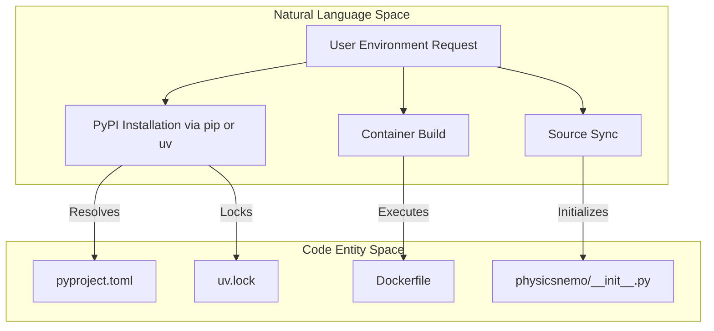
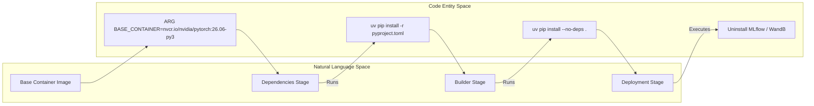
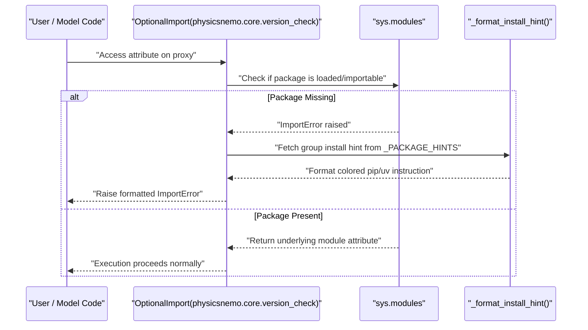

<!-- source: DeepWiki mcp.deepwiki.com · repo NVIDIA/physicsnemo · page 1.1 Installation and Setup · fetched 2026-11-04 -->

# Installation and Setup

<details>
<summary>Relevant source files</summary>

The following files were used as context for generating this wiki page:

- [.gitignore](.gitignore)
- [CHANGELOG.md](CHANGELOG.md)
- [Dockerfile](Dockerfile)
- [Makefile](Makefile)
- [deps/README.md](deps/README.md)
- [docker/install-container-dependencies.sh](docker/install-container-dependencies.sh)
- [docs/img/inverse_pinn_sample_points.png](docs/img/inverse_pinn_sample_points.png)
- [examples/cfd/darcy_physics_informed/README.md](examples/cfd/darcy_physics_informed/README.md)
- [examples/cfd/external_aerodynamics/domino_nim_finetuning/README.md](examples/cfd/external_aerodynamics/domino_nim_finetuning/README.md)
- [examples/cfd/inverse_pinns/README.md](examples/cfd/inverse_pinns/README.md)
- [examples/cfd/inverse_pinns/config.yaml](examples/cfd/inverse_pinns/config.yaml)
- [examples/cfd/inverse_pinns/train_inverse_pinn.py](examples/cfd/inverse_pinns/train_inverse_pinn.py)
- [examples/cfd/ldc_pinns/README.md](examples/cfd/ldc_pinns/README.md)
- [examples/cfd/mhd_pino/README.md](examples/cfd/mhd_pino/README.md)
- [examples/cfd/mhd_pino/losses/loss_mhd_physicsnemo.py](examples/cfd/mhd_pino/losses/loss_mhd_physicsnemo.py)
- [examples/cfd/mhd_pino/losses/loss_mhd_vec_pot_physicsnemo.py](examples/cfd/mhd_pino/losses/loss_mhd_vec_pot_physicsnemo.py)
- [examples/cfd/mhd_pino/utils/plot_utils.py](examples/cfd/mhd_pino/utils/plot_utils.py)
- [examples/cfd/swe_nonlinear_pino/README.md](examples/cfd/swe_nonlinear_pino/README.md)
- [examples/cfd/swe_nonlinear_pino/train_swe_nl_pino.py](examples/cfd/swe_nonlinear_pino/train_swe_nl_pino.py)
- [examples/cfd/swe_nonlinear_pino/train_utils/plot.py](examples/cfd/swe_nonlinear_pino/train_utils/plot.py)
- [examples/cfd/swe_nonlinear_pino/train_utils/utils.py](examples/cfd/swe_nonlinear_pino/train_utils/utils.py)
- [physicsnemo/__init__.py](physicsnemo/__init__.py)
- [physicsnemo/core/version_check.py](physicsnemo/core/version_check.py)
- [pyproject.toml](pyproject.toml)
- [test/ci_tests/prevent_untracked_imports.py](test/ci_tests/prevent_untracked_imports.py)
- [test/core/test_version_check.py](test/core/test_version_check.py)
- [test/nn/functional/test_natten.py](test/nn/functional/test_natten.py)
- [uv.lock](uv.lock)
- [v2.0-MIGRATION-GUIDE.md](v2.0-MIGRATION-GUIDE.md)

</details>


## Purpose and Scope

This page covers the installation and setup procedures for PhysicsNeMo v2.0+, including installation via PyPI (`pip`/`uv`), Docker containers, and source builds [v2.0-MIGRATION-GUIDE.md:4-8](). It details `pyproject.toml` dependency and extras groups [pyproject.toml:68-81](), lockfile handling via `uv.lock` [uv.lock:1-4](), the lazy-loading implementation using `OptionalImport` in `physicsnemo/core/version_check.py` [physicsnemo/core/version_check.py:25-39](), cross-platform support [v2.0-MIGRATION-GUIDE.md:12-16](), and the v2.0 migration path and compatibility layer [v2.0-MIGRATION-GUIDE.md:47-73]().

Sources: [v2.0-MIGRATION-GUIDE.md:4-8](), [pyproject.toml:68-81](), [uv.lock:1-4](), [physicsnemo/core/version_check.py:25-39]()

---

## Installation Methods Overview

PhysicsNeMo supports three primary installation workflows. The framework recommends `uv` for local development and dependency resolution [v2.0-MIGRATION-GUIDE.md:12-24]().

Title: Installation Workflows and Code Entity Mapping


Sources: [v2.0-MIGRATION-GUIDE.md:12-27](), [pyproject.toml:1-53](), [Dockerfile:1-30]()

---

## PyPI and UV Installation & Extras Groups

PhysicsNeMo is published on PyPI as `nvidia-physicsnemo` and specifies Python compatibility via `requires-python = ">=3.11,<3.15"` [pyproject.toml:5-13](). 

### Dependency Groups and Extras

The project uses `pyproject.toml` to declare core dependencies (such as `torch>=2.10.0`, `warp-lang>=1.14.0`, and `tensordict[zarr]>=0.14.0`) [pyproject.toml:23-52]() alongside conflicting and optional extras managed by `uv` [pyproject.toml:66-81]().

| Extra Name | Purpose | Associated Code / Packages |
|------------|---------|----------------------------|
| `cu12` | CUDA 12.8 Backend Support | `torch` (cu128), `cuml-cu12`, `cupy-cuda12x` [pyproject.toml:108-111,138,146]() |
| `cu13` | CUDA 13.0 Backend Support | `torch` (cu130), `cuml-cu13`, `cupy-cuda13x` [pyproject.toml:99-102,139,145]() |
| `natten-cu12` / `natten-cu13` | Neighborhood Attention extension wheels | `natten` pre-built wheels via flat indexes [pyproject.toml:120-130,153-156]() |
| `transformer-engine-cu12` | Transformer Engine integration | `transformer-engine-torch` [pyproject.toml:78-80,168-178]() |

```bash
# Basic installation via uv
uv pip install nvidia-physicsnemo

# Installation with specific CUDA backend and extras
uv pip install "nvidia-physicsnemo[cu13,gnns]"
```

Sources: [pyproject.toml:13-81](), [uv.lock:1-16]()

---

## Docker Container and Platform Support

The official container images are structured using a multi-stage `Dockerfile` (`dependencies` -> `builder` -> `deploy` / `ci`) [Dockerfile:19-29]().

### Multi-Stage Build Architecture

Title: Docker Build Stages and Package Flow


### Platform Compatibility
- **Linux:** Native support for x86_64 and ARM64 (aarch64) with platform-specific wheel overrides for packages like `torch_scatter` and `onnxruntime` [Dockerfile:75-92]().
- **Windows:** Supported for x86_64 via `uv` or `pip` [v2.0-MIGRATION-GUIDE.md:12-16]().
- **macOS:** Supported for CPU-only execution; CUDA extras must be omitted [pyproject.toml:136]().

Sources: [Dockerfile:1-150](), [v2.0-MIGRATION-GUIDE.md:12-16]()

---

## Optional Dependencies and Lazy Loading

To avoid heavy upfront imports and hard requirements on optional packages (such as `torch_geometric` or `pyvista`), PhysicsNeMo implements a lazy-loading and version-checking mechanism in `physicsnemo.core.version_check` [physicsnemo/core/version_check.py:19-39]().

### `OptionalImport` Implementation

The `OptionalImport` class delays package resolution until attribute access occurs [physicsnemo/core/version_check.py:25-39](). If the requested module is absent, it formats an install hint referencing `pyproject.toml` extras using `_format_install_hint` [physicsnemo/core/version_check.py:100-157]().

Title: Optional Import Lazy Resolution Flow


Sources: [physicsnemo/core/version_check.py:25-186](), [test/core/test_version_check.py:25-69]()

---

## v2.0 Migration Guide and Compatibility Layer

The v2.0 refactor restructured core modules to prevent circular dependencies and isolate subsystems [v2.0-MIGRATION-GUIDE.md:28-31]().

### Key Structural Changes
1. **Core Abstractions:** `Module` and `Meta` are relocated to `physicsnemo.core` [v2.0-MIGRATION-GUIDE.md:33-34]().
2. **Utilities Reorganization:** `physicsnemo.launch` is removed; logging moves to `physicsnemo.utils.logging` and checkpointing moves to `physicsnemo.utils.checkpoint` [v2.0-MIGRATION-GUIDE.md:35-37]().
3. **Domain Parallelism:** `ShardTensor` is isolated under `physicsnemo.domain_parallel` [v2.0-MIGRATION-GUIDE.md:44-45]().

### Compatibility Layer (`physicsnemo.compat`)

To maintain backwards compatibility for legacy import paths, PhysicsNeMo provides `physicsnemo.compat` which maps deprecated module paths inside `sys.modules` [v2.0-MIGRATION-GUIDE.md:47-56]().

```python
# Enable compatibility mode via environment variable:
# export PHYSICSNEMO_ENABLE_COMPAT=1

# Or programmatically:
from physicsnemo.compat import install
install()
```

Sources: [physicsnemo/__init__.py:30-42](), [v2.0-MIGRATION-GUIDE.md:28-73]()

---

