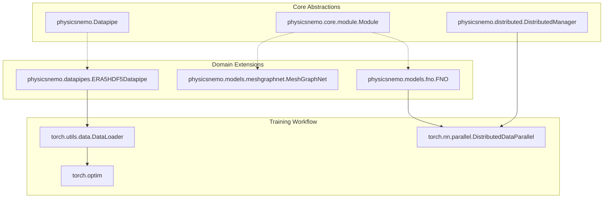
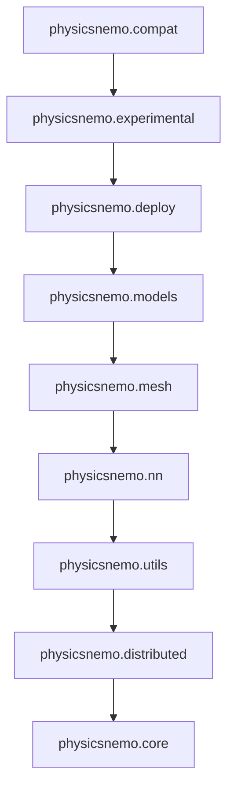
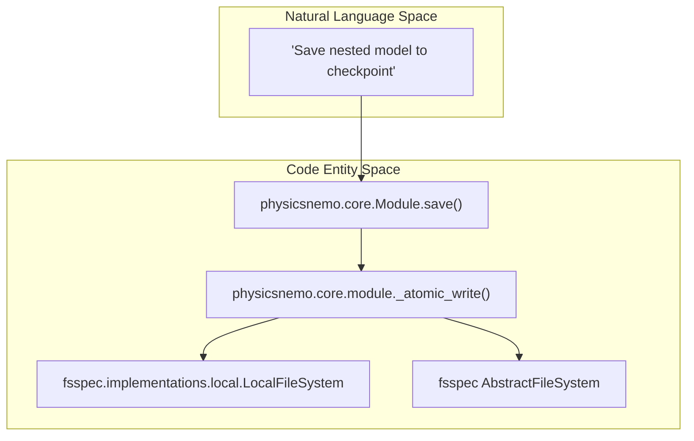
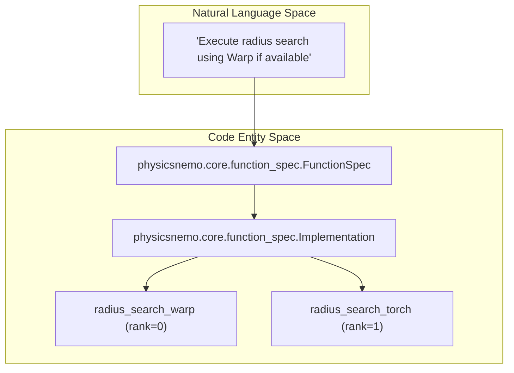

<!-- source: DeepWiki mcp.deepwiki.com · repo NVIDIA/physicsnemo · page 1.2 Core Architecture · fetched 2026-11-04 -->

# Core Architecture

Relevant source files

The following files were used as context for generating this wiki page:

- [.importlinter](.importlinter)
- [docs/api/diffusion/noise_schedulers.rst](docs/api/diffusion/noise_schedulers.rst)
- [docs/img/nn/functional/geometry/mesh_poisson_disk_sample/mesh_poisson_modes.gif](docs/img/nn/functional/geometry/mesh_poisson_disk_sample/mesh_poisson_modes.gif)
- [docs/img/nn/functional/geometry/mesh_to_voxel_fraction/mesh_to_voxel_rotation.gif](docs/img/nn/functional/geometry/mesh_to_voxel_fraction/mesh_to_voxel_rotation.gif)
- [docs/img/nn/functional/geometry/sdf/sdf_slice_overview.png](docs/img/nn/functional/geometry/sdf/sdf_slice_overview.png)
- [docs/img/nn/functional/geometry/sdf/sdf_slice_sweep.gif](docs/img/nn/functional/geometry/sdf/sdf_slice_sweep.gif)
- [physicsnemo/core/function_spec.py](physicsnemo/core/function_spec.py)
- [physicsnemo/core/module.py](physicsnemo/core/module.py)
- [physicsnemo/core/registry.py](physicsnemo/core/registry.py)
- [physicsnemo/diffusion/__init__.py](physicsnemo/diffusion/__init__.py)
- [physicsnemo/diffusion/base.py](physicsnemo/diffusion/base.py)
- [physicsnemo/diffusion/metrics/__init__.py](physicsnemo/diffusion/metrics/__init__.py)
- [physicsnemo/diffusion/metrics/losses.py](physicsnemo/diffusion/metrics/losses.py)
- [physicsnemo/diffusion/noise_schedulers/__init__.py](physicsnemo/diffusion/noise_schedulers/__init__.py)
- [physicsnemo/diffusion/noise_schedulers/domain_parallel.py](physicsnemo/diffusion/noise_schedulers/domain_parallel.py)
- [physicsnemo/diffusion/noise_schedulers/noise_schedulers.py](physicsnemo/diffusion/noise_schedulers/noise_schedulers.py)
- [physicsnemo/diffusion/preconditioners/preconditioners.py](physicsnemo/diffusion/preconditioners/preconditioners.py)
- [physicsnemo/diffusion/samplers/__init__.py](physicsnemo/diffusion/samplers/__init__.py)
- [physicsnemo/diffusion/samplers/samplers.py](physicsnemo/diffusion/samplers/samplers.py)
- [physicsnemo/diffusion/samplers/solvers.py](physicsnemo/diffusion/samplers/solvers.py)
- [physicsnemo/diffusion/utils/__init__.py](physicsnemo/diffusion/utils/__init__.py)
- [physicsnemo/diffusion/utils/model_wrappers.py](physicsnemo/diffusion/utils/model_wrappers.py)
- [physicsnemo/models/mlp/fully_connected.py](physicsnemo/models/mlp/fully_connected.py)
- [physicsnemo/models/unet/unet.py](physicsnemo/models/unet/unet.py)
- [physicsnemo/nn/functional/derivatives/mesh_green_gauss_gradient/_warp_impl.py](physicsnemo/nn/functional/derivatives/mesh_green_gauss_gradient/_warp_impl.py)
- [physicsnemo/nn/functional/derivatives/mesh_lsq_gradient/_warp_impl.py](physicsnemo/nn/functional/derivatives/mesh_lsq_gradient/_warp_impl.py)
- [physicsnemo/nn/functional/derivatives/uniform_grid_gradient/_warp_impl/utils.py](physicsnemo/nn/functional/derivatives/uniform_grid_gradient/_warp_impl/utils.py)
- [physicsnemo/nn/functional/geometry/farthest_point_sampling/_warp_impl.py](physicsnemo/nn/functional/geometry/farthest_point_sampling/_warp_impl.py)
- [physicsnemo/nn/functional/geometry/mesh_poisson_disk_sample/__init__.py](physicsnemo/nn/functional/geometry/mesh_poisson_disk_sample/__init__.py)
- [physicsnemo/nn/functional/geometry/mesh_poisson_disk_sample/_warp_impl/__init__.py](physicsnemo/nn/functional/geometry/mesh_poisson_disk_sample/_warp_impl/__init__.py)
- [physicsnemo/nn/functional/geometry/mesh_poisson_disk_sample/_warp_impl/_kernels.py](physicsnemo/nn/functional/geometry/mesh_poisson_disk_sample/_warp_impl/_kernels.py)
- [physicsnemo/nn/functional/geometry/mesh_poisson_disk_sample/_warp_impl/op.py](physicsnemo/nn/functional/geometry/mesh_poisson_disk_sample/_warp_impl/op.py)
- [physicsnemo/nn/functional/geometry/mesh_to_voxel_fraction/_warp_impl/op.py](physicsnemo/nn/functional/geometry/mesh_to_voxel_fraction/_warp_impl/op.py)
- [physicsnemo/nn/functional/neighbors/radius_search/_warp_impl.py](physicsnemo/nn/functional/neighbors/radius_search/_warp_impl.py)
- [physicsnemo/nn/module/mlp_layers.py](physicsnemo/nn/module/mlp_layers.py)
- [test/ci_tests/header_check.py](test/ci_tests/header_check.py)
- [test/core/test_function_spec.py](test/core/test_function_spec.py)
- [test/core/test_module_nested.py](test/core/test_module_nested.py)
- [test/diffusion/test_wrappers.py](test/diffusion/test_wrappers.py)
- [test/models/mlp/test_fully_connected.py](test/models/mlp/test_fully_connected.py)
- [test/models/unet/test_unet.py](test/models/unet/test_unet.py)
- [test/nn/module/test_mlp_layers.py](test/nn/module/test_mlp_layers.py)

## Purpose and Scope
This page details the core architecture of PhysicsNeMo, focusing on the foundational abstractions that govern model lifecycles, execution, data pipelines, distributed coordination, and code organization. It outlines the implementation of `physicsnemo.core.Module`, the `FunctionSpec` multi-backend dispatch system, utility modules in `physicsnemo.core`, the compatibility layer, and the strict import-layer contracts enforced by `.importlinter`.

---

## Architectural Overview

PhysicsNeMo's architecture is structured around three foundational abstractions that manage the execution lifecycle, data ingestion, and multi-GPU coordination:

1. **`Module` (`physicsnemo.core.Module`)**: Extends `torch.nn.Module` to provide argument serialization, nested module composition, atomic checkpointing, and model metadata management `[physicsnemo/core/module.py:123-145]()`.
2. **`Datapipe` (`physicsnemo.Datapipe`)**: Manages domain-specific data loading, transforms, and parallel batch generation.
3. **`DistributedManager` (`physicsnemo.distributed.DistributedManager`)**: Coordinates process groups, device meshes, and multi-node training topologies across PyTorch, Slurm, and OpenMPI.

**Diagram: Three Core Abstractions**

Sources: [.importlinter:1-28](), [physicsnemo/core/module.py:123-145]()

---

## The Import-Layer Contract (`.importlinter`)

To prevent circular dependencies and enforce strict architectural layering, PhysicsNeMo uses `import-linter` configured via `.importlinter`. The contract specifies that core abstractions remain independent of models, datasets, and high-level applications, flowing strictly from bottom-level utilities up to application recipes.

**Diagram: Layer Dependency Hierarchy**

Sources: [.importlinter:8-40]()

The internal layers of `physicsnemo.core` are strictly ordered as follows:
- `module` (top layer)
- `registry`, `meta`, `function_spec`
- `warnings`, `version_check`, `filesystem` (bottom layer)

Sources: [.importlinter:29-39]()

---

## Module: Model Lifecycle Management

All neural network models in PhysicsNeMo inherit from `physicsnemo.core.Module`, which replaces `torch.nn.Module` and adds capabilities for serialization, metadata tracking via `ModelMetaData`, and automatic factory registration `[physicsnemo/core/module.py:123-145]`.

### Core Implementation Details
- **JSON-Serializable Arguments**: Models must accept JSON-serializable arguments in their `__init__` constructor (with the exception of nested `physicsnemo.Module` or `torch.nn.Module` converted via `Module.from_torch`) `[physicsnemo/core/module.py:130-144]()`.
- **Atomic Serialization**: Checkpoints are written safely via the `_atomic_write` context manager, which writes to a temporary sibling file (`<file_name>.tmp-*`) before replacing the destination atomically using `os.replace` (local) or `fs.mv` (remote fsspec) `[physicsnemo/core/module.py:75-106]()`.
- **State Dictionary Logging**: Loading state dictionaries logs missing and unexpected keys automatically via `_load_state_dict_with_logging` `[physicsnemo/core/module.py:49-72]()`.

**Diagram: Natural Language Space to Module Lifecycle**

Sources: [physicsnemo/core/module.py:75-106](), [physicsnemo/core/module.py:123-171]()

Sources: [physicsnemo/core/module.py:46-171]()

---

## FunctionSpec System and Backend Dispatch

The `FunctionSpec` class (`physicsnemo.core.function_spec.FunctionSpec`) manages operations with multiple backend implementations (such as Warp, PyTorch, cuML, and SciPy), providing a unified interface for dispatch, parity testing, and benchmarking `[physicsnemo/core/function_spec.py:66-114]()`.

### Implementation and Selection
- **`Implementation` Dataclass**: Stores metadata for each backend variant, including `name`, `func`, `required_imports`, `rank` (lower rank indicates higher preference), and `baseline` flags `[physicsnemo/core/function_spec.py:36-64]()`.
- **Dynamic Dispatch**: At runtime, `FunctionSpec` evaluates `required_imports` (e.g., `"warp>=0.6.0"`) and selects the lowest-rank available implementation `[physicsnemo/core/function_spec.py:106-113]()`.

**Diagram: Natural Language Space to FunctionSpec Dispatch**

Sources: [physicsnemo/core/function_spec.py:36-114](), [physicsnemo/nn/functional/neighbors/radius_search/_warp_impl.py:187-190]()

Sources: [physicsnemo/core/function_spec.py:34-114]()

---

## Core Utilities (`physicsnemo.core`)

The `physicsnemo.core` package contains foundational helper subsystems that support the module and functional layers:
- **`ModelRegistry` (`physicsnemo.core.registry.ModelRegistry`)**: A singleton handling model discovery, entry points, auto-registration from `pyproject.toml`, and factory instantiation `[physicsnemo/core/module.py:42-43]()`.
- **`ModelMetaData` (`physicsnemo.core.meta.ModelMetaData`)**: A dataclass tracking optimization flags (`jit`, `cuda_graphs`, `amp_gpu`, `onnx`, etc.) associated with a `Module` `[physicsnemo/core/module.py:41-149]()`.
- **`version_check` (`physicsnemo.core.version_check`)**: Provides `OptionalImport` and `check_version_spec` for safe, lazy loading of optional external dependencies like `transformer_engine` or `warp` `[physicsnemo/models/unet/unet.py:29-37]()`.
- **`filesystem` (`physicsnemo.core.filesystem`)**: Manages remote and local file system interactions (`_download_cached`, `_get_fs`) for weights and configuration files `[physicsnemo/core/module.py:40-41]()`.

Sources: [physicsnemo/core/module.py:40-43](), [physicsnemo/models/unet/unet.py:29-37]()

---

## The Compatibility Layer (`physicsnemo.compat`)

The `physicsnemo.compat` namespace preserves backward compatibility for legacy checkpoints, configuration structures, and refactored module paths. For instance, when former monolithic modules (such as noise schedulers) are split into individual files, compatibility shims emit deprecation warnings and forward imports to their new locations `[physicsnemo/diffusion/noise_schedulers/noise_schedulers.py:17-41]()`.

Sources: [.importlinter:13-19](), [physicsnemo/diffusion/noise_schedulers/noise_schedulers.py:17-41]()

---

