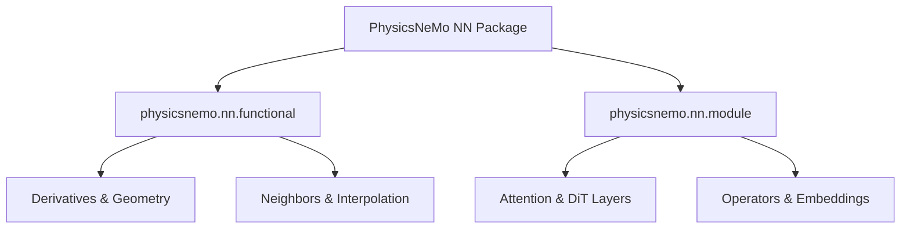
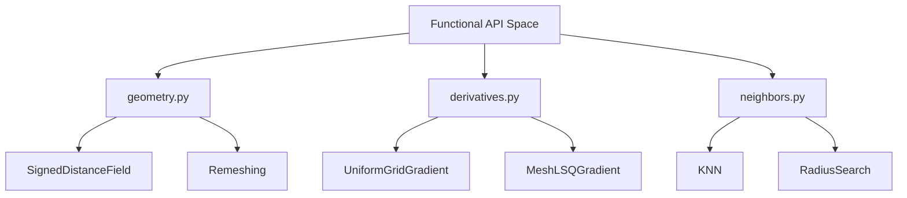
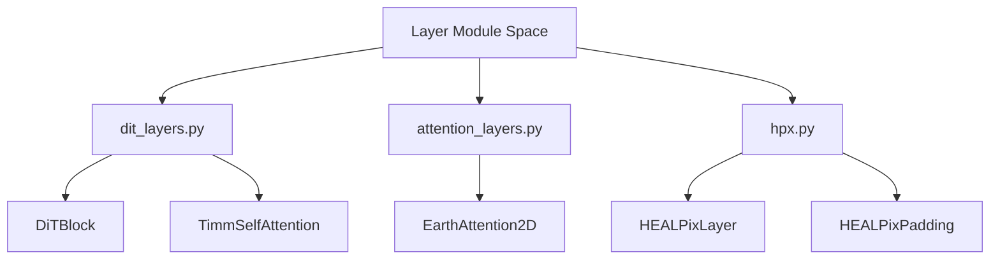

<!-- source: DeepWiki mcp.deepwiki.com · repo NVIDIA/physicsnemo · page 1.3 Neural Network Primitives (physicsnemo.nn) · fetched 2026-11-04 -->

# Neural Network Primitives (physicsnemo.nn)

Relevant source files

The following files were used as context for generating this wiki page:

- [benchmarks/physicsnemo/nn/functional/registry.py](benchmarks/physicsnemo/nn/functional/registry.py)
- [docs/api/mesh/transformations.rst](docs/api/mesh/transformations.rst)
- [docs/api/nn/functionals/geometry.rst](docs/api/nn/functionals/geometry.rst)
- [docs/api/nn/functionals/normalization.rst](docs/api/nn/functionals/normalization.rst)
- [docs/api/nn/layers/rope.rst](docs/api/nn/layers/rope.rst)
- [docs/api/physicsnemo.nn.functionals.rst](docs/api/physicsnemo.nn.functionals.rst)
- [docs/api/physicsnemo.nn.layers.rst](docs/api/physicsnemo.nn.layers.rst)
- [physicsnemo/mesh/README.md](physicsnemo/mesh/README.md)
- [physicsnemo/mesh/geometry/_cell_normals.py](physicsnemo/mesh/geometry/_cell_normals.py)
- [physicsnemo/mesh/remeshing/_partition.py](physicsnemo/mesh/remeshing/_partition.py)
- [physicsnemo/mesh/transformations/deform/__init__.py](physicsnemo/mesh/transformations/deform/__init__.py)
- [physicsnemo/models/dit/dit.py](physicsnemo/models/dit/dit.py)
- [physicsnemo/nn/__init__.py](physicsnemo/nn/__init__.py)
- [physicsnemo/nn/functional/__init__.py](physicsnemo/nn/functional/__init__.py)
- [physicsnemo/nn/functional/geometry/__init__.py](physicsnemo/nn/functional/geometry/__init__.py)
- [physicsnemo/nn/functional/geometry/deform/__init__.py](physicsnemo/nn/functional/geometry/deform/__init__.py)
- [physicsnemo/nn/functional/geometry/deform/_warp_impl/__init__.py](physicsnemo/nn/functional/geometry/deform/_warp_impl/__init__.py)
- [physicsnemo/nn/functional/normalization.py](physicsnemo/nn/functional/normalization.py)
- [physicsnemo/nn/module/__init__.py](physicsnemo/nn/module/__init__.py)
- [physicsnemo/nn/module/dit_layers.py](physicsnemo/nn/module/dit_layers.py)
- [physicsnemo/nn/module/rope.py](physicsnemo/nn/module/rope.py)
- [test/mesh/geometry/test_cell_normals.py](test/mesh/geometry/test_cell_normals.py)
- [test/mesh/remeshing/test_partition.py](test/mesh/remeshing/test_partition.py)
- [test/models/dit/test_dit.py](test/models/dit/test_dit.py)
- [test/nn/module/test_dit_layers.py](test/nn/module/test_dit_layers.py)
- [test/nn/module/test_rope.py](test/nn/module/test_rope.py)

The `physicsnemo.nn` package provides foundational, high-performance neural network primitives designed for physics-informed modeling, scientific machine learning, and spatial computing. It bridges raw tensor computations with domain-specific architectures by splitting functionality into two core sub-packages: stateless, GPU-accelerated functionals (`physicsnemo.nn.functional`) and reusable, stateful layer modules (`physicsnemo.nn.module`) [physicsnemo/nn/__init__.py:1-172, physicsnemo/nn/functional/__init__.py:1-144]().

---

## Package Architecture and Overview

The `physicsnemo.nn` package abstracts lower-level hardware execution details, enabling seamless execution across PyTorch and Warp backends. Functionals expose stateless operations (such as differential operators, spatial queries, and geometric transforms) that can be embedded directly into custom loss functions, data preprocessing pipelines, or training loops. Conversely, layer modules encapsulate learnable parameters and follow standard PyTorch container semantics (`nn.Module`), integrating directly into PhysicsNeMo's model zoo.

*Figure 1: High-level organization of `physicsnemo.nn` primitives linking functional specifications to modular neural network layers.*

Sources: `physicsnemo/nn/__init__.py:1-172`, `physicsnemo/nn/functional/__init__.py:1-144`

---

## Functional API (`physicsnemo.nn.functional`)

The functional subsystem supplies stateless routines for spatial geometry, numerical differentiation, spectral transforms, and spatial indexing. These primitives are registered within a unified `FunctionSpec` framework that standardizes input generation, forward execution, and benchmarking via Automated Speed Variations (ASV) [benchmarks/physicsnemo/nn/functional/registry.py:17-117]().

*Mapping functional domains to their underlying python modules and classes.*

For comprehensive details on differential operators, geometric transformations (SDF, deformation, sampling, remeshing), neighbor search routines (`knn`, `radius_search`), spectral methods, and backend execution patterns, see the child page:
- **[Functional API (physicsnemo.nn.functional)](#1.3.1)**

Sources: `physicsnemo/nn/functional/__init__.py:1-144`, `benchmarks/physicsnemo/nn/functional/registry.py:17-117`

---

## Layer Modules (`physicsnemo.nn.module`)

The layer module subsystem delivers stateful building blocks optimized for physical simulations, weather forecasting, and generative modeling. This includes advanced attention backends (such as physics-attention, GALE, point transformers, and FLARE attention), Diffusion Transformer (`DiT`) components, rotary position embeddings (`RoPE`), Fourier neural operators (`FNO`, `AFNO`), HEALPix grid layers, and specialized normalization and activation functions [physicsnemo/nn/__init__.py:20-172, physicsnemo/nn/module/dit_layers.py:48-152]().

*Mapping architectural layers and attention backends to their respective module implementations.*

For full technical specifications on neural operator layers, diffusion transformers, attention routing mechanisms, activation functions, and weight initialization strategies, see the child page:
- **[Layer Modules (physicsnemo.nn.module)](#1.3.2)**

Sources: `physicsnemo/nn/__init__.py:20-172`, `physicsnemo/nn/module/dit_layers.py:48-152`

---

