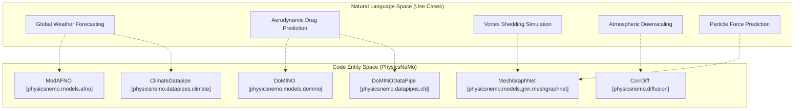
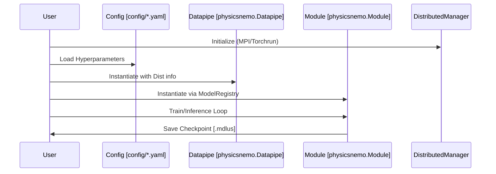

<!-- source: DeepWiki mcp.deepwiki.com · repo NVIDIA/physicsnemo · page 11 Application Examples · fetched 2026-11-04 -->

# Application Examples

Relevant source files

The following files were used as context for generating this wiki page:

- [docs/Makefile](docs/Makefile)
- [docs/examples_weather.rst](docs/examples_weather.rst)
- [docs/img/kmc_energy_rollout.gif](docs/img/kmc_energy_rollout.gif)
- [docs/img/lj_system_physicsnemo_results.png](docs/img/lj_system_physicsnemo_results.png)
- [docs/index.rst](docs/index.rst)
- [examples/README.md](examples/README.md)
- [examples/cfd/gray_scott_rnn/README.md](examples/cfd/gray_scott_rnn/README.md)
- [examples/cfd/gray_scott_rnn/requirements.txt](examples/cfd/gray_scott_rnn/requirements.txt)
- [examples/cfd/navier_stokes_rnn/README.md](examples/cfd/navier_stokes_rnn/README.md)
- [examples/cfd/navier_stokes_rnn/requirements.txt](examples/cfd/navier_stokes_rnn/requirements.txt)
- [examples/cfd/stokes_mgn/README.md](examples/cfd/stokes_mgn/README.md)
- [examples/cfd/stokes_mgn/requirements.txt](examples/cfd/stokes_mgn/requirements.txt)
- [examples/cfd/swe_nonlinear_pino/requirements.txt](examples/cfd/swe_nonlinear_pino/requirements.txt)
- [examples/generative/stormcast/README.md](examples/generative/stormcast/README.md)
- [examples/geophysics/diffusion_fwi/README.md](examples/geophysics/diffusion_fwi/README.md)
- [examples/kinetic_monte_carlo/README.md](examples/kinetic_monte_carlo/README.md)
- [examples/kinetic_monte_carlo/compute_stats.py](examples/kinetic_monte_carlo/compute_stats.py)
- [examples/kinetic_monte_carlo/conf/config_compute_stats.yaml](examples/kinetic_monte_carlo/conf/config_compute_stats.yaml)
- [examples/kinetic_monte_carlo/conf/config_generate.yaml](examples/kinetic_monte_carlo/conf/config_generate.yaml)
- [examples/kinetic_monte_carlo/conf/config_train.yaml](examples/kinetic_monte_carlo/conf/config_train.yaml)
- [examples/kinetic_monte_carlo/dataset/__init__.py](examples/kinetic_monte_carlo/dataset/__init__.py)
- [examples/kinetic_monte_carlo/dataset/dataset.py](examples/kinetic_monte_carlo/dataset/dataset.py)
- [examples/kinetic_monte_carlo/generate.py](examples/kinetic_monte_carlo/generate.py)
- [examples/molecular_dynamics/lennard_jones/README.md](examples/molecular_dynamics/lennard_jones/README.md)
- [examples/molecular_dynamics/lennard_jones/conf/config.yaml](examples/molecular_dynamics/lennard_jones/conf/config.yaml)
- [examples/molecular_dynamics/lennard_jones/lennard_jones_system.py](examples/molecular_dynamics/lennard_jones/lennard_jones_system.py)
- [examples/molecular_dynamics/lennard_jones/requirements.txt](examples/molecular_dynamics/lennard_jones/requirements.txt)
- [examples/molecular_dynamics/lennard_jones/utils.py](examples/molecular_dynamics/lennard_jones/utils.py)
- [examples/weather/regional_weather_diffusion/.gitignore](examples/weather/regional_weather_diffusion/.gitignore)

This page provides a high-level overview of the end-to-end application examples included in the PhysicsNeMo repository. These examples demonstrate how to compose `physicsnemo.Module` architectures with domain-specific `physicsnemo.Datapipe` implementations to solve real-world physics-ML problems.

For deep technical details, implementation walkthroughs, and execution instructions, please refer to the specific child pages linked in each section.

## Domain Overview

PhysicsNeMo applications are categorized by scientific domain, ranging from global weather forecasting to micro-scale molecular dynamics.

Sources: [examples/README.md:12-102](), [examples/molecular_dynamics/lennard_jones/lennard_jones_system.py:27-32]()

## Weather and Climate

PhysicsNeMo provides a comprehensive suite of examples for atmospheric modeling, covering medium-range global forecasting, regional convection-allowing models, and generative downscaling.

*   **FCN-AFNO & SFNO**: Baseline models for global forecasting using Adaptive Fourier Neural Operators [examples/README.md:18-18]().
*   **CorrDiff**: A generative diffusion pipeline for kilometer-scale atmospheric downscaling, combining regression and diffusion steps [examples/README.md:69-69]().
*   **StormCast**: High-resolution regional weather emulation using generative diffusion [examples/README.md:70-70]().
*   **Temporal Interpolation**: Increasing temporal resolution (e.g., 6h to 1h) using `ModAFNO` [examples/README.md:74-74]().

For details, see [Weather and Climate](#11.1).

Sources: [examples/README.md:18-74]()

## Computational Fluid Dynamics (CFD)

CFD examples demonstrate the use of Neural Operators and Graph Neural Networks (GNNs) for simulating fluid flow across structured grids and unstructured meshes, as well as physics-informed fine-tuning.

*   **MeshGraphNet (MGN)**: Applied to vortex shedding [examples/README.md:17-17]() and Lagrangian fluid flow [examples/README.md:19-19]().
*   **DoMINO**: Used for external aerodynamics and drag prediction on complex geometries [examples/README.md:36-36]().
*   **Physics-Informed MGN**: A hybrid approach where a data-driven `MeshGraphNet` is fine-tuned using physics-based constraints (e.g., Stokes flow via `physicsnemo.sym`) [examples/cfd/stokes_mgn/README.md:1-9]().
*   **Neural Operators**: FNO and PINO implementations for Darcy flow, Magnetohydrodynamics, and Shallow Water Equations [examples/README.md:41-45]().

For details, see [Computational Fluid Dynamics](#11.2).

Sources: [examples/README.md:17-45](), [examples/cfd/stokes_mgn/README.md:1-9]()

## Generative Models

This section focuses on advanced generative workflows, particularly diffusion-based models for super-resolution, ensemble prediction, and inversion problems.

*   **MoWE (Mixture of Weather Experts)**: An ensemble prediction model built on the Diffusion Transformer (`DiT`) architecture [examples/README.md:71-71]().
*   **Flow Reconstruction**: Using Denoising Diffusion Probabilistic Models (`DDPM`) for fluid super-resolution [examples/README.md:48-48]().
*   **ReGen**: Generative data assimilation for sparse weather observations [examples/README.md:72-72]().
*   **Diffusion FWI**: Generative full-waveform inversion for geophysics using acoustic/elastic wave equations [examples/geophysics/diffusion_fwi/README.md:2-22]().

For details, see [Generative Models](#11.3).

Sources: [examples/README.md:48-72](), [examples/geophysics/diffusion_fwi/README.md:2-22]()

## Scientific Domain Examples

PhysicsNeMo extends into various specialized fields of science and engineering, showcasing the flexibility of the `MeshGraphNet` and operator backbones across diverse physical systems.

*   **Structural Mechanics**: Automotive crash dynamics and deforming plate simulations [examples/README.md:76-81]().
*   **Healthcare**: Cardiovascular simulations (`bloodflow_1d_mgn`) and brain anomaly detection (`FNO`) [examples/README.md:83-88]().
*   **Molecular Dynamics**: Force and potential prediction for Lennard-Jones systems using `MeshGraphNet` and nearest-neighbor edge creation [examples/molecular_dynamics/lennard_jones/README.md:1-11]().
*   **Kinetic Monte Carlo**: Probabilistic surrogates for KMC solvers using `GeoTransolver` [examples/README.md:102-106]().

For details, see [Scientific Domain Examples](#11.4).

Sources: [examples/README.md:76-106](), [examples/molecular_dynamics/lennard_jones/README.md:1-11]()

## Minimal Examples and Tutorials

Minimal examples offer introductory pathways for learning core framework concepts without heavy distributed dependencies or large datasets.

*   **Darcy Flow**: Introductory examples for data-driven FNO and physics-informed Darcy flow [examples/README.md:14-15]().
*   **Lid Driven Cavity Flow**: Purely physics-driven training using `physicsnemo.sym` [examples/README.md:16-16]().
*   **Mesh Tutorials and Datapipes**: Foundational notebooks and utility modules demonstrating datapipe pipelines and mesh operations.

For details, see [Minimal Examples and Tutorials](#11.5).

Sources: [examples/README.md:14-16]()

## Common Workflow Pattern

Regardless of the domain, most examples follow a unified execution pattern utilizing the `DistributedManager` and Hydra-based configurations.

Sources: [examples/molecular_dynamics/lennard_jones/lennard_jones_system.py:93-172](), [examples/cfd/stokes_mgn/README.md:116-156]()

### Typical File Structure

Each example typically includes:
1.  `train.py`: The main entry point for distributed training and optimization setup [examples/molecular_dynamics/lennard_jones/lennard_jones_system.py:92-155]().
2.  `conf/`: YAML files managed by Hydra for model hyperparameters and runtime settings [examples/molecular_dynamics/lennard_jones/conf/config.yaml]().
3.  `README.md`: Domain-specific theory, dataset requirements, and execution instructions [examples/molecular_dynamics/lennard_jones/README.md:1-68]().

Sources: [examples/README.md:1-142](), [examples/molecular_dynamics/lennard_jones/lennard_jones_system.py:92-172](), [examples/molecular_dynamics/lennard_jones/README.md:1-68]()

---

