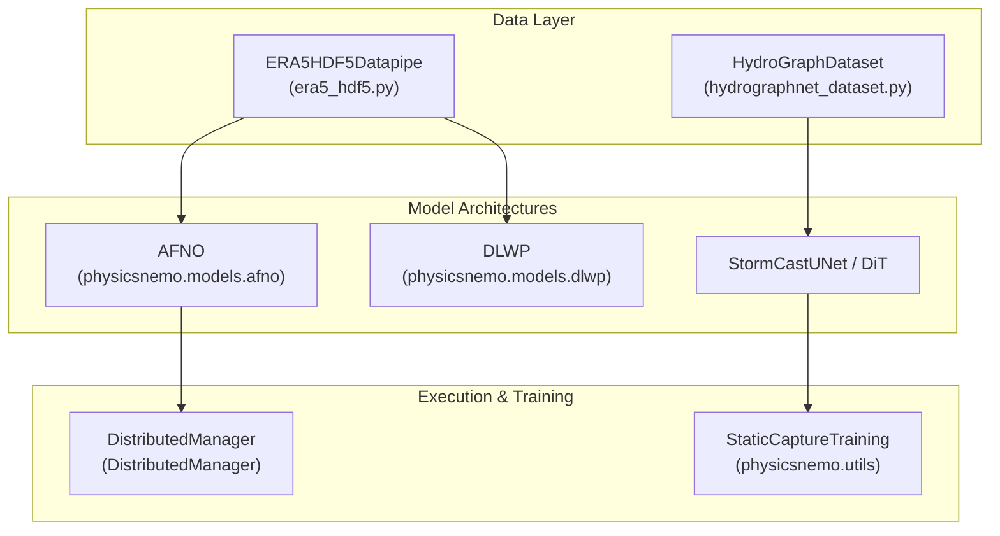
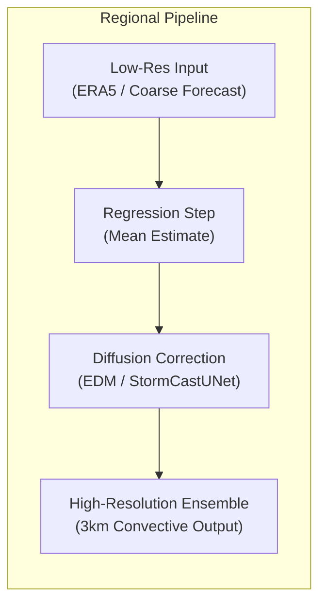
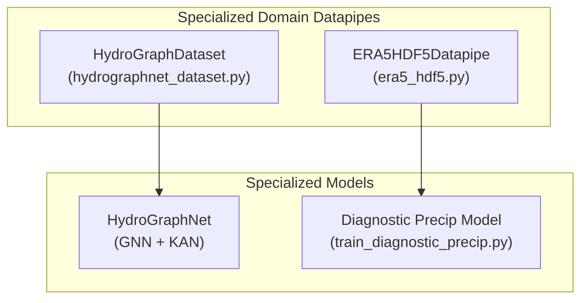

<!-- source: DeepWiki mcp.deepwiki.com · repo NVIDIA/physicsnemo · page 11.1 Weather and Climate · fetched 2026-11-04 -->

# Weather and Climate

Relevant source files

The following files were used as context for generating this wiki page:

- [examples/cfd/darcy_nested_fnos/requirements.txt](examples/cfd/darcy_nested_fnos/requirements.txt)
- [examples/cfd/darcy_transolver/requirements.txt](examples/cfd/darcy_transolver/requirements.txt)
- [examples/cfd/external_aerodynamics/globe/airfrans/requirements.txt](examples/cfd/external_aerodynamics/globe/airfrans/requirements.txt)
- [examples/cfd/external_aerodynamics/globe/drivaer/requirements.txt](examples/cfd/external_aerodynamics/globe/drivaer/requirements.txt)
- [examples/cfd/mhd_pino/requirements.txt](examples/cfd/mhd_pino/requirements.txt)
- [examples/cfd/mhd_pino/train_mhd.py](examples/cfd/mhd_pino/train_mhd.py)
- [examples/cfd/mhd_pino/train_mhd_vec_pot.py](examples/cfd/mhd_pino/train_mhd_vec_pot.py)
- [examples/cfd/mhd_pino/train_mhd_vec_pot_tfno.py](examples/cfd/mhd_pino/train_mhd_vec_pot_tfno.py)
- [examples/reservoir_simulation/xmgn/requirements.txt](examples/reservoir_simulation/xmgn/requirements.txt)
- [examples/weather/diagnostic/train_diagnostic_precip.py](examples/weather/diagnostic/train_diagnostic_precip.py)
- [examples/weather/dlwp/conf/config.yaml](examples/weather/dlwp/conf/config.yaml)
- [examples/weather/dlwp/cube_sphere_plotter_no_subplots.py](examples/weather/dlwp/cube_sphere_plotter_no_subplots.py)
- [examples/weather/dlwp/era5_hdf5.py](examples/weather/dlwp/era5_hdf5.py)
- [examples/weather/dlwp/requirements.txt](examples/weather/dlwp/requirements.txt)
- [examples/weather/dlwp/train_dlwp.py](examples/weather/dlwp/train_dlwp.py)
- [examples/weather/fcn_afno/conf/config.yaml](examples/weather/fcn_afno/conf/config.yaml)
- [examples/weather/fcn_afno/requirements.txt](examples/weather/fcn_afno/requirements.txt)
- [examples/weather/fcn_afno/train_era5.py](examples/weather/fcn_afno/train_era5.py)
- [examples/weather/flood_modeling/hydrographnet/README.md](examples/weather/flood_modeling/hydrographnet/README.md)
- [examples/weather/flood_modeling/hydrographnet/inference.py](examples/weather/flood_modeling/hydrographnet/inference.py)
- [examples/weather/flood_modeling/hydrographnet/requirements.txt](examples/weather/flood_modeling/hydrographnet/requirements.txt)
- [examples/weather/flood_modeling/hydrographnet/train.py](examples/weather/flood_modeling/hydrographnet/train.py)
- [examples/weather/flood_modeling/hydrographnet/utils.py](examples/weather/flood_modeling/hydrographnet/utils.py)
- [examples/weather/pangu_weather/requirements.txt](examples/weather/pangu_weather/requirements.txt)
- [examples/weather/pangu_weather/train_pangu_era5.py](examples/weather/pangu_weather/train_pangu_era5.py)
- [examples/weather/pangu_weather/train_pangu_lite_era5.py](examples/weather/pangu_weather/train_pangu_lite_era5.py)
- [examples/weather/temporal_interpolation/requirements.txt](examples/weather/temporal_interpolation/requirements.txt)
- [examples/weather/unified_recipe/requirements.txt](examples/weather/unified_recipe/requirements.txt)
- [physicsnemo/datapipes/cae/mesh_datapipe.py](physicsnemo/datapipes/cae/mesh_datapipe.py)
- [physicsnemo/datapipes/climate/climate.py](physicsnemo/datapipes/climate/climate.py)
- [physicsnemo/datapipes/climate/era5_hdf5.py](physicsnemo/datapipes/climate/era5_hdf5.py)
- [physicsnemo/datapipes/climate/utils/zenith_angle.py](physicsnemo/datapipes/climate/utils/zenith_angle.py)
- [physicsnemo/datapipes/gnn/hydrographnet_dataset.py](physicsnemo/datapipes/gnn/hydrographnet_dataset.py)
- [physicsnemo/datapipes/gnn/lagrangian_dataset.py](physicsnemo/datapipes/gnn/lagrangian_dataset.py)
- [test/datapipes/test_hydrographnet.py](test/datapipes/test_hydrographnet.py)

This page provides a high-level overview of PhysicsNeMo's applications for weather forecasting, climate modeling, and hydrological extremes. The framework supports global atmospheric reanalysis (e.g., ERA5), regional convection-allowing models (e.g., HRRR), super-resolution correction, and specialized physical simulations such as flood modeling and temporal interpolation.

For detailed walkthroughs and technical deep dives, refer to the child pages:
- **[FCN-AFNO Training on ERA5](#11.1.1)** — Complete walkthrough of global AFNO model training, ERA5 data loading, and distributed setups.
- **[CorrDiff Super-resolution](#11.1.2)** — Generative correction diffusion for atmospheric downscaling, patching, and ensemble generation.
- **[StormCast and Regional Weather Diffusion](#11.1.3)** — High-resolution regional modeling pipelines combining regression and diffusion with domain parallelism.

---

## Big Picture: Weather Modeling Pipeline

PhysicsNeMo unifies weather and climate modeling under a common architecture utilizing specialized datapipes, neural operators, diffusion modules, and distributed trainers. 

**Diagram: Weather & Climate Architecture Mapping**

**Sources:** [examples/weather/fcn_afno/train_era5.py:26-30](), [examples/weather/dlwp/train_dlwp.py:29-32](), [physicsnemo/datapipes/gnn/hydrographnet_dataset.py:48-52]()

---

## Global Weather Forecasting

Global medium-range weather forecasting models map atmospheric states (such as pressure, temperature, and wind vectors at multiple pressure levels) forward in time. PhysicsNeMo provides implementations of state-of-the-art neural operators and cubed-sphere architectures.

- **FCN-AFNO**: Combines Fourier Neural Operators with Vision Transformer patches to enable efficient global medium-range forecasting [examples/weather/fcn_afno/train_era5.py:148-156](). For a complete training guide, see [FCN-AFNO Training on ERA5](#11.1.1).
- **DLWP and SwinRNN**: Implements cubed-sphere and HEALPix-based architectures for spherical weather prediction, incorporating physical constraints like top-of-atmosphere incident solar radiation (`zenith_angle.py`) [examples/weather/dlwp/train_dlwp.py:32-38]().
- **GraphCast & Pangu**: Graph-based and 3D Earth-specific transformer architectures designed for multi-step autoregressive global forecasting.

**Sources:** [examples/weather/fcn_afno/train_era5.py:148-156](), [examples/weather/dlwp/train_dlwp.py:32-38]()

---

## Regional Super-Resolution and Diffusion

Global models typically operate at coarse spatial resolutions (e.g., 0.25 degrees or ~25km). To capture fine-scale meteorological phenomena such as severe thunderstorms and local topography, PhysicsNeMo supplies regional diffusion and super-resolution pipelines.

- **CorrDiff**: Implements a two-stage generative workflow combining a deterministic regression UNet with a generative diffusion model (`EDMPrecondSuperResolution`) to produce high-resolution ensembles [examples/weather/corrdiff/train.py:34-49](). See [CorrDiff Super-resolution](#11.1.2).
- **StormCast and Regional Weather Diffusion**: Emulates kilometer-scale convection-allowing models (like NOAA's HRRR) using domain parallelism and FSDP. See [StormCast and Regional Weather Diffusion](#11.1.3).

**Diagram: Regional Downscaling Workflow**

**Sources:** [examples/weather/corrdiff/train.py:34-49](), [examples/weather/stormcast/README.md:6]()

---

## Specialized Applications: Flood Modeling and Climate Diagnostics

Beyond standard atmospheric forecasting, PhysicsNeMo addresses hydrological extremes, diagnostic precipitation modeling, and temporal interpolation.

- **Flood Modeling (HydroGraphNet)**: Integrates graph neural networks with Kolmogorov–Arnold Networks (KANs) to predict water depth and volume across unstructured river networks [examples/weather/flood_modeling/hydrographnet/README.md:28-43](). The dataset pipeline handles graph construction and automated downloading from repositories (`HydroGraphDataset`) [physicsnemo/datapipes/gnn/hydrographnet_dataset.py:106-116]().
- **Diagnostic Precipitation and HealDA**: Specialized architectures for diagnostic post-processing, data assimilation, and temporal interpolation of sparse meteorological observations.

**Diagram: Specialized Weather and Climate Modules**

**Sources:** [examples/weather/flood_modeling/hydrographnet/README.md:28-43](), [physicsnemo/datapipes/gnn/hydrographnet_dataset.py:106-116]()

---

