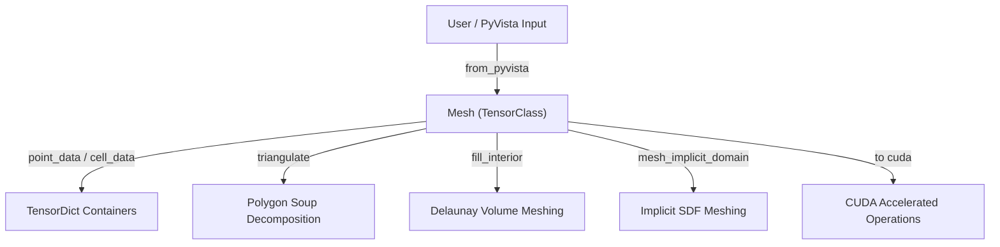
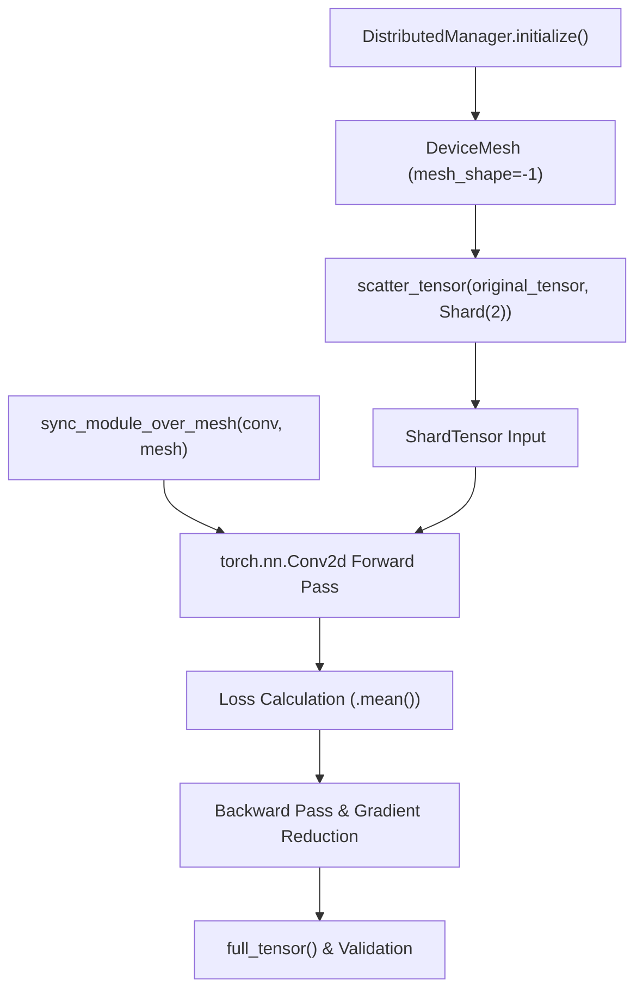
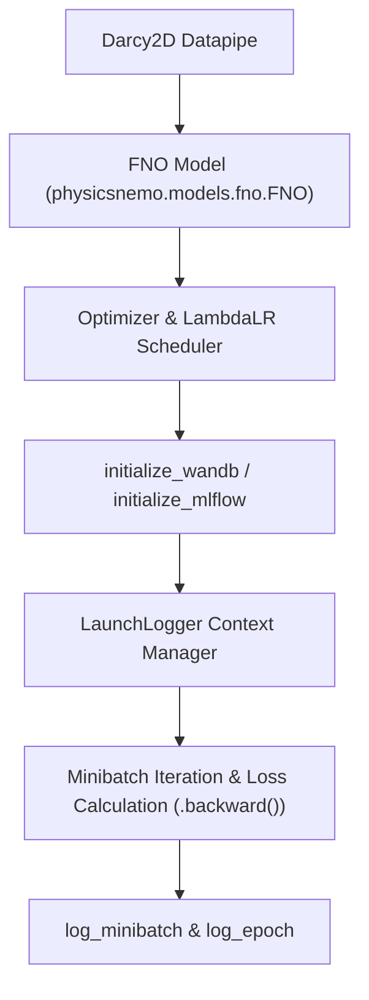

<!-- source: DeepWiki mcp.deepwiki.com · repo NVIDIA/physicsnemo · page 11.5 Minimal Examples and Tutorials · fetched 2026-11-04 -->

# Minimal Examples and Tutorials

Relevant source files

The following files were used as context for generating this wiki page:

- [docs/api/mesh/generate.rst](docs/api/mesh/generate.rst)
- [docs/api/mesh/index.rst](docs/api/mesh/index.rst)
- [docs/api/mesh/tessellation.rst](docs/api/mesh/tessellation.rst)
- [docs/api/physicsnemo.domain_parallel.rst](docs/api/physicsnemo.domain_parallel.rst)
- [docs/test_scripts/domain_parallelism/new_layers/knn_brute_force_ring_sharded.py](docs/test_scripts/domain_parallelism/new_layers/knn_brute_force_ring_sharded.py)
- [docs/test_scripts/domain_parallelism/new_layers/knn_brute_force_sharded.py](docs/test_scripts/domain_parallelism/new_layers/knn_brute_force_sharded.py)
- [docs/test_scripts/domain_parallelism/new_layers/reshape_subtract.py](docs/test_scripts/domain_parallelism/new_layers/reshape_subtract.py)
- [docs/test_scripts/domain_parallelism/new_layers/vector_add_sharded.py](docs/test_scripts/domain_parallelism/new_layers/vector_add_sharded.py)
- [docs/test_scripts/domain_parallelism/new_layers/vector_dot_sharded.py](docs/test_scripts/domain_parallelism/new_layers/vector_dot_sharded.py)
- [docs/test_scripts/domain_parallelism/sharded_conv_example.py](docs/test_scripts/domain_parallelism/sharded_conv_example.py)
- [docs/test_scripts/test_basic.py](docs/test_scripts/test_basic.py)
- [docs/test_scripts/test_basic_checkpointing.py](docs/test_scripts/test_basic_checkpointing.py)
- [docs/test_scripts/test_console_logger.py](docs/test_scripts/test_console_logger.py)
- [docs/test_scripts/test_custom_model_demo_1.py](docs/test_scripts/test_custom_model_demo_1.py)
- [docs/test_scripts/test_mlflow_logger.py](docs/test_scripts/test_mlflow_logger.py)
- [docs/test_scripts/test_simple_distributed.py](docs/test_scripts/test_simple_distributed.py)
- [docs/test_scripts/test_wandb_logger.py](docs/test_scripts/test_wandb_logger.py)
- [examples/minimal/ShardTensorExamples/4_convolution/README.md](examples/minimal/ShardTensorExamples/4_convolution/README.md)
- [examples/minimal/ShardTensorExamples/4_convolution/sharded_conv.py](examples/minimal/ShardTensorExamples/4_convolution/sharded_conv.py)
- [examples/minimal/datapipes/.gitignore](examples/minimal/datapipes/.gitignore)
- [examples/minimal/datapipes/conf/config.yaml](examples/minimal/datapipes/conf/config.yaml)
- [examples/minimal/datapipes/conf/reader/npz.yaml](examples/minimal/datapipes/conf/reader/npz.yaml)
- [examples/minimal/datapipes/conf/reader/tensorstore_zarr.yaml](examples/minimal/datapipes/conf/reader/tensorstore_zarr.yaml)
- [examples/minimal/datapipes/conf/reader/zarr.yaml](examples/minimal/datapipes/conf/reader/zarr.yaml)
- [examples/minimal/datapipes/conf/transforms/normalize.yaml](examples/minimal/datapipes/conf/transforms/normalize.yaml)
- [examples/minimal/datapipes/conf/transforms/subsample.yaml](examples/minimal/datapipes/conf/transforms/subsample.yaml)
- [examples/minimal/datapipes/conf/tutorial_04_pointcloud.yaml](examples/minimal/datapipes/conf/tutorial_04_pointcloud.yaml)
- [examples/minimal/datapipes/generate_regular_data.py](examples/minimal/datapipes/generate_regular_data.py)
- [examples/minimal/datapipes/generate_variable_points_data.py](examples/minimal/datapipes/generate_variable_points_data.py)
- [examples/minimal/datapipes/requirements.txt](examples/minimal/datapipes/requirements.txt)
- [examples/minimal/mesh/README.md](examples/minimal/mesh/README.md)
- [examples/minimal/mesh/tutorial_8_io_interop.ipynb](examples/minimal/mesh/tutorial_8_io_interop.ipynb)
- [examples/minimal/mesh/tutorial_9_mesh_generation.ipynb](examples/minimal/mesh/tutorial_9_mesh_generation.ipynb)
- [physicsnemo/mesh/tessellation/__init__.py](physicsnemo/mesh/tessellation/__init__.py)
- [physicsnemo/mesh/tessellation/delaunay.py](physicsnemo/mesh/tessellation/delaunay.py)
- [physicsnemo/mesh/tessellation/fill_interior.py](physicsnemo/mesh/tessellation/fill_interior.py)
- [test/mesh/tessellation/test_delaunay.py](test/mesh/tessellation/test_delaunay.py)
- [test/mesh/tessellation/test_fill_interior.py](test/mesh/tessellation/test_fill_interior.py)

## Purpose and Scope
This page documents the minimal examples, progressive tutorials, and test scripts located under `examples/minimal/` and `docs/test_scripts/`. These resources provide hands-on onboarding paths for developers and researchers using PhysicsNeMo. The scope covers GPU-accelerated mesh tutorials (`examples/minimal/mesh`), distributed tensor sharding examples (`examples/minimal/ShardTensorExamples`), configuration-driven datapipe tutorials (`examples/minimal/datapipes`), and documentation test scripts validating logging, training loops, and basic model execution (`docs/test_scripts`).

---

## 1. PhysicsNeMo-Mesh Tutorial Series (`examples/minimal/mesh`)

The `examples/minimal/mesh` directory contains nine progressive Jupyter notebooks introducing **PhysicsNeMo-Mesh**, an accelerator-native library for simplicial complexes and spatial data structures [examples/minimal/mesh/README.md:1-201](). 

### Core Data Structure and Abstractions
The central abstractions exposed across the tutorials are:
- `Mesh`: A tensorclass wrapping `points`, `cells`, `point_data`, `cell_data`, and `global_data` inside `TensorDict` containers [docs/api/mesh/index.rst:100-113]().
- `DomainMesh`: A container for complete simulation domains with interior volumes and named boundary patches [examples/minimal/mesh/README.md:158-170]().
- `triangulate`: A vectorized vertex-0 fan and ear-clipping utility that decomposes polygonal cells (polygon soups) into valid simplex connectivity [docs/api/mesh/tessellation.rst:1-12()]().
- `fill_interior`: Constrained Delaunay triangulation combined with Ruppert refinement to generate volume meshes from closed 2D boundary loops [docs/api/mesh/tessellation.rst:62-89]().
- `mesh_implicit_domain`: GPU-native implicit volume meshing from signed distance functions ($\varphi(x) < 0$) [docs/api/mesh/generate.rst:39-58]().

### Tutorial Outline
1. **Getting Started (`tutorial_1_getting_started.ipynb`)**: Explores the 5-field mesh structure, PyVista interop, scalar/vector data attachment, and GPU migration (`.to("cuda")`) [examples/minimal/mesh/README.md:79-92]().
2. **Operations (`tutorial_2_operations.ipynb`)**: Covers geometric transformations, subdivision schemes (Loop, Butterfly), slicing, and manifold validation [examples/minimal/mesh/README.md:93-106]().
3. **Discrete Calculus (`tutorial_3_calculus.ipynb`)**: Focuses on gradients (LSQ/DEC methods), divergence, curl, and Gaussian/mean curvature [examples/minimal/mesh/README.md:107-119]().
4. **Neighbors & Spatial (`tutorial_4_neighbors_spatial.ipynb`)**: Demonstrates topological adjacency, BVH construction, spatial queries, and data interpolation [examples/minimal/mesh/README.md:120-132]().
5. **Quality & Repair (`tutorial_5_quality_repair.ipynb`)**: Assesses element quality metrics and repairs mesh topology [examples/minimal/mesh/README.md:133-144]().
6. **ML Integration (`tutorial_6_ml_integration.ipynb`)**: Integrates meshes into PyTorch production pipelines, batching, and `torch.compile` compatibility [examples/minimal/mesh/README.md:145-157]().
7. **Domain Mesh (`tutorial_7_domain_mesh.ipynb`)**: Builds multi-patch simulation domains using `DomainMesh` [examples/minimal/mesh/README.md:158-170]().
8. **I/O & Serialization (`tutorial_8_io_interop.ipynb`)**: Importers (`from_pyvista`), polygon soup triangulation (`triangulate`), exporters (`to_pyvista`), and memmap serialization (`.pmsh`) [examples/minimal/mesh/README.md:171-184]().
9. **Mesh Generation (`tutorial_9_mesh_generation.ipynb`)**: Boundary filling (`fill_interior`) and implicit domain meshing (`mesh_implicit_domain`, `marching_cubes`) [examples/minimal/mesh/README.md:185-201]().

*Figure 1: Mesh Tutorial Data Flow and Code Entity Mapping.*

Sources: `examples/minimal/mesh/README.md:1-201`, `docs/api/mesh/index.rst:100-146`, `docs/api/mesh/tessellation.rst:1-89`, `docs/api/mesh/generate.rst:39-65`

---

## 2. ShardTensor and Distributed Examples (`examples/minimal/ShardTensorExamples`)

The `ShardTensorExamples` directory illustrates distributed tensor sharding and domain parallelism using PyTorch's `DeviceMesh` and PhysicsNeMo's `ShardTensor` subsystem [examples/minimal/ShardTensorExamples/4_convolution/README.md:1-30]().

### Convolution Sharding Example (`sharded_conv.py`)
The example `examples/minimal/ShardTensorExamples/4_convolution/sharded_conv.py` demonstrates how standard `torch.nn.Module` layers operate transparently on distributed inputs without code modification [examples/minimal/ShardTensorExamples/4_convolution/sharded_conv.py:1-132]().

Key steps in the execution flow:
1. **Initialization**: Initialize `DistributedManager` and construct a 1D `DeviceMesh` via `dm.initialize_mesh()` [examples/minimal/ShardTensorExamples/4_convolution/sharded_conv.py:26-62]().
2. **Data Sharding**: Distribute tensors across process ranks along specific tensor dimensions using `scatter_tensor()` with `Shard()` placements [examples/minimal/ShardTensorExamples/4_convolution/sharded_conv.py:71-86]().
3. **Weight Synchronization**: Broadcast local random weights identically across all ranks using `sync_module_over_mesh()` [examples/minimal/ShardTensorExamples/4_convolution/sharded_conv.py:90-96]().
4. **Forward and Backward**: Execute standard convolutions (`torch.nn.Conv2d`) on `ShardTensor` inputs, triggering automatic placement promotion and gradient reduction during `.backward()` [examples/minimal/ShardTensorExamples/4_convolution/sharded_conv.py:99-103]().
5. **Gather and Verify**: Reconstruct full tensors via `.full_tensor()` and verify numerical parity against single-GPU baselines [examples/minimal/ShardTensorExamples/4_convolution/sharded_conv.py:106-128]().

*Figure 2: ShardTensor Convolution Workflow and Distributed Data Flow.*

Sources: `examples/minimal/ShardTensorExamples/4_convolution/sharded_conv.py:1-133`, `examples/minimal/ShardTensorExamples/4_convolution/README.md:1-31`, `docs/test_scripts/domain_parallelism/sharded_conv_example.py:1-118`

---

## 3. Datapipe Tutorials and Configuration (`examples/minimal/datapipes`)

The `examples/minimal/datapipes` directory provides configuration-driven data loading pipelines utilizing Hydra-style configurations [examples/minimal/datapipes/requirements.txt:1-5](). 

### Configuration Structure
- **Readers (`conf/reader/`)**: Defines readers for NumPy `.npz` archives (`npz.yaml`) and TensorStore/Zarr stores (`tensorstore_zarr.yaml`, `zarr.yaml`) [examples/minimal/datapipes/conf/reader/npz.yaml]().
- **Transforms (`conf/transforms/`)**: Implements composable data augmentations including subsampling (`subsample.yaml`) and normalization (`normalize.yaml`) [examples/minimal/datapipes/conf/transforms/subsample.yaml]().
- **Manifests**: Point cloud and structured grid datapipe configuration files (`conf/tutorial_04_pointcloud.yaml`) [examples/minimal/datapipes/conf/tutorial_04_pointcloud.yaml]().

Sources: `examples/minimal/datapipes/requirements.txt:1-6`, `examples/minimal/datapipes/conf/config.yaml`

---

## 4. Documentation Test Scripts (`docs/test_scripts`)

Scripts in `docs/test_scripts/` serve double-duty as documentation snippets and integration test cases validating logging frameworks, optimizers, and neural operator training loops.

### WandB and MLflow Logging Integration
Scripts `docs/test_scripts/test_wandb_logger.py` and `docs/test_scripts/test_mlflow_logger.py` establish a complete training loop embedding logging hooks [docs/test_scripts/test_wandb_logger.py:1-73](), [docs/test_scripts/test_mlflow_logger.py:1-74]().

*Figure 3: Training Loop and Experiment Tracking Data Flow.*

- **Data Loading**: Initializes `Darcy2D` benchmark datapipes with configurable permeability resolutions and normalization coefficients [docs/test_scripts/test_wandb_logger.py:14-20]().
- **Model Construction**: Instantiates a 2D Fourier Neural Operator (`FNO`) with customizable latent channels and Fourier modes [docs/test_scripts/test_wandb_logger.py:21-31]().
- **Experiment Tracking**: Configures offline tracking via `initialize_wandb()` or `initialize_mlflow()`, wrapping epoch executions inside `LaunchLogger` to control console and backend logging frequency [docs/test_scripts/test_wandb_logger.py:41-70]().

Sources: `docs/test_scripts/test_wandb_logger.py:1-74`, `docs/test_scripts/test_mlflow_logger.py:1-75`

---

