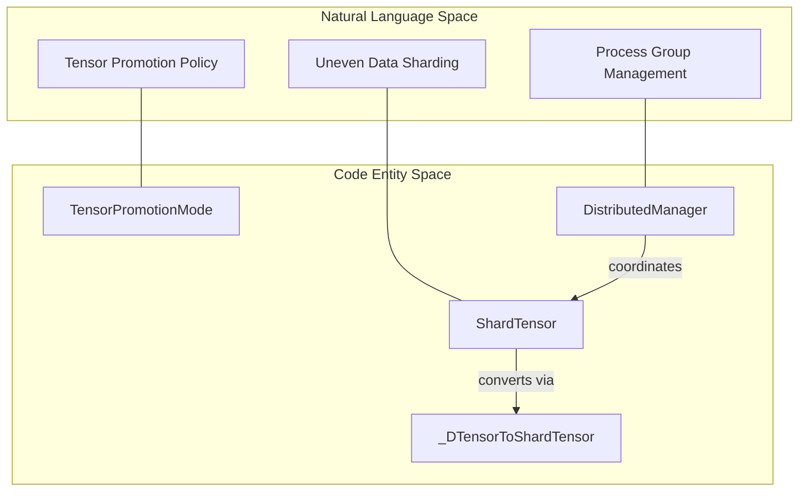
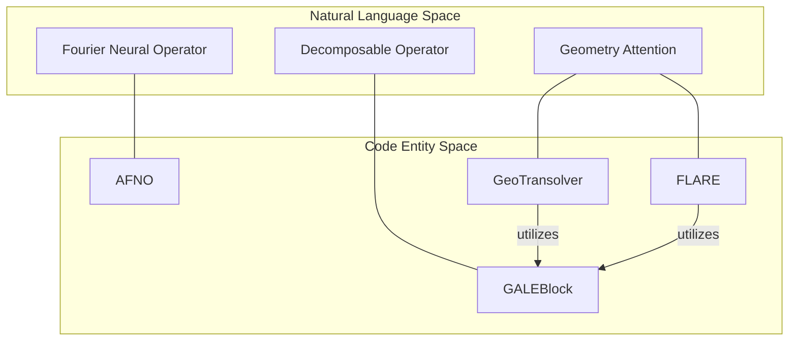

<!-- source: DeepWiki mcp.deepwiki.com · repo NVIDIA/physicsnemo · page 12 Glossary · fetched 2026-11-04 -->

# Glossary

Relevant source files

The following files were used as context for generating this wiki page:

- [.github/PULL_REQUEST_TEMPLATE.md](.github/PULL_REQUEST_TEMPLATE.md)
- [.gitlab/issue_templates/bug.md](.gitlab/issue_templates/bug.md)
- [.gitlab/issue_templates/documentation.md](.gitlab/issue_templates/documentation.md)
- [.gitlab/issue_templates/feature_request.md](.gitlab/issue_templates/feature_request.md)
- [.gitlab/issue_templates/security.md](.gitlab/issue_templates/security.md)
- [.gitlab/merge_request_templates/Default.md](.gitlab/merge_request_templates/Default.md)
- [CHANGELOG.md](CHANGELOG.md)
- [CONTRIBUTING.md](CONTRIBUTING.md)
- [Dockerfile](Dockerfile)
- [Makefile](Makefile)
- [README.md](README.md)
- [codecov.yml](codecov.yml)
- [docs/conf.py](docs/conf.py)
- [docs/img/Modulus-850x720.svg](docs/img/Modulus-850x720.svg)
- [docs/research.md](docs/research.md)
- [greptile.json](greptile.json)
- [physicsnemo/__init__.py](physicsnemo/__init__.py)
- [physicsnemo/core/version_check.py](physicsnemo/core/version_check.py)
- [physicsnemo/domain_parallel/__init__.py](physicsnemo/domain_parallel/__init__.py)
- [physicsnemo/domain_parallel/_shard_redistribute.py](physicsnemo/domain_parallel/_shard_redistribute.py)
- [physicsnemo/domain_parallel/_shard_tensor_spec.py](physicsnemo/domain_parallel/_shard_tensor_spec.py)
- [physicsnemo/domain_parallel/custom_ops/__init__.py](physicsnemo/domain_parallel/custom_ops/__init__.py)
- [physicsnemo/domain_parallel/custom_ops/_tensor_ops.py](physicsnemo/domain_parallel/custom_ops/_tensor_ops.py)
- [physicsnemo/domain_parallel/shard_tensor.py](physicsnemo/domain_parallel/shard_tensor.py)
- [physicsnemo/domain_parallel/shard_utils/attention_patches.py](physicsnemo/domain_parallel/shard_utils/attention_patches.py)
- [physicsnemo/domain_parallel/shard_utils/halo_scatter.py](physicsnemo/domain_parallel/shard_utils/halo_scatter.py)
- [physicsnemo/domain_parallel/shard_utils/natten_patches.py](physicsnemo/domain_parallel/shard_utils/natten_patches.py)
- [physicsnemo/mesh/domain_mesh.py](physicsnemo/mesh/domain_mesh.py)
- [physicsnemo/mesh/mesh.py](physicsnemo/mesh/mesh.py)
- [physicsnemo/mesh/transformations/geometric.py](physicsnemo/mesh/transformations/geometric.py)
- [pyproject.toml](pyproject.toml)
- [test/ci_tests/prevent_untracked_imports.py](test/ci_tests/prevent_untracked_imports.py)
- [test/core/test_version_check.py](test/core/test_version_check.py)
- [test/domain_parallel/models/test_geotransolver.py](test/domain_parallel/models/test_geotransolver.py)
- [test/domain_parallel/test_redistribute.py](test/domain_parallel/test_redistribute.py)
- [test/domain_parallel/test_shard_alignment.py](test/domain_parallel/test_shard_alignment.py)
- [test/mesh/deformation/test_deformation_topology.py](test/mesh/deformation/test_deformation_topology.py)
- [test/mesh/io/io_pyvista/test_pyvista_example_datasets.py](test/mesh/io/io_pyvista/test_pyvista_example_datasets.py)
- [test/mesh/io/io_pyvista/test_to_pyvista_dtypes.py](test/mesh/io/io_pyvista/test_to_pyvista_dtypes.py)
- [test/mesh/mesh/test_compile.py](test/mesh/mesh/test_compile.py)
- [test/mesh/mesh/test_init_validation.py](test/mesh/mesh/test_init_validation.py)
- [test/mesh/mesh/test_point_normals_weighting.py](test/mesh/mesh/test_point_normals_weighting.py)
- [test/mesh/test_domain_mesh_transforms.py](test/mesh/test_domain_mesh_transforms.py)
- [test/mesh/transformations/test_shrinkwrap.py](test/mesh/transformations/test_shrinkwrap.py)
- [test/mesh/transformations/test_transformations.py](test/mesh/transformations/test_transformations.py)
- [test/mesh/utilities/test_cache.py](test/mesh/utilities/test_cache.py)
- [test/nn/functional/test_natten.py](test/nn/functional/test_natten.py)
- [uv.lock](uv.lock)

This page provides definitions and technical implementation details for codebase-specific terms, jargon, abbreviations, and domain concepts used within PhysicsNeMo. It serves as a reference for onboarding engineers to understand the relationship between high-level physics/ML concepts and their representation in the code.

---

## Core Abstractions

### Module
The foundational building block for all models in PhysicsNeMo. It extends `torch.nn.Module` to provide enhanced metadata handling, argument serialization, and versioning.
*   **Implementation:** `physicsnemo.Module` [physicsnemo/__init__.py:23-23]().
*   **Key Feature:** Integrates with `ModelMetaData` [physicsnemo/__init__.py:22-22]() to track model provenance and configuration.

### Datapipe
The standard interface for data loading and preprocessing. PhysicsNeMo Datapipe objects are designed to handle complex scientific formats like Zarr, HDF5, and VTK/VTP with high throughput on GPUs.
*   **Implementation:** `physicsnemo.Datapipe` [CONTRIBUTING.md:53-57]().

### DistributedManager
A singleton utility that manages the distributed environment (MPI, Slurm, or PyTorch Distributed). It provides centralized access to rank, world size, and local device assignment.
*   **Implementation:** `physicsnemo.distributed.DistributedManager` [physicsnemo/domain_parallel/shard_tensor.py:43-43]().

### OptionalImport
A lazy-loading utility for optional dependencies that defers import time until first attribute access, raising a formatted installation hint if the package is missing.
*   **Implementation:** `physicsnemo.core.version_check.OptionalImport` [physicsnemo/core/version_check.py:25-38]().

Sources: [physicsnemo/__init__.py:22-23](), [CONTRIBUTING.md:53-57](), [physicsnemo/domain_parallel/shard_tensor.py:43-43](), [physicsnemo/core/version_check.py:25-38]().

---

## Distributed Computing & Domain Parallelism

### ShardTensor
A specialized tensor type extending `torch.Tensor` and wrapping `DTensor` to support uneven sharding across GPUs. This is critical for domain parallelism where different processing units hold varying numbers of mesh nodes or spatial points.
*   **Implementation:** `physicsnemo.domain_parallel.shard_tensor.ShardTensor` [physicsnemo/domain_parallel/shard_tensor.py:59-82]().

### TensorPromotionMode
Controls how plain, unsharded `torch.Tensor` instances (such as FSDP2 weight tensors) interact with `ShardTensor` instances during intercepted operations.
*   **Implementation:** `physicsnemo.domain_parallel.shard_tensor.TensorPromotionMode` [physicsnemo/domain_parallel/shard_tensor.py:59-82]().

### Domain Parallelism
A strategy where the physical computational domain (e.g., a 3D finite-element mesh or simulation volume) is partitioned across multiple GPUs rather than splitting only along batch dimensions.
*   **Code Pointer:** `physicsnemo.domain_parallel` [CONTRIBUTING.md:60-65]().

### Halo Exchange
The process of exchanging boundary data ("ghost cells" or overlapping point neighborhoods) between adjacent GPUs in a domain-parallel simulation to maintain stencil and convolution continuity.

**System Entity Mapping: Distributed Training & Sharding**

Sources: [physicsnemo/domain_parallel/shard_tensor.py:59-155](), [CONTRIBUTING.md:60-65]().

Sources: [physicsnemo/domain_parallel/shard_tensor.py:59-155](), [CONTRIBUTING.md:60-65]().

---

## Generative & Diffusion Models

### EDM Preconditioning
A normalization and scaling scheme proposed by Karras et al. (2022) for Elucidated Diffusion Models that scales network inputs and outputs to preserve unit variance across diverse noise levels.
*   **Implementation:** `EDMPrecond` [CHANGELOG.md:104-113]().

### Noise Scheduler
A component defining the progression of noise standard deviations ($\sigma$) applied during forward and reverse diffusion processes.
*   **Implementation:** `physicsnemo.diffusion` [CONTRIBUTING.md:69-71]().

### DiT (Diffusion Transformer)
A transformer-based backbone replacing standard UNet architectures in modern scientific diffusion workflows.
*   **Implementation:** `physicsnemo.models.dit` [README.md:54-54]().

Sources: [CHANGELOG.md:104-113](), [CONTRIBUTING.md:69-71](), [README.md:54-54]().

---

## Mesh & Geometric Processing

### Mesh (Tensorclass)
A GPU-accelerated tensorclass data structure representing simplicial complexes (points, edges, faces, cells) with arbitrary field data associations via `TensorDict`.
*   **Implementation:** `physicsnemo.mesh.Mesh` [physicsnemo/mesh/mesh.py:134-144]().

### SDF (Signed Distance Field)
A continuous spatial representation where each coordinate maps to its signed shortest distance to the nearest geometry boundary (negative inside, positive outside).
*   **Code Pointer:** `physicsnemo.nn.functional` [physicsnemo/mesh/transformations/geometric.py:38-38]().

### Marching Cubes
An algorithm used to extract an isosurface polygonal mesh from a discretized 3D scalar field or implicit function.
*   **Implementation:** `physicsnemo.mesh.generate` [CHANGELOG.md:126-127]().

Sources: [physicsnemo/mesh/mesh.py:134-144](), [physicsnemo/mesh/transformations/geometric.py:38-38](), [CHANGELOG.md:126-127]().

---

## Model Architectures

### DoMINO
**Decomposable Multi-scale Iterative Neural Operator**. A point-cloud and mesh-based operator architecture designed for large-scale external aerodynamics and surface solution modeling.
*   **Implementation:** `physicsnemo.models.domino` [README.md:53-53]().

### AFNO
**Adaptive Fourier Neural Operator**. A vision transformer adaptation that performs efficient global token mixing in the spectral domain using the Fast Fourier Transform.
*   **Implementation:** `physicsnemo.models.afno` [CONTRIBUTING.md:49-52]().

### GeoTransolver & FLARE
Advanced physics-attention operator models configured with geometry-aware latent embeddings (GALE) for multi-physics surrogate modeling.
*   **Implementation:** `physicsnemo.models.geotransolver.GeoTransolver` and `physicsnemo.models.flare.FLARE` [CHANGELOG.md:102-107]().

**System Entity Mapping: Neural Operators & Attention**

Sources: [CHANGELOG.md:102-107](), [CONTRIBUTING.md:49-52]().

Sources: [CHANGELOG.md:102-107](), [CONTRIBUTING.md:49-52]().

---

## Domain Concepts (Weather & CFD)

| Term | Definition | Code Pointer |
| :--- | :--- | :--- |
| **ERA5** | Fifth generation ECMWF global atmospheric reanalysis dataset. | `physicsnemo.datapipes.climate` [CONTRIBUTING.md:53-57]() |
| **HEALPix** | Hierarchical Equal Area isoLatitude Pixelization grid standard for spherical data. | `physicsnemo.datapipes.healpix` [CONTRIBUTING.md:53-57]() |
| **Zonal Statistics** | Statistical metrics aggregated along lines of constant latitude. | `physicsnemo.metrics` [CONTRIBUTING.md:58-60]() |
| **NATTEN** | Neighborhood Attention Extension providing optimized sliding-window attention kernels. | `physicsnemo.nn.functional.natten` [CHANGELOG.md:50-52]() |
| **CRPS** | Continuous Ranked Probability Score for probabilistic ensemble evaluation. | `physicsnemo.metrics` [CONTRIBUTING.md:58-60]() |

Sources: [CONTRIBUTING.md:53-60](), [CHANGELOG.md:50-52]().