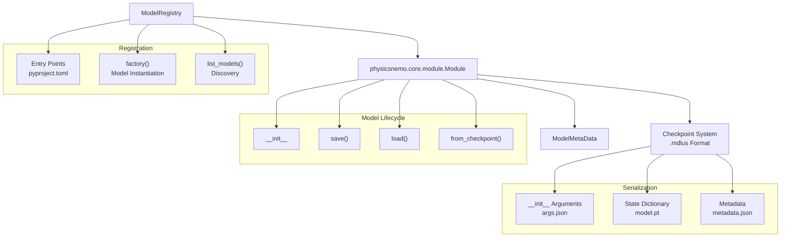
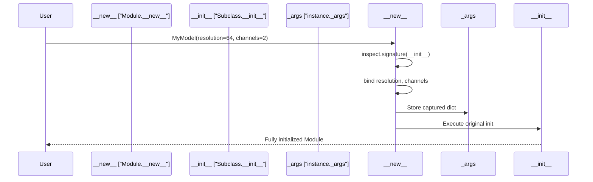
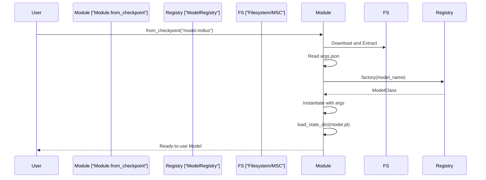

<!-- source: DeepWiki mcp.deepwiki.com · repo NVIDIA/physicsnemo · page 2 Model System · fetched 2026-11-04 -->

# Model System

Relevant source files

The following files were used as context for generating this wiki page:

- [docs/api/models/convolutional.rst](docs/api/models/convolutional.rst)
- [docs/api/models/fnos.rst](docs/api/models/fnos.rst)
- [docs/api/models/fully_connected.rst](docs/api/models/fully_connected.rst)
- [docs/api/models/gnns.rst](docs/api/models/gnns.rst)
- [docs/api/models/modules.rst](docs/api/models/modules.rst)
- [docs/api/models/operators.rst](docs/api/models/operators.rst)
- [docs/api/models/recurrent.rst](docs/api/models/recurrent.rst)
- [docs/api/models/transolver.rst](docs/api/models/transolver.rst)
- [docs/api/models/weather.rst](docs/api/models/weather.rst)
- [docs/api/physicsnemo.sym.rst](docs/api/physicsnemo.sym.rst)
- [docs/api/physicsnemo.utils.rst](docs/api/physicsnemo.utils.rst)
- [docs/api_index.rst](docs/api_index.rst)
- [docs/api_models.rst](docs/api_models.rst)
- [physicsnemo/core/module.py](physicsnemo/core/module.py)
- [physicsnemo/core/registry.py](physicsnemo/core/registry.py)
- [physicsnemo/models/mlp/fully_connected.py](physicsnemo/models/mlp/fully_connected.py)
- [physicsnemo/models/unet/unet.py](physicsnemo/models/unet/unet.py)
- [physicsnemo/sym/__init__.py](physicsnemo/sym/__init__.py)
- [physicsnemo/sym/computation.py](physicsnemo/sym/computation.py)
- [physicsnemo/sym/constants.py](physicsnemo/sym/constants.py)
- [physicsnemo/sym/eq/__init__.py](physicsnemo/sym/eq/__init__.py)
- [physicsnemo/sym/eq/gradients.py](physicsnemo/sym/eq/gradients.py)
- [physicsnemo/utils/checkpoint.py](physicsnemo/utils/checkpoint.py)
- [test/ci_tests/header_check.py](test/ci_tests/header_check.py)
- [test/core/test_module_nested.py](test/core/test_module_nested.py)
- [test/diffusion/test_domain_parallel_sampling.py](test/diffusion/test_domain_parallel_sampling.py)
- [test/models/mlp/test_fully_connected.py](test/models/mlp/test_fully_connected.py)
- [test/models/unet/test_unet.py](test/models/unet/test_unet.py)
- [test/utils/test_checkpoint_distributed.py](test/utils/test_checkpoint_distributed.py)

The Model System provides PhysicsNeMo's core model management infrastructure, enabling model creation, registration, serialization, and checkpoint handling. This system consists of three primary components: the `Module` base class for model definitions, the `ModelRegistry` for model discovery and instantiation, and the checkpointing system for saving and loading models with their complete state.

For information about specific model architectures (FNO, AFNO, MeshGraphNet, etc.), see [Model Architectures](#3). For distributed training infrastructure, see [Distributed Computing](#5).

## System Architecture

The Model System establishes a foundation for all neural network models in PhysicsNeMo by extending PyTorch's `torch.nn.Module` with additional capabilities for argument serialization, model registration, and checkpoint management.

**Model System Component Hierarchy**

Sources: [physicsnemo/core/module.py:123-172](), [physicsnemo/utils/checkpoint.py:17-30]()

## Core Components

### 2.1 Module Base Class

The `physicsnemo.core.module.Module` class serves as the foundational base for all models in the framework. It extends `torch.nn.Module` to provide automatic argument capture via a custom `__new__` method, enabling seamless serialization of model configurations. It also integrates `ModelMetaData` to track optimization capabilities like CUDA graphs and AMP support.

For details, see [Module Base Class](#2.1).

Sources: [physicsnemo/core/module.py:123-172](), [test/core/test_module_nested.py:44-60]()

### 2.2 Model Registry

The `ModelRegistry` is a singleton system that manages model discovery and instantiation. It uses Python's entry points to automatically discover models registered under the `physicsnemo.models` group. This allows the framework to instantiate models by string names using a factory pattern, supporting both native PhysicsNeMo models and converted torch modules.

For details, see [Model Registry](#2.2).

Sources: [physicsnemo/core/registry.py:1-80]()

### 2.3 Checkpointing and Serialization

PhysicsNeMo introduces the `.mdlus` checkpoint format, which is an archive containing model weights, initialization arguments, and versioning metadata. This format ensures that models can be reconstructed exactly as they were trained, including support for complex nested module hierarchies, distributed checkpointing via PyTorch DCP, and backward compatibility mappings.

For details, see [Checkpointing and Serialization](#2.3).

Sources: [physicsnemo/utils/checkpoint.py:17-54](), [physicsnemo/core/module.py:75-106]()

## Model Lifecycle Workflows

### Argument Capture Mechanism

The system ensures that any class inheriting from `Module` automatically tracks its constructor arguments. This is critical for the `from_checkpoint` functionality which reconstructs the model object before loading weights.

Sources: [physicsnemo/core/module.py:123-172]()

### Loading from Checkpoints

The `from_checkpoint()` method provides a high-level API to instantiate a model directly from a file path. It handles downloading from remote sources, extracting the `.mdlus` archive, and applying any necessary argument overrides or backward compatibility transformations.

Sources: [physicsnemo/core/module.py:123-172](), [test/core/test_module_nested.py:161-204]()

---

