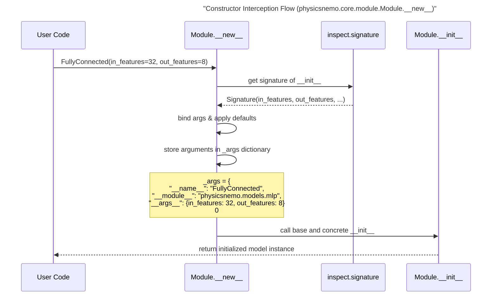

<!-- source: DeepWiki mcp.deepwiki.com · repo NVIDIA/physicsnemo · page 2.1 Module Base Class · fetched 2026-11-04 -->

# Module Base Class

<details>
<summary>Relevant source files</summary>

The following files were used as context for generating this wiki page:

- [physicsnemo/core/module.py](physicsnemo/core/module.py)
- [physicsnemo/core/registry.py](physicsnemo/core/registry.py)
- [physicsnemo/models/mlp/fully_connected.py](physicsnemo/models/mlp/fully_connected.py)
- [physicsnemo/models/unet/unet.py](physicsnemo/models/unet/unet.py)
- [test/ci_tests/header_check.py](test/ci_tests/header_check.py)
- [test/core/test_module_nested.py](test/core/test_module_nested.py)
- [test/models/mlp/test_fully_connected.py](test/models/mlp/test_fully_connected.py)
- [test/models/unet/test_unet.py](test/models/unet/test_unet.py)

</details>


## Purpose and Scope

This document describes the `physicsnemo.Module` base class, which serves as the foundation for all neural network models in PhysicsNeMo. The `Module` class extends PyTorch's `torch.nn.Module` with additional functionality for automatic argument serialization, nested module support, and seamless conversion from PyTorch models.

This page focuses on the core functionality of `Module` itself—initialization, argument capture, nested module support, and PyTorch interoperability. For information about model registration and discovery, see **2.2 Model Registry**. For details on checkpoint serialization formats and storage backends, see **2.3 Checkpointing and Serialization**.

Sources: [physicsnemo/core/module.py:123-172]()

---

## Class Overview

The `Module` class provides a drop-in replacement for `torch.nn.Module` with enhanced serialization capabilities. The key requirement is that all `__init__` arguments must be JSON-serializable, with one important exception: arguments that are themselves `physicsnemo.Module` instances are automatically handled for nested composition.

### Module Architecture and Code Mapping

This diagram bridges natural language concepts of model creation and serialization to the exact code entities in `physicsnemo.core.module`.

```mermaid
classDiagram
    title "PhysicsNeMo Module Class Hierarchy and Code Mapping"
    
    class torch_nn_Module {
        <<PyTorch Base>>
        +forward()
        +parameters()
        +state_dict()
    }
    
    class Module {
        <<Code Entity: physicsnemo.core.module.Module>>
        +meta: ModelMetaData
        +device_buffer: Tensor
        -_args: Dict
        +__new__(cls, *args, **kwargs)
        +__init__(meta)
        +save(file_name)
        +load(file_name)
        +from_checkpoint()$ 
        +from_torch()$
        +instantiate()$
    }
    
    class ModelMetaData {
        <<Code Entity: physicsnemo.core.meta.ModelMetaData>>
        +name: str
        +jit: bool
        +cuda_graphs: bool
        +amp: bool
    }
    
    class ConcreteModel {
        <<Example: physicsnemo.models.mlp.FullyConnected>>
        +__init__(in_features, out_features, num_layers)
        +forward(x)
    }
    
    torch_nn_Module <|-- Module
    Module <|-- ConcreteModel
    Module --o ModelMetaData: "contains meta"
    Module --o Module: "nested modules"
```

**Key Design Principles:**
- **Transparent Argument Capture**: `__new__` intercepts all constructor arguments before instantiation [physicsnemo/core/module.py:182-225]().
- **Nested Composition**: Supports arbitrary nesting of `physicsnemo.Module` instances [physicsnemo/core/module.py:130-144]().
- **PyTorch Compatibility**: Any `torch.nn.Module` can be wrapped via `from_torch()` [physicsnemo/core/module.py:915-973]().
- **Automatic Registration**: Classes can be registered to the `ModelRegistry` using entry points or registry decorators [physicsnemo/core/registry.py:83-141]().

Sources: [physicsnemo/core/module.py:123-225](), [physicsnemo/core/meta.py:22-63](), [physicsnemo/core/registry.py:83-141]()

---

## Initialization and Argument Capture

### The `__new__` Method: Automatic Argument Storage

The `Module` class uses a custom `__new__` method to intercept and store all initialization arguments before the object is created. This enables automatic serialization without requiring developers to manually track their arguments.

### Argument Binding Data Flow



### Implementation Details

The argument capture mechanism works as follows:

1. **Signature Inspection**: Uses `inspect.signature()` to get the `__init__` method's parameter names and defaults.
2. **Argument Binding**: Binds positional and keyword arguments to the signature, applying defaults.
3. **VAR_KEYWORD Unpacking**: Extracts `**kwargs` if present and merges into flat argument dictionary.
4. **Storage Format**: Stores as `_args` dictionary containing class name, module path, and bound arguments.

### Initialization Method

The `__init__` method itself is minimal and initializes base state [physicsnemo/core/module.py:238-253]():

```python
def __init__(self, meta: Union[ModelMetaData, None] = None):
    super().__init__()
    self.meta = meta
    self.register_buffer("device_buffer", torch.empty(0), persistent=False)
```

- **`meta`**: Optional `ModelMetaData` instance containing optimization flags (JIT, CUDA graphs, AMP, etc.).
- **`device_buffer`**: Zero-size non-persistent buffer used to track the model's device placement [physicsnemo/core/module.py:252]().

Sources: [physicsnemo/core/module.py:182-253](), [physicsnemo/core/meta.py:22-63]()

---

## Nested Module Support

### Nested Module Architecture

PhysicsNeMo supports arbitrary nesting of `Module` instances, enabling compositional model architectures. When saving, nested modules are recursively serialized; when loading, they are recursively reconstructed.

```mermaid
graph TB
    title "Nested Module Composition and Serialization Layout"
    
    subgraph "Object Hierarchy Space"
        OuterModel["OuterModel<br/>(physicsnemo.core.module.Module)"]
        InnerModel1["InnerModel1<br/>(physicsnemo.core.module.Module)"]
        InnerModel2["InnerModel2<br/>(physicsnemo.core.module.Module)"]
        TorchWrapper["TorchWrapper<br/>(from_torch conversion)"]
        
        OuterModel -->|"arg: inner1"| InnerModel1
        OuterModel -->|"arg: inner2"| InnerModel2
        InnerModel2 -->|"arg: torch_model"| TorchWrapper
    end
    
    subgraph "Serialization Dictionary Structure"
        RootArgs["_args dictionary"]
        ArgsOuter["'__args__': {<br/>'inner1': '__physicsnemo.Module__.inner1',<br/>'inner2': '__physicsnemo.Module__.inner2'<br/>}"]
        ArgsInner1["'__physicsnemo.Module__.inner1': {<br/>'__name__': 'InnerModel1',<br/>'__args__': {...}<br/>}"]
        ArgsInner2["'__physicsnemo.Module__.inner2': {<br/>'__name__': 'InnerModel2',<br/>'__args__': {...}<br/>}"]
        
        RootArgs --> ArgsOuter
        RootArgs --> ArgsInner1
        RootArgs --> ArgsInner2
    end
```

### Serialization of Nested Modules

When saving, nested `Module` arguments are replaced with placeholder strings using `_BASE_CKPT_PREFIX = "__physicsnemo.Module__"` [physicsnemo/core/module.py:46-47](), and their configuration dictionaries are stored recursively at the checkpoint root level [physicsnemo/core/module.py:450-515]().

### Deserialization of Nested Modules

The reconstruction helper `_from_checkpoint_process()` parses these placeholders, recursively instantiates sub-modules depth-first, and injects them into parent constructors [physicsnemo/core/module.py:728-866]().

Sources: [physicsnemo/core/module.py:43-47](), [physicsnemo/core/module.py:450-515](), [physicsnemo/core/module.py:728-866]()

---

## Converting from PyTorch Modules

### The `from_torch()` Static Method

The `from_torch()` method allows seamless integration of existing PyTorch models into PhysicsNeMo's serialization infrastructure [physicsnemo/core/module.py:915-973]().

```mermaid
graph LR
    title "PyTorch to PhysicsNeMo Conversion Pipeline"
    
    subgraph "Source Space"
        TorchClass["torch.nn.Module Subclass<br/>class TorchModel(torch.nn.Module)"]
    end
    
    subgraph "Conversion Code (Module.from_torch)"
        InspectSig["inspect.getfullargspec()"]
        CreateWrapper["Dynamic Class Generator"]
        SignatureReconstruct["inspect.Signature rebuilding"]
    end
    
    subgraph "Destination Space"
        PNMClass["physicsnemo.Module Subclass<br/>TorchModelPhysicsNeMoModel"]
        ForwardDelegate["Forward pass delegates to self.inner_model"]
    end
    
    TorchClass --> InspectSig
    InspectSig --> CreateWrapper
    CreateWrapper --> SignatureReconstruct
    SignatureReconstruct --> PNMClass
    PNMClass --> ForwardDelegate
```

### Conversion Process

The conversion creates a wrapper class dynamically [physicsnemo/core/module.py:934-973]():
1. **Define Inner Wrapper Class**: Creates a subclassing `physicsnemo.Module`.
2. **Extract Original Signature**: Uses inspection tools to retrieve argument names and defaults from the original PyTorch model.
3. **Reconstruct Signature**: Creates a new `inspect.Signature` and assigns it to the wrapper's `__init__`.
4. **Generate Unique Name**: Names the generated class `{OriginalClassName}PhysicsNeMoModel`.

Sources: [physicsnemo/core/module.py:915-973]()

---

## Model Instantiation and Class Resolution

### Class Resolution and Factory Pattern

The `instantiate()` class method creates model instances from argument dictionaries [physicsnemo/core/module.py:374-416]().

### Instantiation Resolution Code Mapping

```mermaid
graph TD
    title "Class Resolution Fallback Chain (Module._get_class_from_args)"
    
    ArgDict["Argument Dictionary<br/>__name__, __module__, __args__"] --> Resolve["physicsnemo.core.module.Module._get_class_from_args()"]
    
    Resolve --> CheckCurrent{"Matches current class name?"}
    CheckCurrent -->|Yes| UseCurrent["Return calling class"]
    CheckCurrent -->|No| CheckRegistry["physicsnemo.core.registry.ModelRegistry"]
    
    CheckRegistry --> FoundInRegistry{"Found in registry?"}
    FoundInRegistry -->|Yes| ReturnRegistered["Return registered class"]
    FoundInRegistry -->|No| TryImport["importlib.import_module(__module__)"]
    
    TryImport --> LoadEntryPoint{"Is importlib.metadata.EntryPoint?"}
    LoadEntryPoint -->|Yes| CallLoad["EntryPoint.load()"]
    LoadEntryPoint -->|No| ReturnImported["Return imported class"]
    CallLoad --> ReturnImported
```

### Class Resolution Algorithm

The `_get_class_from_args()` method resolves classes using a fallback chain [physicsnemo/core/module.py:322-371]():
1. **Current Class Match**: If the calling class name matches `"__name__"`, use the calling class.
2. **Registry Lookup**: Check `ModelRegistry()` for registered models [physicsnemo/core/registry.py:142-162]().
3. **Dynamic Import**: Use `importlib.import_module()` with the `"__module__"` path.
4. **Backward Compatibility**: Automatically translates legacy `"modulus.*"` paths to `"physicsnemo.*"`.
5. **EntryPoint Loading**: If an `EntryPoint` is encountered, `.load()` is invoked.

Sources: [physicsnemo/core/module.py:322-416](), [physicsnemo/core/registry.py:142-162]()

---

## Argument Overriding

### The `_overridable_args` Mechanism

Subclasses can declare which `__init__` arguments can be overridden when loading from checkpoints by defining `_overridable_args` [physicsnemo/core/module.py:157]().

### Override Process

The `from_checkpoint()` method accepts an `override_args` dictionary [physicsnemo/core/module.py:646-663]():
1. **Validation**: The `_override_args()` method ensures keys are declared in `_overridable_args` [physicsnemo/core/module.py:292-319]().
2. **Dot-Separated Paths**: Override keys support dot-separated syntax for nested modules (e.g., `m2.a`) [physicsnemo/core/module.py:691-708]().
3. **Keyword Safety**: Validates that override keys are valid Python identifiers and not reserved keywords [physicsnemo/core/module.py:713-725]().

Sources: [physicsnemo/core/module.py:292-319](), [physicsnemo/core/module.py:646-725]()

---

## Model Implementation Standards (MOD Rules)

Models in PhysicsNeMo must adhere to specific coding standards:
- **MOD-001**: Use `physicsnemo.Module` as the base class for all neural network modules [physicsnemo/core/module.py:123-124]().
- **MOD-002**: Constructor arguments must be JSON serializable, except for nested `physicsnemo.Module` instances [physicsnemo/core/module.py:130-144]().
- **MOD-003**: Call `super().__init__(meta=meta)` at the start of `__init__` [physicsnemo/core/module.py:160]().
- **MOD-004**: Use `ModelMetaData` to explicitly define model capabilities (JIT, AMP, CUDA graphs, ONNX, etc.) [physicsnemo/core/meta.py:22-63]().
- **MOD-005**: Support automatic registration via the `ModelRegistry` and entry point specifications [physicsnemo/core/registry.py:60-81]().
- **MOD-008a**: Verify constructor attributes and default values in test suites [test/models/mlp/test_fully_connected.py:49-83]().

Sources: [physicsnemo/core/module.py:123-160](), [physicsnemo/core/meta.py:22-63](), [physicsnemo/core/registry.py:60-81](), [test/models/mlp/test_fully_connected.py:49-83]()

---

