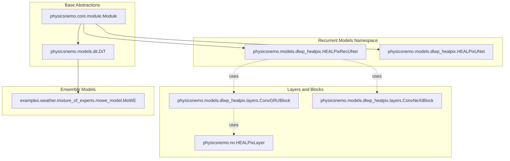
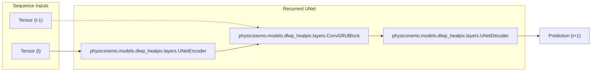
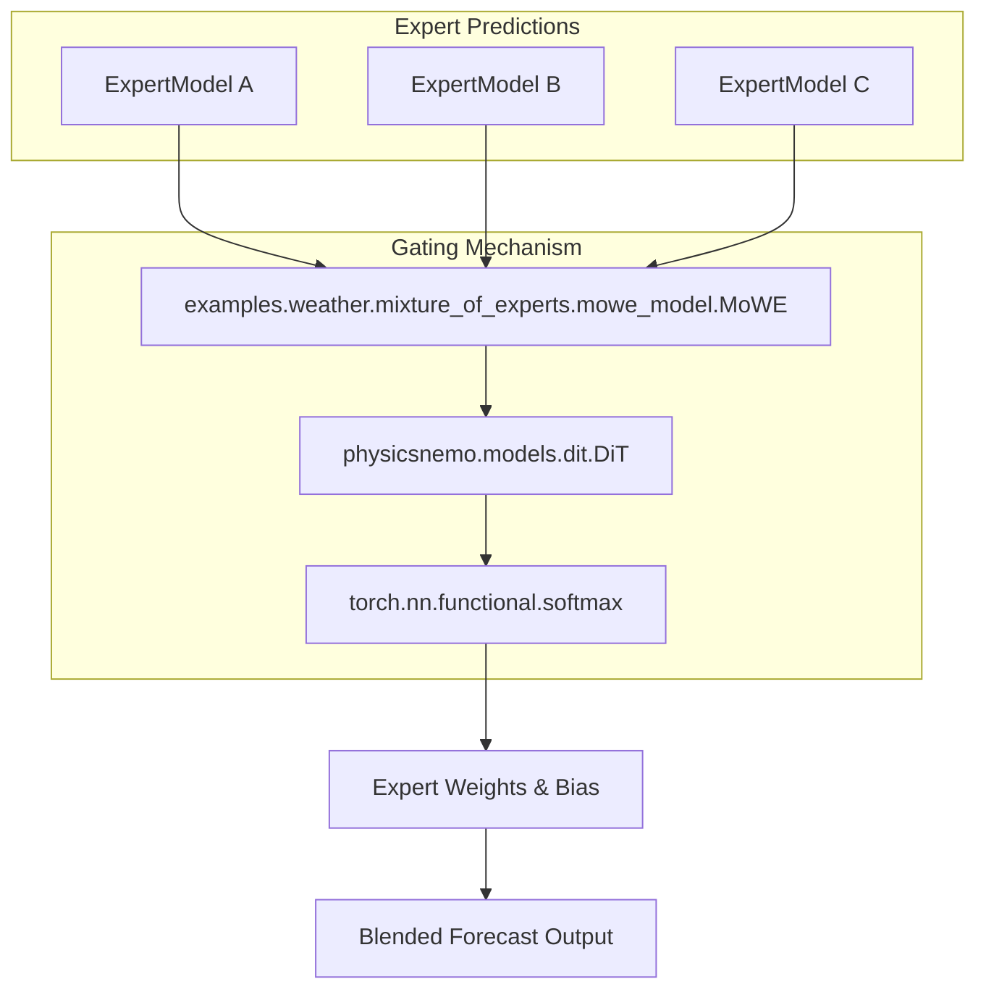

<!-- source: DeepWiki mcp.deepwiki.com · repo NVIDIA/physicsnemo · page 3.4 Recurrent and Hybrid Models · fetched 2026-11-04 -->

# Recurrent and Hybrid Models

Relevant source files

The following files were used as context for generating this wiki page:

- [physicsnemo/models/dlwp_healpix/HEALPixRecUNet.py](physicsnemo/models/dlwp_healpix/HEALPixRecUNet.py)
- [physicsnemo/models/dlwp_healpix/HEALPixUNet.py](physicsnemo/models/dlwp_healpix/HEALPixUNet.py)
- [physicsnemo/models/dlwp_healpix/layers/__init__.py](physicsnemo/models/dlwp_healpix/layers/__init__.py)
- [physicsnemo/models/dlwp_healpix/layers/healpix_blocks.py](physicsnemo/models/dlwp_healpix/layers/healpix_blocks.py)
- [physicsnemo/models/dlwp_healpix/layers/healpix_decoder.py](physicsnemo/models/dlwp_healpix/layers/healpix_decoder.py)
- [physicsnemo/models/dlwp_healpix/layers/healpix_encoder.py](physicsnemo/models/dlwp_healpix/layers/healpix_encoder.py)
- [physicsnemo/nn/module/hpx/padding.py](physicsnemo/nn/module/hpx/padding.py)
- [physicsnemo/nn/module/transformer_layers.py](physicsnemo/nn/module/transformer_layers.py)
- [test/metrics/test_healpix_loss.py](test/metrics/test_healpix_loss.py)
- [test/models/dlwp_healpix/test_healpix_blocks.py](test/models/dlwp_healpix/test_healpix_blocks.py)
- [test/models/dlwp_healpix/test_healpix_encoder_decoder.py](test/models/dlwp_healpix/test_healpix_encoder_decoder.py)
- [test/models/dlwp_healpix/test_healpix_layers.py](test/models/dlwp_healpix/test_healpix_layers.py)
- [test/models/dlwp_healpix/test_healpix_recunet_model.py](test/models/dlwp_healpix/test_healpix_recunet_model.py)
- [test/models/dlwp_healpix/test_healpix_unet_model.py](test/models/dlwp_healpix/test_healpix_unet_model.py)
- [test/models/fengwu/data/fengwu_output.pth](test/models/fengwu/data/fengwu_output.pth)
- [test/models/pangu/data/pangu_output.pth](test/models/pangu/data/pangu_output.pth)
- [test/nn/module/test_healpix.py](test/nn/module/test_healpix.py)

## Purpose and Scope

This document covers recurrent, hybrid, and ensemble model architectures in PhysicsNeMo designed for sequential prediction tasks, particularly in weather forecasting and climate modeling. Recurrent models process temporal sequences through recurrent connections, while hybrid models combine multiple architectures or expert models for improved prediction. These architectures complement the feedforward neural operators (see [Neural Operators](#3.1)) and graph networks (see [Graph Neural Networks](#3.2)) available in PhysicsNeMo.

As a parent page, this section provides a high-level overview. For detailed deep-dives, refer to the child pages:
- [DLWP and SwinRNN](#3.4.1) — Document DLWP cubed-sphere model, `HEALPixUNet`, `HEALPixRecUNet`, HEALPix layers and padding, and SwinRNN.
- [MoWE (Mixture of Weather Experts)](#3.4.2) — Document MoWE: DiT-based mixture of experts, ensemble prediction, expert weighting, and CRPS-based training.

---

## Architecture Overview

PhysicsNeMo provides two primary categories of sequential and hybrid prediction models:

1.  **Recurrent Models**: Process temporal sequences with recurrent connections, specialized for spherical geospatial grids like HEALPix and cubed-sphere. Key implementations include `HEALPixRecUNet` [physicsnemo/models/dlwp_healpix/HEALPixRecUNet.py:67-68]() and `ConvGRUBlock` [physicsnemo/models/dlwp_healpix/layers/healpix_blocks.py:45-48]().
2.  **Hybrid/Ensemble Models**: Combine multiple expert models or leverage diffusion transformer (DiT) backbones for robust probabilistic forecasting (e.g., MoWE).

### Model Registry and Entity Mapping

The following diagram bridges natural language architectural concepts to concrete code entities within the repository.

**Model Entity Relationships**

Sources: `physicsnemo/models/dlwp_healpix/HEALPixRecUNet.py:67-68](), [physicsnemo/models/dlwp_healpix/HEALPixUNet.py:64-65](), [physicsnemo/models/dlwp_healpix/layers/healpix_blocks.py:45-58]()

---

## Recurrent Models (DLWP and SwinRNN)

Recurrent architectures in PhysicsNeMo are tailored for modeling temporal dependencies in Earth system dynamics. 

### HEALPix Recurrent UNet
The Deep Learning Weather Prediction (DLWP) model family implements UNet structures mapped onto HEALPix spherical meshes (`HEALPixUNet` and `HEALPixRecUNet`) [physicsnemo/models/dlwp_healpix/HEALPixUNet.py:64-65](), [physicsnemo/models/dlwp_healpix/HEALPixRecUNet.py:67-68](). By embedding convolutional Gated Recurrent Units (`ConvGRUBlock`) [physicsnemo/models/dlwp_healpix/layers/healpix_blocks.py:45-48]() within encoder and decoder bottleneck layers, these models maintain hidden temporal states across integration steps.

**Recurrent Execution Flow**

For detailed coverage of HEALPix grid padding, manifold folding, and Swin Transformer RNN hybrids, see [DLWP and SwinRNN](#3.4.1).

Sources: `physicsnemo/models/dlwp_healpix/HEALPixRecUNet.py:67-125](), [physicsnemo/models/dlwp_healpix/layers/healpix_blocks.py:45-130]()

---

## Hybrid and Ensemble Models (MoWE)

Mixture and ensemble models bridge deterministic physics-informed predictions with uncertainty quantification and multi-model blending.

### Mixture of Weather Experts
The **Mixture of Weather Experts (MoWE)** integrates outputs from diverse forecasting models using a Diffusion Transformer (`DiT`) backbone to learn expert weighting dynamically.

**MoWE Architecture and Gating**

For detailed information on expert weighting, continuous ranked probability score (CRPS) training configurations, and ensemble generation, see [MoWE (Mixture of Weather Experts)](#3.4.2).

Sources: `examples/weather/mixture_of_experts/mowe_model.py:23-62]()

---

## Summary of Specialized Models

| Architecture Family | Primary Class Name | Domain / Application | Key Code References |
| :--- | :--- | :--- | :--- |
| **HEALPix Recurrent UNet** | `HEALPixRecUNet` | Sequential Weather (HEALPix Grid) | [physicsnemo/models/dlwp_healpix/HEALPixRecUNet.py:67-68]() |
| **HEALPix Feedforward UNet** | `HEALPixUNet` | Diagnostic/Single-Step Weather | [physicsnemo/models/dlwp_healpix/HEALPixUNet.py:64-65]() |
| **Mixture of Weather Experts** | `MoWE` | Ensemble Blending & CRPS Training | [examples/weather/mixture_of_experts/mowe_model.py:23-29]() |
| **ConvGRU Block** | `ConvGRUBlock` | Recurrent Spatial-Temporal Kernels | [physicsnemo/models/dlwp_healpix/layers/healpix_blocks.py:45-48]() |

Sources: `physicsnemo/models/dlwp_healpix/HEALPixRecUNet.py:67-68](), [physicsnemo/models/dlwp_healpix/HEALPixUNet.py:64-65](), [examples/weather/mixture_of_experts/mowe_model.py:23-29]()

---

