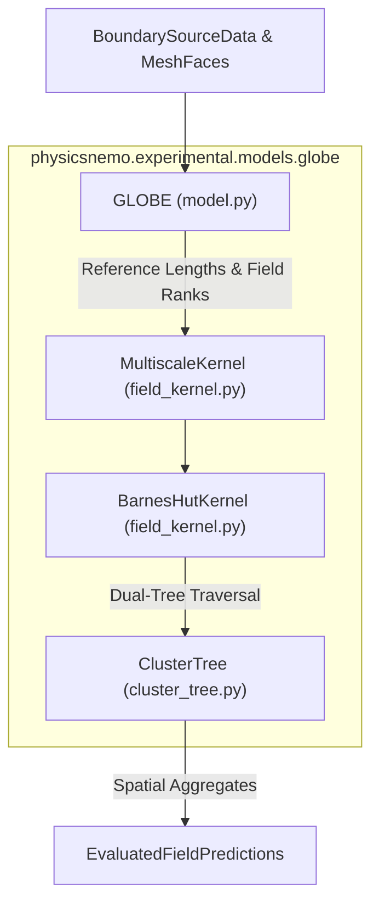
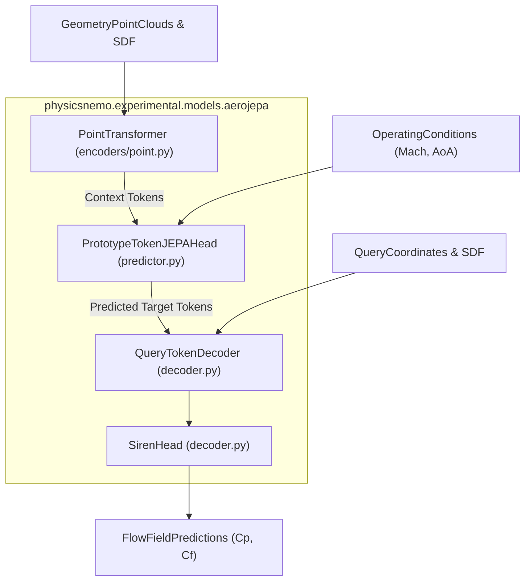
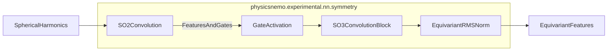

<!-- source: DeepWiki mcp.deepwiki.com · repo NVIDIA/physicsnemo · page 3.5 Specialized and Experimental Models · fetched 2026-11-04 -->

# Specialized and Experimental Models

Relevant source files

The following files were used as context for generating this wiki page:

- [docs/img/topodiff_doc/grid_topology.png](docs/img/topodiff_doc/grid_topology.png)
- [docs/img/topodiff_doc/topodiff.png](docs/img/topodiff_doc/topodiff.png)
- [docs/img/topodiff_doc/topology_generated.png](docs/img/topodiff_doc/topology_generated.png)
- [examples/cfd/external_aerodynamics/aerojepa/README.md](examples/cfd/external_aerodynamics/aerojepa/README.md)
- [examples/cfd/external_aerodynamics/aerojepa/conf/config.yaml](examples/cfd/external_aerodynamics/aerojepa/conf/config.yaml)
- [examples/cfd/external_aerodynamics/aerojepa/conf/config_inference.yaml](examples/cfd/external_aerodynamics/aerojepa/conf/config_inference.yaml)
- [examples/cfd/external_aerodynamics/aerojepa/conf/config_paper.yaml](examples/cfd/external_aerodynamics/aerojepa/conf/config_paper.yaml)
- [examples/cfd/external_aerodynamics/aerojepa/conf/model/aerojepa.yaml](examples/cfd/external_aerodynamics/aerojepa/conf/model/aerojepa.yaml)
- [examples/cfd/external_aerodynamics/aerojepa/conf/model/aerojepa_paper.yaml](examples/cfd/external_aerodynamics/aerojepa/conf/model/aerojepa_paper.yaml)
- [examples/cfd/external_aerodynamics/aerojepa/requirements.txt](examples/cfd/external_aerodynamics/aerojepa/requirements.txt)
- [examples/cfd/external_aerodynamics/globe/airfrans/dataset.py](examples/cfd/external_aerodynamics/globe/airfrans/dataset.py)
- [examples/cfd/external_aerodynamics/globe/airfrans/inference.py](examples/cfd/external_aerodynamics/globe/airfrans/inference.py)
- [examples/cfd/external_aerodynamics/globe/airfrans/mlflow_launch.sh](examples/cfd/external_aerodynamics/globe/airfrans/mlflow_launch.sh)
- [examples/cfd/external_aerodynamics/globe/airfrans/run.sh](examples/cfd/external_aerodynamics/globe/airfrans/run.sh)
- [examples/cfd/external_aerodynamics/globe/airfrans/train.py](examples/cfd/external_aerodynamics/globe/airfrans/train.py)
- [examples/cfd/external_aerodynamics/globe/airfrans/utilities.py](examples/cfd/external_aerodynamics/globe/airfrans/utilities.py)
- [examples/cfd/external_aerodynamics/globe/drivaer/run.sh](examples/cfd/external_aerodynamics/globe/drivaer/run.sh)
- [examples/cfd/external_aerodynamics/globe/drivaer/train.py](examples/cfd/external_aerodynamics/globe/drivaer/train.py)
- [examples/generative/topodiff/README.md](examples/generative/topodiff/README.md)
- [examples/generative/topodiff/conf/config.yaml](examples/generative/topodiff/conf/config.yaml)
- [examples/generative/topodiff/inference.py](examples/generative/topodiff/inference.py)
- [examples/generative/topodiff/train.py](examples/generative/topodiff/train.py)
- [examples/generative/topodiff/train_classifier.py](examples/generative/topodiff/train_classifier.py)
- [examples/generative/topodiff/train_regressor.py](examples/generative/topodiff/train_regressor.py)
- [examples/generative/topodiff/utils.py](examples/generative/topodiff/utils.py)
- [physicsnemo/conftest.py](physicsnemo/conftest.py)
- [physicsnemo/experimental/models/aerojepa/decoder.py](physicsnemo/experimental/models/aerojepa/decoder.py)
- [physicsnemo/experimental/models/aerojepa/encoders/context.py](physicsnemo/experimental/models/aerojepa/encoders/context.py)
- [physicsnemo/experimental/models/aerojepa/encoders/point.py](physicsnemo/experimental/models/aerojepa/encoders/point.py)
- [physicsnemo/experimental/models/aerojepa/encoders/target.py](physicsnemo/experimental/models/aerojepa/encoders/target.py)
- [physicsnemo/experimental/models/aerojepa/predictor.py](physicsnemo/experimental/models/aerojepa/predictor.py)
- [physicsnemo/experimental/models/globe/__init__.py](physicsnemo/experimental/models/globe/__init__.py)
- [physicsnemo/experimental/models/globe/field_kernel.py](physicsnemo/experimental/models/globe/field_kernel.py)
- [physicsnemo/experimental/models/globe/hierarchical_acceleration.md](physicsnemo/experimental/models/globe/hierarchical_acceleration.md)
- [physicsnemo/experimental/models/globe/model.py](physicsnemo/experimental/models/globe/model.py)
- [physicsnemo/experimental/models/healda/__init__.py](physicsnemo/experimental/models/healda/__init__.py)
- [physicsnemo/experimental/models/healda/healda.py](physicsnemo/experimental/models/healda/healda.py)
- [physicsnemo/experimental/models/healda/point_embed.py](physicsnemo/experimental/models/healda/point_embed.py)
- [physicsnemo/experimental/models/healda/scatter_aggregator.py](physicsnemo/experimental/models/healda/scatter_aggregator.py)
- [physicsnemo/models/figconvnet/base_model.py](physicsnemo/models/figconvnet/base_model.py)
- [physicsnemo/models/figconvnet/components/encodings.py](physicsnemo/models/figconvnet/components/encodings.py)
- [physicsnemo/models/figconvnet/components/mlp.py](physicsnemo/models/figconvnet/components/mlp.py)
- [physicsnemo/models/figconvnet/components/reductions.py](physicsnemo/models/figconvnet/components/reductions.py)
- [physicsnemo/models/figconvnet/figconvunet.py](physicsnemo/models/figconvnet/figconvunet.py)
- [physicsnemo/models/figconvnet/geometries.py](physicsnemo/models/figconvnet/geometries.py)
- [physicsnemo/models/figconvnet/grid_feature_group.py](physicsnemo/models/figconvnet/grid_feature_group.py)
- [physicsnemo/models/figconvnet/neighbor_ops.py](physicsnemo/models/figconvnet/neighbor_ops.py)
- [physicsnemo/models/figconvnet/point_feature_conv.py](physicsnemo/models/figconvnet/point_feature_conv.py)
- [physicsnemo/models/figconvnet/point_feature_grid_conv.py](physicsnemo/models/figconvnet/point_feature_grid_conv.py)
- [physicsnemo/models/topodiff/__init__.py](physicsnemo/models/topodiff/__init__.py)
- [physicsnemo/nn/module/hpx/tokenizer.py](physicsnemo/nn/module/hpx/tokenizer.py)
- [physicsnemo/nn/module/pade.py](physicsnemo/nn/module/pade.py)
- [test/models/globe/test_barnes_hut_kernel.py](test/models/globe/test_barnes_hut_kernel.py)
- [test/models/globe/test_field_kernel.py](test/models/globe/test_field_kernel.py)
- [test/models/globe/test_inference.py](test/models/globe/test_inference.py)
- [test/models/healda/__init__.py](test/models/healda/__init__.py)
- [test/models/healda/data/healda_conditional_output.pth](test/models/healda/data/healda_conditional_output.pth)
- [test/models/healda/data/healda_zero_conditioning_output.pth](test/models/healda/data/healda_zero_conditioning_output.pth)
- [test/models/healda/data/point_embed_multisensor_output.pth](test/models/healda/data/point_embed_multisensor_output.pth)
- [test/models/healda/test_point_embed.py](test/models/healda/test_point_embed.py)
- [test/models/healda/test_scatter_aggregator.py](test/models/healda/test_scatter_aggregator.py)
- [test/models/healda/test_scatter_mean.py](test/models/healda/test_scatter_mean.py)

This section documents specialized architectures and experimental layers within PhysicsNeMo that address specific geometric constraints, multi-sensor data assimilation, symmetry equivariance, boundary-element PDE solvers, and joint-embedding predictive architectures. These models extend foundational neural operator and GNN frameworks to handle complex 3D topologies, irregular observation patterns, or physical symmetries.

Sources: [physicsnemo/experimental/models/globe/model.py:66-83]()

---

## GLOBE: Green's-function-Like Operator for Boundary Element PDEs

**GLOBE** (`physicsnemo.experimental.models.globe.GLOBE`) is a neural surrogate architecture for boundary-driven elliptic PDEs that combines learnable Green's-function-like kernels with equivariant multi-scale representations [physicsnemo/experimental/models/globe/model.py:66-74]().

### Architecture and Implementation
- **GLOBE Class**: Implements the top-level module taking spatial dimensions, output field ranks, boundary source data ranks, and global conditioning [physicsnemo/experimental/models/globe/model.py:66-146]().
- **MultiscaleKernel & BarnesHutKernel**: `MultiscaleKernel` (`physicsnemo.experimental.models.globe.field_kernel.MultiscaleKernel`) combines kernel branches across reference length scales. `BarnesHutKernel` (`physicsnemo.experimental.models.globe.field_kernel.BarnesHutKernel`) accelerates spatial interactions via dual-tree traversal (`ClusterTree` and `DualInteractionPlan`) [physicsnemo/experimental/models/globe/field_kernel.py:122-159]() and `test/models/globe/test_barnes_hut_kernel.py:31-40]().

### GLOBE Data Flow Diagram (Bridge to Code Entity Space)

Sources: [physicsnemo/experimental/models/globe/model.py:66-146](), [physicsnemo/experimental/models/globe/field_kernel.py:122-159](), [test/models/globe/test_barnes_hut_kernel.py:31-40]()

---

## AeroJEPA: Joint-Embedding Predictive Architecture for Aerodynamics

**AeroJEPA** is a Joint-Embedding Predictive Architecture applied to 3D external aerodynamics. Rather than mapping geometry directly to flow fields, it predicts latent flow representations from geometry and operating conditions, reconstructing fields via continuous implicit decoders.

### Key Components
- **PointTransformer / Encoders**: `PointTransformer` (`physicsnemo.experimental.models.aerojepa.encoders.point.PointTransformer`) tokenizes input point clouds and processes local neighborhoods with `LocalPointTransformerBlock` [physicsnemo/experimental/models/aerojepa/encoders/point.py:17-36]() and `build_geometry_features` [physicsnemo/experimental/models/aerojepa/encoders/point.py:90-165]().
- **PrototypeTokenJEPAHead**: `PrototypeTokenJEPAHead` (`physicsnemo.experimental.models.aerojepa.predictor.PrototypeTokenJEPAHead`) maps target positions and conditioning vectors to target-token features via interleaved self- and cross-attention blocks [physicsnemo/experimental/models/aerojepa/predictor.py:54-105]().
- **QueryTokenDecoder & SirenHead**: `QueryTokenDecoder` (`physicsnemo.experimental.models.aerojepa.decoder.QueryTokenDecoder`) decodes predicted tokens at arbitrary query coordinates, optionally utilizing `SirenHead` (`physicsnemo.experimental.models.aerojepa.decoder.SirenHead`) for high-frequency pressure fields or final refinement [physicsnemo/experimental/models/aerojepa/decoder.py:17-56]().

### AeroJEPA System Architecture (Bridge to Code Entity Space)

Sources: [physicsnemo/experimental/models/aerojepa/encoders/point.py:17-36](), [physicsnemo/experimental/models/aerojepa/predictor.py:54-105](), [physicsnemo/experimental/models/aerojepa/decoder.py:17-56]()

---

## Transolver and GeoTransolver

The **Transolver** (Transformer-based Solver) learns mappings between function spaces on irregular meshes using physical state slices. **GeoTransolver** extends this with geometry-aware latent embeddings (GALE).

### GALE (Geometry-Aware Latent Embeddings)
- **GALE**: Extends `PhysicsAttentionIrregularMesh` to perform cross-attention between physical state slices and geometric context [physicsnemo/experimental/models/geotransolver/gale.py:35]().
- **Implementation**: Uses learnable `state_mixing` to blend self-attention and cross-attention [physicsnemo/experimental/models/geotransolver/gale.py:35]().

| Class | Role | Source |
| :--- | :--- | :--- |
| `Transolver` | Main transformer-based solver for irregular meshes. | [physicsnemo/models/transolver/transolver.py:1]() |
| `GALE` | Geometry-aware attention with cross-context. | [physicsnemo/experimental/models/geotransolver/gale.py:35]() |
| `GeoTransolver` | Top-level model integrating GALE blocks. | [physicsnemo/experimental/models/geotransolver/geotransolver.py:1]() |

Sources: [physicsnemo/experimental/models/geotransolver/gale.py:35](), [physicsnemo/models/transolver/transolver.py:1-50]()

---

## HEALDa: Multi-Sensor Data Assimilation

**HEALDa** (HEALPix Data Assimilation) processes heterogeneous observations from multiple sensors onto uniform HEALPix grids [physicsnemo/experimental/models/healda/__init__.py:17-30]().

### Data Flow and Tokenization
1. **Observation Splitting**: Slices observation tensors into per-sensor groups [physicsnemo/experimental/models/healda/point_embed.py:57-65]().
2. **Tokenization**: `ObsTokenizerFiLM` maps measurements, metadata, and embeddings into feature spaces [physicsnemo/experimental/models/healda/__init__.py:25-28]().
3. **Aggregation**: `ScatterAggregator` reduces observations within grid pixels using scatter operations [physicsnemo/experimental/models/healda/scatter_aggregator.py:17-25]().

Sources: [physicsnemo/experimental/models/healda/__init__.py:17-40](), [physicsnemo/experimental/models/healda/scatter_aggregator.py:17-25]()

---

## FIGConvNet: Fine-Grained Implicit 3D Convolution

**FIGConvNet** (Factorized Implicit Global Convolutional Network) represents 3D space using factorized 2D grids (XY, YZ, XZ) for computational efficiency at high resolutions [physicsnemo/models/figconvnet/figconvunet.py:173-189]().

### Key Entities
- **VerticesToPointFeatures**: Converts coordinates into sinusoidal positional encodings [physicsnemo/models/figconvnet/figconvunet.py:60-111]().
- **GridFeatureGroup**: Manages 2D factorized grid collections [physicsnemo/models/figconvnet/grid_feature_group.py:38]().
- **PointFeatureToGrid**: Projects point features onto factorized planes [physicsnemo/models/figconvnet/point_feature_grid_ops.py:49]().

Sources: [physicsnemo/models/figconvnet/figconvunet.py:60-189](), [physicsnemo/models/figconvnet/geometries.py:32-35]()

---

## Other Specialized Models

| Model | Description | Source |
| :--- | :--- | :--- |
| **DPOT** | Deep Potential Operator Transformer for molecular dynamics and potential surfaces. | [physicsnemo/models/dpot/dpot.py:1]() |
| **TopoDiff** | Diffusion-based model for topology optimization with classifier/DPS guidance. | [physicsnemo/models/topodiff/topodiff.py:1]() |
| **MeshReduced** | Temporal models for reduced-order modeling on meshes. | [physicsnemo/models/mesh_reduced/mesh_reduced.py:1]() |

Sources: [physicsnemo/models/dpot/dpot.py:1](), [physicsnemo/models/topodiff/topodiff.py:1](), [physicsnemo/models/mesh_reduced/mesh_reduced.py:1]()

---

## Experimental Symmetry-Equivariant Layers

Located in `physicsnemo.experimental.nn.symmetry`, these layers provide primitives for building $SO(2)$ and $SO(3)$ equivariant neural networks [physicsnemo/experimental/nn/symmetry/__init__.py:22-25]().

### Symmetry Layers and Logic
- **GateActivation**: Preserves equivariance by applying nonlinearities to $l=0$ features while scaling $l>0$ features via invariant gates [physicsnemo/experimental/nn/symmetry/activation.py:54-68]().
- **SO2Convolution**: Equivariant linear transformation producing features and gates [physicsnemo/experimental/nn/symmetry/activation.py:124]().
- **EdgeRotation**: Applies Wigner D-matrix rotations to spherical harmonic embeddings [physicsnemo/experimental/nn/symmetry/wigner.py:70]().
- **Equivariant Normalization**: `EquivariantRMSNorm` and `EquivariantLayerNorm` handle scaling across spherical harmonic degrees [physicsnemo/experimental/nn/symmetry/layer_norm.py:58-64]().

### Symmetry Layer Relationships

Sources: [physicsnemo/experimental/nn/symmetry/__init__.py:22-54](), [physicsnemo/experimental/nn/symmetry/activation.py:54-144]()

---

