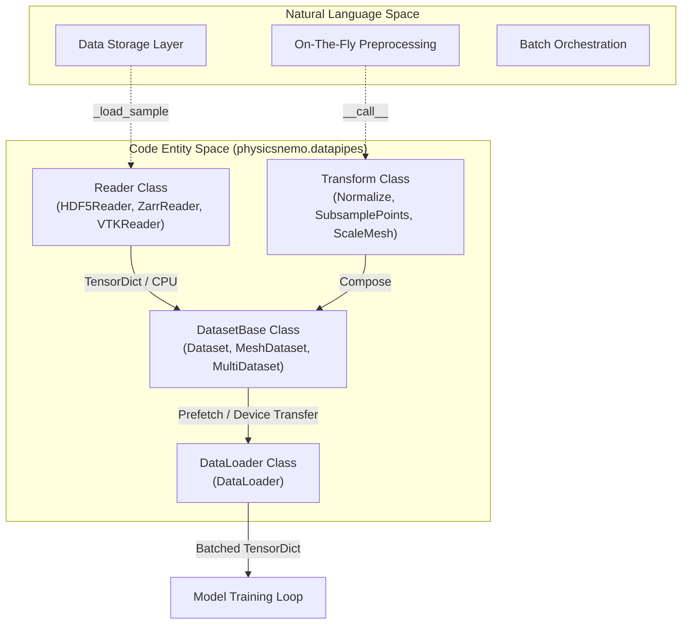

<!-- source: DeepWiki mcp.deepwiki.com · repo NVIDIA/physicsnemo · page 4 Data Management · fetched 2026-11-04 -->

# Data Management

Relevant source files

The following files were used as context for generating this wiki page:

- [docs/api/datapipes/physicsnemo.datapipes.benchmarks.rst](docs/api/datapipes/physicsnemo.datapipes.benchmarks.rst)
- [docs/api/datapipes/physicsnemo.datapipes.cae.rst](docs/api/datapipes/physicsnemo.datapipes.cae.rst)
- [docs/api/datapipes/physicsnemo.datapipes.climate.rst](docs/api/datapipes/physicsnemo.datapipes.climate.rst)
- [docs/api/datapipes/physicsnemo.datapipes.gnn.rst](docs/api/datapipes/physicsnemo.datapipes.gnn.rst)
- [docs/api/datapipes/physicsnemo.datapipes.readers.rst](docs/api/datapipes/physicsnemo.datapipes.readers.rst)
- [docs/api/datapipes/physicsnemo.datapipes.rst](docs/api/datapipes/physicsnemo.datapipes.rst)
- [docs/api/datapipes/physicsnemo.datapipes.transforms.rst](docs/api/datapipes/physicsnemo.datapipes.transforms.rst)
- [docs/api/nn/functionals/sampling.rst](docs/api/nn/functionals/sampling.rst)
- [examples/minimal/mesh/tutorial_7_domain_mesh.ipynb](examples/minimal/mesh/tutorial_7_domain_mesh.ipynb)
- [physicsnemo/datapipes/RNG.md](physicsnemo/datapipes/RNG.md)
- [physicsnemo/datapipes/__init__.py](physicsnemo/datapipes/__init__.py)
- [physicsnemo/datapipes/dataloader.py](physicsnemo/datapipes/dataloader.py)
- [physicsnemo/datapipes/dataset.py](physicsnemo/datapipes/dataset.py)
- [physicsnemo/datapipes/transforms/__init__.py](physicsnemo/datapipes/transforms/__init__.py)
- [physicsnemo/datapipes/transforms/base.py](physicsnemo/datapipes/transforms/base.py)
- [physicsnemo/datapipes/transforms/mesh/base.py](physicsnemo/datapipes/transforms/mesh/base.py)
- [physicsnemo/datapipes/transforms/mesh/transforms.py](physicsnemo/datapipes/transforms/mesh/transforms.py)
- [physicsnemo/datapipes/transforms/subsample.py](physicsnemo/datapipes/transforms/subsample.py)
- [physicsnemo/mesh/sampling/__init__.py](physicsnemo/mesh/sampling/__init__.py)
- [physicsnemo/models/domino/utils/utils.py](physicsnemo/models/domino/utils/utils.py)
- [test/datapipes/core/test_dataset.py](test/datapipes/core/test_dataset.py)
- [test/datapipes/core/test_multi_dataset.py](test/datapipes/core/test_multi_dataset.py)
- [test/datapipes/transforms/test_set_global_field.py](test/datapipes/transforms/test_set_global_field.py)
- [test/datapipes/transforms/test_subsample.py](test/datapipes/transforms/test_subsample.py)

## Purpose and Scope

PhysicsNeMo v2.0 introduces a redesigned, high-performance, GPU-centric data loading infrastructure. The system is built on a modular philosophy that separates data reading, transformation, and batch orchestration to enable scalable scientific machine learning (SciML) workflows [docs/api/datapipes/physicsnemo.datapipes.rst:15-39](). This page provides a high-level overview of the `Datapipe` architecture, built-in readers, transforms pipelines, RNG reproducibility policies, and domain-specific datasets for Climate and CFD applications.

For deeper technical details, see the child pages:
- [Datapipe Base Class](#4.1)
- [Climate and Weather Data](#4.2)
- [CFD and Mesh Data](#4.3)
- [Data Curation](#4.4)

Sources: [docs/api/datapipes/physicsnemo.datapipes.rst:15-39]()

## Datapipe Architecture

In PhysicsNeMo v2.0, the datapipe API prioritizes GPU-first preprocessing and strict isolation of roles [docs/api/datapipes/physicsnemo.datapipes.rst:23-40](). Data flows along a predictable path from storage to model ingestion, coordinated by four foundational components:

1.  **Reader**: Brings raw data from storage formats (HDF5, Zarr, VTK, NumPy) into CPU memory as a `TensorDict` [docs/api/datapipes/physicsnemo.datapipes.rst:43-48](), [physicsnemo/datapipes/__init__.py:23-27]().
2.  **Transform**: Applies on-the-fly instance manipulations (normalization, subsampling, geometric augmentation) [docs/api/datapipes/physicsnemo.datapipes.rst:43-48](), [physicsnemo/datapipes/__init__.py:24]().
3.  **Dataset**: Coordinates the `Reader` and `Transform` execution pipeline, managing optional automatic device transfer to target hardware [docs/api/datapipes/physicsnemo.datapipes.rst:43-48](), [physicsnemo/datapipes/__init__.py:25]().
4.  **DataLoader**: Orchestrates batched iteration, index sampling, and stream-based asynchronous prefetching [docs/api/datapipes/physicsnemo.datapipes.rst:43-48](), [physicsnemo/datapipes/__init__.py:26]().

Dataset Pipeline Architecture

Sources: [docs/api/datapipes/physicsnemo.datapipes.rst:23-48](), [physicsnemo/datapipes/__init__.py:23-27]()

### GPU-Centric Orchestration and RNG

The `physicsnemo.datapipes.DataLoader` manages asynchronous CUDA streams to overlap data loading, host-to-device transfers, and kernel execution [docs/api/datapipes/physicsnemo.datapipes.rst:133-162](). Deterministic execution is opt-in via the `seed` argument, which forks independent `torch.Generator` streams across samplers, readers, and stochastic transforms using hierarchical seed derivation (`physicsnemo.datapipes._rng`) [physicsnemo/datapipes/RNG.md:1-51]().

For details on the base class API, multi-dataset management, and the RNG policy, see [Datapipe Base Class](#4.1).

Sources: [docs/api/datapipes/physicsnemo.datapipes.rst:133-162](), [physicsnemo/datapipes/RNG.md:1-51]()

## Core Components

### Readers and Storage Formats
Readers provide a unified interface for streaming data into `TensorDict` instances. They handle format-specific parsing and memory layout mapping.

| Reader Class | Target Formats | Primary Use Case |
| :--- | :--- | :--- |
| `HDF5Reader` | `.h5`, `.hdf5` | Large gridded climate and numerical weather data [docs/api/datapipes/physicsnemo.datapipes.rst:68-71]() |
| `ZarrReader` / `TensorStoreZarrReader` | `.zarr` | Chunked, compressed arrays for cloud and distributed storage [docs/api/datapipes/physicsnemo.datapipes.rst:107-119]() |
| `NumpyReader` | `.npy` | Simple arrays and benchmark datasets [physicsnemo/datapipes/__init__.py:50]() |
| `VTKReader` / `MeshReader` | `.vtp`, `.vtu`, `.stl` | Unstructured grids for CFD and structural mechanics [physicsnemo/datapipes/__init__.py:49-53]() |
| `DomainMeshReader` | Structured directories | Coupled volume and boundary surface simulation domains [examples/minimal/mesh/tutorial_7_domain_mesh.ipynb:21-28]() |

Sources: [physicsnemo/datapipes/__init__.py:46-55](), [docs/api/datapipes/physicsnemo.datapipes.rst:68-71]()

### Transforms and Composition
Transforms are composable operations that modify `TensorDict` or `Mesh` samples. They include normalization utilities (`Normalize`, `NormalizeVectors`), spatial samplers (`SubsamplePoints`, `KNearestNeighbors`), geometric modifiers (`ComputeSDF`, `Scale`, `Translate`), and mesh-specific augmentations (`ScaleMesh`, `RotateMesh`, `CenterMesh`) [physicsnemo/datapipes/__init__.py:62-99](), [physicsnemo/datapipes/transforms/mesh/transforms.py:53-204]().

Sources: [physicsnemo/datapipes/__init__.py:62-99](), [physicsnemo/datapipes/transforms/mesh/transforms.py:53-204]()

### MultiDataset Support
The `MultiDataset` class enables mixing distinct datasets under a unified index space [physicsnemo/datapipes/__init__.py:44](). It appends dataset provenance metadata (`dataset_index`) and supports strict output validation (`output_strict=True`) to guarantee consistent schema collation across heterogeneous sources.

Sources: [physicsnemo/datapipes/__init__.py:44](), [test/datapipes/core/test_multi_dataset.py:48-68]()

## Domain-Specific Infrastructure

PhysicsNeMo provides domain-tailored pipelines built on top of the core datapipe components.

### Climate and Weather Data
Climate datapipes handle spherical grids, spatial projections, and global meteorological reanalysis datasets [docs/api/datapipes/physicsnemo.datapipes.climate.rst:4-62](). 
- **ERA5HDF5Datapipe**: Optimized for high-resolution atmospheric tensor extraction.
- **HEALPix Datapipes**: Structured for equal-area isolatitude pixelation on the sphere.
- For details, see [Climate and Weather Data](#4.2).

Sources: [docs/api/datapipes/physicsnemo.datapipes.climate.rst:4-62]()

### CFD and Mesh Data
CFD pipelines manage unstructured domains, point clouds, and boundary condition metadata using `DomainMesh` containers [examples/minimal/mesh/tutorial_7_domain_mesh.ipynb:21-28]().
- **DoMINODataPipe**: Dedicated pipeline for DoMINO external aerodynamics workflows [docs/api/datapipes/physicsnemo.datapipes.cae.rst:4-30]().
- **GNN Datasets**: Loaders for `VortexShedding`, `AhmedBody`, `DrivAerNet`, and `HydroGraphNet` [docs/api/datapipes/physicsnemo.datapipes.gnn.rst:4-35]().
- For details, see [CFD and Mesh Data](#4.3).

Sources: [docs/api/datapipes/physicsnemo.datapipes.cae.rst:4-30](), [docs/api/datapipes/physicsnemo.datapipes.gnn.rst:4-35](), [examples/minimal/mesh/tutorial_7_domain_mesh.ipynb:21-28]()

### Data Curation Tools
Data curation pipelines streamline raw data ingestion, scaling, and format conversion before model training [docs/api/datapipes/physicsnemo.datapipes.cae.rst:16-18]().
- **ERA5Mirror**: Automates Copernicus CDS downloads and local storage mirroring.
- **Unified Weather Curation**: Prepares multi-source meteorological datasets into streaming-ready Zarr/HDF5 archives.
- For details, see [Data Curation](#4.4).

Sources: [docs/api/datapipes/physicsnemo.datapipes.cae.rst:16-18](), [docs/api/datapipes/physicsnemo.datapipes.climate.rst:4-6]()

## Child Pages

- [Datapipe Base Class](#4.1) — Document physicsnemo.Datapipe interface, MultiDataset, dataloader, readers (HDF5/Zarr/VTK/NumPy/mesh), RNG policy, and the transforms pipeline.
- [Climate and Weather Data](#4.2) — Document ERA5HDF5Datapipe, climate datapipe, HEALPix datapipes, zenith angle computation, normalization, and Zarr/HDF5 formats.
- [CFD and Mesh Data](#4.3) — Document DoMINODataPipe, transolver datapipe, mesh datapipe, GNN datasets (VortexShedding, AhmedBody, DrivAerNet, Lagrangian, HydroGraphNet), SDF computation, and geometric transforms.
- [Data Curation](#4.4) — Document ERA5Mirror data acquisition, the unified weather recipe curation pipeline, DLWP data curation, and format conversions.

---

