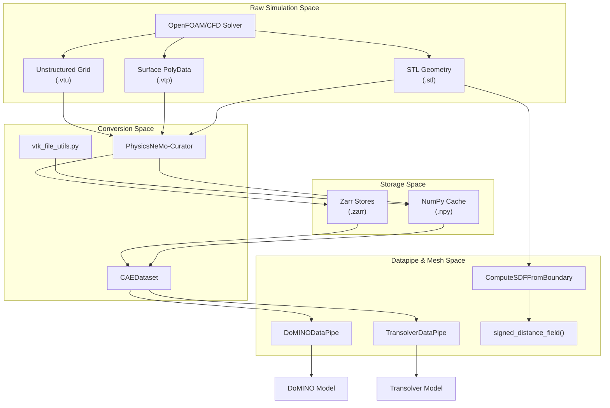
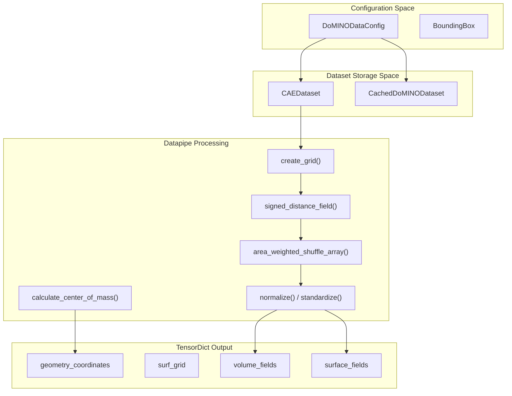
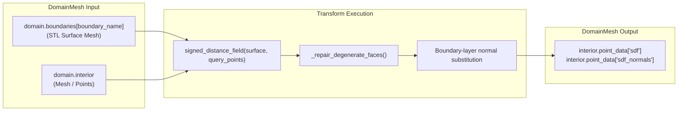

<!-- source: DeepWiki mcp.deepwiki.com · repo NVIDIA/physicsnemo · page 4.3 CFD and Mesh Data · fetched 2026-11-04 -->

# CFD and Mesh Data

Relevant source files

The following files were used as context for generating this wiki page:

- [docs/api/mesh/spatial.rst](docs/api/mesh/spatial.rst)
- [docs/img/domino_result_rtwt.jpg](docs/img/domino_result_rtwt.jpg)
- [docs/img/lagrangian_meshgraphnet_compressed.gif](docs/img/lagrangian_meshgraphnet_compressed.gif)
- [docs/img/lagrangian_meshgraphnet_multi.png](docs/img/lagrangian_meshgraphnet_multi.png)
- [examples/cfd/external_aerodynamics/domino/README.md](examples/cfd/external_aerodynamics/domino/README.md)
- [examples/cfd/external_aerodynamics/domino/src/conf/config.yaml](examples/cfd/external_aerodynamics/domino/src/conf/config.yaml)
- [examples/cfd/external_aerodynamics/domino/src/inference_on_stl.py](examples/cfd/external_aerodynamics/domino/src/inference_on_stl.py)
- [examples/cfd/external_aerodynamics/domino/src/test.py](examples/cfd/external_aerodynamics/domino/src/test.py)
- [examples/cfd/external_aerodynamics/domino/src/train.py](examples/cfd/external_aerodynamics/domino/src/train.py)
- [examples/cfd/external_aerodynamics/domino/src/utils.py](examples/cfd/external_aerodynamics/domino/src/utils.py)
- [examples/cfd/external_aerodynamics/transformer_models/src/inference_on_zarr.py](examples/cfd/external_aerodynamics/transformer_models/src/inference_on_zarr.py)
- [examples/cfd/external_aerodynamics/transformer_models/src/metrics.py](examples/cfd/external_aerodynamics/transformer_models/src/metrics.py)
- [examples/cfd/external_aerodynamics/unified_external_aero_recipe/src/sdf.py](examples/cfd/external_aerodynamics/unified_external_aero_recipe/src/sdf.py)
- [examples/cfd/external_aerodynamics/unified_external_aero_recipe/tests/test_sdf_transform.py](examples/cfd/external_aerodynamics/unified_external_aero_recipe/tests/test_sdf_transform.py)
- [examples/cfd/lagrangian_mgn/README.md](examples/cfd/lagrangian_mgn/README.md)
- [examples/cfd/lagrangian_mgn/conf/config.yaml](examples/cfd/lagrangian_mgn/conf/config.yaml)
- [examples/cfd/lagrangian_mgn/conf/config_2d.yaml](examples/cfd/lagrangian_mgn/conf/config_2d.yaml)
- [examples/cfd/lagrangian_mgn/conf/config_3d.yaml](examples/cfd/lagrangian_mgn/conf/config_3d.yaml)
- [examples/cfd/lagrangian_mgn/conf/experiment/multi_material.yaml](examples/cfd/lagrangian_mgn/conf/experiment/multi_material.yaml)
- [examples/cfd/lagrangian_mgn/inference.py](examples/cfd/lagrangian_mgn/inference.py)
- [examples/cfd/lagrangian_mgn/loggers.py](examples/cfd/lagrangian_mgn/loggers.py)
- [examples/cfd/lagrangian_mgn/raw_datasets/download_dataset.sh](examples/cfd/lagrangian_mgn/raw_datasets/download_dataset.sh)
- [examples/cfd/lagrangian_mgn/train.py](examples/cfd/lagrangian_mgn/train.py)
- [physicsnemo/datapipes/cae/domino_datapipe.py](physicsnemo/datapipes/cae/domino_datapipe.py)
- [physicsnemo/datapipes/cae/transolver_datapipe.py](physicsnemo/datapipes/cae/transolver_datapipe.py)
- [physicsnemo/datapipes/gnn/ahmed_body_dataset.py](physicsnemo/datapipes/gnn/ahmed_body_dataset.py)
- [physicsnemo/datapipes/gnn/drivaernet_dataset.py](physicsnemo/datapipes/gnn/drivaernet_dataset.py)
- [physicsnemo/datapipes/transforms/geometric.py](physicsnemo/datapipes/transforms/geometric.py)
- [physicsnemo/domain_parallel/shard_utils/mesh_ops.py](physicsnemo/domain_parallel/shard_utils/mesh_ops.py)
- [physicsnemo/mesh/spatial/__init__.py](physicsnemo/mesh/spatial/__init__.py)
- [physicsnemo/mesh/spatial/sdf.py](physicsnemo/mesh/spatial/sdf.py)
- [physicsnemo/models/domino/model.py](physicsnemo/models/domino/model.py)
- [physicsnemo/nn/functional/geometry/sdf.py](physicsnemo/nn/functional/geometry/sdf.py)
- [physicsnemo/sym/eq/pde.py](physicsnemo/sym/eq/pde.py)
- [physicsnemo/sym/utils/sympy/torch_printer.py](physicsnemo/sym/utils/sympy/torch_printer.py)
- [physicsnemo/utils/memory.py](physicsnemo/utils/memory.py)
- [test/datapipes/test_ahmed_body.py](test/datapipes/test_ahmed_body.py)
- [test/datapipes/test_domino_datapipe.py](test/datapipes/test_domino_datapipe.py)
- [test/datapipes/test_lagrangian.py](test/datapipes/test_lagrangian.py)
- [test/datapipes/test_stokes.py](test/datapipes/test_stokes.py)
- [test/datapipes/test_vortex_shedding.py](test/datapipes/test_vortex_shedding.py)
- [test/mesh/spatial/test_mesh_sdf.py](test/mesh/spatial/test_mesh_sdf.py)
- [test/nn/functional/geometry/test_sdf.py](test/nn/functional/geometry/test_sdf.py)
- [test/utils/test_mesh_utils.py](test/utils/test_mesh_utils.py)

## Purpose and Scope

This page documents the CFD (Computational Fluid Dynamics) and mesh data management infrastructure in PhysicsNeMo. It covers data formats, specialized datapipes, and preprocessing pipelines for point cloud-based models (`DoMINO`), transformer-based operators (`Transolver`), mesh-native domain models (`DomainMesh`), graph neural network datasets (`MeshGraphNet`, `LagrangianDataset`), Signed Distance Field (SDF) computation using NVIDIA Warp and PyTorch BVH, and geometric transforms.

**Scope:**
- `DoMINODataPipe` and `CachedDoMINODataset` for processing CFD volumetric, surface, and boundary geometry data.
- `TransolverDataPipe` and `TransolverDataConfig` supporting scale/translational invariance and field normalizations.
- Mesh datapipes and domain mesh transforms, including `ComputeSDFFromBoundary` and degenerate face repair.
- GNN datasets (`VortexSheddingDataset`, `AhmedBodyDataset`, `DrivaernetDataset`, `LagrangianDataset`, `HydroGraphNet`).
- SDF computation via `physicsnemo.mesh.spatial.sdf` and Warp-backed custom operators.
- Geometric transformations (normalization, spatial bounding box cropping, center-of-mass translation).

Sources: [examples/cfd/external_aerodynamics/domino/README.md:1-25](), [physicsnemo/datapipes/cae/domino_datapipe.py:17-30](), [physicsnemo/datapipes/cae/transolver_datapipe.py:17-35](), [examples/cfd/external_aerodynamics/unified_external_aero_recipe/src/sdf.py:17-34]()

## Data Format Overview

PhysicsNeMo supports standard CFD and CAE data formats used across industrial and research simulation pipelines:

| Format | Extension | Description | Primary Use Case |
|--------|-----------|-------------|------------------|
| STL | `.stl` | Stereolithography surface mesh | Boundary geometry representation for vehicles, bodies, and airfoils. |
| VTP | `.vtp` | VTK PolyData XML | Surface fields (e.g., pressure, wall shear stress, surface normals). |
| VTU | `.vtu` | VTK Unstructured Grid XML | Volume fields (velocity, pressure, turbulent viscosity). |
| NPY/NPZ | `.npy`, `.npz` | NumPy binary arrays | Preprocessed training data cache for fast I/O. |
| Zarr | `.zarr` | Chunked array storage | Large-scale multi-simulation dataset storage. |

### CFD Data Flow and Code Entities

Sources: [examples/cfd/external_aerodynamics/domino/README.md:63-118](), [physicsnemo/datapipes/cae/domino_datapipe.py:41-59](), [examples/cfd/external_aerodynamics/unified_external_aero_recipe/src/sdf.py:20-34]()

## DoMINO Data Pipeline

### DoMINODataPipe Architecture

The `DoMINODataPipe` is the primary datapipe implementation for loading multi-scale point-cloud CFD data, generating latent grids, evaluating signed distance fields, and batching surface and volume tensor structures.

Sources: [physicsnemo/datapipes/cae/domino_datapipe.py:72-132](), [physicsnemo/datapipes/cae/domino_datapipe.py:525-678](), [physicsnemo/datapipes/cae/domino_datapipe.py:1056-1100]()

### Geometric Preprocessing and Sampling

DoMINO requires both global geometry representations and localized point samples:
1. **Grid Generation**: `create_grid` instantiates 3D latent spatial regular grids within bounding boxes (`bounding_box_dims` and `bounding_box_dims_surf`) [physicsnemo/datapipes/cae/domino_datapipe.py:47-52]()
2. **SDF Calculation**: `signed_distance_field` calculates the closest signed distance from domain nodes to the bounding geometry [physicsnemo/datapipes/cae/domino_datapipe.py:58-59]()
3. **Sampling Strategies**: `area_weighted_shuffle_array` samples points on vehicle surfaces proportional to cell surface areas, preventing bias in high-resolution mesh regions [physicsnemo/datapipes/cae/domino_datapipe.py:52-54]()

Sources: [physicsnemo/datapipes/cae/domino_datapipe.py:47-60](), [physicsnemo/datapipes/cae/domino_datapipe.py:525-580]()

Sources: [examples/cfd/external_aerodynamics/domino/README.md:1-25](), [physicsnemo/datapipes/cae/domino_datapipe.py:17-30]()

## Transolver Data Pipeline

The `TransolverDataPipe` and `TransolverDataConfig` classes support physics transformer operators (such as Transolver and GeoTransolver) that operate on arbitrary point clouds and meshes [physicsnemo/datapipes/cae/transolver_datapipe.py:50-153]().

### Configuration and Invariance Controls

`TransolverDataConfig` manages features, spatial resolutions, and coordinate transformation invariants:
- **`model_type`**: Selects `"surface"`, `"volume"`, or `"combined"` simulation domains [physicsnemo/datapipes/cae/transolver_datapipe.py:72-72]().
- **`translational_invariance`**: Enables centering coordinates relative to the object's center of mass or `reference_origin` [physicsnemo/datapipes/cae/transolver_datapipe.py:92-95]().
- **`scale_invariance`**: Normalizes point coordinates using a predefined `reference_scale` tensor `(1, 3)` [physicsnemo/datapipes/cae/transolver_datapipe.py:97-144]().
- **Feature Additions**: Controls whether surface normals (`include_normals`) and signed distance fields (`include_sdf`) are concatenated into input feature embeddings [physicsnemo/datapipes/cae/transolver_datapipe.py:76-78]().

Sources: [physicsnemo/datapipes/cae/transolver_datapipe.py:50-145]()

Sources: [physicsnemo/datapipes/cae/transolver_datapipe.py:50-145]()

## Mesh Datapipes and Geometric Transforms

PhysicsNeMo provides domain-level mesh structures (`DomainMesh`) and extensible mesh transforms registered in the datapipe registry [examples/cfd/external_aerodynamics/unified_external_aero_recipe/src/sdf.py:28-48]().

### ComputeSDFFromBoundary Transform

The `ComputeSDFFromBoundary` class is a mesh transform designed to inject boundary geometry signed distance fields into domain volume point data [examples/cfd/external_aerodynamics/unified_external_aero_recipe/src/sdf.py:47-76]().

Sources: [examples/cfd/external_aerodynamics/unified_external_aero_recipe/src/sdf.py:47-162](), [physicsnemo/mesh/spatial/sdf.py:49-146]()

Sources: [examples/cfd/external_aerodynamics/unified_external_aero_recipe/src/sdf.py:47-162](), [physicsnemo/mesh/spatial/sdf.py:49-146]()

## GNN Datasets

PhysicsNeMo includes specialized graph neural network datasets for modeling Lagrangian particle dynamics and external aerodynamics:
- **`LagrangianDataset`**: Loads TFRecord/NumPy-based particle simulations (water, sand, multi-material granular flows) and builds graph connectivity for message-passing networks [test/datapipes/test_lagrangian.py:39-44]().
- **`AhmedBodyDataset`**: Prepares graph structures and boundary surface conditions for flow around Ahmed body vehicle geometries [physicsnemo/datapipes/gnn/ahmed_body_dataset.py:1-25]().
- **`DrivaernetDataset`**: Processes point clouds and surface mesh topologies from the DrivAerNet dataset for aerodynamic coefficient and surface pressure prediction [physicsnemo/datapipes/gnn/drivaernet_dataset.py:1-20]().
- **`VortexSheddingDataset`**: Curates 2D/3D temporal flow fields past cylinders for unsteady vortex shedding benchmarks [test/datapipes/test_vortex_shedding.py:1-15]().

Sources: [physicsnemo/datapipes/gnn/ahmed_body_dataset.py:1-25](), [physicsnemo/datapipes/gnn/drivaernet_dataset.py:1-20](), [test/datapipes/test_lagrangian.py:39-44]()

Sources: [physicsnemo/datapipes/gnn/ahmed_body_dataset.py:1-25](), [physicsnemo/datapipes/gnn/drivaernet_dataset.py:1-20](), [test/datapipes/test_lagrangian.py:39-44]()

## Signed Distance Field (SDF) Computation & Geometry

Signed Distance Field computations in PhysicsNeMo rely on NVIDIA Warp custom operators wrapped via `physicsnemo.mesh.spatial.sdf` [physicsnemo/mesh/spatial/sdf.py:17-30]().

### Degenerate Face Repair and Stream Safety
Real CAD and STL files often contain degenerate or near-zero-area triangles (collinear vertices, duplicate points). The `_repair_degenerate_faces` utility identifies triangles whose height falls below `_DEGENERATE_TRI_REL_HEIGHT` (1e-4) times their longest edge and displaces the off-edge vertex along a robust unit perpendicular vector [physicsnemo/mesh/spatial/sdf.py:46-146](). This prevents Warp proximity queries from silently failing or returning distance metrics to incorrect faces [physicsnemo/mesh/spatial/sdf.py:53-61]().

Furthermore, Warp launches are made stream- and allocator-safe using `FunctionSpec.warp_launch_context`, ensuring seamless execution alongside PyTorch data prefetch streams without host thread synchronization [physicsnemo/mesh/spatial/sdf.py:22-26]().

Sources: [physicsnemo/mesh/spatial/sdf.py:17-146](), [test/mesh/spatial/test_mesh_sdf.py:17-34]()

Sources: [physicsnemo/mesh/spatial/sdf.py:17-146](), [test/mesh/spatial/test_mesh_sdf.py:17-34]()

---

