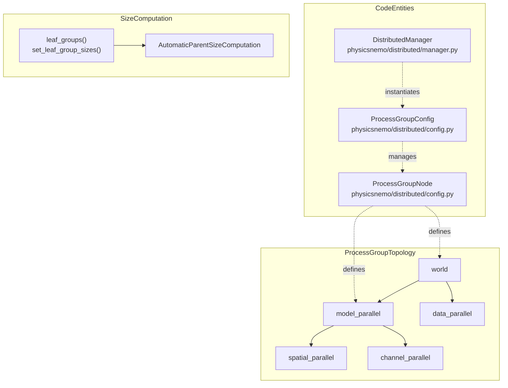
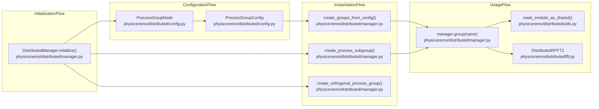

<!-- source: DeepWiki mcp.deepwiki.com · repo NVIDIA/physicsnemo · page 5.3 Process Groups and Parallelism · fetched 2026-11-04 -->

# Process Groups and Parallelism

<details>
<summary>Relevant source files</summary>

The following files were used as context for generating this wiki page:

- [docs/api/physicsnemo.domain_parallel.rst](docs/api/physicsnemo.domain_parallel.rst)
- [docs/test_scripts/domain_parallelism/new_layers/knn_brute_force_ring_sharded.py](docs/test_scripts/domain_parallelism/new_layers/knn_brute_force_ring_sharded.py)
- [docs/test_scripts/domain_parallelism/new_layers/knn_brute_force_sharded.py](docs/test_scripts/domain_parallelism/new_layers/knn_brute_force_sharded.py)
- [docs/test_scripts/domain_parallelism/new_layers/reshape_subtract.py](docs/test_scripts/domain_parallelism/new_layers/reshape_subtract.py)
- [docs/test_scripts/domain_parallelism/new_layers/vector_add_sharded.py](docs/test_scripts/domain_parallelism/new_layers/vector_add_sharded.py)
- [docs/test_scripts/domain_parallelism/new_layers/vector_dot_sharded.py](docs/test_scripts/domain_parallelism/new_layers/vector_dot_sharded.py)
- [docs/test_scripts/domain_parallelism/sharded_conv_example.py](docs/test_scripts/domain_parallelism/sharded_conv_example.py)
- [examples/minimal/ShardTensorExamples/4_convolution/README.md](examples/minimal/ShardTensorExamples/4_convolution/README.md)
- [examples/minimal/ShardTensorExamples/4_convolution/sharded_conv.py](examples/minimal/ShardTensorExamples/4_convolution/sharded_conv.py)
- [physicsnemo/distributed/manager.py](physicsnemo/distributed/manager.py)
- [test/conftest.py](test/conftest.py)
- [test/datapipes/test_climate.py](test/datapipes/test_climate.py)
- [test/datapipes/test_mesh_datapipe.py](test/datapipes/test_mesh_datapipe.py)
- [test/distributed/test_config.py](test/distributed/test_config.py)
- [test/distributed/test_distributed_fft.py](test/distributed/test_distributed_fft.py)
- [test/distributed/test_manager.py](test/distributed/test_manager.py)
- [test/distributed/test_manager_timeout.py](test/distributed/test_manager_timeout.py)
- [test/domain_parallel/ops/test_cross.py](test/domain_parallel/ops/test_cross.py)
- [test/models/sfno/test_sfno.py](test/models/sfno/test_sfno.py)

</details>


## Purpose and Scope

This document covers PhysicsNeMo's process group system for organizing parallel computations across multiple devices and nodes. Process groups define hierarchical communication topologies that enable different parallelism strategies: model parallelism (sharding model parameters), data parallelism (replicating models with gradient synchronization), spatial parallelism (domain decomposition for large grids/meshes), and Fully Sharded Data Parallel (FSDP) integration. Additionally, this page outlines the architectural split between the `physicsnemo.domain_parallel` subsystem (for tensor sharding and mesh operations) and the `physicsnemo.distributed` subsystem (for process management and topology configuration).

The system is built around the `DistributedManager` singleton, which manages the lifecycle of these groups. For core manager initialization, see [DistributedManager (5.1)](). For distributed tensor operations within these groups, see [ShardTensor System (5.2)](). For communication primitives, see [Communication Primitives (5.4)]().

Sources: [physicsnemo/distributed/manager.py:68-129](), [test/distributed/test_config.py:36-68]()

---

## Process Group Hierarchy

PhysicsNeMo organizes parallel processes into a hierarchical tree structure. Each node in the tree represents a process group containing a subset of all processes. Child groups partition their parent's processes into non-overlapping subsets (subgroups) or orthogonal decompositions.

### ProcessGroupNode

`ProcessGroupNode` represents a single node in the process group hierarchy. It stores the group's name, size (number of processes), and relationships to parent/child nodes.

**Key attributes:**
- `name`: String identifier for the group.
- `size`: Number of processes in this group.
- `parent`: Reference to parent node.
- `children`: List of child nodes.

Sources: [physicsnemo/distributed/config.py:29-30](), [test/distributed/test_config.py:38-40]()

### ProcessGroupConfig

`ProcessGroupConfig` manages the complete hierarchy starting from a root node (usually "world"). It provides methods to add nodes, set sizes, and validate the configuration before instantiation.

**Key methods:**
- `add_node(node, parent)`: Add a child node to the hierarchy [test/distributed/test_config.py:45-50]().
- `set_leaf_group_sizes(sizes_dict)`: Set sizes for leaf groups, automatically computing parent sizes [test/distributed/test_config.py:60-61]().
- `get_node(name)`: Retrieve a node by name [test/distributed/test_config.py:63-67]().
- `leaf_groups()`: Return list of leaf group names [test/distributed/test_config.py:53-57]().

**Hierarchy Example:**
```
world (24 processes)
├── model_parallel (6 processes)
│   ├── spatial_parallel (2 processes)
│   └── channel_parallel (3 processes)
└── data_parallel (4 processes)
```

In this configuration, `spatial_parallel` and `channel_parallel` are leaves with sizes 2 and 3. Their parent `model_parallel` has size 2×3=6. Since there are 4 `data_parallel` groups (one per model), `world` has 6×4=24 processes.

Sources: [test/distributed/test_config.py:36-68](), [physicsnemo/distributed/config.py:29-30]()

---

## Hierarchical Process Group Structure



Sources: [physicsnemo/distributed/config.py:29-30](), [test/distributed/test_config.py:36-68]()

---

## Creating Process Groups

PhysicsNeMo provides several methods for creating process groups through `DistributedManager`.

### Method 1: Subgroups

`DistributedManager.create_process_subgroup(name, size, group_name=None, verbose=False)` creates non-overlapping subgroups by partitioning a parent group into chunks of `size` processes.

**Example:** Create model-parallel groups of size 4:
```python
DistributedManager.create_process_subgroup("model_parallel", 4)
```
Sources: [test/distributed/test_distributed_fft.py:40-42]()

### Method 2: Orthogonal Groups

`DistributedManager.create_orthogonal_process_group(name, orthogonal_group_name, verbose=False)` creates groups orthogonal to an existing group. Processes in the same subgroup of `orthogonal_group_name` are placed in different groups of `name`.

**Example:** Create data-parallel groups orthogonal to model-parallel:
```python
DistributedManager.create_orthogonal_process_group("data_parallel", "model_parallel")
```
Sources: [test/distributed/test_distributed_fft.py:44-46]()

### Method 3: Config-Based Creation

`DistributedManager.create_groups_from_config(config, verbose=False)` creates all groups in a `ProcessGroupConfig` hierarchy. This is the robust approach for complex multi-level hierarchies.

Sources: [test/distributed/test_config.py:115](), [physicsnemo/distributed/manager.py:68-129]()

---

## Querying Process Groups

After creation, `DistributedManager` provides methods to query group properties. All methods accept an optional `name` parameter (default: `None`, which refers to the default/world group [physicsnemo/distributed/manager.py:204-213]()).

### Key Query Methods

| Method | Return Type | Description |
|--------|-------------|-------------|
| `group(name=None)` | `dist.ProcessGroup` | PyTorch distributed process group handle [physicsnemo/distributed/manager.py:204-215]() |
| `group_names` | `List[str]` | List of all named process groups created [physicsnemo/distributed/manager.py:169-173]() |
| `rank` | `int` | Global process rank [physicsnemo/distributed/manager.py:134-136]() |
| `world_size` | `int` | Total number of processes [physicsnemo/distributed/manager.py:143-145]() |

**Error Handling:** Querying an undefined group raises `PhysicsNeMoUndefinedGroupError` [physicsnemo/distributed/manager.py:36-51]().

Sources: [physicsnemo/distributed/manager.py:134-215]()

---

## Parallelism Strategies and FSDP Integration

### Model Parallelism
Shards model parameters across devices. This is managed via the `model_parallel` group, used in neural operators like AFNO and FNO to shard large linear layers or spectral transforms [test/distributed/test_distributed_fft.py:39-42]().

### Data Parallelism and FSDP Integration
Replicates or shards model states across devices. PhysicsNeMo integrates standard data parallelism with PyTorch's Fully Sharded Data Parallel (FSDP) over the `data_parallel` or hybrid process groups, enabling memory-efficient scaling of large architectures such as GraphCast and large Diffusion Transformers (DiT).

### Spatial Parallelism
Decomposes spatial domains (grids/meshes) across devices using `spatial_parallel` subgroups to handle extremely large simulation domains [test/distributed/test_distributed_fft.py:48-53]().

Sources: [test/distributed/test_config.py:75-88](), [test/distributed/test_distributed_fft.py:39-53]()

---

## Domain Parallel vs Distributed Module Split

PhysicsNeMo separates distributed infrastructure into two complementary namespaces:

1. **`physicsnemo.distributed`**: Manages low-level process group topologies, rank mapping, initialization launchers (Slurm, OpenMPI, ENV), and communication primitives (`DistributedManager`, `ProcessGroupConfig`, `ProcessGroupNode`) [physicsnemo/distributed/manager.py:68-129]().
2. **`physicsnemo.domain_parallel`**: Implements high-level tensor abstractions and domain decomposition operators (`ShardTensor`, `scatter_tensor`, `sync_module_over_mesh`) that sit on top of PyTorch's `DTensor` and use the process groups defined by `DistributedManager` [docs/test_scripts/domain_parallelism/sharded_conv_example.py:6-11]().

Sources: [physicsnemo/distributed/manager.py:68-129](), [docs/test_scripts/domain_parallelism/sharded_conv_example.py:6-11]()

---

## Integration and Communication

### Shared Module Parameters
`mark_module_as_shared(module, group_name, recurse=True)` flags parameters that are replicated across a group and require gradient reduction.

### Distributed FFT
`DistributedRFFT2` implements a 2D Real FFT that operates across a distributed process group (typically `spatial_parallel`), handling transposes and communication internally [physicsnemo/distributed/fft.py:24](), [test/distributed/test_distributed_fft.py:120]().

### Autograd Communication Primitives
PhysicsNeMo provides custom autograd-aware communication primitives in `physicsnemo.distributed.autograd`:
- `scatter_v`: Variable-sized scatter.
- `gather_v`: Variable-sized gather.
- `all_gather_v`: Variable-sized all-gather.
- `indexed_all_to_all_v`: All-to-all with indexing support.

Sources: [physicsnemo/distributed/fft.py:24](), [test/distributed/test_distributed_fft.py:120]()

---

## Process Group Creation and Usage Flow



Sources: [physicsnemo/distributed/manager.py:68-129](), [physicsnemo/distributed/fft.py:24](), [test/distributed/test_config.py:115]()

---

## Summary of Key Entities

| Code Entity | File Path | Role |
|-------------|-----------|------|
| `DistributedManager` | `physicsnemo/distributed/manager.py` | Singleton managing distributed state and groups. |
| `ProcessGroupConfig` | `physicsnemo/distributed/config.py` | Defines the tree structure of parallel groups. |
| `ProcessGroupNode` | `physicsnemo/distributed/config.py` | Individual node in the hierarchy. |
| `ShardTensor` | `physicsnemo/domain_parallel/_tensor.py` | DTensor extension for uneven sharding and domain parallelism. |
| `all_gather_v` | `physicsnemo/distributed/autograd.py` | Communication primitive for unevenly sharded tensors. |

Sources: [physicsnemo/distributed/manager.py:68-129](), [physicsnemo/distributed/config.py:29-30]()

---

