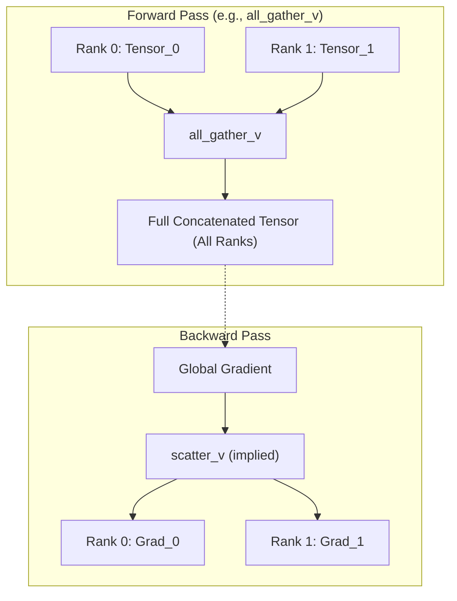
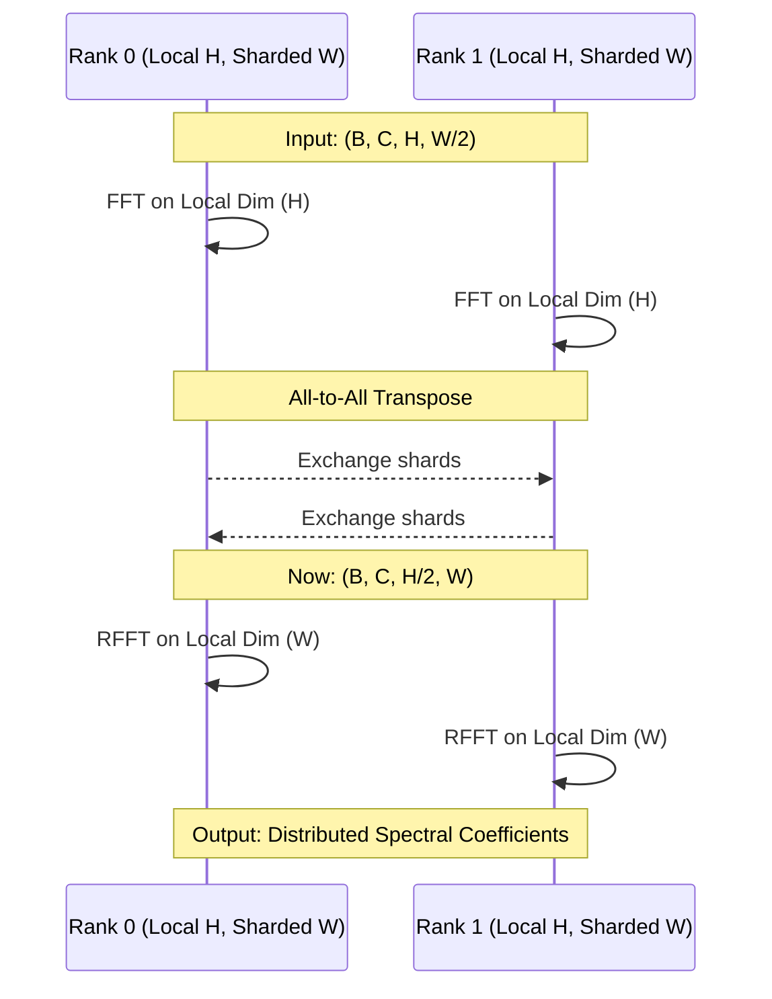
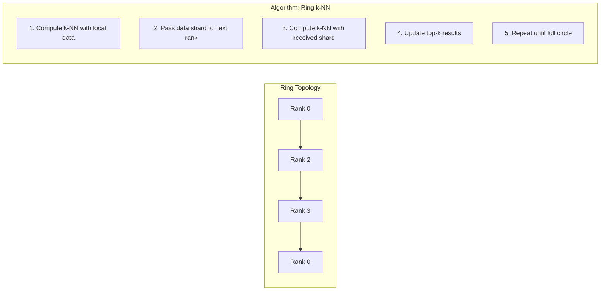
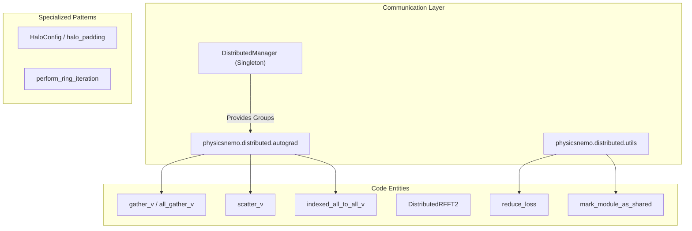

<!-- source: DeepWiki mcp.deepwiki.com · repo NVIDIA/physicsnemo · page 5.4 Communication Primitives · fetched 2026-11-04 -->

# Communication Primitives

Relevant source files

The following files were used as context for generating this wiki page:

- [physicsnemo/distributed/manager.py](physicsnemo/distributed/manager.py)
- [physicsnemo/domain_parallel/custom_ops/_reductions.py](physicsnemo/domain_parallel/custom_ops/_reductions.py)
- [physicsnemo/domain_parallel/shard_utils/normalization_patches.py](physicsnemo/domain_parallel/shard_utils/normalization_patches.py)
- [physicsnemo/domain_parallel/shard_utils/ring.py](physicsnemo/domain_parallel/shard_utils/ring.py)
- [test/conftest.py](test/conftest.py)
- [test/datapipes/test_climate.py](test/datapipes/test_climate.py)
- [test/datapipes/test_mesh_datapipe.py](test/datapipes/test_mesh_datapipe.py)
- [test/distributed/test_config.py](test/distributed/test_config.py)
- [test/distributed/test_distributed_fft.py](test/distributed/test_distributed_fft.py)
- [test/distributed/test_manager.py](test/distributed/test_manager.py)
- [test/distributed/test_manager_timeout.py](test/distributed/test_manager_timeout.py)
- [test/domain_parallel/ops/test_convolution.py](test/domain_parallel/ops/test_convolution.py)
- [test/domain_parallel/ops/test_cross.py](test/domain_parallel/ops/test_cross.py)
- [test/domain_parallel/ops/test_knn.py](test/domain_parallel/ops/test_knn.py)
- [test/domain_parallel/ops/test_normalization.py](test/domain_parallel/ops/test_normalization.py)
- [test/domain_parallel/ops/utils.py](test/domain_parallel/ops/utils.py)
- [test/domain_parallel/test_grad_sharding.py](test/domain_parallel/test_grad_sharding.py)
- [test/domain_parallel/test_reductions.py](test/domain_parallel/test_reductions.py)
- [test/models/sfno/test_sfno.py](test/models/sfno/test_sfno.py)
- [test/models/test_distributed_graph.py](test/models/test_distributed_graph.py)

## Purpose and Scope

This page documents PhysicsNeMo's communication primitives for distributed tensor operations. These primitives extend PyTorch's standard collective operations to handle **variable-sized data** and **uneven sharding** — critical requirements for scientific computing workloads where data is irregularly distributed, such as adaptive meshes, variable-sized point clouds, or spectral methods.

Standard PyTorch collectives (`all_gather`, `scatter`, `gather`) often assume equal chunk sizes across ranks. PhysicsNeMo provides **variable-sized variants** (`all_gather_v`, `scatter_v`, `gather_v`, `indexed_all_to_all_v`) that accept different-sized tensors per rank, along with specialized communication patterns like **ring passing**, **halo exchange**, and **distributed FFT**.

For overall distributed system architecture, see [Distributed Manager](5.1). For tensor sharding abstractions, see [ShardTensor System](5.2).

---

## Variable-Sized Collective Operations

PhysicsNeMo implements custom autograd-supported collectives in `physicsnemo.distributed.autograd` to handle uneven data distributions. These functions wrap `torch.distributed` calls while providing the necessary `backward` passes for gradient flow.

### Supported Variable Collectives

| Operation | Function Name | Description |
|-----------|---------------|-------------|
| **Scatter** | `scatter_v` | Scatters different-sized chunks from a source rank to all other ranks. [physicsnemo/distributed/autograd.py:25-26]() |
| **Gather** | `gather_v` | Gathers different-sized chunks from all ranks to a single destination rank. [physicsnemo/distributed/autograd.py:23-24]() |
| **All-Gather** | `all_gather_v` | Gathers different-sized chunks from all ranks and broadcasts the result to all ranks. [physicsnemo/distributed/autograd.py:22-22]() |
| **Indexed All-to-All** | `indexed_all_to_all_v` | Performs a sparse, targeted exchange where each rank sends/receives specific indices of data. [physicsnemo/distributed/autograd.py:24-24]() |

### Autograd Support and Data Flow

These primitives are implemented as `torch.autograd.Function` subclasses. This ensures that when a variable-sized tensor is gathered in the forward pass, the gradients are correctly scattered (or reduced) in the backward pass.

**Implementation Details**:
- `scatter_v`: The backward pass performs a `gather_v` to return gradients to the source rank. [test/distributed/test_autograd.py:53-65]()
- `all_gather_v`: The backward pass performs a `reduce_scatter` (or equivalent) to aggregate gradients across ranks. [test/distributed/test_autograd.py:119-135]()
- `indexed_all_to_all_v`: Uses index lists to route data; the backward pass uses the same indices to route gradients back to their origins. [test/distributed/test_autograd.py:139-177]()

**Sources**: [physicsnemo/distributed/autograd.py:22-26](), [test/distributed/test_autograd.py:36-177]()

---

## Distributed Fast Fourier Transform (FFT)

For models like AFNO (Adaptive Fourier Neural Operator) and FNO, PhysicsNeMo provides `DistributedRFFT2`. This primitive allows computing 2D Real FFTs across tensors sharded along spatial dimensions.

### DistributedRFFT2 Mechanism

Computing a 2D FFT on a distributed grid requires transposing data so that the dimension being transformed is local to the rank.

**Key Features**:
- **Dimension Agnostic**: Supports splitting along different dimensions (e.g., input split on `-1`, output split on `-2`). [test/distributed/test_distributed_fft.py:81-82]()
- **Normalization**: Supports standard FFT normalizations like `"ortho"`. [test/distributed/test_distributed_fft.py:120-120]()
- **Complex Support**: Handles the transition between real and complex tensors during the transform. [test/distributed/test_distributed_fft.py:154-160]()

**Sources**: [physicsnemo/distributed/fft.py:24-24](), [test/distributed/test_distributed_fft.py:69-143]()

---

## Ring Communication Pattern

Ring-based communication circulates data among ranks in a circular topology. This is used extensively for **Distributed k-Nearest Neighbors (k-NN)** and **Radius Search**, allowing each rank to compare its local queries against the entire global dataset without ever materializing the full dataset on a single GPU.

### Ring Iteration Sequence

**Implementation Components**:
- `perform_ring_iteration`: The core utility for passing a tensor to the next rank while receiving from the previous.
- `ring_knn`: Orchestrates the circulation of point shards to compute global neighbors.
- `merge_outputs`: A specialized Warp kernel used to merge results from different ring steps.

**Sources**: [physicsnemo/distributed/shard_utils/knn.py:38-169](), [physicsnemo/distributed/shard_utils/point_cloud_ops.py:45-147]()

---

## Halo Exchange for Stencil Operations

Halo exchange (ghost cell exchange) is required for operations like convolutions on spatially sharded data. Ranks exchange boundary regions ("halos") to ensure that the convolution kernel has access to the necessary neighbor pixels.

### HaloConfig and Padding

The `HaloConfig` dataclass defines the exchange requirements:
- `halo_size`: Determined by the convolution kernel size, dilation, and stride. [physicsnemo/distributed/shard_utils/conv_patches.py:64-116]()
- `edge_padding_size`: Handles boundaries for the overall domain (e.g., zero-padding at the physical edges of a simulation). [physicsnemo/distributed/shard_utils/conv_patches.py:318-326]()

### Distributed Convolution Flow

1. **Calculate Halos**: `compute_halo_configs_from_conv_args` determines how many pixels must be fetched from neighbors. [physicsnemo/distributed/shard_utils/conv_patches.py:405-409]()
2. **Exchange**: `halo_padding` performs the actual `P2P` or `All-to-All` communication. [physicsnemo/distributed/shard_utils/conv_patches.py:466-467]()
3. **Local Compute**: Standard `torch.nn.functional.conv2d` is called on the padded local tensor.
4. **Gradient Sync**: `ConvGradReducer` ensures that weight gradients are all-reduced across the process group. [physicsnemo/distributed/shard_utils/conv_patches.py:333-364]()

**Sources**: [physicsnemo/distributed/shard_utils/conv_patches.py:155-240](), [physicsnemo/distributed/shard_utils/conv_patches.py:367-503]()

---

## Summary of Communication Entities

This diagram maps the natural language concepts to the specific code entities in the `physicsnemo.distributed` namespace.

**Sources**: [physicsnemo/distributed/autograd.py:22-26](), [physicsnemo/distributed/utils.py:27-31](), [physicsnemo/distributed/fft.py:24-24](), [test/distributed/test_utils.py:24-31]()

---

