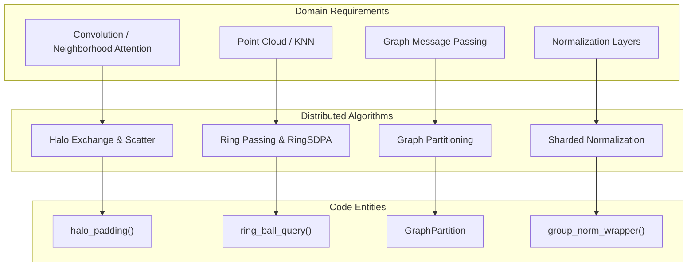
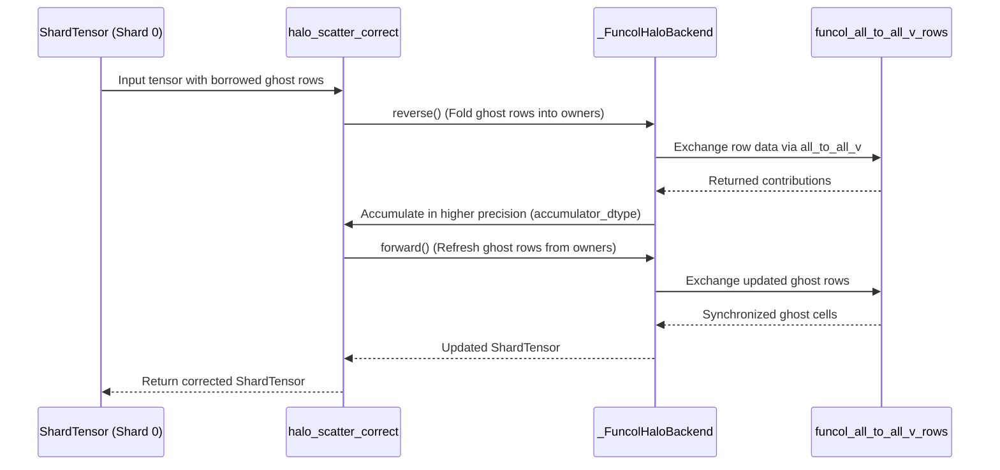
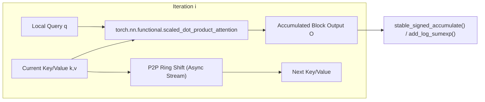

<!-- source: DeepWiki mcp.deepwiki.com · repo NVIDIA/physicsnemo · page 5.5 Distributed Algorithms · fetched 2026-11-04 -->

# Distributed Algorithms

Relevant source files

The following files were used as context for generating this wiki page:

- [physicsnemo/domain_parallel/__init__.py](physicsnemo/domain_parallel/__init__.py)
- [physicsnemo/domain_parallel/_shard_redistribute.py](physicsnemo/domain_parallel/_shard_redistribute.py)
- [physicsnemo/domain_parallel/_shard_tensor_spec.py](physicsnemo/domain_parallel/_shard_tensor_spec.py)
- [physicsnemo/domain_parallel/custom_ops/__init__.py](physicsnemo/domain_parallel/custom_ops/__init__.py)
- [physicsnemo/domain_parallel/custom_ops/_reductions.py](physicsnemo/domain_parallel/custom_ops/_reductions.py)
- [physicsnemo/domain_parallel/custom_ops/_tensor_ops.py](physicsnemo/domain_parallel/custom_ops/_tensor_ops.py)
- [physicsnemo/domain_parallel/shard_tensor.py](physicsnemo/domain_parallel/shard_tensor.py)
- [physicsnemo/domain_parallel/shard_utils/__init__.py](physicsnemo/domain_parallel/shard_utils/__init__.py)
- [physicsnemo/domain_parallel/shard_utils/attention_patches.py](physicsnemo/domain_parallel/shard_utils/attention_patches.py)
- [physicsnemo/domain_parallel/shard_utils/conv_patches.py](physicsnemo/domain_parallel/shard_utils/conv_patches.py)
- [physicsnemo/domain_parallel/shard_utils/grad_ops.py](physicsnemo/domain_parallel/shard_utils/grad_ops.py)
- [physicsnemo/domain_parallel/shard_utils/halo_scatter.py](physicsnemo/domain_parallel/shard_utils/halo_scatter.py)
- [physicsnemo/domain_parallel/shard_utils/linear_patches.py](physicsnemo/domain_parallel/shard_utils/linear_patches.py)
- [physicsnemo/domain_parallel/shard_utils/natten_patches.py](physicsnemo/domain_parallel/shard_utils/natten_patches.py)
- [physicsnemo/domain_parallel/shard_utils/normalization_patches.py](physicsnemo/domain_parallel/shard_utils/normalization_patches.py)
- [physicsnemo/domain_parallel/shard_utils/point_cloud_ops.py](physicsnemo/domain_parallel/shard_utils/point_cloud_ops.py)
- [physicsnemo/domain_parallel/shard_utils/ring.py](physicsnemo/domain_parallel/shard_utils/ring.py)
- [physicsnemo/models/geotransolver/context_projector.py](physicsnemo/models/geotransolver/context_projector.py)
- [physicsnemo/nn/module/gale.py](physicsnemo/nn/module/gale.py)
- [test/domain_parallel/models/harness.py](test/domain_parallel/models/harness.py)
- [test/domain_parallel/models/test_geotransolver.py](test/domain_parallel/models/test_geotransolver.py)
- [test/domain_parallel/ops/test_async_collective_gradients.py](test/domain_parallel/ops/test_async_collective_gradients.py)
- [test/domain_parallel/ops/test_compile_ops.py](test/domain_parallel/ops/test_compile_ops.py)
- [test/domain_parallel/ops/test_convolution.py](test/domain_parallel/ops/test_convolution.py)
- [test/domain_parallel/ops/test_knn.py](test/domain_parallel/ops/test_knn.py)
- [test/domain_parallel/ops/test_normalization.py](test/domain_parallel/ops/test_normalization.py)
- [test/domain_parallel/ops/utils.py](test/domain_parallel/ops/utils.py)
- [test/domain_parallel/test_grad_sharding.py](test/domain_parallel/test_grad_sharding.py)
- [test/domain_parallel/test_redistribute.py](test/domain_parallel/test_redistribute.py)
- [test/domain_parallel/test_reductions.py](test/domain_parallel/test_reductions.py)
- [test/domain_parallel/test_shard_alignment.py](test/domain_parallel/test_shard_alignment.py)
- [test/models/test_distributed_graph.py](test/models/test_distributed_graph.py)

This page documents domain-specific distributed algorithms implemented in PhysicsNeMo for scaling neural operators, graph neural networks, point cloud processing, and attention mechanisms across multiple GPUs. These algorithms handle the coordination patterns required for different physics simulation workloads using the `ShardTensor` distributed subsystem.

For low-level communication primitives (`scatter_v`, `gather_v`, `all_gather_v`, etc.), see **5.4 Communication Primitives**. For the process group setup and parallelism strategies, see **5.3 Process Groups and Parallelism**. For the `ShardTensor` abstraction that enables uneven sharding, see **5.2 ShardTensor System**.

## Overview of Distributed Algorithms

PhysicsNeMo implements high-level distributed algorithms that compose communication primitives into domain-specific patterns, intercepting operations through `ShardTensor` registration mechanisms [physicsnemo/domain_parallel/shard_utils/__init__.py:27-50]().

Title: Distributed Algorithms Mapping

Each algorithm solves a specific challenge:
- **Halo Exchange**: Convolutions and neighborhood attention need neighbor data from adjacent ranks [physicsnemo/domain_parallel/shard_utils/halo_scatter.py:17-26](), [physicsnemo/domain_parallel/shard_utils/natten_patches.py:141-212]().
- **Ring Passing**: kNN, radius search, and scaled dot-product attention must coordinate across all points or sequence chunks without materializing full global tensors on a single rank [physicsnemo/domain_parallel/shard_utils/attention_patches.py:137-184](), [physicsnemo/domain_parallel/shard_utils/point_cloud_ops.py:48-103]().
- **Graph Partitioning**: GNN message passing requires nodes to know their partition boundaries [physicsnemo/models/gnn_layers/graph_partition.py]().
- **Sharded Normalization**: Operations like GroupNorm must reduce statistics across sharded dimensions [physicsnemo/domain_parallel/shard_utils/normalization_patches.py]().

Sources: [physicsnemo/domain_parallel/shard_utils/__init__.py:27-50](), [physicsnemo/domain_parallel/shard_utils/halo_scatter.py:17-26](), [physicsnemo/domain_parallel/shard_utils/natten_patches.py:141-212]()

## Halo Exchange and Symmetric Memory Backends

Spatially sharded tensors require data from neighboring ranks to compute boundary outputs correctly. PhysicsNeMo implements **halo exchange** and torch.compile-safe scatter-correction primitives (`halo_scatter_correct`) to gather boundary data [physicsnemo/domain_parallel/shard_utils/halo_scatter.py:17-26]().

### Transport Backends and Pluggable Communication
Data movement for halo exchanges is handled by pluggable transport backends (such as `_FuncolHaloBackend`) chosen via `select_halo_backend()` [physicsnemo/domain_parallel/shard_utils/halo_scatter.py:24-26](). These backends utilize variable-sized row collectives (`funcol_all_to_all_v_rows`) to exchange ghost cell regions between adjacent ranks [physicsnemo/domain_parallel/shard_utils/halo_scatter.py:82-103]().

Title: Halo Exchange and Scatter Flow

Sources: [physicsnemo/domain_parallel/shard_utils/halo_scatter.py:17-103](), [physicsnemo/domain_parallel/shard_utils/halo_scatter.py:134-183]()

## Ring Attention and Ring Point-Cloud Passing

Point cloud operations and sequence modeling require global contextual awareness across ranks without storing monolithic tensors in memory. PhysicsNeMo uses ring-passing patterns for ball queries and scaled dot-product attention (`RingSDPA`) [physicsnemo/domain_parallel/shard_utils/attention_patches.py:137-184](), [physicsnemo/domain_parallel/shard_utils/point_cloud_ops.py:48-103]().

### RingSDPA Implementation
`RingSDPA` performs scaled dot-product attention on sharded queries, keys, and values (`q`, `k`, `v`) by circulating keys and values through a peer-to-peer ring [physicsnemo/domain_parallel/shard_utils/attention_patches.py:137-184](). Communication is overlapped with computation using a dedicated communication stream and double-buffered K/V tensors.

To prevent underflow, overflow, and precision loss during block-wise accumulation across ring iterations, normalizations are tracked in log space using stable log-sum-accumulate routines (`add_log_sumexp` and `stable_signed_accumulate`) [physicsnemo/domain_parallel/shard_utils/attention_patches.py:47-135]().

Title: RingSDPA Iteration Flow

Sources: [physicsnemo/domain_parallel/shard_utils/attention_patches.py:47-184](), [physicsnemo/domain_parallel/shard_utils/point_cloud_ops.py:48-103]()

## Conv, Linear, Normalization, and NATTEN Patches

PhysicsNeMo registers operation wrappers that intercept standard PyTorch and third-party function calls for `ShardTensor` arguments [physicsnemo/domain_parallel/shard_utils/__init__.py:27-50]().

### Key Operation Patches

| Patch Module | Intercepted Function / Class | Distributed Behavior |
| :--- | :--- | :--- |
| `natten_patches.py` | `na1d`, `na2d`, `na3d` [physicsnemo/domain_parallel/shard_utils/natten_patches.py:36-43]() | Computes spatial halos based on kernel size and dilation, pads tensors, evaluates neighborhood attention, and removes halos [physicsnemo/domain_parallel/shard_utils/natten_patches.py:142-202](). |
| `conv_patches.py` | `generic_conv_nd_wrapper` [physicsnemo/domain_parallel/shard_utils/__init__.py:34]() | Computes receptive field requirements, manages boundary edge padding, and synchronizes gradient reductions via `ConvGradReducer` [physicsnemo/domain_parallel/shard_utils/conv_patches.py:64-116](). |
| `linear_patches.py` | `linear_wrapper` [physicsnemo/domain_parallel/shard_utils/__init__.py:41]() | Handles sharded linear layers and weight auto-promotion [physicsnemo/domain_parallel/shard_tensor.py:59-82](). |
| `normalization_patches.py` | `group_norm_wrapper` [physicsnemo/domain_parallel/shard_utils/__init__.py:44]() | Computes local means and variances, performing cross-rank all-reduces over sharded axes. |

Sources: [physicsnemo/domain_parallel/shard_utils/__init__.py:27-50](), [physicsnemo/domain_parallel/shard_utils/conv_patches.py:64-116](), [physicsnemo/domain_parallel/shard_utils/natten_patches.py:36-202]()

## Mesh Operations and Sharded SDF

For geometric deep learning and CFD applications, mesh operations are distributed across domains [physicsnemo/domain_parallel/shard_utils/mesh_ops.py](). The `sharded_signed_distance_field_wrapper` [physicsnemo/domain_parallel/shard_utils/__init__.py:42]() coordinates domain-parallel signed distance field (SDF) queries, ensuring that query points near partition boundaries correctly evaluate geometry data across neighboring ranks.

Sources: [physicsnemo/domain_parallel/shard_utils/__init__.py:42](), [physicsnemo/domain_parallel/shard_utils/mesh_ops.py]()

## Summary of Distributed Patterns

| Pattern | Implementation Entity | Primary Communication |
| :--- | :--- | :--- |
| **Halo Exchange** | `halo_scatter_correct` / `halo_padding` [physicsnemo/domain_parallel/shard_utils/halo_scatter.py:42](), [physicsnemo/domain_parallel/shard_utils/halo.py]() | `funcol_all_to_all_v_rows` [physicsnemo/domain_parallel/shard_utils/halo_scatter.py:82]() |
| **Ring Attention** | `RingSDPA` [physicsnemo/domain_parallel/shard_utils/attention_patches.py:137]() | Peer-to-peer ring passing [physicsnemo/domain_parallel/shard_utils/ring.py]() |
| **Ring Point Cloud** | `ring_ball_query` [physicsnemo/domain_parallel/shard_utils/point_cloud_ops.py:48]() | Peer-to-peer ring passing |
| **Normalization** | `group_norm_wrapper` [physicsnemo/domain_parallel/shard_utils/normalization_patches.py]() | `all_reduce` |
| **Neighborhood Attention** | `_partial_natten` [physicsnemo/domain_parallel/shard_utils/natten_patches.py:142]() | Halo exchange + local attention |

Sources: [physicsnemo/domain_parallel/shard_utils/halo_scatter.py:42](), [physicsnemo/domain_parallel/shard_utils/attention_patches.py:137](), [physicsnemo/domain_parallel/shard_utils/point_cloud_ops.py:48](), [physicsnemo/domain_parallel/shard_utils/normalization_patches.py](), [physicsnemo/domain_parallel/shard_utils/natten_patches.py:142]()

---

