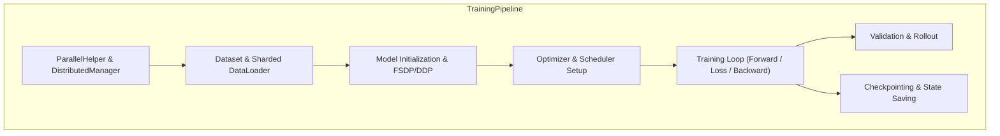
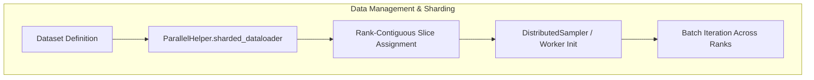
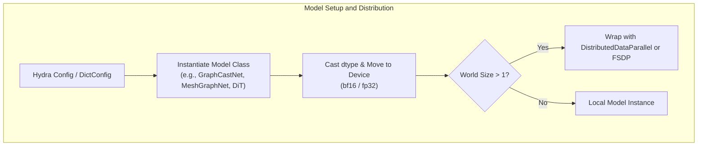
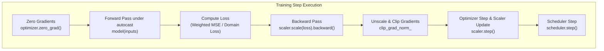
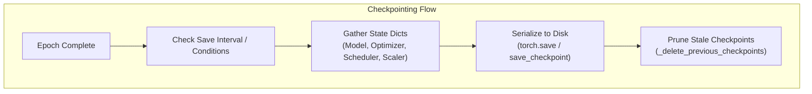

<!-- source: DeepWiki mcp.deepwiki.com · repo NVIDIA/physicsnemo · page 6.1 Training Pipeline · fetched 2026-11-04 -->

# Training Pipeline

Relevant source files

The following files were used as context for generating this wiki page:

- [examples/cfd/external_aerodynamics/domino/src/benchmark_dataloader.py](examples/cfd/external_aerodynamics/domino/src/benchmark_dataloader.py)
- [examples/cfd/external_aerodynamics/domino_nim_finetuning/src/train.py](examples/cfd/external_aerodynamics/domino_nim_finetuning/src/train.py)
- [examples/cfd/external_aerodynamics/figconvnet/configs/base.yaml](examples/cfd/external_aerodynamics/figconvnet/configs/base.yaml)
- [examples/cfd/external_aerodynamics/figconvnet/train.py](examples/cfd/external_aerodynamics/figconvnet/train.py)
- [examples/cfd/external_aerodynamics/moe/train.py](examples/cfd/external_aerodynamics/moe/train.py)
- [examples/cfd/external_aerodynamics/xaeronet/volume/train.py](examples/cfd/external_aerodynamics/xaeronet/volume/train.py)
- [examples/cfd/transient_conjugate_heat_transfer_tank_fill/train.py](examples/cfd/transient_conjugate_heat_transfer_tank_fill/train.py)
- [examples/healthcare/bloodflow_1d_mgn/inference.py](examples/healthcare/bloodflow_1d_mgn/inference.py)
- [examples/healthcare/bloodflow_1d_mgn/train.py](examples/healthcare/bloodflow_1d_mgn/train.py)
- [examples/weather/graphcast/train_base.py](examples/weather/graphcast/train_base.py)
- [examples/weather/graphcast/train_graphcast.py](examples/weather/graphcast/train_graphcast.py)
- [examples/weather/regional_weather_diffusion/utils/logging.py](examples/weather/regional_weather_diffusion/utils/logging.py)
- [examples/weather/regional_weather_diffusion/utils/nn.py](examples/weather/regional_weather_diffusion/utils/nn.py)
- [examples/weather/regional_weather_diffusion/utils/parallel.py](examples/weather/regional_weather_diffusion/utils/parallel.py)
- [examples/weather/regional_weather_diffusion/utils/trainer.py](examples/weather/regional_weather_diffusion/utils/trainer.py)
- [test/common/optimization.py](test/common/optimization.py)

This document provides a comprehensive overview of the training pipeline in PhysicsNeMo, detailing the end-to-end training flow from data loading and distributed setup (DDP/FSDP) to the training loop, validation, epoch management, and reference trainers.

## Overview and Purpose

The training pipeline in PhysicsNeMo follows a modular design that supports diverse physics domains (weather, climate, CFD, external aerodynamics) and advanced model architectures (Neural Operators, GNNs, Diffusion Transformers, and UNets). The pipeline is structured to handle high-performance distributed computing while maintaining clean abstractions for forward passes, loss computation, scaling, and validation.

### Natural Language to Code Entity Space: Training Orchestration

| Concept | Code Entity | File Reference |
| :--- | :--- | :--- |
| **Diffusion/Regional Trainer** | `Trainer` | [examples/weather/regional_weather_diffusion/utils/trainer.py:57-100]() |
| **GraphCast Trainer** | `GraphCastTrainer` | [examples/weather/graphcast/train_graphcast.py:60-172]() |
| **MGN Trainer** | `MGNTrainer` | [examples/healthcare/bloodflow_1d_mgn/train.py:60-155]() |
| **Parallel Helper** | `ParallelHelper` | [examples/weather/regional_weather_diffusion/utils/parallel.py:41-61]() |

Sources: [examples/weather/graphcast/train_graphcast.py:60-172](), [examples/weather/regional_weather_diffusion/utils/trainer.py:57-187](), [examples/healthcare/bloodflow_1d_mgn/train.py:60-155]()

---

## Data Management and Distributed Sharding

PhysicsNeMo relies on specialized datapipe modules and PyTorch data loaders (`torch.utils.data.DataLoader` or `PyGDataLoader`) to supply training batches. For distributed training, particularly under spatial domain parallelism or large-scale data parallelism, custom sharding helpers partition the workload.

The `ParallelHelper` class sets up a 2D device mesh (e.g., combining data parallelism `ddp` and domain parallelism `domain`) and provides contiguous rank-sharded data loaders [examples/weather/regional_weather_diffusion/utils/parallel.py:41-114](). Contiguous slicing ensures that consecutive time steps required by weather or forecasting models remain coherent within local rank caches.

Sources: [examples/weather/regional_weather_diffusion/utils/parallel.py:41-171](), [examples/healthcare/bloodflow_1d_mgn/train.py:106-113]()

---

## Model Initialization and Distributed Setup (DDP/FSDP)

Models are constructed from configurations (typically managed via Hydra and OmegaConf) and transferred to target hardware devices with appropriate precision (`torch.float32`, `torch.bfloat16`, or mixed precision).

Distributed wrapping is handled using either standard PyTorch `DistributedDataParallel` (DDP) or Fully Sharded Data Parallel (FSDP2) combined with domain-parallel sharding primitives [examples/weather/graphcast/train_graphcast.py:167-172](), [examples/weather/regional_weather_diffusion/utils/trainer.py:139-164]().

### Natural Language to Code Entity Space: Model Distribution

| Concept | Code Entity | File Reference |
| :--- | :--- | :--- |
| **Model Distribute** | `ParallelHelper.distribute_model` | [examples/weather/regional_weather_diffusion/utils/parallel.py:149-164]() |
| **GraphCast DDP** | `DistributedDataParallel` | [examples/weather/graphcast/train_graphcast.py:168-172]() |
| **Preconditioner Wrap** | `EDMPreconditioner` | [examples/weather/regional_weather_diffusion/utils/nn.py:93-157]() |

Sources: [examples/weather/graphcast/train_graphcast.py:104-172](), [examples/weather/regional_weather_diffusion/utils/trainer.py:139-164](), [examples/weather/regional_weather_diffusion/utils/nn.py:36-157]()

---

## Optimizer and Loss Setup

Optimizers are configured directly on model parameters after distribution wrapping. Learning rate schedulers (such as `CosineAnnealingLR`, `SequentialLR`, or custom warmup schedulers) govern decay across training epochs or steps.

Loss formulations depend strongly on the physics application domain:
* **Climate/Weather Forecasts**: Cell-area weighted loss functions and spectral/grid loss [examples/weather/graphcast/train_graphcast.py:36-39]().
* **Diffusion Models**: Weighted MSE / Denoising Score Matching losses (`WeightedMSEDSMLoss`) coupled with noise schedulers (`EDMNoiseScheduler`) [examples/weather/regional_weather_diffusion/utils/trainer.py:32-38]().
* **Computational Fluid Dynamics (CFD)**: Masked Mean Squared Error (`masked_mse`) balancing surface and volume physics fields [examples/cfd/transient_conjugate_heat_transfer_tank_fill/train.py:91-101]().

Sources: [examples/weather/graphcast/train_graphcast.py:36-39](), [examples/weather/regional_weather_diffusion/utils/trainer.py:32-38](), [examples/cfd/transient_conjugate_heat_transfer_tank_fill/train.py:91-101]()

---

## Training Loop, Forward & Backward Passes

The core training step executes a forward pass inside an optional automatic mixed precision (AMP) context (`torch.amp.autocast`), computes loss, scales gradients via `GradScaler` if operating in `fp16`/`bf16`, clips gradients to control explosion (`clip_grad_norm_`), and steps the optimizer and scheduler.

In base trainers (e.g., `BaseTrainer` in GraphCast or `MGNTrainer`), time-stepping or auto-regressive rollouts accumulate losses across multiple rollout horizons before triggering backpropagation [examples/weather/graphcast/train_base.py:30-40](), [examples/healthcare/bloodflow_1d_mgn/train.py:173-208]().

Sources: [examples/weather/graphcast/train_base.py:24-84](), [examples/healthcare/bloodflow_1d_mgn/train.py:156-208]()

---

## Validation and Rollout

Validation routines run at fixed epoch intervals to evaluate generalization without gradient tracking (`@torch.no_grad()`). 
* For sequential physics models, validation executes multi-step rollouts where predicted states serve as subsequent inputs.
* Evaluation metrics are aggregated across ranks using `AverageMeterDict` or custom distributed collection wrappers to ensure metrics reflect the global validation domain [examples/cfd/external_aerodynamics/figconvnet/train.py:121-173]().

Sources: [examples/cfd/external_aerodynamics/figconvnet/train.py:121-189](), [examples/healthcare/bloodflow_1d_mgn/inference.py:47-188]()

---

## Checkpointing and Epoch Management

PhysicsNeMo provides unified utilities (`load_checkpoint` and `save_checkpoint`) to serialize and restore model weights, optimizer parameters, learning rate schedulers, gradient scalers, and epoch counters [examples/healthcare/bloodflow_1d_mgn/train.py:143-151](), [examples/cfd/external_aerodynamics/figconvnet/train.py:64-118]().

Checkpoints are typically written out by rank 0 or coordinated via distributed file locking, and older checkpoints can be pruned automatically to manage disk storage [examples/cfd/external_aerodynamics/figconvnet/train.py:49-79]().

Sources: [examples/cfd/external_aerodynamics/figconvnet/train.py:49-118](), [examples/healthcare/bloodflow_1d_mgn/train.py:143-151]()

---

## Reference Trainers & Training Optimizations

PhysicsNeMo reference implementations provide robust trainer classes equipped with production-ready training optimizations:
1. **Automatic Mixed Precision (AMP)**: Reduces memory overhead and accelerates tensor operations via `torch.amp.autocast` and `GradScaler`.
2. **Gradient Clipping**: Prevents exploding gradients via `clip_grad_norm_` [examples/weather/graphcast/train_base.py:69-75]().
3. **Torch Compile**: Optional model compilation (`torch.compile`) to fuse kernels and speed up graph execution [examples/weather/graphcast/train_graphcast.py:141-146]().
4. **Activation Recomputation / Checkpointing**: Lowers memory peaks in large graph neural networks and transformers by recomputing intermediate activations during the backward pass [examples/weather/graphcast/train_graphcast.py:131-139]().

Sources: [examples/weather/graphcast/train_graphcast.py:60-146](), [examples/weather/graphcast/train_base.py:24-84](), [examples/weather/regional_weather_diffusion/utils/trainer.py:57-187]()

---

