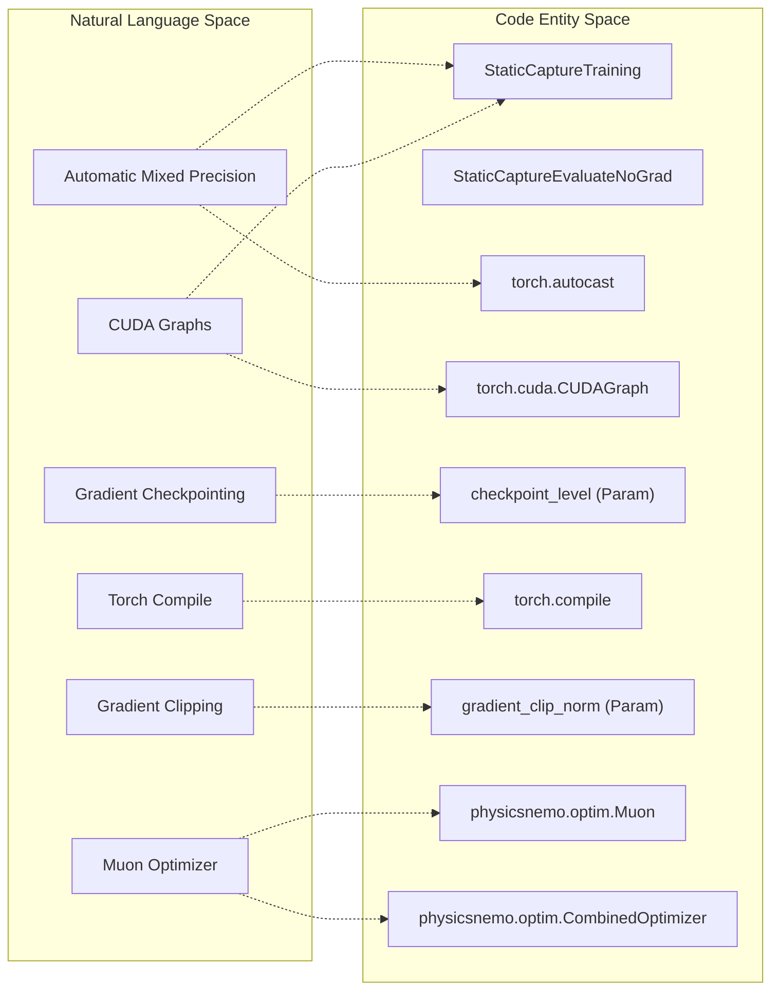
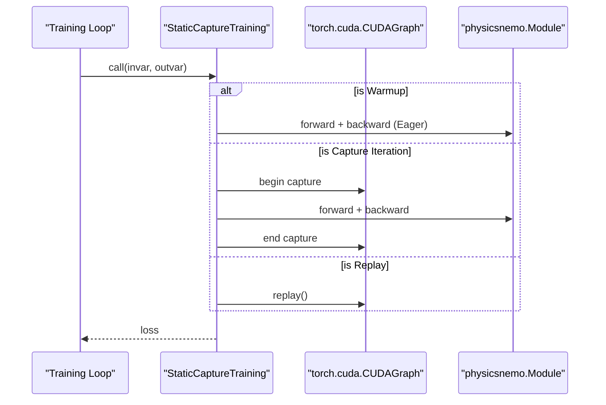
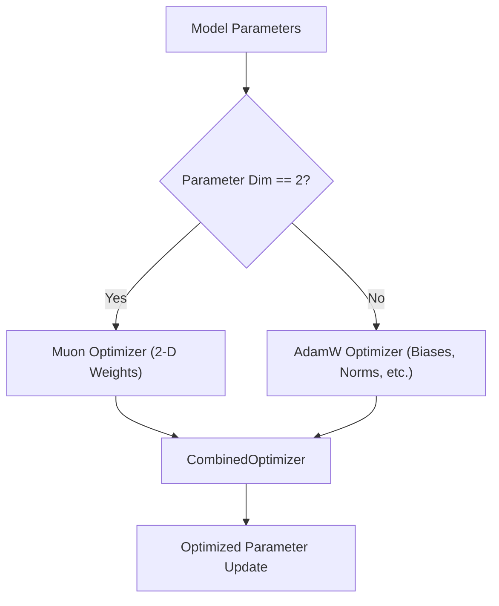

<!-- source: DeepWiki mcp.deepwiki.com · repo NVIDIA/physicsnemo · page 6.2 Optimization Techniques · fetched 2026-11-04 -->

# Optimization Techniques

Relevant source files

The following files were used as context for generating this wiki page:

- [docs/api/physicsnemo.optim.rst](docs/api/physicsnemo.optim.rst)
- [examples/cfd/external_aerodynamics/unified_external_aero_recipe/src/collate.py](examples/cfd/external_aerodynamics/unified_external_aero_recipe/src/collate.py)
- [examples/cfd/external_aerodynamics/unified_external_aero_recipe/src/forces.py](examples/cfd/external_aerodynamics/unified_external_aero_recipe/src/forces.py)
- [examples/cfd/external_aerodynamics/unified_external_aero_recipe/src/forward_kwargs.py](examples/cfd/external_aerodynamics/unified_external_aero_recipe/src/forward_kwargs.py)
- [examples/cfd/external_aerodynamics/unified_external_aero_recipe/src/infer.py](examples/cfd/external_aerodynamics/unified_external_aero_recipe/src/infer.py)
- [examples/cfd/external_aerodynamics/unified_external_aero_recipe/src/loss.py](examples/cfd/external_aerodynamics/unified_external_aero_recipe/src/loss.py)
- [examples/cfd/external_aerodynamics/unified_external_aero_recipe/src/merge_global_data.py](examples/cfd/external_aerodynamics/unified_external_aero_recipe/src/merge_global_data.py)
- [examples/cfd/external_aerodynamics/unified_external_aero_recipe/src/metrics.py](examples/cfd/external_aerodynamics/unified_external_aero_recipe/src/metrics.py)
- [examples/cfd/external_aerodynamics/unified_external_aero_recipe/src/nondim.py](examples/cfd/external_aerodynamics/unified_external_aero_recipe/src/nondim.py)
- [examples/cfd/external_aerodynamics/unified_external_aero_recipe/src/output_normalize.py](examples/cfd/external_aerodynamics/unified_external_aero_recipe/src/output_normalize.py)
- [examples/cfd/external_aerodynamics/unified_external_aero_recipe/src/train.py](examples/cfd/external_aerodynamics/unified_external_aero_recipe/src/train.py)
- [examples/cfd/external_aerodynamics/unified_external_aero_recipe/src/utils.py](examples/cfd/external_aerodynamics/unified_external_aero_recipe/src/utils.py)
- [examples/cfd/external_aerodynamics/unified_external_aero_recipe/tests/test_infer.py](examples/cfd/external_aerodynamics/unified_external_aero_recipe/tests/test_infer.py)
- [examples/cfd/external_aerodynamics/unified_external_aero_recipe/tests/test_loss_equivalence.py](examples/cfd/external_aerodynamics/unified_external_aero_recipe/tests/test_loss_equivalence.py)
- [examples/cfd/external_aerodynamics/unified_external_aero_recipe/tests/test_train_helpers.py](examples/cfd/external_aerodynamics/unified_external_aero_recipe/tests/test_train_helpers.py)
- [examples/cfd/external_aerodynamics/unified_external_aero_recipe/tests/test_utils.py](examples/cfd/external_aerodynamics/unified_external_aero_recipe/tests/test_utils.py)
- [physicsnemo/optim/__init__.py](physicsnemo/optim/__init__.py)
- [physicsnemo/optim/combined_optimizer.py](physicsnemo/optim/combined_optimizer.py)
- [physicsnemo/optim/muon.py](physicsnemo/optim/muon.py)
- [test/datapipes/common/cuda_graphs.py](test/datapipes/common/cuda_graphs.py)
- [test/datapipes/common/iterator_check.py](test/datapipes/common/iterator_check.py)
- [test/optim/__init__.py](test/optim/__init__.py)
- [test/optim/test_muon.py](test/optim/test_muon.py)
- [test/utils/test_capture.py](test/utils/test_capture.py)

This page documents the performance optimization techniques available in PhysicsNeMo to accelerate training and evaluation of models. These techniques are designed to minimize execution time, reduce memory usage, and maximize hardware utilization through static capture, mixed precision, compiled graphs, advanced optimizers like Muon, and distributed primitives.

## Overview of Optimization Techniques

PhysicsNeMo implements multiple optimization layers that can be used individually or in combination via the `StaticCapture` utility and `physicsnemo.optim` module [test/utils/test_capture.py:26-27](), [physicsnemo/optim/__init__.py:19-20]().

The following diagram maps high-level optimization concepts to their specific implementation entities within the codebase.

**Optimization Entity Mapping**

Sources: [test/utils/test_capture.py:26-27](), [test/utils/test_capture.py:103-112](), [physicsnemo/optim/__init__.py:19-20](), [examples/cfd/external_aerodynamics/unified_external_aero_recipe/src/utils.py:114-131]()

## Static Capture Wrappers

PhysicsNeMo provides decorator-based utilities to simplify the complex orchestration of CUDA Graphs and Automatic Mixed Precision (AMP). These are managed via the `_StaticCapture` base class [test/utils/test_capture.py:27]().

### StaticCaptureTraining
The `StaticCaptureTraining` decorator wraps a training step function. It handles:
*   **CUDA Graph Capture**: Records the forward and backward pass into a graph after a specified warmup period [test/utils/test_capture.py:109]().
*   **AMP Integration**: Automatically wraps the execution in `torch.autocast` with support for `float16` and `bfloat16` [test/utils/test_capture.py:110]().
*   **Gradient Clipping**: Integrates clipping directly into the captured graph or replay loop [test/utils/test_capture.py:111]().
*   **Optimizer Support**: Compatible with standard PyTorch optimizers and NVIDIA Apex `FusedAdam` [test/utils/test_capture.py:92-97]().

### StaticCaptureEvaluateNoGrad
Used for inference or validation steps where gradients are not required. It provides similar CUDA Graph and AMP benefits without the backward pass overhead [test/utils/test_capture.py:26]().

**Static Capture Data Flow**

Sources: [test/utils/test_capture.py:103-122](), [test/datapipes/common/cuda_graphs.py:114-128]()

## Automatic Mixed Precision (AMP)

AMP reduces memory requirements and accelerates execution by using lower precision for non-sensitive operations.

### Configuration via Metadata
Models in PhysicsNeMo define their AMP compatibility via the `ModelMetaData` class [physicsnemo/models/diffusion_unets/dhariwal_unet.py:43-57]().
*   `amp_gpu`: Enables AMP for CUDA devices [physicsnemo/models/diffusion_unets/unet.py:39]().
*   `amp_cpu`: Enables AMP for CPU execution [physicsnemo/models/diffusion_unets/unet.py:38]().
*   `bf16`: Indicates support for BFloat16 precision [physicsnemo/models/diffusion_unets/dhariwal_unet.py:51]().

Sources: [physicsnemo/models/diffusion_unets/dhariwal_unet.py:43-57](), [test/models/diffusion/test_song_unet.py:92-93]()

## Gradient Checkpointing and Clipping

Gradient checkpointing trades compute for memory by recomputing activations during the backward pass instead of storing them. In diffusion backbones, this is controlled by the `checkpoint_level` parameter [test/models/diffusion/test_song_unet.py:299-303](). 

Gradient clipping is handled natively within `StaticCaptureTraining` using the `gradient_clip_norm` parameter to prevent exploding gradients during captured graph execution [test/utils/test_capture.py:111]().

Sources: [test/utils/test_capture.py:103-112](), [test/models/diffusion/test_song_unet.py:299-303]()

## JIT and Torch Compile

PhysicsNeMo leverages PyTorch's compilation features to optimize the computation graph. Models are compatible with `torch.compile()` and FX-based transformations [physicsnemo/models/diffusion_unets/dhariwal_unet.py:49](). Furthermore, optimization steps can be individually compiled as demonstrated in Muon optimizer setups [examples/cfd/external_aerodynamics/unified_external_aero_recipe/src/utils.py:140]().

Sources: [physicsnemo/models/diffusion_unets/dhariwal_unet.py:45-49](), [examples/cfd/external_aerodynamics/unified_external_aero_recipe/src/utils.py:139-148]()

## Apex Integrations

PhysicsNeMo integrates with NVIDIA Apex for high-performance building blocks:
*   **Fused Optimizers**: `StaticCaptureTraining` explicitly supports `apex.optimizers.FusedAdam` for faster weight updates [test/utils/test_capture.py:96-97]().
*   **Optimized Layers**: Models support optimized Group Normalization kernels via Apex [test/models/diffusion/test_song_unet.py:90]().

Sources: [test/utils/test_capture.py:29](), [test/utils/test_capture.py:96-100](), [test/models/diffusion/test_song_unet.py:90]()

## Optimizer Integrations (`physicsnemo.optim`)

The `physicsnemo.optim` package provides specialized optimization algorithms tailored for large-scale physics models, including the `Muon` optimizer and `CombinedOptimizer` [physicsnemo/optim/__init__.py:19-20]().

### Muon and Combined Optimizer Architecture
The `Muon` optimizer targets 2-D parameters (such as linear projection weights and attention matrices) using momentum orthogonalized updates, while standard optimizers like `torch.optim.AdamW` handle remaining parameters (biases, embeddings, layer norms) [examples/cfd/external_aerodynamics/unified_external_aero_recipe/src/utils.py:101-131]().

**Optimizer Component Integration**

Sources: [examples/cfd/external_aerodynamics/unified_external_aero_recipe/src/utils.py:101-131](), [physicsnemo/optim/combined_optimizer.py:1](), [physicsnemo/optim/muon.py:1]()

The `build_muon_optimizer` utility automates splitting parameters by dimensionality and binding them under a unified `CombinedOptimizer` instance with optional `torch.compile` support [examples/cfd/external_aerodynamics/unified_external_aero_recipe/src/utils.py:86-131]().

Sources: [physicsnemo/optim/__init__.py:17-22](), [examples/cfd/external_aerodynamics/unified_external_aero_recipe/src/utils.py:86-148]()

## Optimization Summary Table

| Technique | Code Interface | Primary Benefit |
| :--- | :--- | :--- |
| **CUDA Graphs** | `use_graphs=True` in `StaticCaptureTraining` | Reduces CPU launch overhead; kernel fusion. |
| **AMP** | `use_amp=True` or metadata toggles | Faster execution on Tensor Cores; 2x memory reduction. |
| **Gradient Clipping** | `gradient_clip_norm` in `StaticCaptureTraining` | Prevents exploding gradients in captured graphs. |
| **Checkpointing** | `checkpoint_level` in Model Init | Enables training of larger models on smaller GPUs. |
| **Muon / Combined** | `physicsnemo.optim.CombinedOptimizer` | Enhanced convergence for 2-D weight matrices via Muon + AdamW. |
| **Fused Kernels** | `apex.optimizers.FusedAdam` | Reduces memory bandwidth bottleneck during optimization. |

Sources: [test/utils/test_capture.py:103-112](), [test/models/diffusion/test_song_unet.py:90-93](), [physicsnemo/optim/__init__.py:19-20](), [examples/cfd/external_aerodynamics/unified_external_aero_recipe/src/utils.py:114-131]()

---

