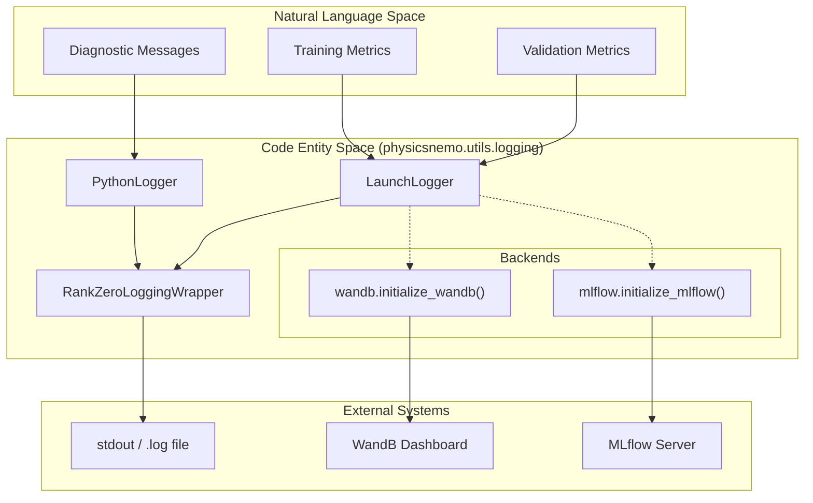
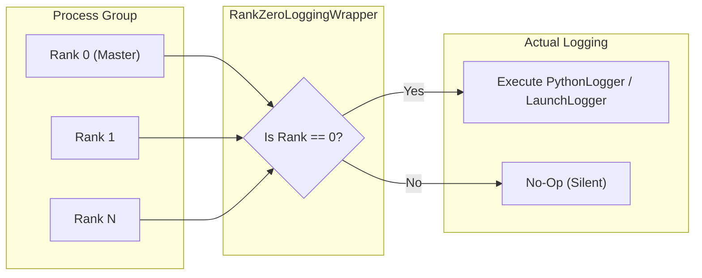

<!-- source: DeepWiki mcp.deepwiki.com · repo NVIDIA/physicsnemo · page 6.3 Logging and Monitoring · fetched 2026-11-04 -->

# Logging and Monitoring

<details>
<summary>Relevant source files</summary>

The following files were used as context for generating this wiki page:

- [docs/test_scripts/test_basic.py](docs/test_scripts/test_basic.py)
- [docs/test_scripts/test_basic_checkpointing.py](docs/test_scripts/test_basic_checkpointing.py)
- [docs/test_scripts/test_console_logger.py](docs/test_scripts/test_console_logger.py)
- [docs/test_scripts/test_custom_model_demo_1.py](docs/test_scripts/test_custom_model_demo_1.py)
- [docs/test_scripts/test_mlflow_logger.py](docs/test_scripts/test_mlflow_logger.py)
- [docs/test_scripts/test_simple_distributed.py](docs/test_scripts/test_simple_distributed.py)
- [docs/test_scripts/test_wandb_logger.py](docs/test_scripts/test_wandb_logger.py)
- [physicsnemo/experimental/datapipes/healda/transforms/obs_features.py](physicsnemo/experimental/datapipes/healda/transforms/obs_features.py)
- [physicsnemo/experimental/datapipes/healda/transforms/obs_features_ext.py](physicsnemo/experimental/datapipes/healda/transforms/obs_features_ext.py)
- [physicsnemo/metrics/general/calibration.py](physicsnemo/metrics/general/calibration.py)
- [physicsnemo/metrics/general/crps.py](physicsnemo/metrics/general/crps.py)
- [physicsnemo/utils/logging/launch.py](physicsnemo/utils/logging/launch.py)
- [test/core/test_registry.py](test/core/test_registry.py)
- [test/datapipes/healda/test_features.py](test/datapipes/healda/test_features.py)
- [test/nn/module/test_interpolation.py](test/nn/module/test_interpolation.py)
- [test/optim/test_combined_optimizer.py](test/optim/test_combined_optimizer.py)
- [test/utils/msc_config_checkpoint.yaml](test/utils/msc_config_checkpoint.yaml)
- [test/utils/msc_config_public_read.yaml](test/utils/msc_config_public_read.yaml)
- [test/utils/test_checkpoint.py](test/utils/test_checkpoint.py)
- [test/utils/test_msc_public_read.py](test/utils/test_msc_public_read.py)

</details>


## Purpose and Scope

This document describes PhysicsNeMo's logging and monitoring infrastructure for tracking training metrics, experiment metadata, and diagnostic information. The system provides three main capabilities:

1.  **Console/file logging** via `PythonLogger` for diagnostic messages.
2.  **Structured metrics logging** via `LaunchLogger` for training/validation statistics.
3.  **Experiment tracking integration** with Weights & Biases (WandB) and MLflow.

In PhysicsNeMo v2.0, these utilities are primarily located in the `physicsnemo.utils.logging` module, which replaces the legacy `physicsnemo.launch` structure in many application contexts [examples/cfd/navier_stokes_rnn/navier_stokes_rnn.py:33]().

---

## Logging System Architecture

The logging infrastructure consists of multiple layers that route information to different backends based on configuration:

Title: Logging Data Flow and Entity Mapping


**Sources:** [examples/cfd/darcy_fno/train_fno_darcy.py:49-53](), [examples/cfd/darcy_nested_fnos/train_nested_darcy.py:32-37](), [docs/test_scripts/test_wandb_logger.py:6-9]()

---

## PythonLogger: Diagnostic Logging

`PythonLogger` provides a thin wrapper around Python's standard `logging` module, offering standard log levels (`debug`, `info`, `warning`, `error`, `success`) for diagnostic messages.

### Basic Usage
In practice, `PythonLogger` is used for high-level status updates such as data download progress or training lifecycle events [examples/cfd/navier_stokes_rnn/navier_stokes_rnn.py:145-170]().

```python
from physicsnemo.utils.logging import PythonLogger

log = PythonLogger(name="darcy_fno")
log.file_logging() # Optional: log to a local file
log.info("Data download starting...")
log.success("Training completed")
```

**Key characteristics:**
*   **Standard Levels**: Supports `info()`, `warning()`, `error()`, and a custom `success()` level [examples/cfd/darcy_fno/train_fno_darcy.py:128-166]().
*   **File Logging**: Can be configured to output to `.log` files via `file_logging()` [examples/cfd/darcy_fno/train_fno_darcy.py:51]().

**Sources:** [examples/cfd/navier_stokes_rnn/navier_stokes_rnn.py:145-160](), [examples/cfd/darcy_fno/train_fno_darcy.py:50-51]()

---

## LaunchLogger: Structured Metrics Logging

`LaunchLogger` is a context manager designed for logging training metrics at different frequencies (per-minibatch, per-epoch). It acts as the primary interface for routing numeric data to configured backends like MLflow or WandB.

### Core API and Context Management
`LaunchLogger` must be initialized once globally before use [examples/cfd/darcy_fno/train_fno_darcy.py:52]().

| Method | Purpose |
| :--- | :--- |
| `LaunchLogger.initialize()` | Globally configures logging backends (e.g., `use_mlflow=True`) [examples/cfd/darcy_nested_fnos/train_nested_darcy.py:73](). |
| `log_minibatch(metrics)` | Logs per-iteration metrics (e.g., loss) [examples/cfd/darcy_fno/train_fno_darcy.py:139](). |
| `log_epoch(metrics)` | Logs per-epoch summaries (e.g., validation error, LR) [examples/cfd/darcy_fno/train_fno_darcy.py:140](). |

### Usage Pattern in Training Loops
```python
with LaunchLogger("train", epoch=pseudo_epoch) as logger:
    for _, batch in zip(range(steps_per_pseudo_epoch), dataloader):
        loss = forward_train(batch["permeability"], batch["darcy"])
        logger.log_minibatch({"loss": loss.detach()})
    logger.log_epoch({"Learning Rate": optimizer.param_groups[0]["lr"]})
```

**Sources:** [examples/cfd/darcy_fno/train_fno_darcy.py:136-140](), [docs/test_scripts/test_mlflow_logger.py:57-70]()

---

## Experiment Tracking Integrations

### MLflow Integration
PhysicsNeMo uses MLflow to track experiments, particularly in complex multi-GPU settings like Nested FNOs [examples/cfd/darcy_nested_fnos/README.md:6-8]().

*   **Initialization**: `initialize_mlflow()` sets up the experiment name, run description, and mode (online/offline) [examples/cfd/darcy_nested_fnos/train_nested_darcy.py:65-72]().
*   **Activation**: `LaunchLogger.initialize(use_mlflow=True)` enables the backend [examples/cfd/darcy_nested_fnos/train_nested_darcy.py:73]().

### Weights & Biases (WandB) Integration
Similar to MLflow, WandB is integrated via a dedicated initialization function.
*   **Initialization**: `initialize_wandb()` configures project, entity, and sync mode [docs/test_scripts/test_wandb_logger.py:42-47]().
*   **Activation**: `LaunchLogger.initialize(use_wandb=True)` [docs/test_scripts/test_wandb_logger.py:48]().

**Sources:** [examples/cfd/darcy_nested_fnos/train_nested_darcy.py:65-73](), [docs/test_scripts/test_wandb_logger.py:42-48]()

---

## Distributed Logging: RankZeroLoggingWrapper

In distributed environments, redundant logging from multiple processes can lead to cluttered consoles and corrupted log files. PhysicsNeMo provides `RankZeroLoggingWrapper` to ensure only the master process (Rank 0) performs logging operations.

Title: Distributed Logging Logic


### Implementation in Distributed Scripts
The wrapper is typically applied during the initialization of the logging infrastructure in a distributed script [examples/cfd/darcy_nested_fnos/train_nested_darcy.py:75]().

```python
dist = DistributedManager()
logger = PythonLogger(name="darcy_nested_fno")
# Wrap the logger so only rank 0 actually logs
logger = RankZeroLoggingWrapper(logger, dist)
```

**Sources:** [examples/cfd/darcy_nested_fnos/train_nested_darcy.py:55-75]()

---

## Complete Logging Workflow

The following table summarizes the typical sequence of logging calls in a PhysicsNeMo application:

| Phase | Action | Code Entity |
| :--- | :--- | :--- |
| **Setup** | Initialize Distributed Environment | `DistributedManager.initialize()` |
| **Setup** | Initialize Diagnostic Logger | `PythonLogger(name)` |
| **Setup** | Initialize Tracker (WandB/MLflow) | `initialize_mlflow(...)` |
| **Setup** | Initialize Global Metrics Logger | `LaunchLogger.initialize(use_mlflow=True)` |
| **Training** | Enter Epoch Context | `with LaunchLogger("train", epoch=i):` |
| **Training** | Log Step Loss | `logger.log_minibatch({"loss": val})` |
| **Validation** | Enter Validation Context | `with LaunchLogger("valid", epoch=i):` |
| **Teardown** | Log Final Success | `log.success("Done")` |

**Sources:** [examples/cfd/darcy_fno/train_fno_darcy.py:46-166](), [examples/cfd/darcy_nested_fnos/train_nested_darcy.py:41-75]()

---

