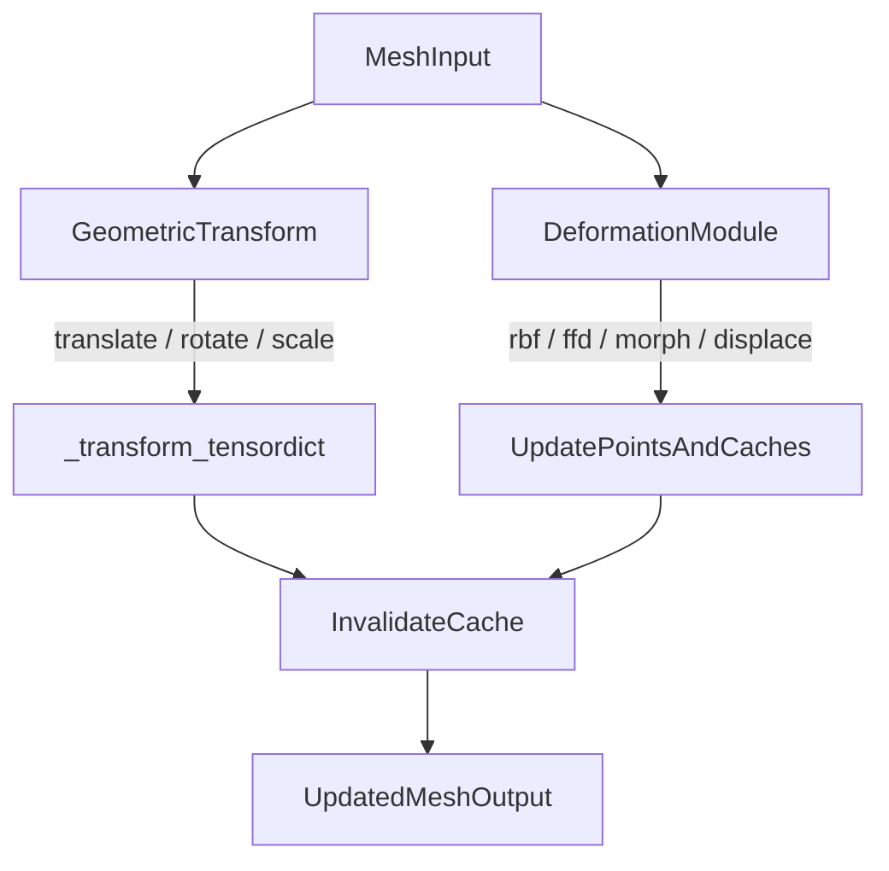
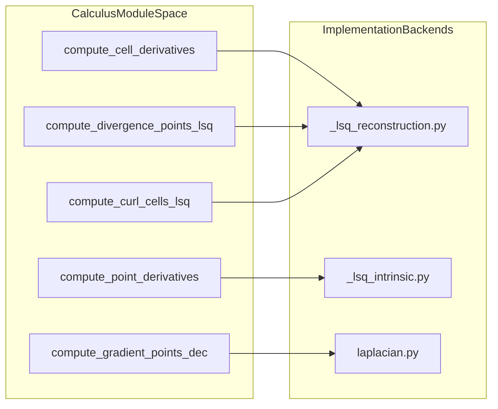
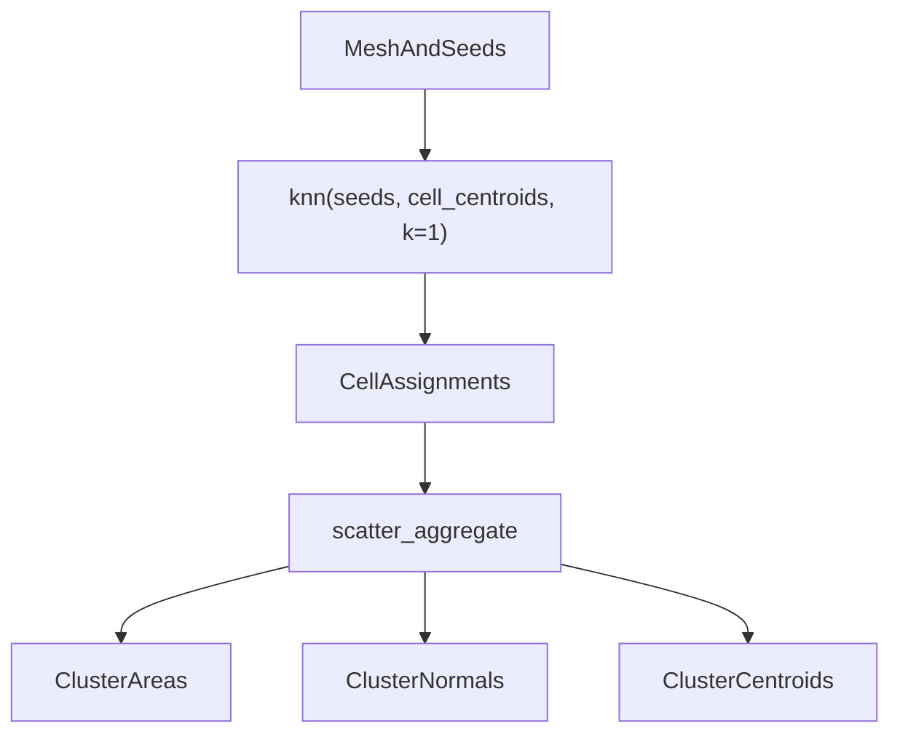

<!-- source: DeepWiki mcp.deepwiki.com · repo NVIDIA/physicsnemo · page 7.2 Mesh Operations and Algorithms · fetched 2026-11-04 -->

# Mesh Operations and Algorithms

Relevant source files

The following files were used as context for generating this wiki page:

- [benchmarks/physicsnemo/mesh/remeshing.py](benchmarks/physicsnemo/mesh/remeshing.py)
- [docs/api/mesh/core.rst](docs/api/mesh/core.rst)
- [docs/api/mesh/remeshing.rst](docs/api/mesh/remeshing.rst)
- [docs/api/mesh/repair.rst](docs/api/mesh/repair.rst)
- [docs/api/mesh/sampling.rst](docs/api/mesh/sampling.rst)
- [docs/api/mesh/smoothing.rst](docs/api/mesh/smoothing.rst)
- [physicsnemo/mesh/boundaries/_detection.py](physicsnemo/mesh/boundaries/_detection.py)
- [physicsnemo/mesh/boundaries/_facet_extraction.py](physicsnemo/mesh/boundaries/_facet_extraction.py)
- [physicsnemo/mesh/boundaries/_topology.py](physicsnemo/mesh/boundaries/_topology.py)
- [physicsnemo/mesh/calculus/__init__.py](physicsnemo/mesh/calculus/__init__.py)
- [physicsnemo/mesh/calculus/_lsq_intrinsic.py](physicsnemo/mesh/calculus/_lsq_intrinsic.py)
- [physicsnemo/mesh/calculus/_lsq_reconstruction.py](physicsnemo/mesh/calculus/_lsq_reconstruction.py)
- [physicsnemo/mesh/calculus/_sharp_flat.py](physicsnemo/mesh/calculus/_sharp_flat.py)
- [physicsnemo/mesh/calculus/curl.py](physicsnemo/mesh/calculus/curl.py)
- [physicsnemo/mesh/calculus/derivatives.py](physicsnemo/mesh/calculus/derivatives.py)
- [physicsnemo/mesh/calculus/divergence.py](physicsnemo/mesh/calculus/divergence.py)
- [physicsnemo/mesh/calculus/integration.py](physicsnemo/mesh/calculus/integration.py)
- [physicsnemo/mesh/curvature/gaussian.py](physicsnemo/mesh/curvature/gaussian.py)
- [physicsnemo/mesh/geometry/_cell_areas.py](physicsnemo/mesh/geometry/_cell_areas.py)
- [physicsnemo/mesh/geometry/dual_meshes.py](physicsnemo/mesh/geometry/dual_meshes.py)
- [physicsnemo/mesh/neighbors/_cell_neighbors.py](physicsnemo/mesh/neighbors/_cell_neighbors.py)
- [physicsnemo/mesh/projections/_embed.py](physicsnemo/mesh/projections/_embed.py)
- [physicsnemo/mesh/projections/_extrude.py](physicsnemo/mesh/projections/_extrude.py)
- [physicsnemo/mesh/projections/_project.py](physicsnemo/mesh/projections/_project.py)
- [physicsnemo/mesh/remeshing/__init__.py](physicsnemo/mesh/remeshing/__init__.py)
- [physicsnemo/mesh/remeshing/_remeshing.py](physicsnemo/mesh/remeshing/_remeshing.py)
- [physicsnemo/mesh/repair/_cleaning.py](physicsnemo/mesh/repair/_cleaning.py)
- [physicsnemo/mesh/repair/degenerate_removal.py](physicsnemo/mesh/repair/degenerate_removal.py)
- [physicsnemo/mesh/repair/hole_filling.py](physicsnemo/mesh/repair/hole_filling.py)
- [physicsnemo/mesh/repair/orientation.py](physicsnemo/mesh/repair/orientation.py)
- [physicsnemo/mesh/sampling/random_point_sampling.py](physicsnemo/mesh/sampling/random_point_sampling.py)
- [physicsnemo/mesh/sampling/sample_data.py](physicsnemo/mesh/sampling/sample_data.py)
- [physicsnemo/mesh/smoothing/laplacian.py](physicsnemo/mesh/smoothing/laplacian.py)
- [physicsnemo/mesh/subdivision/_data.py](physicsnemo/mesh/subdivision/_data.py)
- [physicsnemo/mesh/subdivision/loop.py](physicsnemo/mesh/subdivision/loop.py)
- [physicsnemo/mesh/transformations/deform/displace.py](physicsnemo/mesh/transformations/deform/displace.py)
- [physicsnemo/mesh/transformations/deform/ffd.py](physicsnemo/mesh/transformations/deform/ffd.py)
- [physicsnemo/mesh/transformations/deform/morph.py](physicsnemo/mesh/transformations/deform/morph.py)
- [physicsnemo/mesh/transformations/deform/rbf.py](physicsnemo/mesh/transformations/deform/rbf.py)
- [physicsnemo/mesh/utilities/_scatter_ops.py](physicsnemo/mesh/utilities/_scatter_ops.py)
- [physicsnemo/mesh/utilities/_topology.py](physicsnemo/mesh/utilities/_topology.py)
- [physicsnemo/mesh/validation/quality.py](physicsnemo/mesh/validation/quality.py)
- [physicsnemo/mesh/validation/validate.py](physicsnemo/mesh/validation/validate.py)
- [physicsnemo/mesh/visualization/_matplotlib_impl.py](physicsnemo/mesh/visualization/_matplotlib_impl.py)
- [physicsnemo/mesh/visualization/_pyvista_impl.py](physicsnemo/mesh/visualization/_pyvista_impl.py)
- [physicsnemo/mesh/visualization/draw_mesh.py](physicsnemo/mesh/visualization/draw_mesh.py)
- [physicsnemo/nn/functional/geometry/remeshing/_warp_impl/_kernels/assign_vertices.py](physicsnemo/nn/functional/geometry/remeshing/_warp_impl/_kernels/assign_vertices.py)
- [physicsnemo/nn/functional/geometry/remeshing/_warp_impl/_kernels/project_centroids_to_surface.py](physicsnemo/nn/functional/geometry/remeshing/_warp_impl/_kernels/project_centroids_to_surface.py)
- [test/mesh/boundaries/test_facet_extraction.py](test/mesh/boundaries/test_facet_extraction.py)
- [test/mesh/calculus/test_calculus.py](test/mesh/calculus/test_calculus.py)
- [test/mesh/calculus/test_gradient_layout.py](test/mesh/calculus/test_gradient_layout.py)
- [test/mesh/calculus/test_integration.py](test/mesh/calculus/test_integration.py)
- [test/mesh/curvature/test_curvature.py](test/mesh/curvature/test_curvature.py)
- [test/mesh/geometry/test_dual_meshes.py](test/mesh/geometry/test_dual_meshes.py)
- [test/mesh/mesh/test_data_conversion.py](test/mesh/mesh/test_data_conversion.py)
- [test/mesh/mesh/test_merge.py](test/mesh/mesh/test_merge.py)
- [test/mesh/misc/test_sync_free_linalg.py](test/mesh/misc/test_sync_free_linalg.py)
- [test/mesh/projections/test_projections.py](test/mesh/projections/test_projections.py)
- [test/mesh/remeshing/__init__.py](test/mesh/remeshing/__init__.py)
- [test/mesh/repair/test_repair.py](test/mesh/repair/test_repair.py)
- [test/mesh/sampling/test_find_nearest_cells.py](test/mesh/sampling/test_find_nearest_cells.py)
- [test/mesh/sampling/test_sample_data.py](test/mesh/sampling/test_sample_data.py)
- [test/mesh/utilities/test_scatter_ops.py](test/mesh/utilities/test_scatter_ops.py)
- [test/mesh/visualization/test_visualization.py](test/mesh/visualization/test_visualization.py)

This page documents the geometric transformations, deformations, discrete calculus operators, remeshing, partitioning, repair, subdivision, smoothing, curvature, projections, and spatial sampling routines in the GPU-accelerated `physicsnemo.mesh` subsystem [v2.0-MIGRATION-GUIDE.md:123-128](). These algorithms support 2D planar triangulations, 3D surface meshes, tetrahedral volume meshes, curve meshes, and point clouds using a unified tensorclass architecture [physicsnemo/mesh/mesh.py:39-49]().

---

## Geometric Transformations and Deformations

The library implements linear and affine transformations alongside mesh deformation modules (Radial Basis Functions, Free-Form Deformation, and surface morphing). When a mesh is transformed, cached geometric properties (such as cell areas and normals) are invalidated or transformed depending on the operation type [physicsnemo/mesh/transformations/geometric.py:17-27]().

### Affine Transformations
*   **`translate(mesh, vector)`**: Shifts all vertex coordinates by a displacement vector [physicsnemo/mesh/transformations/geometric.py:31](). Preserves cell areas and normals [physicsnemo/mesh/transformations/geometric.py:23-26]().
*   **`rotate(mesh, angle, axis=None)`**: Rotates the mesh in 2D or 3D. In 3D, it applies Rodrigues' rotation formula: $R = I\cos\theta + [u]_\times\sin\theta + (u \otimes u)(1-\cos\theta)$ [physicsnemo/mesh/transformations/geometric.py:192-205]().
*   **`scale(mesh, factor)`**: Scales mesh coordinates and updates the `cell_areas` cache [physicsnemo/mesh/transformations/geometric.py:22-29]().
*   **`transform(mesh, matrix)`**: Applies an arbitrary affine matrix to coordinates [physicsnemo/mesh/transformations/geometric.py:30]().

Associated field data in `point_data`, `cell_data`, and `global_data` transform accordingly [physicsnemo/mesh/transformations/geometric.py:44-50]():
*   **Vectors**: $v' = v M^T$ [physicsnemo/mesh/transformations/geometric.py:98-99]()
*   **Rank-2 Tensors**: $T' = M T M^T$ [physicsnemo/mesh/transformations/geometric.py:101-106]()
*   **Higher-rank Tensors**: Transformed using `torch.einsum` [physicsnemo/mesh/transformations/geometric.py:108-131]()

### Deformations (RBF, FFD, Morph, Displace)
*   **RBF (`physicsnemo/mesh/transformations/deform/rbf.py`)**: Radial Basis Function mesh warping based on control point displacements.
*   **FFD (`physicsnemo/mesh/transformations/deform/ffd.py`)**: Free-Form Deformation using parametric lattice control volumes.
*   **Morph (`physicsnemo/mesh/transformations/deform/morph.py`)**: Surface-to-surface morphing algorithms.
*   **Displace / Shrinkwrap (`physicsnemo/mesh/transformations/deform/displace.py`)**: Normal displacement and projection-based shrinkwrapping.

**Transformation & Deformation Logic Flow**
Title: "MeshTransformationPipeline"

Sources: [physicsnemo/mesh/transformations/geometric.py:17-157](), [physicsnemo/mesh/transformations/deform/rbf.py:1](), [physicsnemo/mesh/transformations/deform/ffd.py:1](), [physicsnemo/mesh/transformations/deform/morph.py:1](), [physicsnemo/mesh/transformations/deform/displace.py:1]()

---

## Discrete Calculus

PhysicsNeMo implements discrete differential operators using two complementary frameworks:
1.  **Discrete Exterior Calculus (DEC)**: Rigorous differential geometry framework following Desbrun et al. [physicsnemo/mesh/calculus/__init__.py:17-25]()
2.  **Weighted Least-Squares (LSQ) Reconstruction**: Standard CFD approach for numerical gradients and divergences [physicsnemo/mesh/calculus/__init__.py:19-23]()

### Core Operators
*   **Gradient**: $\nabla \varphi$ (scalar $\to$ vector) computed via `compute_gradient_points_lsq`, `compute_gradient_cells_lsq`, or `compute_gradient_points_dec` [physicsnemo/mesh/calculus/__init__.py:51-55]().
*   **Divergence**: $\operatorname{div}(v)$ (vector $\to$ scalar) computed via `compute_divergence_points_lsq`, `compute_divergence_cells_lsq`, or `compute_divergence_points_dec` [physicsnemo/mesh/calculus/__init__.py:47-50]().
*   **Curl**: $\operatorname{curl}(v)$ (vector $\to$ vector in 3D) computed via `compute_curl_points_lsq` and `compute_curl_cells_lsq` [physicsnemo/mesh/calculus/__init__.py:38-41]().
*   **Laplacian**: $\Delta \varphi$ (scalar $\to$ scalar Laplace-Beltrami operator) via `compute_laplacian_points_dec` [physicsnemo/mesh/calculus/__init__.py:63-65]().
*   **Integration**: Measures, moments, cell data, point data, and flux integration via `physicsnemo.mesh.calculus.integration` [physicsnemo/mesh/calculus/__init__.py:56-62]().

**Calculus Architecture Mapping**
Title: "CalculusEngineMapping"

Sources: [physicsnemo/mesh/calculus/__init__.py:1-71](), [physicsnemo/mesh/calculus/derivatives.py:1]()

---

## Remeshing and Partitioning

### Warp-Based Surface Remeshing
PhysicsNeMo provides Warp-accelerated surface remeshing on CPU and CUDA for 2D triangle manifolds embedded in 3D [docs/api/mesh/remeshing.rst:6-9]().
*   **Cluster Budget**: `n_clusters` defines the global target number of output vertices [docs/api/mesh/remeshing.rst:7-9]().
*   **Resolution Control**: `resolution_field` specifies relative linear resolution multipliers. The implementation converts linear resolution $r$ to Centroidal Voronoi Tessellation (CVT) integration density $r^4$ [docs/api/mesh/remeshing.rst:120-123]().
*   **Point Data Transfer**: `transfer_point_data` barycentrically interpolates selected floating-point fields using recorded source triangles and barycentric weights [docs/api/mesh/remeshing.rst:11-14, 64-67]().

### Discrete Voronoi Partitioning
The `partition_cells` function groups mesh cells into Voronoi regions based on Euclidean distance to seed points [physicsnemo/mesh/remeshing/_partition.py:17-23]().
*   **Input**: A `Mesh` and seed locations [physicsnemo/mesh/remeshing/_partition.py:70-72]().
*   **Output**: `CellPartition` container with `assignments`, `cluster_areas`, `cluster_normals`, and `cluster_centroids` [physicsnemo/mesh/remeshing/_partition.py:45-68]().
*   **Mechanism**: Uses `knn(k=1)` for assignment and `scatter_aggregate` for accumulation [physicsnemo/mesh/remeshing/_partition.py:159-166]().

**Discrete Voronoi Partitioning Pipeline**
Title: "DiscreteVoronoiPipeline"

Sources: [docs/api/mesh/remeshing.rst:1-171](), [physicsnemo/mesh/remeshing/_remeshing.py:1-182](), [physicsnemo/mesh/remeshing/_partition.py:17-175]()

---

## Projections, Subdivision, and Repair

### Projections and Dimensionality Changes
*   **Extrusion (`extrude`)**: Sweeps a mesh along a vector to increase manifold dimension [test/mesh/projections/test_projections.py:24]:
    *   0-simplex (Point) $\to$ 1-simplex (Edge) [test/mesh/projections/test_projections.py:30-48]()
    *   1-simplex (Edge) $\to$ 2-simplex (Triangle) [test/mesh/projections/test_projections.py:70-87]()
    *   2-simplex (Triangle) $\to$ 3-simplex (Tetrahedron) [test/mesh/projections/test_projections.py:130-149]()
*   **Embedding (`embed`)**: Increases spatial dimension without changing connectivity [test/mesh/projections/test_projections.py:24]().
*   **Projection (`project`)**: Flattens coordinates onto a lower-dimensional subspace [test/mesh/projections/test_projections.py:24]().

### Subdivision and Repair
*   **Loop Subdivision (`physicsnemo/mesh/subdivision/loop.py`)**: Smooth triangle mesh subdivision.
*   **Orientation and Cleaning (`physicsnemo/mesh/repair/orientation.py`, `_cleaning.py`)**: Corrects face winding, removes degenerate elements, and cleans non-manifold geometry.

Sources: [test/mesh/projections/test_projections.py:17-174](), [physicsnemo/mesh/subdivision/loop.py:1](), [physicsnemo/mesh/repair/orientation.py:1](), [physicsnemo/mesh/repair/_cleaning.py:1]()

---

## Smoothing, Curvature, and Spatial Indexing/Sampling

### Laplacian Smoothing
Laplacian smoothing with cotangent weights adjusts vertex positions to improve mesh quality while preserving boundaries and sharp features [physicsnemo/mesh/smoothing/laplacian.py:17-21, 48-52]().
*   **Parameters**: `n_iter`, `relaxation_factor`, `convergence`, `feature_angle`, `preserve_boundaries`, `preserve_features`, and `inplace` [physicsnemo/mesh/smoothing/laplacian.py:38-46]().

### Spatial Indexing and Sampling
*   **BVH (`physicsnemo/mesh/spatial`)**: Bounding Volume Hierarchies provide $O(M \log N)$ containment and proximity queries [physicsnemo/mesh/sampling/sample_data.py:17-22]().
*   **Nearest Neighbor Search (`find_nearest_cells`)**: Assigns query points to cell centroids via `knn` [physicsnemo/mesh/sampling/sample_data.py:27]().
*   **Barycentric Sampling**: Solves linear systems or least-squares projection to interpolate field data at arbitrary query locations [physicsnemo/mesh/sampling/sample_data.py:55-123]().

Sources: [physicsnemo/mesh/smoothing/laplacian.py:17-122](), [physicsnemo/mesh/sampling/sample_data.py:17-178]()

---

## Summary of Key Operations

| Category | Key Functions / Classes | Description |
| :--- | :--- | :--- |
| **Transformations** | `translate`, `rotate`, `scale`, `transform` | Affine operations with automatic tensor field transformations. |
| **Deformations** | `rbf`, `ffd`, `morph`, `displace` | Mesh warping and displacement routines. |
| **Calculus** | `compute_gradient_points_lsq`, `compute_divergence_points_dec`, `compute_curl_cells_lsq` | Differential operators via LSQ or DEC. |
| **Remeshing** | `remesh`, `partition_cells` | Warp CVT remeshing and Voronoi cell partitioning. |
| **Projections** | `extrude`, `embed`, `project` | Manifold and spatial dimensionality changes. |
| **Repair & Subdivision** | `orientation`, `_cleaning`, `loop` | Mesh cleaning, normal orientation, and subdivision. |
| **Smoothing & Spatial** | `smooth_laplacian`, `BVH`, `knn`, `find_nearest_cells` | Geometry-aware smoothing and spatial indexing. |

Sources: [physicsnemo/mesh/mesh.py:25-36](), [physicsnemo/mesh/transformations/geometric.py:1-40](), [physicsnemo/mesh/remeshing/_partition.py:1-44](), [physicsnemo/mesh/calculus/__init__.py:1-71]()

---

