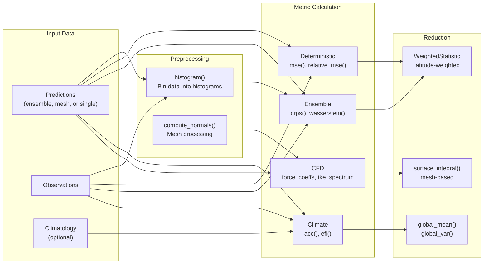

<!-- source: DeepWiki mcp.deepwiki.com · repo NVIDIA/physicsnemo · page 8 Metrics and Evaluation · fetched 2026-11-04 -->

# Metrics and Evaluation

Relevant source files

The following files were used as context for generating this wiki page:

- [physicsnemo/metrics/general/mse.py](physicsnemo/metrics/general/mse.py)
- [physicsnemo/metrics/general/relative_error.py](physicsnemo/metrics/general/relative_error.py)
- [test/metrics/test_metrics_general.py](test/metrics/test_metrics_general.py)

## Purpose and Scope

This document provides a high-level overview of PhysicsNeMo's evaluation metrics infrastructure. The framework is organized into three main categories of metrics: **general statistical metrics** (histogram computation, CRPS, Wasserstein distance, entropy, calibration, MSE, relative error), **climate-specific metrics** (ACC, EFI, latitude-weighted statistics), and **CFD and aerodynamic metrics** (force coefficients, turbulence spectra, integral quantities). These metrics support deterministic, ensemble, and mesh-based predictions, enabling rigorous model validation across physics domains.

As a parent page, this document summarizes the evaluation architecture. For detailed documentation on specific implementations, consult the child pages:
- For general statistical metrics and diffusion losses, see [General Metrics](#8.1).
- For weather and climate measures, see [Climate-Specific Metrics](#8.2).
- For fluid dynamics, force computation, and aerodynamic loss functions, see [CFD and Aerodynamic Metrics](#8.3).

---

## Metrics System Architecture

The metrics system is organized into modules under `physicsnemo.metrics`, categorized by domain-agnostic statistical measures, weather/climate evaluations, and computational fluid dynamics (CFD) analysis.

### Module Organization

```mermaid
graph TB
    subgraph "physicsnemo.metrics"
        General["general/<br/>Domain-agnostic metrics"]
        Climate["climate/<br/>Weather/climate metrics"]
        CFD["cae/cfd & cae/integral<br/>CFD & Mesh metrics"]
    end
    
    subgraph "General Metrics"
        Histogram["histogram<br/>Histogram, PDF, CDF"]
        CRPS["crps<br/>Continuous Ranked<br/>Probability Score"]
        Wasserstein["wasserstein<br/>Wasserstein Distance"]
        Entropy["entropy<br/>Entropy & KL Divergence"]
        Calibration["calibration<br/>Rank Probability Score"]
        Ensemble["ensemble_metrics<br/>Mean, Variance"]
        PowerSpectrum["power_spectrum<br/>Fourier Analysis"]
        MSE["mse<br/>MSE, RMSE"]
        RelError["relative_error<br/>Relative MSE & L2"]
    end
    
    subgraph "Climate Metrics"
        ACC["acc<br/>Anomaly Correlation<br/>Coefficient"]
        EFI["efi<br/>Extreme Forecast Index"]
        ClimateReduction["reduction<br/>Zonal & Global<br/>Statistics"]
    end

    subgraph "CFD Metrics"
        ForceCoeffs["cfd.compute_force_coefficients<br/>Drag/Lift Analysis"]
        TKESpectrum["cfd.compute_tke_spectrum<br/>Turbulence Analysis"]
        Integrals["integral.surface_integral<br/>Flux/Area Integration"]
    end
    
    General --> Histogram
    General --> CRPS
    General --> Wasserstein
    General --> Entropy
    General --> Calibration
    General --> Ensemble
    General --> PowerSpectrum
    General --> MSE
    General --> RelError
    
    Climate --> ACC
    Climate --> EFI
    Climate --> ClimateReduction
    
    CFD --> ForceCoeffs
    CFD --> TKESpectrum
    CFD --> Integrals
    
    CRPS -.depends on.-> Histogram
    Wasserstein -.depends on.-> Histogram
    Calibration -.depends on.-> Histogram
    EFI -.depends on.-> Histogram
    ClimateReduction -.extends.-> Reduction
    ACC -.uses.-> ClimateReduction
```

Sources: [test/metrics/test_metrics_general.py:23-31](), [physicsnemo/metrics/general/mse.py:26-113](), [physicsnemo/metrics/general/relative_error.py:95-197]()

### Metric Computation Workflow

Sources: [test/metrics/test_metrics_general.py:67-193](), [physicsnemo/metrics/general/mse.py:26-113](), [physicsnemo/metrics/general/relative_error.py:95-197]()

---

## General Metrics

General metrics in `physicsnemo.metrics.general` provide domain-agnostic statistical measures for model evaluation. These include fundamental regression error functions such as mean squared error (`mse`, `rmse` in [physicsnemo/metrics/general/mse.py:26-113]()) and target-normalized relative errors (`relative_mse`, `relative_l2` in [physicsnemo/metrics/general/relative_error.py:95-197]()). 

Advanced evaluation tools cover probabilistic and distributional comparisons, including histogram binning, Continuous Ranked Probability Score (CRPS), Wasserstein distance, entropy, calibration metrics, ensemble statistics, and diffusion-specific losses.

For comprehensive documentation, see [General Metrics](#8.1).

Sources: [physicsnemo/metrics/general/mse.py:26-113](), [physicsnemo/metrics/general/relative_error.py:95-197]()

---

## Climate-Specific Metrics

Climate metrics in `physicsnemo.metrics.climate` implement evaluation measures tailored for weather and climate forecasting models. Key metrics include the Anomaly Correlation Coefficient (ACC) for assessing forecast skill relative to climatology, the Extreme Forecast Index (EFI) for extreme weather detection, and latitude-weighted zonal and global statistical reductions.

For comprehensive documentation, see [Climate-Specific Metrics](#8.2).

Sources: [test/metrics/test_metrics_climate.py:21-26]()

---

## CFD and Aerodynamic Metrics

Computational Fluid Dynamics (CFD) metrics evaluate the physical accuracy of fluid simulations across structured and unstructured meshes. The toolkit provides functions for aerodynamic force and moment coefficient calculation, turbulent kinetic energy (TKE) spectrum analysis, velocity gradient tensor invariants, and spatial surface/line integrations.

For comprehensive documentation, see [CFD and Aerodynamic Metrics](#8.3).

Sources: [test/metrics/test_metrics_cfd.py:21-26](), [test/metrics/test_metrics_integral.py:20-21]()

---

## Integration and Analysis

Metrics are typically computed during model rollout and evaluated using post-processing analysis workflows and notebooks. For instance, CFD recipes utilize rollout engines to generate time-series predictions, followed by surface interpolation and force calculation.

### Geometry Interpolation
To compare model outputs against experimental data or ground truth simulation meshes, PhysicsNeMo provides geometry interpolation utilities:
- `physicsnemo_geometry_interpolator()`: Samples and interpolates mesh fields onto boundary geometries [examples/cfd/vortex_shedding_mgn/inference_analysis/utils.py:93-125]().
- `physicsnemo_geometry_interior_interpolator()`: Interpolates results within interior volumes [examples/cfd/vortex_shedding_mgn/inference_analysis/utils.py:127-157]().

Sources: [examples/cfd/vortex_shedding_mgn/inference_analysis/utils.py:23-157]()

---

