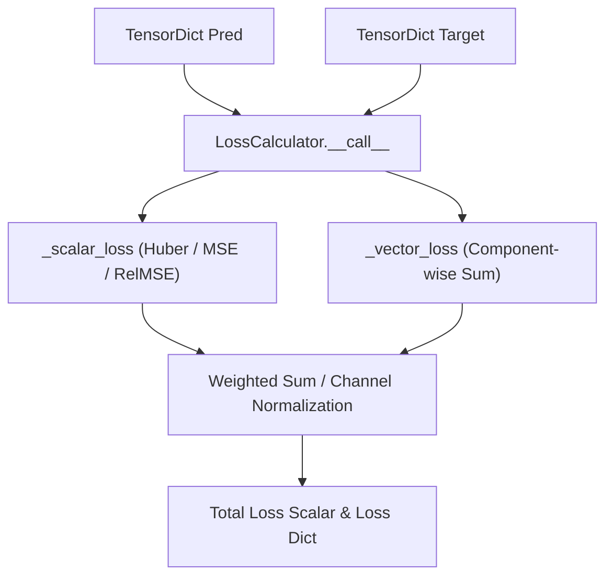
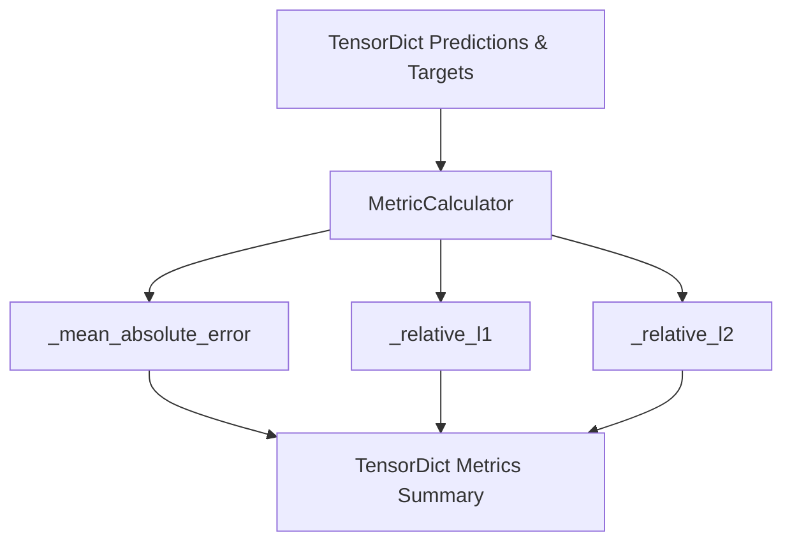

<!-- source: DeepWiki mcp.deepwiki.com · repo NVIDIA/physicsnemo · page 8.3 CFD and Aerodynamic Metrics · fetched 2026-11-04 -->

# CFD and Aerodynamic Metrics

<details>
<summary>Relevant source files</summary>

The following files were used as context for generating this wiki page:

- [docs/api/physicsnemo.optim.rst](docs/api/physicsnemo.optim.rst)
- [examples/cfd/external_aerodynamics/unified_external_aero_recipe/src/collate.py](examples/cfd/external_aerodynamics/unified_external_aero_recipe/src/collate.py)
- [examples/cfd/external_aerodynamics/unified_external_aero_recipe/src/forces.py](examples/cfd/external_aerodynamics/unified_external_aero_recipe/src/forces.py)
- [examples/cfd/external_aerodynamics/unified_external_aero_recipe/src/forward_kwargs.py](examples/cfd/external_aerodynamics/unified_external_aero_recipe/src/forward_kwargs.py)
- [examples/cfd/external_aerodynamics/unified_external_aero_recipe/src/infer.py](examples/cfd/external_aerodynamics/unified_external_aero_recipe/src/infer.py)
- [examples/cfd/external_aerodynamics/unified_external_aero_recipe/src/loss.py](examples/cfd/external_aerodynamics/unified_external_aero_recipe/src/loss.py)
- [examples/cfd/external_aerodynamics/unified_external_aero_recipe/src/merge_global_data.py](examples/cfd/external_aerodynamics/unified_external_aero_recipe/src/merge_global_data.py)
- [examples/cfd/external_aerodynamics/unified_external_aero_recipe/src/metrics.py](examples/cfd/external_aerodynamics/unified_external_aero_recipe/src/metrics.py)
- [examples/cfd/external_aerodynamics/unified_external_aero_recipe/src/nondim.py](examples/cfd/external_aerodynamics/unified_external_aero_recipe/src/nondim.py)
- [examples/cfd/external_aerodynamics/unified_external_aero_recipe/src/output_normalize.py](examples/cfd/external_aerodynamics/unified_external_aero_recipe/src/output_normalize.py)
- [examples/cfd/external_aerodynamics/unified_external_aero_recipe/src/train.py](examples/cfd/external_aerodynamics/unified_external_aero_recipe/src/train.py)
- [examples/cfd/external_aerodynamics/unified_external_aero_recipe/src/utils.py](examples/cfd/external_aerodynamics/unified_external_aero_recipe/src/utils.py)
- [examples/cfd/external_aerodynamics/unified_external_aero_recipe/tests/test_infer.py](examples/cfd/external_aerodynamics/unified_external_aero_recipe/tests/test_infer.py)
- [examples/cfd/external_aerodynamics/unified_external_aero_recipe/tests/test_loss_equivalence.py](examples/cfd/external_aerodynamics/unified_external_aero_recipe/tests/test_loss_equivalence.py)
- [examples/cfd/external_aerodynamics/unified_external_aero_recipe/tests/test_train_helpers.py](examples/cfd/external_aerodynamics/unified_external_aero_recipe/tests/test_train_helpers.py)
- [examples/cfd/external_aerodynamics/unified_external_aero_recipe/tests/test_utils.py](examples/cfd/external_aerodynamics/unified_external_aero_recipe/tests/test_utils.py)
- [examples/cfd/vortex_shedding_mgn/conf/config.yaml](examples/cfd/vortex_shedding_mgn/conf/config.yaml)
- [examples/cfd/vortex_shedding_mgn/inference.py](examples/cfd/vortex_shedding_mgn/inference.py)
- [examples/cfd/vortex_shedding_mgn/inference_analysis/inference_analysis.ipynb](examples/cfd/vortex_shedding_mgn/inference_analysis/inference_analysis.ipynb)
- [examples/cfd/vortex_shedding_mgn/inference_analysis/utils.py](examples/cfd/vortex_shedding_mgn/inference_analysis/utils.py)
- [examples/cfd/vortex_shedding_mgn/raw_dataset/download_dataset.sh](examples/cfd/vortex_shedding_mgn/raw_dataset/download_dataset.sh)
- [examples/cfd/vortex_shedding_mgn/train.py](examples/cfd/vortex_shedding_mgn/train.py)
- [physicsnemo/optim/__init__.py](physicsnemo/optim/__init__.py)
- [physicsnemo/optim/combined_optimizer.py](physicsnemo/optim/combined_optimizer.py)
- [physicsnemo/optim/muon.py](physicsnemo/optim/muon.py)
- [test/metrics/test_metrics_cfd.py](test/metrics/test_metrics_cfd.py)
- [test/metrics/test_metrics_integral.py](test/metrics/test_metrics_integral.py)
- [test/optim/__init__.py](test/optim/__init__.py)
- [test/optim/test_muon.py](test/optim/test_muon.py)

</details>


This page documents the CFD and aerodynamic metric infrastructure used across PhysicsNeMo aerodynamic recipes (such as the Unified External Aerodynamics Recipe). It covers physics-based non-dimensionalization transforms, configurable loss calculators, TensorDict-based metric evaluation kernels, and aerodynamic force/integral computations.

---

## 1. Physics-Based Non-Dimensionalization (`nondim.py`)

Aerodynamic datasets often span wide ranges of flow velocities, densities, and reference lengths. To stabilize neural network training, fields are non-dimensionalized using freestream reference scales. The `NonDimensionalizeByMetadata` transform applies algebraic scalings based on metadata extracted from `global_data` tensors [examples/cfd/external_aerodynamics/unified_external_aero_recipe/src/nondim.py:144-187]().

### Reference Scale Extraction
The helper `freestream_scales` computes dynamic pressure $q_\infty = \frac{1}{2} \rho_\infty |\vec{U}_\infty|^2$ and magnitude scales from global flow properties [examples/cfd/external_aerodynamics/unified_external_aero_recipe/src/nondim.py:53-76]():

```python
def freestream_scales(global_data: TensorDict):
    U_inf = global_data["U_inf"].float()
    rho_inf = global_data["rho_inf"].float()
    p_inf = global_data["p_inf"].float()
    U_inf_mag_sq = (U_inf * U_inf).sum()
    q_inf = 0.5 * rho_inf * U_inf_mag_sq
    U_inf_mag = U_inf_mag_sq.sqrt()
    T_inf = global_data["T_inf"].float() if "T_inf" in global_data else None
    return q_inf, p_inf, U_inf_mag, rho_inf, T_inf
``` [examples/cfd/external_aerodynamics/unified_external_aero_recipe/src/nondim.py:53-76]()

### Non-Dimensionalization Formulas
The `_nondim_field` and `_redim_field` functions apply transformations according to the field type registry [examples/cfd/external_aerodynamics/unified_external_aero_recipe/src/nondim.py:84-142]():

| Field Type Tag | Forward Formula (`_nondim_field`) | Inverse Formula (`_redim_field`) | Physical Meaning |
| :--- | :--- | :--- | :--- |
| `"pressure"` | $\frac{p - p_\infty}{q_\infty}$ | $p^* q_\infty + p_\infty$ | Pressure Coefficient ($C_p$) |
| `"stress"` | $\frac{\tau}{q_\infty}$ | $\tau^* q_\infty$ | Skin-Friction Coefficient ($C_f$) |
| `"velocity"` | $\frac{\vec{U}}{\|\vec{U}_\infty\|}$ | $\vec{U}^* \|\vec{U}_\infty\|$ | Velocity Ratio |
| `"temperature"`| $\frac{T}{T_\infty}$ | $T^* T_\infty$ | Temperature Ratio |
| `"density"` | $\frac{\rho}{\rho_\infty}$ | $\rho^* \rho_\infty$ | Density Ratio |
| `"identity"` | $x$ | $x$ | Pass-through |

Sources: `examples/cfd/external_aerodynamics/unified_external_aero_recipe/src/nondim.py` [examples/cfd/external_aerodynamics/unified_external_aero_recipe/src/nondim.py:1-187]()

---

## 2. Aerodynamic Loss Functions (`loss.py`)

The `LossCalculator` class computes aggregate and per-field losses over `TensorDict` predictions and targets [examples/cfd/external_aerodynamics/unified_external_aero_recipe/src/loss.py:142-170](). It handles scalar and vector fields uniformly while supporting per-field weighting and channel-count normalization [examples/cfd/external_aerodynamics/unified_external_aero_recipe/src/loss.py:17-34]().


*Figure 8.3.1: Data flow for `LossCalculator` mapping predictions and targets to scalar losses.*

Sources: `examples/cfd/external_aerodynamics/unified_external_aero_recipe/src/loss.py` [examples/cfd/external_aerodynamics/unified_external_aero_recipe/src/loss.py:1-170]()

### Scalar and Vector Loss Kernels
- **Scalar Loss (`_scalar_loss`)**: Evaluates loss (Huber, MSE, or relative MSE) on aligned tensors [examples/cfd/external_aerodynamics/unified_external_aero_recipe/src/loss.py:68-95](). Shape checking guards against dimension mismatches [examples/cfd/external_aerodynamics/unified_external_aero_recipe/src/loss.py:83-88]().
- **Vector Loss (`_vector_loss`)**: Iterates across spatial components ($D$), computing losses per component and summing them up so that $D$-dimensional vector contributions scale proportionally to their dimension [examples/cfd/external_aerodynamics/unified_external_aero_recipe/src/loss.py:98-135]().

Sources: `examples/cfd/external_aerodynamics/unified_external_aero_recipe/src/loss.py` [examples/cfd/external_aerodynamics/unified_external_aero_recipe/src/loss.py:68-135]()

---

## 3. Configurable Diagnostic Metrics (`metrics.py`)

The `MetricCalculator` mirrors the `TensorDict` interface of `LossCalculator`, producing unweighted diagnostic summaries across configured evaluation metrics [examples/cfd/external_aerodynamics/unified_external_aero_recipe/src/metrics.py:17-30]().

### Supported Metric Kernels
`METRIC_FUNCTIONS` maps string identifiers to metric implementations [examples/cfd/external_aerodynamics/unified_external_aero_recipe/src/metrics.py:88-92]():
1. **`"mae"` (`_mean_absolute_error`)**: Mean absolute error over all elements [examples/cfd/external_aerodynamics/unified_external_aero_recipe/src/metrics.py:54-58]().
2. **`"l1"` (`_relative_l1`)**: Relative L1 error $\frac{\sum |\text{pred} - \text{target}|}{\sum |\text{target}|}$ computed over the spatial axis [examples/cfd/external_aerodynamics/unified_external_aero_recipe/src/metrics.py:61-73]().
3. **`"l2"` (`_relative_l2`)**: Relative L2 error $\frac{\sqrt{\sum (\text{pred} - \text{target})^2}}{\sqrt{\sum \text{target}^2}}$ over the spatial axis [examples/cfd/external_aerodynamics/unified_external_aero_recipe/src/metrics.py:75-86]().

Sources: `examples/cfd/external_aerodynamics/unified_external_aero_recipe/src/metrics.py` [examples/cfd/external_aerodynamics/unified_external_aero_recipe/src/metrics.py:54-92]()


*Figure 8.3.2: `MetricCalculator` evaluation pipeline linking TensorDict fields to statistical and relative error metrics.*

Sources: `examples/cfd/external_aerodynamics/unified_external_aero_recipe/src/metrics.py` [examples/cfd/external_aerodynamics/unified_external_aero_recipe/src/metrics.py:142-178]()

---

## 4. Force and Integral Computation (`forces.py`)

In external aerodynamics applications, point-wise surface fields (such as pressure coefficient $C_p$ and skin-friction tensor $\tau_w$) are integrated over surface meshes to compute macroscopic aerodynamic coefficients:
- **Lift Force ($C_L$)**: Integration of pressure and viscous forces projected along the lift direction.
- **Drag Force ($C_D$)**: Integration projected along the freestream flow direction.

The `ForceContext` and `ForceAccumulator` utility classes handle surface face integration, normal vector weighting, and reference area scaling during inference runs [examples/cfd/external_aerodynamics/unified_external_aero_recipe/src/infer.py:85-85]().

Sources: `examples/cfd/external_aerodynamics/unified_external_aero_recipe/src/infer.py` [examples/cfd/external_aerodynamics/unified_external_aero_recipe/src/infer.py:85-86]()

---

## 5. Distributed Aggregation (`train.py`)

Under distributed training (DDP), rank-local metrics and losses must be properly reduced across ranks. The `_reduce_and_average` function divides rank-local sums by local sample counts and applies a fused `all_reduce` via `fused_all_reduce` to compute global mean metrics without retaining integer count tensors in float reduction buffers [examples/cfd/external_aerodynamics/unified_external_aero_recipe/src/train.py:105-164]().

```python
def _reduce_and_average(
    loss_sum: Float[torch.Tensor, ""],
    losses_td: TensorDict | None,
    metrics_td: TensorDict | None,
    n_samples: int,
    *,
    device: torch.device | str,
):
    ...
``` [examples/cfd/external_aerodynamics/unified_external_aero_recipe/src/train.py:105-164]()

Sources: `examples/cfd/external_aerodynamics/unified_external_aero_recipe/src/train.py` [examples/cfd/external_aerodynamics/unified_external_aero_recipe/src/train.py:105-164]()

---

