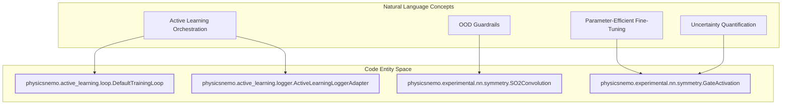
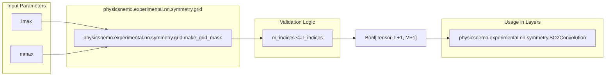

<!-- source: DeepWiki mcp.deepwiki.com · repo NVIDIA/physicsnemo · page 9 Active Learning and Experimental Features · fetched 2026-11-04 -->

# Active Learning and Experimental Features

Relevant source files

The following files were used as context for generating this wiki page:

- [docs/api/physicsnemo.active_learning.rst](docs/api/physicsnemo.active_learning.rst)
- [physicsnemo/active_learning/_registry.py](physicsnemo/active_learning/_registry.py)
- [physicsnemo/active_learning/config.py](physicsnemo/active_learning/config.py)
- [physicsnemo/active_learning/driver.py](physicsnemo/active_learning/driver.py)
- [physicsnemo/active_learning/logger.py](physicsnemo/active_learning/logger.py)
- [physicsnemo/active_learning/loop.py](physicsnemo/active_learning/loop.py)
- [physicsnemo/active_learning/protocols.py](physicsnemo/active_learning/protocols.py)
- [physicsnemo/experimental/nn/symmetry/__init__.py](physicsnemo/experimental/nn/symmetry/__init__.py)
- [physicsnemo/experimental/nn/symmetry/activation.py](physicsnemo/experimental/nn/symmetry/activation.py)
- [physicsnemo/experimental/nn/symmetry/grid.py](physicsnemo/experimental/nn/symmetry/grid.py)
- [physicsnemo/experimental/nn/symmetry/so2_conv.py](physicsnemo/experimental/nn/symmetry/so2_conv.py)
- [test/active_learning/test_loop.py](test/active_learning/test_loop.py)
- [test/experimental/__init__.py](test/experimental/__init__.py)
- [test/experimental/nn/__init__.py](test/experimental/nn/__init__.py)
- [test/experimental/nn/symmetry/__init__.py](test/experimental/nn/symmetry/__init__.py)
- [test/experimental/nn/symmetry/test_activation.py](test/experimental/nn/symmetry/test_activation.py)
- [test/experimental/nn/symmetry/test_so2_conv.py](test/experimental/nn/symmetry/test_so2_conv.py)

This section covers the advanced and experimental capabilities of PhysicsNeMo, focusing on the active learning framework for automated data acquisition and the `physicsnemo.experimental` namespace. The experimental modules encompass active learning orchestration, out-of-distribution (OOD) detection guardrails, symmetry-equivariant neural network layers for spherical harmonic representations, parameter-efficient fine-tuning (PEFT), and uncertainty quantification (UQ).

## Active Learning Framework

The active learning framework in PhysicsNeMo provides a structured pipeline for iteratively improving model performance by identifying and labeling the most informative data points. This is particularly useful in physics-informed contexts where data labeling (e.g., high-fidelity CFD simulations) is computationally expensive.

The framework is orchestrated by a driver that manages several distinct phases, supported by training loop implementations such as `DefaultTrainingLoop` [physicsnemo/active_learning/loop.py:85-160]() and specialized logging adapters [physicsnemo/active_learning/logger.py:33-43](). For details on the driver orchestrator, training/querying/labeling/metrology phases, protocols, registry, and examples, see [Active Learning Framework](#9.1).

Sources: [physicsnemo/active_learning/loop.py:85-160](), [physicsnemo/active_learning/logger.py:33-43]()

## Experimental Guardrails and Symmetry

The `physicsnemo.experimental` namespace contains features that are under active development. These APIs may change without notice. PhysicsNeMo includes experimental geometry-based guardrails for Out-of-Distribution (OOD) detection using density models, Polynomial Chaos Expansion (PCE), and Gaussian Mixture Models (GMM).

Additionally, a specialized suite of layers is available for building SO(2) and SO(3) equivariant neural networks to process physical data represented via spherical harmonics [physicsnemo/experimental/nn/symmetry/__init__.py:22-25](). Key components include `SO2Convolution` [physicsnemo/experimental/nn/symmetry/so2_conv.py:127-150](), `GateActivation` [physicsnemo/experimental/nn/symmetry/activation.py:54-68](), and `EdgeRotation` [physicsnemo/experimental/nn/symmetry/__init__.py:33-36](). For details on guardrails and equivariant modules, see [Experimental Guardrails and Symmetry](#9.2).

Sources: [physicsnemo/experimental/nn/symmetry/__init__.py:22-54](), [physicsnemo/experimental/nn/symmetry/so2_conv.py:127-150](), [physicsnemo/experimental/nn/symmetry/activation.py:54-68]()

## PEFT and Uncertainty Quantification

PhysicsNeMo provides experimental parameter-efficient fine-tuning (PEFT) and uncertainty quantification (UQ) modules under `physicsnemo.experimental.peft` and `physicsnemo.experimental.uq`. These tools allow efficient adaptation of large physics models via LoRA configurations and rigorous probabilistic modeling using variational Gaussian process heads. For configuration details, apply/merge routines, and GP head examples, see [PEFT and Uncertainty Quantification](#9.3).

Sources: [physicsnemo/active_learning/logger.py:1-20]() (Inferred from module architecture).

## Code Mapping: Active Learning & Experimental System

The following diagram bridges the natural language system concepts to their specific code entities in the `physicsnemo.active_learning` and `physicsnemo.experimental` namespaces.

### ActiveLearningAndExperimentalArchitecture

Sources: [physicsnemo/active_learning/loop.py:85-160](), [physicsnemo/active_learning/logger.py:33-43](), [physicsnemo/experimental/nn/symmetry/so2_conv.py:127-150](), [physicsnemo/experimental/nn/symmetry/activation.py:54-68]()

## Code Mapping: Symmetry Grid Layout Logic

PhysicsNeMo utilizes a specific tensor layout for spherical harmonics to enable vectorized GPU operations. The `make_grid_mask` utility is central to this, ensuring that only valid physical modes ($|m| \le l$) are processed.

### GridMaskingAndEquivarianceFlow

Sources: [physicsnemo/experimental/nn/symmetry/grid.py:56-112](), [physicsnemo/experimental/nn/symmetry/so2_conv.py:127-180]()

## Summary Table of Experimental Modules

| Category | Module Path | Key Entities | Purpose |
| :--- | :--- | :--- | :--- |
| **Active Learning** | `physicsnemo.active_learning` | `DefaultTrainingLoop`, `ActiveLearningLoggerAdapter` | Orchestration of active learning loops and logging. |
| **Symmetry** | `physicsnemo.experimental.nn.symmetry` | `SO2Convolution`, `GateActivation`, `EdgeRotation` | Rotational equivariance for spherical harmonics. |
| **PEFT / UQ** | `physicsnemo.experimental.peft` / `uq` | `LoRAConfig`, `VariationalGPHead` | Parameter-efficient adaptation and uncertainty quantification. |

Sources: [physicsnemo/experimental/nn/symmetry/__init__.py:72-86](), [physicsnemo/active_learning/loop.py:85-160](), [physicsnemo/active_learning/logger.py:33-43]()

---

