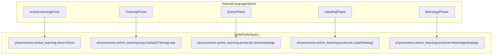
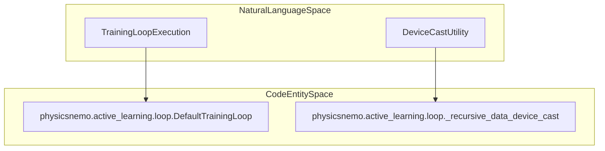

<!-- source: DeepWiki mcp.deepwiki.com · repo NVIDIA/physicsnemo · page 9.1 Active Learning Framework · fetched 2026-11-04 -->

# Active Learning Framework

<details>
<summary>Relevant source files</summary>

The following files were used as context for generating this wiki page:

- [docs/api/physicsnemo.active_learning.rst](docs/api/physicsnemo.active_learning.rst)
- [physicsnemo/active_learning/_registry.py](physicsnemo/active_learning/_registry.py)
- [physicsnemo/active_learning/config.py](physicsnemo/active_learning/config.py)
- [physicsnemo/active_learning/driver.py](physicsnemo/active_learning/driver.py)
- [physicsnemo/active_learning/logger.py](physicsnemo/active_learning/logger.py)
- [physicsnemo/active_learning/loop.py](physicsnemo/active_learning/loop.py)
- [physicsnemo/active_learning/protocols.py](physicsnemo/active_learning/protocols.py)
- [test/active_learning/test_loop.py](test/active_learning/test_loop.py)

</details>


The `physicsnemo.active_learning` module provides an extensible framework for iterative model improvement in physics-informed machine learning workflows. It automates the cycle of training, identifying informative data points (querying), acquiring labels via simulation or oracles, and performing metrology for evaluation where data acquisition is computationally expensive.

Sources: [physicsnemo/active_learning/driver.py:17-21](), [docs/api/physicsnemo.active_learning.rst:1-15]()

---

## 1. Driver Orchestrator (`Driver`)

The `Driver` class [physicsnemo/active_learning/driver.py:108-153]() serves as the central orchestrator for the active learning loop, implementing `DriverProtocol`. It manages the transition between phases and maintains experiment state via `ActiveLearningCheckpoint` [physicsnemo/active_learning/driver.py:54-106]().

### Key Responsibilities
* **Phase Sequencing**: Enforces the immutable phase execution order defined in `_PHASE_ORDER`: `TRAINING`, `METROLOGY`, `QUERY`, and `LABELING` [physicsnemo/active_learning/driver.py:155-161]().
* **State Tracking**: Manages `active_learning_step_idx`, `run_id`, and `current_phase` for logging and checkpointing [physicsnemo/active_learning/driver.py:71-74](), [physicsnemo/active_learning/logger.py:78-94]().
* **Queue Management**: Maintains `query_queue` and `label_queue` instances for passing data between strategies [physicsnemo/active_learning/driver.py:136-139]().

**Entity Mapping: Driver Orchestration & Code Entities**

Sources: [physicsnemo/active_learning/driver.py:108-161](), [physicsnemo/active_learning/protocols.py:36-55]()

---

## 2. Protocols and Phase Architecture

The framework relies on structural subtyping (`typing.Protocol`) in `physicsnemo.active_learning.protocols` to define clear component boundaries without requiring strict inheritance [physicsnemo/active_learning/protocols.py:24-32]().

### Core Protocols
* **`AbstractQueue[T]`**: Generic queue protocol supporting `.put(item)` and `.get()` for inter-strategy communication [physicsnemo/active_learning/protocols.py:117-175]().
* **`DataPool[T]`**: Protocol for data reservoirs supporting dataset appends and sampling.
* **`ActiveLearningProtocol`**: Base protocol providing uniform configuration and serialization interfaces.
* **`QueryStrategy`**: Defines sample selection logic from unlabeled data pools into `query_queue` [physicsnemo/active_learning/protocols.py:41-43]().
* **`LabelStrategy`**: Defines processes for assigning ground truth labels to queued samples [physicsnemo/active_learning/protocols.py:43-44]().
* **`MetrologyStrategy`**: Assesses model improvements outside standard validation metrics [physicsnemo/active_learning/protocols.py:44-45]().

Sources: [physicsnemo/active_learning/protocols.py:1-181]()

---

## 3. Default Training Loop (`DefaultTrainingLoop`)

`DefaultTrainingLoop` implements the `TrainingLoop` protocol [physicsnemo/active_learning/loop.py:85-100](). It handles standard epoch-based training with PyTorch modules, integrating static graph capture (`StaticCaptureTraining`), progress bars, checkpointing, and distributed execution.

### Device and DType Casting
The helper function `_recursive_data_device_cast` recursively traverses data structures (tensors, dicts, lists, tuples) and casts them to the target device and floating-point precision asynchronously (`non_blocking=True`) [physicsnemo/active_learning/loop.py:38-83]().

```python
# Conceptual usage of recursive casting inside DefaultTrainingLoop data loading
batch = _recursive_data_device_cast(raw_batch, device=self.device, dtype=self.dtype)
```

**Entity Mapping: Training Loop Execution**

Sources: [physicsnemo/active_learning/loop.py:38-100](), [test/active_learning/test_loop.py:39-155]()

---

## 4. Registry and Configuration System

### Active Learning Registry (`ActiveLearningRegistry`)
The singleton `registry` object [physicsnemo/active_learning/_registry.py:29-82]() enables string-based class lookup and checkpoint round-tripping for strategies. Classes are registered via decorator [physicsnemo/active_learning/_registry.py:88-120]():

```python
@registry.register("my_custom_strategy")
class MyCustomStrategy:
    def __init__(self, param1: int):
        self.param1 = param1
```

### Configuration Dataclasses
The configuration layer separates concerns into modular dataclasses in `physicsnemo.active_learning.config`:
* **`OptimizerConfig`**: Encapsulates `optimizer_cls`, `optimizer_kwargs`, `scheduler_cls`, and `scheduler_kwargs` with dictionary serialization/deserialization methods (`to_dict` / `from_dict`) [physicsnemo/active_learning/config.py:48-156]().
* **`TrainingConfig`**: Groups training pools, validation pools, epoch constraints, and training loop references [physicsnemo/active_learning/config.py:159-182]().
* **`DriverConfig` & `StrategiesConfig`**: Manage output paths, save frequencies, and selected active learning strategy mappings.

Sources: [physicsnemo/active_learning/_registry.py:29-188](), [physicsnemo/active_learning/config.py:48-182]()

---

## 5. Structured Logging (`ActiveLearningLoggerAdapter`)

Active learning runs produce multi-iteration telemetry. The logging module (`physicsnemo.active_learning.logger`) provides specialized adapters and formatters to inject context [physicsnemo/active_learning/logger.py:33-188]().

* **`ActiveLearningLoggerAdapter`**: Automatically appends `iteration`, `run_id`, and `phase` context extracted from the `Driver` reference to log records [physicsnemo/active_learning/logger.py:33-98]().
* **`JSONFormatter`**: Serializes log entries into JSON records for pipeline ingestion [physicsnemo/active_learning/logger.py:101-154]().
* **`ContextFormatter`**: Formats human-readable, color-coded console messages with object and phase tags [physicsnemo/active_learning/logger.py:164-192]().

Sources: [physicsnemo/active_learning/logger.py:33-192]()

---

## 6. Applications: Moons and Aerodynamics Examples

The framework is validated on standard synthetic benchmarks and real-world physics recipes:
1. **Moons Synthetic Example**: Fits boundary layers on 2D clustered points. High-entropy points near the decision boundary are queried, labeled, and integrated back into the training pool.
2. **Aerodynamics Recipes (`aero`)**: Orchestrates active learning loops over complex CFD meshes (e.g., external vehicle aerodynamics), where unlabeled geometries are evaluated for spatial uncertainty and sent to high-fidelity solvers.

Sources: [physicsnemo/active_learning/driver.py:108-161](), [docs/api/physicsnemo.active_learning.rst:1-15]()

---

