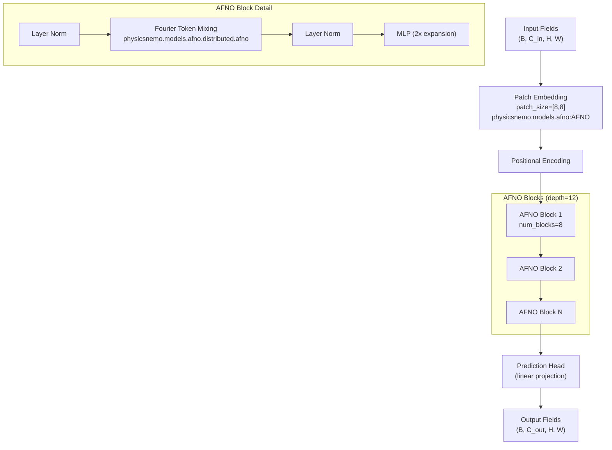
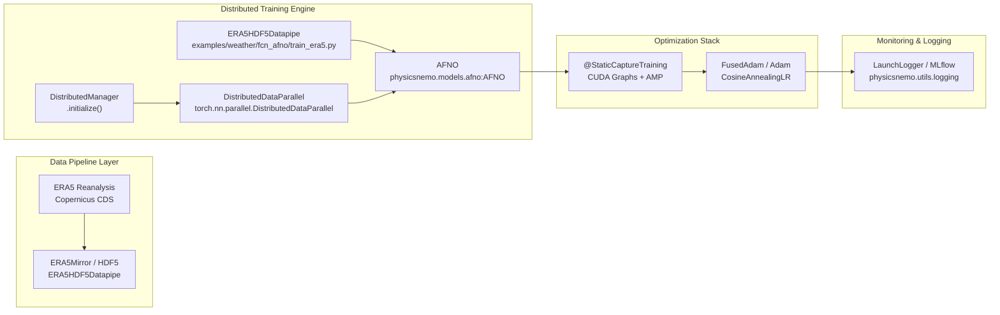

<!-- source: DeepWiki mcp.deepwiki.com · repo NVIDIA/physicsnemo · extra page AFNO · fetched 2026-11-04 -->

# AFNO

<details>
<summary>Relevant source files</summary>

The following files were used as context for generating this wiki page:

- [examples/cfd/mhd_pino/train_mhd.py](examples/cfd/mhd_pino/train_mhd.py)
- [examples/cfd/mhd_pino/train_mhd_vec_pot.py](examples/cfd/mhd_pino/train_mhd_vec_pot.py)
- [examples/cfd/mhd_pino/train_mhd_vec_pot_tfno.py](examples/cfd/mhd_pino/train_mhd_vec_pot_tfno.py)
- [examples/weather/diagnostic/train_diagnostic_precip.py](examples/weather/diagnostic/train_diagnostic_precip.py)
- [examples/weather/dlwp/conf/config.yaml](examples/weather/dlwp/conf/config.yaml)
- [examples/weather/dlwp/cube_sphere_plotter_no_subplots.py](examples/weather/dlwp/cube_sphere_plotter_no_subplots.py)
- [examples/weather/dlwp/era5_hdf5.py](examples/weather/dlwp/era5_hdf5.py)
- [examples/weather/dlwp/train_dlwp.py](examples/weather/dlwp/train_dlwp.py)
- [examples/weather/fcn_afno/conf/config.yaml](examples/weather/fcn_afno/conf/config.yaml)
- [examples/weather/fcn_afno/train_era5.py](examples/weather/fcn_afno/train_era5.py)
- [examples/weather/pangu_weather/train_pangu_era5.py](examples/weather/pangu_weather/train_pangu_era5.py)
- [examples/weather/pangu_weather/train_pangu_lite_era5.py](examples/weather/pangu_weather/train_pangu_lite_era5.py)
- [physicsnemo/domain_parallel/shard_utils/halo.py](physicsnemo/domain_parallel/shard_utils/halo.py)
- [physicsnemo/models/afno/distributed/afno.py](physicsnemo/models/afno/distributed/afno.py)
- [physicsnemo/models/afno/distributed/layers.py](physicsnemo/models/afno/distributed/layers.py)
- [physicsnemo/nn/module/attention_layers.py](physicsnemo/nn/module/attention_layers.py)
- [physicsnemo/nn/module/utils/__init__.py](physicsnemo/nn/module/utils/__init__.py)
- [physicsnemo/nn/module/utils/weight_init.py](physicsnemo/nn/module/utils/weight_init.py)
- [test/common/fwdaccuracy.py](test/common/fwdaccuracy.py)
- [test/models/afno/data/afno_output.pth](test/models/afno/data/afno_output.pth)
- [test/models/afno/data/modafno_output.pth](test/models/afno/data/modafno_output.pth)
- [test/nn/module/test_weight_init.py](test/nn/module/test_weight_init.py)

</details>


## Purpose and Scope

This document covers the AFNO (Adaptive Fourier Neural Operator) model architecture in PhysicsNeMo, its implementation details, Vision Transformer adaptation, ModAFNO variant, distributed execution, and its primary application in weather forecasting through FourCastNet. AFNO is a neural operator that adapts vision transformer concepts with Fourier-based token mixing for processing global gridded atmospheric data.

For other neural operators, see [Neural Operators](#3.1). For FNO (Fourier Neural Operator), see [3.1.2 FNO](). For DoMINO and point cloud processing, see [3.1.3 DoMINO]().

## Architecture Overview

AFNO (Adaptive Fourier Neural Operator) is a neural network architecture that combines vision transformer design principles with efficient Fourier-based token mixing. It processes atmospheric state data on regular grids by:

1. Patching input fields into non-overlapping patches (`patch_size=[8, 8]`)
2. Embedding patches into a higher-dimensional space (`embed_dim=768`)
3. Processing through transformer blocks with Fourier-based attention (`depth=12`, `num_blocks=8`)
4. Reconstructing the output fields from patch embeddings

The key innovation is replacing standard attention mechanisms with token mixing in the Fourier domain via `physicsnemo.models.afno`, which provides computational efficiency for large-scale grid data while maintaining global receptive fields.

**AFNO Architecture Components**



Sources: [examples/weather/fcn_afno/train_era5.py:148-156](), [physicsnemo/models/afno/distributed/afno.py]()

## Implementation in PhysicsNeMo

### Model Registration and Core Parameters

AFNO is registered in PhysicsNeMo's model registry and can be instantiated through the entry point system or imported directly from `physicsnemo.models.afno`.

| Parameter | Type | Description | Example |
|-----------|------|-------------|---------|
| `inp_shape` | List[int] | Input spatial dimensions (H, W) | `[720, 1440]` |
| `in_channels` | int | Number of input channels | `20` |
| `out_channels` | int | Number of output channels | `20` |
| `patch_size` | List[int] | Patch dimensions | `[8, 8]` |
| `embed_dim` | int | Embedding dimension | `768` |
| `depth` | int | Number of AFNO blocks | `12` |
| `num_blocks` | int | Fourier blocks per AFNO block | `8` |

Sources: [examples/weather/fcn_afno/train_era5.py:148-156]()

### Model Instantiation and Distributed AFNO

```python
from physicsnemo.models.afno import AFNO

# Create AFNO model for ERA5 data (0.25° resolution)
model = AFNO(
    inp_shape=[720, 1440],      # ERA5 grid: 721×1440 → 720×1440 for patching
    in_channels=20,              # 20 atmospheric variables
    out_channels=20,             # Predict same 20 variables
    patch_size=[8, 8],           # 8×8 patches
    embed_dim=768,               # Embedding dimension
    depth=12,                    # 12 transformer blocks
    num_blocks=8                 # 8 Fourier blocks per transformer
)
```

For large-scale or multi-GPU environments, PhysicsNeMo provides distributed AFNO implementations under `physicsnemo.models.afno.distributed.afno` and `physicsnemo.models.afno.distributed.layers`, which shard spatial dimensions or spectral weights across a `DeviceMesh` to accommodate high-resolution global grids.

Sources: [examples/weather/fcn_afno/train_era5.py:148-156](), [physicsnemo/models/afno/distributed/afno.py]()

## ModAFNO Variant

ModAFNO extends the standard AFNO architecture by modifying the spectral filtering blocks to support modulated or conditioned operator learning, often used in hybrid data-driven physics tasks or multi-physics conditioning. It utilizes structural components defined in `physicsnemo.models.afno` while maintaining compatibility with the standard configuration pipeline and checkpoint structures (such as those tested in `test/models/afno/data/modafno_output.pth`).

Sources: [physicsnemo/models/afno](), [test/models/afno/data/modafno_output.pth]()

## FourCastNet Weather Forecasting Application

FourCastNet (Fourier Forecasting Neural Network) is the primary application of AFNO in PhysicsNeMo (`examples/weather/fcn_afno/train_era5.py`), providing global data-driven weather forecasting at 0.25° resolution.

### System Architecture and Data Pipeline



Sources: [examples/weather/fcn_afno/train_era5.py:23-34](), [examples/weather/fcn_afno/train_era5.py:115-130]()

### FourCastNet Characteristics

| Aspect | Details |
|--------|---------|
| **Resolution** | 0.25° (approximately 25 km at equator) |
| **Grid Size** | 721 latitude × 1440 longitude points |
| **Variables** | 20-channel subset of ERA5 (surface and pressure-level) |
| **Time Step** | 6 hours ($\Delta t = 6\text{h}$) |
| **Forecast Range** | Multi-step autoregressive rollout (up to 1 week) |
| **Training Data** | ERA5 reanalysis via `ERA5HDF5Datapipe` |
| **Inference Speed** | ~2 seconds for week-long forecast |

Sources: [examples/weather/fcn_afno/train_era5.py:118-130](), [examples/weather/fcn_afno/conf/config.yaml:29-35]()

## Training and Optimization

### Training Loop & Loss Function

FourCastNet training (`examples/weather/fcn_afno/train_era5.py`) optimizes a normalized $L_p$ loss function across multi-step autoregressive rollouts:

```python
def loss_func(x, y, p=2.0):
    yv = y.reshape(x.size()[0], -1)
    xv = x.reshape(x.size()[0], -1)
    diff_norms = torch.linalg.norm(xv - yv, ord=p, dim=1)
    y_norms = torch.linalg.norm(yv, ord=p, dim=1)

    return torch.mean(diff_norms / y_norms)
```

Sources: [examples/weather/fcn_afno/train_era5.py:36-43]()

### Optimization Features

AFNO training leverages PhysicsNeMo optimization utilities:
- **CUDA Graphs & AMP**: Managed via decorators such as `@StaticCaptureTraining` and `@StaticCaptureEvaluateNoGrad` imported from `physicsnemo.utils`.
- **Distributed Execution**: Initialized using `DistributedManager.initialize()` and wrapped via PyTorch's `DistributedDataParallel`.
- **Logging**: Integrated with `LaunchLogger` and MLflow tracking via `initialize_mlflow`.

Sources: [examples/weather/fcn_afno/train_era5.py:28-33](), [examples/weather/fcn_afno/train_era5.py:97-116]()

Sources:
- [examples/weather/fcn_afno/train_era5.py]()
- [examples/weather/fcn_afno/conf/config.yaml]()
- [physicsnemo/models/afno/distributed/afno.py]()
- [physicsnemo/models/afno/distributed/layers.py]()

---

