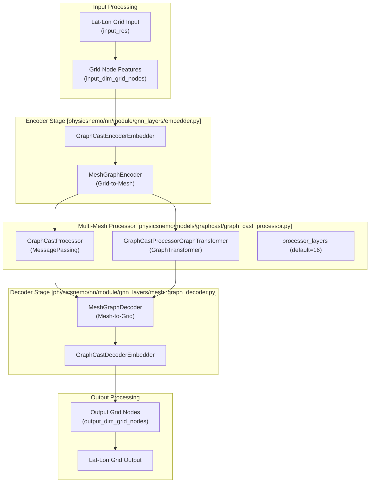
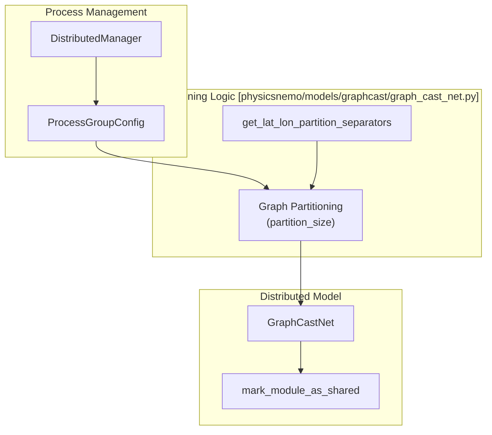

<!-- source: DeepWiki mcp.deepwiki.com · repo NVIDIA/physicsnemo · extra page GraphCast · fetched 2026-11-04 -->

# GraphCast

<details>
<summary>Relevant source files</summary>

The following files were used as context for generating this wiki page:

- [examples/cfd/external_aerodynamics/domino/requirements.txt](examples/cfd/external_aerodynamics/domino/requirements.txt)
- [examples/cfd/swe_distributed_gnn/README.md](examples/cfd/swe_distributed_gnn/README.md)
- [examples/cfd/swe_distributed_gnn/config_graphcast_swe.yaml](examples/cfd/swe_distributed_gnn/config_graphcast_swe.yaml)
- [examples/cfd/swe_distributed_gnn/requirements.txt](examples/cfd/swe_distributed_gnn/requirements.txt)
- [examples/cfd/swe_distributed_gnn/shallow_water_pde_dataset.py](examples/cfd/swe_distributed_gnn/shallow_water_pde_dataset.py)
- [examples/cfd/swe_distributed_gnn/shallow_water_solver.py](examples/cfd/swe_distributed_gnn/shallow_water_solver.py)
- [examples/cfd/swe_distributed_gnn/train.py](examples/cfd/swe_distributed_gnn/train.py)
- [examples/weather/graphcast/README.md](examples/weather/graphcast/README.md)
- [examples/weather/graphcast/compute_time_diff_std.py](examples/weather/graphcast/compute_time_diff_std.py)
- [examples/weather/graphcast/conf/config.yaml](examples/weather/graphcast/conf/config.yaml)
- [examples/weather/graphcast/data_utils.py](examples/weather/graphcast/data_utils.py)
- [examples/weather/graphcast/requirements.txt](examples/weather/graphcast/requirements.txt)
- [examples/weather/graphcast/train_utils.py](examples/weather/graphcast/train_utils.py)
- [physicsnemo/metrics/climate/graphcast_loss.py](physicsnemo/metrics/climate/graphcast_loss.py)
- [physicsnemo/models/graphcast/graph_cast_net.py](physicsnemo/models/graphcast/graph_cast_net.py)
- [physicsnemo/nn/module/gumbel_softmax.py](physicsnemo/nn/module/gumbel_softmax.py)
- [physicsnemo/utils/mesh/combine_vtp_files.py](physicsnemo/utils/mesh/combine_vtp_files.py)
- [physicsnemo/utils/mesh/convert_file_formats.py](physicsnemo/utils/mesh/convert_file_formats.py)
- [physicsnemo/utils/mesh/generate_stl.py](physicsnemo/utils/mesh/generate_stl.py)
- [test/models/graphcast/test_concat_trick.py](test/models/graphcast/test_concat_trick.py)
- [test/models/graphcast/test_grad_checkpointing.py](test/models/graphcast/test_grad_checkpointing.py)
- [test/models/graphcast/test_graphcast.py](test/models/graphcast/test_graphcast.py)
- [test/models/graphcast/utils.py](test/models/graphcast/utils.py)
- [test/pytest_utils.py](test/pytest_utils.py)

</details>


## Purpose and Scope

This document describes the **GraphCastNet** model architecture in PhysicsNeMo, a graph neural network designed for global weather forecasting on icosahedral grids. GraphCastNet implements a multi-mesh encoder-processor-decoder architecture that operates on hierarchical mesh representations of global atmospheric data, supporting distributed training, memory-efficient message passing, and optimized gradient checkpointing.

For information about:
- General graph neural network models for irregular meshes, see [MeshGraphNet](#3.2.1)
- Neural operator approaches, see [Neural Operators](#3.1)
- Distributed training infrastructure, see [Distributed Computing](#5)

**Sources:** `[physicsnemo/models/graphcast/graph_cast_net.py:133-136]()`, `[examples/cfd/swe_distributed_gnn/README.md:10-12]()`

---

## Architecture Overview

GraphCastNet uses a multi-mesh encoder-processor-decoder architecture. The model transforms latitude-longitude grid data to a hierarchical icosahedral mesh representation, processes it through graph convolutions or transformer layers, and transforms it back to the original grid format.

### Code-Entity Architecture Mapping



**Sources:** `[physicsnemo/models/graphcast/graph_cast_net.py:133-200]()`, `[physicsnemo/models/graphcast/graph_cast_net.py:270-350]()`

---

## GraphCastNet Class and Initialization

The main model class is `GraphCastNet` located in `physicsnemo.models.graphcast.graph_cast_net`. It inherits from `physicsnemo.Module` and utilizes a specialized `MetaData` configuration class for optimization flags (`amp_gpu`, `bf16`, etc.).

### Initialization Parameters

| Parameter | Type | Description |
|-----------|------|-------------|
| `mesh_level` | int | Level of the latent mesh used to build the graph (default: 6) `[physicsnemo/models/graphcast/graph_cast_net.py:139]()`. |
| `multimesh` | bool | If `True`, includes nodes from all mesh levels up to `mesh_level` `[physicsnemo/models/graphcast/graph_cast_net.py:141]()`. |
| `input_res` | tuple | Resolution of the latitude-longitude grid `(H, W)` `[physicsnemo/models/graphcast/graph_cast_net.py:144]()`. |
| `processor_type` | Literal | `"MessagePassing"` or `"GraphTransformer"` `[physicsnemo/models/graphcast/graph_cast_net.py:154]()`. |
| `processor_layers`| int | Number of processor layers (default: 16) `[physicsnemo/models/graphcast/graph_cast_net.py:162]()`. |
| `hidden_dim` | int | Hidden dimension for node and edge embeddings (default: 512) `[physicsnemo/models/graphcast/graph_cast_net.py:166]()`. |
| `do_concat_trick` | bool | Enable memory-efficient concatenation trick in message passing `[physicsnemo/models/graphcast/graph_cast_net.py:180]()`. |
| `graph_backend` | str | Backend for graph operations, e.g., `"pyg"` `[physicsnemo/models/graphcast/graph_cast_net.py:184]()`. |

**Sources:** `[physicsnemo/models/graphcast/graph_cast_net.py:116-187]()`

---

## Multi-Mesh Architecture Components

### Processor Variants
The model supports two types of graph processors:
1. **GraphCastProcessor**: Implements standard multi-scale message passing between nodes and edges `[physicsnemo/models/graphcast/graph_cast_net.py:38]()`.
2. **GraphCastProcessorGraphTransformer**: Uses multi-head attention mechanisms for message aggregation `[physicsnemo/models/graphcast/graph_cast_net.py:39]()`. It accepts parameters such as `khop_neighbors` (default: 32) and `num_attention_heads` (default: 4) `[physicsnemo/models/graphcast/graph_cast_net.py:157-161]()`.

### Graph Structures
The internal geometry is managed using the `Graph` utility class `[physicsnemo/models/graphcast/graph_cast_net.py:26]()`. Key subgraphs include:
- `g2m_graph`: Grid-to-mesh connectivity `[physicsnemo/models/graphcast/graph_cast_net.py:301]()`.
- `m2g_graph`: Mesh-to-grid connectivity `[physicsnemo/models/graphcast/graph_cast_net.py:341]()`.
- `mesh_graph`: Latent icosahedral multi-mesh connectivity `[physicsnemo/models/graphcast/graph_cast_net.py:318]()`.

**Sources:** `[physicsnemo/models/graphcast/graph_cast_net.py:26-40]()`, `[physicsnemo/models/graphcast/graph_cast_net.py:270-350]()`

---

## Distributed Training and Partitioning

GraphCastNet supports distributed training via domain and graph partitioning, allowing scaling across multiple GPUs.

### Distributed Partitioning Mapping



### Lat-Lon Partitioning
To minimize communication overhead and edge cuts across ranks, the latitude-longitude grid can be partitioned using `get_lat_lon_partition_separators` `[physicsnemo/models/graphcast/graph_cast_net.py:45-113]()`. This function computes coordinate separation intervals (`min_seps`, `max_seps`) for each chunk `[physicsnemo/models/graphcast/graph_cast_net.py:59]`.

### Distributed GNN Integration
When training distributed variants (such as the Shallow Water Equations GNN example), shared weights across ranks are synchronized by registering gradient hooks using `mark_module_as_shared` `[examples/cfd/swe_distributed_gnn/README.md:132-145]()`.

**Sources:** `[physicsnemo/models/graphcast/graph_cast_net.py:45-113]()`, `[examples/cfd/swe_distributed_gnn/README.md:132-145]()`

---

## Forward Pass and Performance Optimizations

### Data Flow
1. **Input**: Latitude-longitude tensor of shape `(B, C, H, W)` `[test/models/graphcast/test_graphcast.py:136-140]()`.
2. **Encoder**: Projects grid data onto mesh nodes via `GraphCastEncoderEmbedder` and `MeshGraphEncoder` `[physicsnemo/models/graphcast/graph_cast_net.py:300]()`.
3. **Processor**: Executes iterative message passing or transformer blocks across the latent multi-mesh graph `[physicsnemo/models/graphcast/graph_cast_net.py:317-338]()`.
4. **Decoder**: Projects processed mesh states back to the regular grid via `MeshGraphDecoder` and `GraphCastDecoderEmbedder` `[physicsnemo/models/graphcast/graph_cast_net.py:340]()`.

### Memory Optimizations
- **Concatenation Trick (`do_concat_trick`)**: Avoids explicit large tensor allocations during message passing by optimizing MLP layers on source, destination, and edge features `[examples/weather/graphcast/conf/config.yaml:58]()`, `[test/models/graphcast/test_concat_trick.py:29-30]`.
- **Gradient Checkpointing**: Configurable checkpointing is supported across the encoder, processor segments, and decoder `[examples/weather/graphcast/conf/config.yaml:43-51]()`, `[test/models/graphcast/test_grad_checkpointing.py:57-60]()`.
- **Activation Recomputation (`recompute_activation`)**: Trades compute for memory by recomputing activations (e.g., SiLU) during the backward pass `[examples/weather/graphcast/conf/config.yaml:63]()`.

**Sources:** `[physicsnemo/models/graphcast/graph_cast_net.py:360-400]()`, `[test/models/graphcast/test_grad_checkpointing.py:53-61]()`, `[test/models/graphcast/test_concat_trick.py:68-79]()`

---

## Configuration and Usage

### Configuration via Hydra
The model and its optimizations are typically controlled via Hydra configuration files (e.g., `examples/weather/graphcast/conf/config.yaml`) `[examples/weather/graphcast/conf/config.yaml:29-64]()`:

```yaml
processor_layers: 16
hidden_dim: 512
mesh_level: 6
multimesh: true
processor_type: MessagePassing
concat_trick: true
checkpoint_processor: false
segments: 1
```

### Instantiation Example
```python
from physicsnemo.models.graphcast.graph_cast_net import GraphCastNet
import torch

model = GraphCastNet(
    mesh_level=1,
    input_res=(721, 1440),
    input_dim_grid_nodes=474,
    processor_layers=16,
    hidden_dim=512,
    do_concat_trick=True
).to("cuda")

# Forward pass with shape (batch, channels, lat, lon)
x = torch.randn(1, 474, 721, 1440, device="cuda")
output = model(x)
```

**Sources:** `[test/models/graphcast/test_graphcast.py:56-74]()`, `[examples/weather/graphcast/conf/config.yaml:29-64]()`

---

