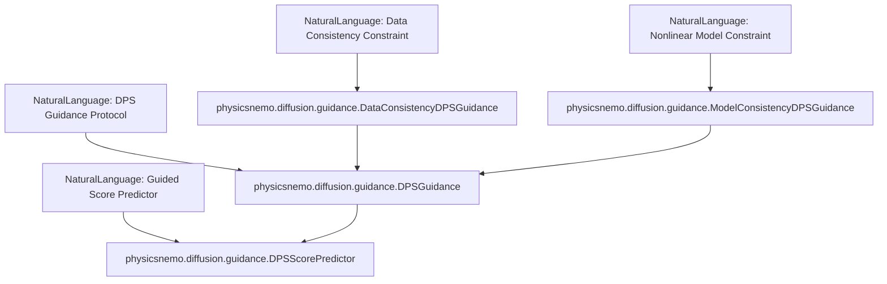
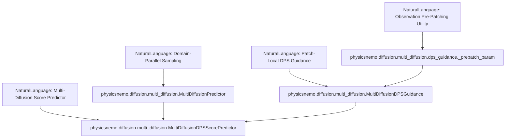

<!-- source: DeepWiki mcp.deepwiki.com · repo NVIDIA/physicsnemo · extra page Guidance and Multi-Diffusion · fetched 2026-11-04 -->

# Guidance and Multi-Diffusion

<details>
<summary>Relevant source files</summary>

The following files were used as context for generating this wiki page:

- [physicsnemo/diffusion/guidance/__init__.py](physicsnemo/diffusion/guidance/__init__.py)
- [physicsnemo/diffusion/guidance/dps_guidance.py](physicsnemo/diffusion/guidance/dps_guidance.py)
- [physicsnemo/diffusion/multi_diffusion/dps_guidance.py](physicsnemo/diffusion/multi_diffusion/dps_guidance.py)
- [physicsnemo/diffusion/utils/utils.py](physicsnemo/diffusion/utils/utils.py)
- [test/diffusion/data/test_dps_guidance_data_tensor_sda_1d.pth](test/diffusion/data/test_dps_guidance_data_tensor_sda_1d.pth)
- [test/diffusion/data/test_dps_guidance_data_tensor_sda_2d.pth](test/diffusion/data/test_dps_guidance_data_tensor_sda_2d.pth)
- [test/diffusion/data/test_dps_guidance_data_tensor_sda_3d.pth](test/diffusion/data/test_dps_guidance_data_tensor_sda_3d.pth)
- [test/diffusion/data/test_dps_guidance_dps_data_tensor_sda_1d.pth](test/diffusion/data/test_dps_guidance_dps_data_tensor_sda_1d.pth)
- [test/diffusion/data/test_dps_guidance_dps_data_tensor_sda_2d.pth](test/diffusion/data/test_dps_guidance_dps_data_tensor_sda_2d.pth)
- [test/diffusion/data/test_dps_guidance_dps_data_tensor_sda_3d.pth](test/diffusion/data/test_dps_guidance_dps_data_tensor_sda_3d.pth)
- [test/diffusion/data/test_multi_diffusion_dps_guidance_data_tensor_sda.pth](test/diffusion/data/test_multi_diffusion_dps_guidance_data_tensor_sda.pth)
- [test/diffusion/test_dps_guidance.py](test/diffusion/test_dps_guidance.py)

</details>


## Purpose and Scope
This page documents the Diffusion Posterior Sampling (DPS) guidance infrastructure, the guidance API, multi-diffusion patch-based generation, and domain-parallel sampling within PhysicsNeMo (`physicsnemo/diffusion`). These components enable conditioned sampling, data and model consistency steering during reverse diffusion, memory-efficient patch-based generation for large physical domains (such as high-resolution weather grids and fluid flow fields), and distributed parallel execution.

Sources: `physicsnemo/diffusion/guidance/dps_guidance.py`, `physicsnemo/diffusion/multi_diffusion/dps_guidance.py`

---

## 1. Diffusion Posterior Sampling (DPS) Overview
DPS incorporates observational constraints into unconditional or conditional diffusion models during inference without retraining the underlying network. At each reverse diffusion step, a score correction is computed based on the gradient of a data consistency or observation loss evaluated at the predicted clean state $\hat{\mathbf{x}}_0$.

The standard mathematical formulation implemented by the guidance framework is:

$$\nabla_{\mathbf{x}} \sum_i \boldsymbol{\rho}_i(t)\, \ell\big( A(\hat{\mathbf{x}}_0),\, \mathbf{y} \big)_i$$

where:
- $A$ is an observation operator (potentially nonlinear).
- $\mathbf{y}$ is the observed data tensor.
- $\ell$ is an elementwise loss function (e.g., $L_1$ or $L_2$ norm).
- $i$ indexes the observation components.
- $\boldsymbol{\rho}(t)$ is a time-dependent strength parameter (or scaled standard deviation adaptation term).

Sources: `physicsnemo/diffusion/guidance/dps_guidance.py:44-73`

---

## 2. The Guidance API and Protocols

The guidance system is built around protocols that decouple observation constraints from score predictors. 


*Figure 1: Bridging Natural Language Guidance Concepts to Code Entities in `physicsnemo.diffusion.guidance`.*

Sources: `physicsnemo/diffusion/guidance/dps_guidance.py:19-174`, `physicsnemo/diffusion/guidance/__init__.py:17-31`

### Key Protocols and Classes
- **`DPSGuidance` Protocol**: Defines the minimal interface for a guidance callable. Implementations must accept noisy latent state `x`, diffusion time `t`, and clean state estimate `x_0`, returning a score-like adjustment tensor [physicsnemo/diffusion/guidance/dps_guidance.py:44-156]().
- **`DPSScorePredictor`**: Combines an underlying $x_0$-predictor with one or more `DPSGuidance` objects to construct a valid score predictor conforming to the `Predictor` interface [physicsnemo/diffusion/guidance/dps_guidance.py:75-148]().

---

## 3. Concrete Guidance Implementations

PhysicsNeMo provides built-in guidance classes for common observation scenarios:

1. **`DataConsistencyDPSGuidance`**: Handles linear or identity observation operators with support for binary masks (e.g., inpainting, sparse sensor assimilation) and per-channel noise standard deviation scaling (`std_y`).
2. **`ModelConsistencyDPSGuidance`**: Supports arbitrary (possibly nonlinear) observation operators $A(\cdot)$ applied to the clean state estimate before evaluating loss against observations $\mathbf{y}$.

Both classes support flexible Lp loss exponents (via `_lp_loss_fn` where $p=1$ or $p=2$) and Scaled Data Adaptation (SDA) parameters utilizing noise schedulers (`sigma_fn`, `alpha_fn`).

```mermaid
graph TD
    InputState[""InputLatentState[x,t]""] --> X0Predictor[""X0Predictor[x_0]""]
    X0Predictor --> GuidanceEval[""DPSGuidance.__call__[x,t,x0]""]
    GuidanceEval --> LossComp[""PointwiseLpLoss[l(A(x_0), y)]""]
    LossComp --> GradCalc[""BackpropGradient[nabla_x]""]
    GradCalc --> ScoreCombine[""CombineScore[Score + GuidanceTerm]""]
```
*Figure 2: Data Flow for Computing and Combining DPS Guidance Terms during Sampling.*

Sources: `physicsnemo/diffusion/guidance/dps_guidance.py:29-41`, `physicsnemo/diffusion/guidance/__init__.py:17-31`, `test/diffusion/test_dps_guidance.py:95-186`

Sources: `physicsnemo/diffusion/guidance/dps_guidance.py:29-174`, `physicsnemo/diffusion/guidance/__init__.py:17-31`

---

## 4. Multi-Diffusion Patch-Based Generation

For ultra-high-resolution spatial domains (such as regional weather downscaling or large-scale aerodynamics grids), global DPS gradient evaluations exceed GPU memory limits. The multi-diffusion submodule (`physicsnemo.diffusion.multi_diffusion`) provides patch-local guidance structures.

### `MultiDiffusionDPSGuidance` and Chunked Execution
- **`MultiDiffusionDPSGuidance` Protocol**: Extends standard DPS guidance with an optional `slice_start` argument [physicsnemo/diffusion/multi_diffusion/dps_guidance.py:63-150]().
- **Chunked Batch Mode**: When `slice_start=s` is provided, the guidance computes updates on a subset of patches ($K \leq \text{chunk\_size}$), keeping peak GPU memory proportional to the chunk size rather than the full patch grid $P \times B$ [physicsnemo/diffusion/multi_diffusion/dps_guidance.py:63-98]().
- **`_prepatch_param`**: Pre-patches global observation tensors and masks into patch layouts matching the multi-diffusion grid structure [physicsnemo/diffusion/multi_diffusion/dps_guidance.py:45-61]().

Sources: `physicsnemo/diffusion/multi_diffusion/dps_guidance.py:19-169`

---

## 5. Domain-Parallel Sampling Integration

Domain-Parallel Sampling (DPS) combined with multi-diffusion distributes spatial patches across multiple ranks in a distributed environment managed by `DistributedManager`.


*Figure 3: Mapping Domain-Parallel and Multi-Diffusion Concepts to Code Primitives.*

Sources: `physicsnemo/diffusion/multi_diffusion/dps_guidance.py:45-169`, `physicsnemo/diffusion/multi_diffusion/predictor.py:1-50`

### Execution Flow in Domain-Parallel Sampling
1. **Domain Partitioning**: The global spatial domain is decomposed into overlapping or disjoint patches handled across distributed devices.
2. **Patch-Local Score Prediction**: `MultiDiffusionDPSScorePredictor` evaluates the model across local patches.
3. **Chunked Guidance Application**: `MultiDiffusionDPSGuidance` applies observational constraints chunk-by-chunk to prevent out-of-memory errors during gradient backpropagation through $x_0$.
4. **Aggregation**: Overlapping patch predictions are blended using multi-diffusion weighting functions to ensure smooth global reconstruction.

Sources: `physicsnemo/diffusion/multi_diffusion/dps_guidance.py:63-169`, `physicsnemo/diffusion/utils/utils.py:27-63`

---

