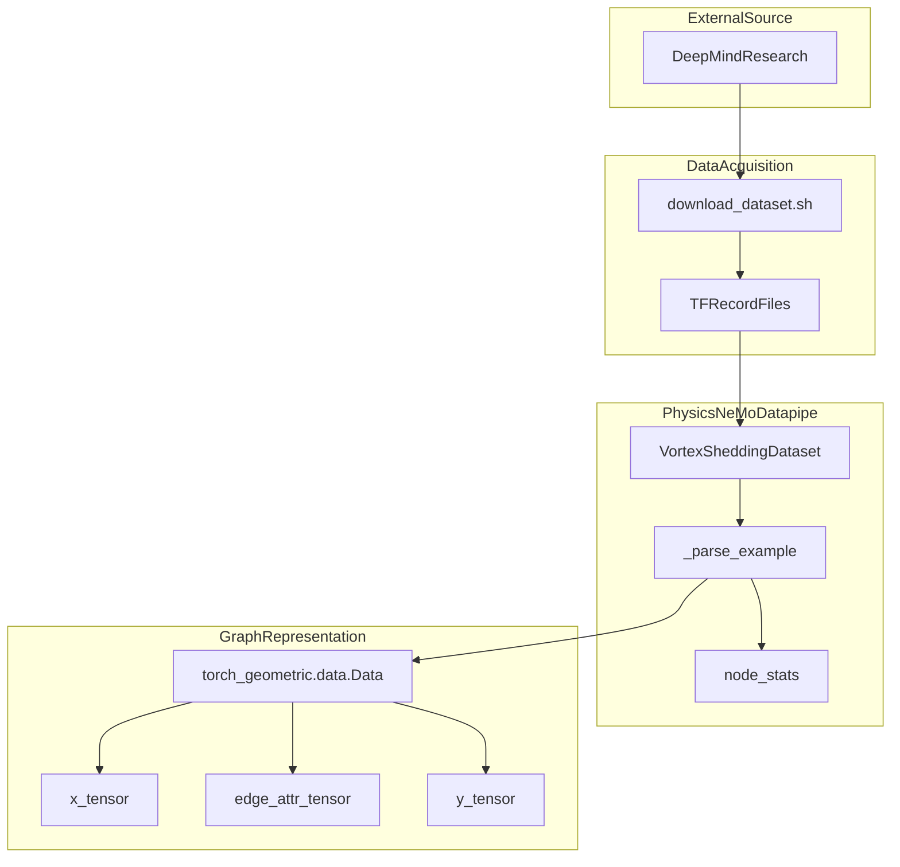
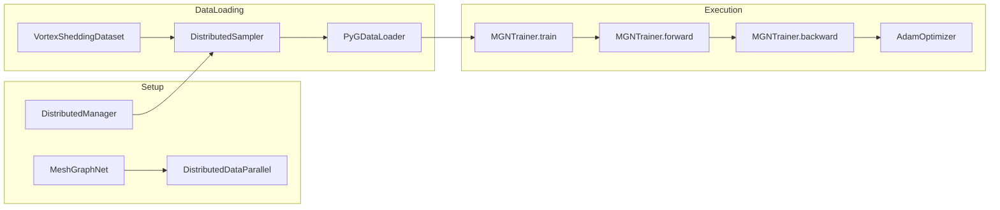
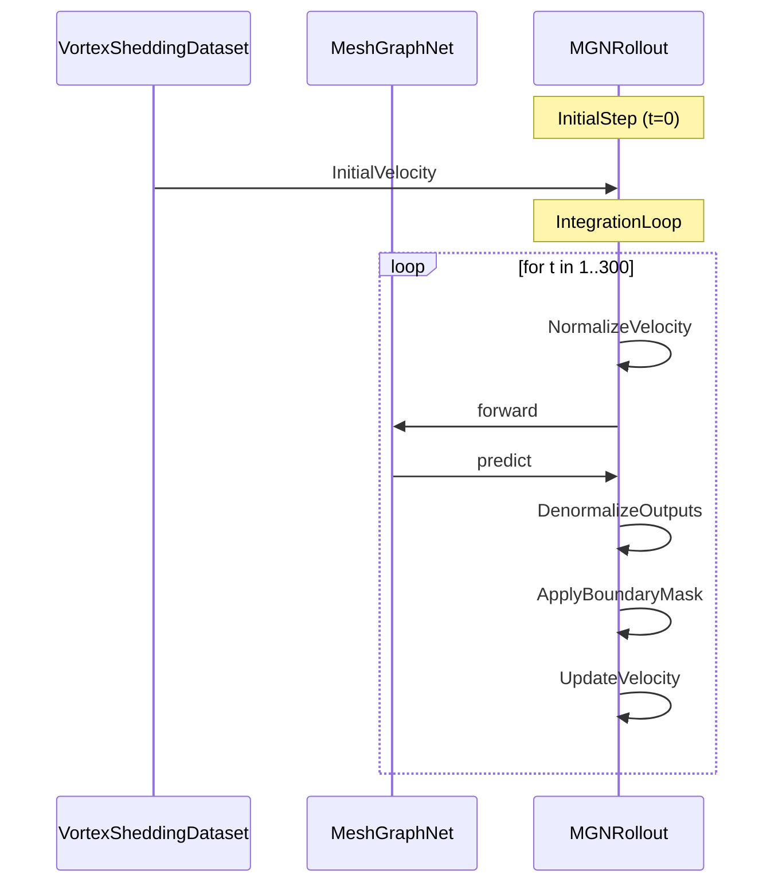

<!-- source: DeepWiki mcp.deepwiki.com · repo NVIDIA/physicsnemo · extra page MeshGraphNet for Vortex Shedding · fetched 2026-11-04 -->

# MeshGraphNet for Vortex Shedding

Relevant source files

The following files were used as context for generating this wiki page:

- [examples/cfd/vortex_shedding_mesh_reduced/README.md](examples/cfd/vortex_shedding_mesh_reduced/README.md)
- [examples/cfd/vortex_shedding_mesh_reduced/requirements.txt](examples/cfd/vortex_shedding_mesh_reduced/requirements.txt)
- [examples/cfd/vortex_shedding_mesh_reduced/test_sequence.py](examples/cfd/vortex_shedding_mesh_reduced/test_sequence.py)
- [examples/cfd/vortex_shedding_mesh_reduced/train.py](examples/cfd/vortex_shedding_mesh_reduced/train.py)
- [examples/cfd/vortex_shedding_mesh_reduced/train_sequence.py](examples/cfd/vortex_shedding_mesh_reduced/train_sequence.py)
- [examples/cfd/vortex_shedding_mgn/conf/config.yaml](examples/cfd/vortex_shedding_mgn/conf/config.yaml)
- [examples/cfd/vortex_shedding_mgn/inference.py](examples/cfd/vortex_shedding_mgn/inference.py)
- [examples/cfd/vortex_shedding_mgn/inference_analysis/inference_analysis.ipynb](examples/cfd/vortex_shedding_mgn/inference_analysis/inference_analysis.ipynb)
- [examples/cfd/vortex_shedding_mgn/inference_analysis/utils.py](examples/cfd/vortex_shedding_mgn/inference_analysis/utils.py)
- [examples/cfd/vortex_shedding_mgn/raw_dataset/download_dataset.sh](examples/cfd/vortex_shedding_mgn/raw_dataset/download_dataset.sh)
- [examples/cfd/vortex_shedding_mgn/train.py](examples/cfd/vortex_shedding_mgn/train.py)
- [physicsnemo/datapipes/gnn/ahmed_body_dataset.py](physicsnemo/datapipes/gnn/ahmed_body_dataset.py)
- [physicsnemo/datapipes/gnn/drivaernet_dataset.py](physicsnemo/datapipes/gnn/drivaernet_dataset.py)
- [physicsnemo/sym/eq/pde.py](physicsnemo/sym/eq/pde.py)
- [physicsnemo/sym/utils/sympy/torch_printer.py](physicsnemo/sym/utils/sympy/torch_printer.py)
- [test/datapipes/test_ahmed_body.py](test/datapipes/test_ahmed_body.py)
- [test/datapipes/test_stokes.py](test/datapipes/test_stokes.py)
- [test/datapipes/test_vortex_shedding.py](test/datapipes/test_vortex_shedding.py)
- [test/metrics/test_metrics_cfd.py](test/metrics/test_metrics_cfd.py)
- [test/metrics/test_metrics_integral.py](test/metrics/test_metrics_integral.py)

## Purpose and Scope

This document provides a technical guide for training and evaluating MeshGraphNet (MGN) on the cylinder flow vortex shedding problem. It covers dataset preparation, distributed training using `DistributedDataParallel`, autoregressive rollout inference, and visualization. This example demonstrates the application of Graph Neural Networks (GNNs) to unstructured mesh-based CFD simulations within the PhysicsNeMo framework.

For the core model implementation, see [MeshGraphNet (3.2.1)](). For the multiscale variant, see [BiStride MeshGraphNet (3.2.1)]().

---

## Dataset Overview

The vortex shedding example uses 2D cylinder flow data (von Kármán vortex street) at Reynolds number Re ≈ 100.

### Dataset Structure and Data Flow

**Sources**: [examples/cfd/vortex_shedding_mgn/raw_dataset/download_dataset.sh:1-12](), [physicsnemo/datapipes/gnn/vortex_shedding_dataset.py]()

### Data Acquisition
The dataset is fetched from the DeepMind research repository using a bash utility script. It consists of trajectory-based simulations stored in TFRecord format.

| Trajectory Type | Count | Timesteps |
| :--- | :--- | :--- |
| Training | 400 | 300 |
| Testing | 100 | 300 |

**Sources**: [examples/cfd/vortex_shedding_mgn/conf/config.yaml:24-30]()

---

## Model Configuration

The `MeshGraphNet` model follows an Encoder-Processor-Decoder architecture. In this example, it is configured to handle specific CFD state variables.

### Architecture Parameters

| Parameter | Value | Description |
| :--- | :--- | :--- |
| `num_input_features` | 6 | Velocity (2), Mesh Pos (2), Node Type (1), Time (1) |
| `num_edge_features` | 3 | Relative Mesh Pos (2), Distance (1) |
| `num_output_features` | 3 | Velocity Difference (2), Pressure (1) |
| `processor_size` | 15 | Number of message passing blocks |
| `hidden_dim_processor`| 128 | Width of MLP layers in processor |

**Sources**: [examples/cfd/vortex_shedding_mgn/conf/config.yaml:33-35](), [physicsnemo/models/meshgraphnet/meshgraphnet.py:159-163]()

### Optimization and Memory Features
The implementation supports several performance-oriented features:
* **Recompute Activation**: When `recompute_activation=True`, the model uses `SiLU` and recomputes activations during backward to save memory [examples/cfd/vortex_shedding_mgn/train.py:49-55]().
* **Gradient Checkpointing**: Configurable via `num_processor_checkpoint_segments` to segment the processor blocks [physicsnemo/models/meshgraphnet/meshgraphnet.py:91-92]().
* **Concat Trick**: Replaces standard sum aggregation with a concatenation-based MLP for potential stability [physicsnemo/models/meshgraphnet/meshgraphnet.py:89-90]().

**Sources**: [examples/cfd/vortex_shedding_mgn/train.py:43-115](), [physicsnemo/models/meshgraphnet/meshgraphnet.py:85-95]()

---

## Training Pipeline

The `MGNTrainer` class orchestrates the distributed training process using `DistributedManager`.

### Training Logic and Code Entities

**Key Implementation Details**:
* **Distributed Setup**: Uses `DistributedManager` to handle multi-GPU orchestration and `DistributedSampler` for data sharding [examples/cfd/vortex_shedding_mgn/train.py:45-72]().
* **Precision**: Supports Automatic Mixed Precision (AMP) via `torch.amp.autocast` and `GradScaler` [examples/cfd/vortex_shedding_mgn/train.py:160-168]().
* **Optimization**: Defaults to standard `Adam` or fused variants depending on device availability [examples/cfd/vortex_shedding_mgn/train.py:120-125]().

**Sources**: [examples/cfd/vortex_shedding_mgn/train.py:43-174]()

---

## Rollout Inference

Inference is performed autoregressively, where the model's prediction at time $t$ becomes the input for time $t+1$.

### Autoregressive Data Flow

**Boundary Enforcement**: The `MGNRollout` class applies a boolean mask to ensure that "wall_boundary" and "outflow" nodes do not receive velocity updates during integration [examples/cfd/vortex_shedding_mgn/inference.py:134-139]().

**Sources**: [examples/cfd/vortex_shedding_mgn/inference.py:90-158]()

---

## Visualization

The `MGNRollout` class includes a PyVista/Matplotlib-based visualization pipeline to generate GIFs of the predicted flow fields.

| Variable | Index | Description |
| :--- | :--- | :--- |
| `u` | 0 | Horizontal velocity component |
| `v` | 1 | Vertical velocity component |
| `p` | 2 | Static pressure field |

The `animate` function uses `mtri.Triangulation` to map the graph nodes and connectivity (faces) back to a spatial grid for rendering [examples/cfd/vortex_shedding_mgn/inference.py:184-191]().

**Sources**: [examples/cfd/vortex_shedding_mgn/inference.py:159-220]()

---

## Variant: Ahmed Body Drag Prediction

While the Vortex Shedding example focuses on temporal rollout, PhysicsNeMo also supports MeshGraphNet for static geometry tasks like the **Ahmed Body**.

### Ahmed Body Specifics
* **Dataset**: `AhmedBodyDataset` handles STL/VTK processing for car geometries [test/datapipes/test_ahmed_body.py:35-43]().
* **Multiscale Support**: Uses `BiStrideMeshGraphNet` and `BistrideMultiLayerGraphDataset` to handle the high node counts (~70k nodes) typical of 3D aerodynamic meshes [test/datapipes/test_bsms.py:63-86]().
* **Objective**: Predicts surface pressure and wall shear stress to compute total aerodynamic drag [test/datapipes/test_ahmed_body.py:42]().

**Sources**: [physicsnemo/models/meshgraphnet/bsms_mgn.py](), [test/models/meshgraphnet/test_bsms_mgn.py:193-204]()

---

## Summary of Model Variants

| Model Class | Feature | Use Case |
| :--- | :--- | :--- |
| `MeshGraphNet` | Standard Encoder-Processor-Decoder | General mesh-based CFD (Vortex Shedding) |
| `BiStrideMeshGraphNet` | Multiscale hierarchy with pooling | Large 3D meshes (Ahmed Body) |
| `MeshGraphKAN` | Kolmogorov-Arnold Network encoder | Interpretable node encoding [physicsnemo/models/meshgraphnet/meshgraphkan.py:46-48]() |
| `HybridMeshGraphNet` | Separate Mesh/World edge encoders | Complex boundary interactions [physicsnemo/models/meshgraphnet/hybrid_meshgraphnet.py:56-61]() |

**Sources**: [physicsnemo/models/meshgraphnet/meshgraphnet.py](), [physicsnemo/models/meshgraphnet/bsms_mgn.py](), [physicsnemo/models/meshgraphnet/meshgraphkan.py](), [physicsnemo/models/meshgraphnet/hybrid_meshgraphnet.py]()

---

