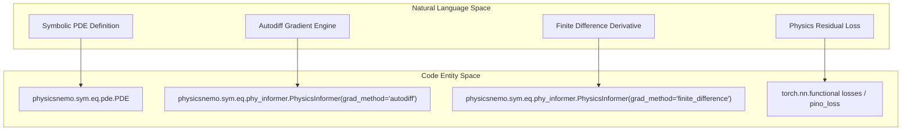
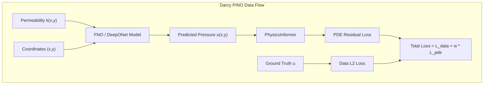

<!-- source: DeepWiki mcp.deepwiki.com · repo NVIDIA/physicsnemo · extra page Physics-Informed CFD (PINN/PINO) · fetched 2026-11-04 -->

# Physics-Informed CFD (PINN/PINO)

<details>
<summary>Relevant source files</summary>

The following files were used as context for generating this wiki page:

- [docs/img/inverse_pinn_sample_points.png](docs/img/inverse_pinn_sample_points.png)
- [examples/cfd/darcy_physics_informed/README.md](examples/cfd/darcy_physics_informed/README.md)
- [examples/cfd/darcy_physics_informed/conf/config_deeponet.yaml](examples/cfd/darcy_physics_informed/conf/config_deeponet.yaml)
- [examples/cfd/darcy_physics_informed/conf/config_pino.yaml](examples/cfd/darcy_physics_informed/conf/config_pino.yaml)
- [examples/cfd/darcy_physics_informed/darcy_physics_informed_deeponet.py](examples/cfd/darcy_physics_informed/darcy_physics_informed_deeponet.py)
- [examples/cfd/darcy_physics_informed/darcy_physics_informed_fno.py](examples/cfd/darcy_physics_informed/darcy_physics_informed_fno.py)
- [examples/cfd/darcy_physics_informed/download_data.py](examples/cfd/darcy_physics_informed/download_data.py)
- [examples/cfd/darcy_physics_informed/utils.py](examples/cfd/darcy_physics_informed/utils.py)
- [examples/cfd/external_aerodynamics/domino_nim_finetuning/README.md](examples/cfd/external_aerodynamics/domino_nim_finetuning/README.md)
- [examples/cfd/inverse_pinns/README.md](examples/cfd/inverse_pinns/README.md)
- [examples/cfd/inverse_pinns/config.yaml](examples/cfd/inverse_pinns/config.yaml)
- [examples/cfd/inverse_pinns/train_inverse_pinn.py](examples/cfd/inverse_pinns/train_inverse_pinn.py)
- [examples/cfd/ldc_pinns/README.md](examples/cfd/ldc_pinns/README.md)
- [examples/cfd/ldc_pinns/config.yaml](examples/cfd/ldc_pinns/config.yaml)
- [examples/cfd/ldc_pinns/train.py](examples/cfd/ldc_pinns/train.py)
- [examples/cfd/mhd_pino/README.md](examples/cfd/mhd_pino/README.md)
- [examples/cfd/mhd_pino/losses/loss_mhd_physicsnemo.py](examples/cfd/mhd_pino/losses/loss_mhd_physicsnemo.py)
- [examples/cfd/mhd_pino/losses/loss_mhd_vec_pot_physicsnemo.py](examples/cfd/mhd_pino/losses/loss_mhd_vec_pot_physicsnemo.py)
- [examples/cfd/mhd_pino/utils/plot_utils.py](examples/cfd/mhd_pino/utils/plot_utils.py)
- [examples/cfd/swe_nonlinear_pino/README.md](examples/cfd/swe_nonlinear_pino/README.md)
- [examples/cfd/swe_nonlinear_pino/train_swe_nl_pino.py](examples/cfd/swe_nonlinear_pino/train_swe_nl_pino.py)
- [examples/cfd/swe_nonlinear_pino/train_utils/plot.py](examples/cfd/swe_nonlinear_pino/train_utils/plot.py)
- [examples/cfd/swe_nonlinear_pino/train_utils/utils.py](examples/cfd/swe_nonlinear_pino/train_utils/utils.py)
- [physicsnemo/datapipes/gnn/ahmed_body_dataset.py](physicsnemo/datapipes/gnn/ahmed_body_dataset.py)
- [physicsnemo/datapipes/gnn/drivaernet_dataset.py](physicsnemo/datapipes/gnn/drivaernet_dataset.py)
- [physicsnemo/sym/eq/pde.py](physicsnemo/sym/eq/pde.py)
- [physicsnemo/sym/utils/sympy/torch_printer.py](physicsnemo/sym/utils/sympy/torch_printer.py)
- [test/datapipes/test_ahmed_body.py](test/datapipes/test_ahmed_body.py)
- [test/datapipes/test_stokes.py](test/datapipes/test_stokes.py)
- [test/datapipes/test_vortex_shedding.py](test/datapipes/test_vortex_shedding.py)
- [v2.0-MIGRATION-GUIDE.md](v2.0-MIGRATION-GUIDE.md)

</details>


## Purpose and Scope
This page documents the physics-informed neural network (PINN) and physics-informed neural operator (PINO) frameworks within PhysicsNeMo (`physicsnemo`). These methods blend data-driven machine learning models with governing physical laws (partial differential equations, or PDEs) to regularize training, enable zero-data or sparse-data learning, and solve inverse problems. 

Specifically, this page covers:
- The `physicsnemo.sym` symbolic PDE residual utilities (`PhysicsInformer`, `PDE`).
- Darcy flow physics-informed FNO and DeepONet architectures `[examples/cfd/darcy_physics_informed/README.md:1-90]()`.
- Lid-Driven Cavity (LDC) PINNs `[examples/cfd/ldc_pinns/README.md:1-61]()`.
- Inverse PINNs for parameter identification `[examples/cfd/inverse_pinns/README.md]()`.
- Magnetohydrodynamics (MHD) PINO `[examples/cfd/mhd_pino/README.md:1-150]()`.
- Nonlinear Shallow Water Equations (SWE) PINO `[examples/cfd/swe_nonlinear_pino/README.md:1-110]()`.

---

## 1. Physics-Informed Architecture & `physicsnemo.sym` Utilities

PhysicsNeMo provides explicit training loops combined with symbolic PDE definitions via the `physicsnemo.sym` package (installed with `pip install "nvidia-physicsnemo[sym]"`) `[examples/cfd/darcy_physics_informed/README.md:11-14]`. Unlike legacy implicit solvers, v2.0 applications manage optimizers, loss aggregation, and validation steps directly in PyTorch while leveraging `PhysicsInformer` to evaluate PDE residuals `[examples/cfd/darcy_physics_informed/darcy_physics_informed_deeponet.py:165-170]()`.

### Natural Language to Code Entity Mapping

The following diagram maps high-level physics-informed concepts to their concrete code implementations across different CFD examples.


*Sources: `examples/cfd/darcy_physics_informed/darcy_physics_informed_deeponet.py:124-170](), [examples/cfd/darcy_physics_informed/darcy_physics_informed_fno.py:109-115]()`*

---

## 2. Darcy Flow: Physics-Informed FNO & DeepONet

Darcy flow describes fluid flow through a porous medium, governed by the elliptic diffusion equation:
$$\nabla \cdot (k \nabla u) = q$$
where $k$ is the permeability field, $u$ is the pressure/head, and $q$ is the forcing function `[examples/cfd/darcy_physics_informed/darcy_physics_informed_deeponet.py:124-124]()`.

### DeepONet Implementation (Autodiff)
In `darcy_physics_informed_deeponet.py`, a DeepONet architecture is constructed using an `FNO` as the branch network (taking permeability $k$) and a `FullyConnected` MLP as the trunk network (taking spatial coordinates $x, y$) `[examples/cfd/darcy_physics_informed/darcy_physics_informed_deeponet.py:137-164]()`:

```python
model = DeepONet(
    output_keys=["k", "u"],
    trunk_net=model_trunk,
    branch_net=model_branch,
).to(device)
```
`[examples/cfd/darcy_physics_informed/darcy_physics_informed_deeponet.py:159-163]()`

By wrapping spatial coordinates with `.requires_grad_(True)`, PyTorch automatic differentiation is used inside `PhysicsInformer(grad_method="autodiff")` to compute exact spatial gradients of the pressure field $u$ with respect to inputs `[examples/cfd/darcy_physics_informed/darcy_physics_informed_deeponet.py:165-170](), [examples/cfd/darcy_physics_informed/darcy_physics_informed_deeponet.py:194-197]()`.

### FNO Implementation (Finite Difference)
Alternatively, `darcy_physics_informed_fno.py` applies a pure `FNO` model mapping $k \to u$ and evaluates PDE residuals using finite differences (`grad_method="finite_difference"`) over a uniform grid resolution `[examples/cfd/darcy_physics_informed/darcy_physics_informed_fno.py:97-115]()`:

```python
phy_informer = PhysicsInformer(
    required_outputs=["diffusion_u"],
    equations=darcy,
    grad_method="finite_difference",
    device=device,
    fd_dx=1 / 240,
)
```
`[examples/cfd/darcy_physics_informed/darcy_physics_informed_fno.py:109-115]()`


*Sources: `examples/cfd/darcy_physics_informed/darcy_physics_informed_deeponet.py:91-197](), [examples/cfd/darcy_physics_informed/darcy_physics_informed_fno.py:97-168]()`*

---

## 3. Lid-Driven Cavity (LDC) PINNs

The Lid-Driven Cavity (LDC) example demonstrates purely physics-driven neural networks where no training dataset is required `[examples/cfd/ldc_pinns/README.md:1-39]()`. 

- **Geometry Generation**: Collocation points are sampled dynamically from spatial geometries using `physicsnemo.mesh` and `GeometryDatapipe` utilities `[examples/cfd/ldc_pinns/README.md:41-44]()`.
- **Loss Formulation**: Boundary condition constraints (e.g., moving lid velocity, wall no-slip) and interior Navier-Stokes PDE residuals are computed explicitly via `PhysicsInformer` `[examples/cfd/ldc_pinns/README.md:14-18]`.

---

## 4. Inverse PINNs

Inverse PINNs extend standard PINNs by treating unknown physical parameters (such as diffusion coefficients, viscosity, or source terms) as optimizable parameters alongside neural network weights. 

- **Workflow**: Sparse or noisy observations of the state variables are combined with governing PDE residual losses. As training proceeds via gradient descent, the model simultaneously fits the observed data and estimates the unknown governing parameters embedded in the PDE operator `[examples/cfd/inverse_pinns/train_inverse_pinn.py]()`.

---

## 5. Magnetohydrodynamics (MHD) PINO

The MHD PINO example solves complex incompressible magnetohydrodynamics equations governing conductive fluids interacting with a magnetic field $\mathbf{B}$ `[examples/cfd/mhd_pino/README.md:6-24]()`:

$$\begin{align}
\partial_t \mathbf{u}+\mathbf{u} \cdot \nabla \mathbf{u} &= -\nabla \left( p+\frac{B^2}{2} \right)/\rho_0 +\mathbf{B} \cdot \nabla \mathbf{B}+\nu \nabla^2 \mathbf{u} \\
\partial_t \mathbf{B}+\mathbf{u} \cdot \nabla \mathbf{B} &= \mathbf{B} \cdot \nabla \mathbf{u}+\eta \nabla^2 \mathbf{B} \\
\nabla \cdot \mathbf{u} &= 0, \quad \nabla \cdot \mathbf{B} = 0
\end{align}$$

### Vector Potential Formulation
To strictly enforce $\nabla \cdot \mathbf{B} = 0$, the model can evolve the magnetic vector potential $\mathbf{A}$ where $\mathbf{B} = \nabla \times \mathbf{A}$, satisfying the evolutionary equation `[examples/cfd/mhd_pino/README.md:32-47]()`:
$$\partial_t \mathbf{A} + \mathbf{u} \cdot \nabla \mathbf{A}=\eta \nabla^2 \mathbf{A}$$

- **Models**: Supports standard Fourier Neural Operators (`FNO`) as well as Tensor-Factorized Fourier Neural Operators (`TFNO`) where weights are factorized using TensorLy `[examples/cfd/mhd_pino/README.md:105-110]()`.

---

## 6. Nonlinear Shallow Water Equations (SWE) PINO

The SWE PINO example models 3 coupled nonlinear partial differential equations applicable to tsunami modeling and ocean dynamics `[examples/cfd/swe_nonlinear_pino/README.md:1-15]()`:

$$\begin{align}
\frac{\partial \eta}{\partial t} + \frac{\partial (\eta u)}{\partial x} + \frac{\partial (\eta v)}{\partial y} &= 0 \\
\frac{\partial (\eta u)}{\partial t} + \frac{\partial}{\partial x}\left(\eta u^2 + \frac{1}{2}g\eta^2\right) + \frac{\partial(\eta u v)}{\partial y} &= \nu(u_{xx} + u_{yy}) \\
\frac{\partial (\eta v)}{\partial t} + \frac{\partial (\eta u v)}{\partial x} + \frac{\partial}{\partial y}\left(\eta v^2 + \frac{1}{2}g\eta^2\right) &= \nu(v_{xx} + v_{yy})
\end{align}$$
where $\eta(x,y,t)$ is total fluid column height perturbation, and $u, v$ are horizontal velocity components `[examples/cfd/swe_nonlinear_pino/README.md:11-26]()`.

### Implementation Details in `train_swe_nl_pino.py`
- **Data & Transforms**: Loads 2D SWE time-series tensors via `DataLoader2D_swe` `[examples/cfd/swe_nonlinear_pino/train_swe_nl_pino.py:173-180]()`.
- **PDE Node Construction**: Symbolic PDE evaluation nodes are compiled using `SWE_NL` `[examples/cfd/swe_nonlinear_pino/train_swe_nl_pino.py:168-170]()`:
  ```python
  swe_nl = SWE_NL(g=cfg.data.g, nu=cfg.data.nu)
  swe_nl_node = swe_nl.make_computations()
  ```
- **Loss Calculation**: Supports switching between original derivative formulas and `physicsnemo` Fourier derivative routines during validation and training loops `[examples/cfd/swe_nonlinear_pino/train_swe_nl_pino.py:78-94]()`.

---

## Summary Table of PINN/PINO Examples

| Example | Domain / Physics | Base Architecture | Derivative Method | Key Utility |
| :--- | :--- | :--- | :--- | :--- |
| **Darcy DeepONet** | Darcy Flow (Elliptic) | FNO (Branch) + MLP (Trunk) | Autodiff (`torch.autograd`) | `PhysicsInformer` |
| **Darcy FNO** | Darcy Flow (Elliptic) | FNO | Finite Difference / Fourier | `PhysicsInformer` |
| **LDC PINNs** | Navier-Stokes (Cavity) | Fully Connected MLP | Autodiff | `GeometryDatapipe` |
| **Inverse PINNs** | Parameter Estimation | MLP / Operator | Autodiff | `physicsnemo.sym` |
| **MHD PINO** | Magnetohydrodynamics | FNO / TFNO | Fourier / Numerical | `PhysicsInformer` |
| **SWE PINO** | Nonlinear Shallow Water | FNO | Fourier / `physicsnemo_fourier` | `SWE_NL` |

*Sources: `examples/cfd/darcy_physics_informed/darcy_physics_informed_deeponet.py()`, `examples/cfd/darcy_physics_informed/darcy_physics_informed_fno.py()`, `examples/cfd/swe_nonlinear_pino/train_swe_nl_pino.py()`*

---

