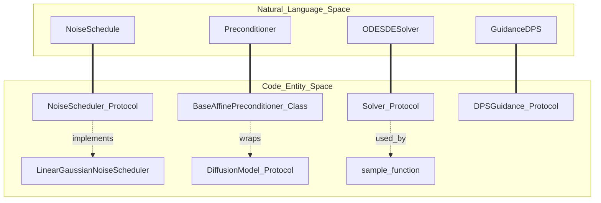
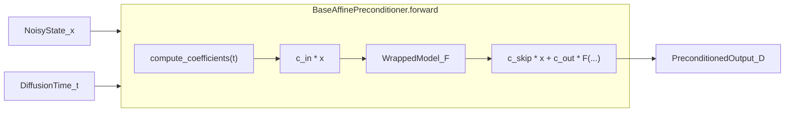

<!-- source: DeepWiki mcp.deepwiki.com · repo NVIDIA/physicsnemo · extra page Preconditioning and Samplers · fetched 2026-11-04 -->

# Preconditioning and Samplers

<details>
<summary>Relevant source files</summary>

The following files were used as context for generating this wiki page:

- [.importlinter](.importlinter)
- [docs/api/diffusion/noise_schedulers.rst](docs/api/diffusion/noise_schedulers.rst)
- [physicsnemo/diffusion/__init__.py](physicsnemo/diffusion/__init__.py)
- [physicsnemo/diffusion/base.py](physicsnemo/diffusion/base.py)
- [physicsnemo/diffusion/metrics/__init__.py](physicsnemo/diffusion/metrics/__init__.py)
- [physicsnemo/diffusion/metrics/losses.py](physicsnemo/diffusion/metrics/losses.py)
- [physicsnemo/diffusion/noise_schedulers/__init__.py](physicsnemo/diffusion/noise_schedulers/__init__.py)
- [physicsnemo/diffusion/noise_schedulers/domain_parallel.py](physicsnemo/diffusion/noise_schedulers/domain_parallel.py)
- [physicsnemo/diffusion/noise_schedulers/noise_schedulers.py](physicsnemo/diffusion/noise_schedulers/noise_schedulers.py)
- [physicsnemo/diffusion/preconditioners/preconditioners.py](physicsnemo/diffusion/preconditioners/preconditioners.py)
- [physicsnemo/diffusion/samplers/__init__.py](physicsnemo/diffusion/samplers/__init__.py)
- [physicsnemo/diffusion/samplers/samplers.py](physicsnemo/diffusion/samplers/samplers.py)
- [physicsnemo/diffusion/samplers/solvers.py](physicsnemo/diffusion/samplers/solvers.py)
- [physicsnemo/diffusion/utils/__init__.py](physicsnemo/diffusion/utils/__init__.py)
- [physicsnemo/diffusion/utils/model_wrappers.py](physicsnemo/diffusion/utils/model_wrappers.py)
- [physicsnemo/nn/module/mlp_layers.py](physicsnemo/nn/module/mlp_layers.py)
- [test/diffusion/test_wrappers.py](test/diffusion/test_wrappers.py)
- [test/nn/module/test_mlp_layers.py](test/nn/module/test_mlp_layers.py)

</details>


Preconditioning in diffusion models refers to the scaling and transformation of inputs and outputs to the denoising network to improve training stability, gradient conditioning, and sampling quality across varying noise scales. PhysicsNeMo implements EDM-based and affine preconditioning schemes, flexible noise schedulers, stochastic and deterministic samplers, model wrappers, and denoising score matching losses within the `physicsnemo.diffusion` package [physicsnemo/diffusion/preconditioners/preconditioners.py:62-172](), [physicsnemo/diffusion/metrics/losses.py:96-163]().

---

## 1. Core Framework Abstractions and Protocols

The PhysicsNeMo diffusion framework is built around protocol-based abstractions that decouple neural network architectures from time-dependent stochastic differential equations (SDEs) or ordinary differential equations (ODs):

- **`DiffusionModel`**: A prediction-agnostic protocol satisfied by neural backbones taking a noisy state `x`, time tensor `t`, and optional conditioning information [physicsnemo/diffusion/base.py:27-101]().
- **`NoiseScheduler`**: Protocol defining time discretization, noise injection via `add_noise`, and per-sample weighting `loss_weight` [physicsnemo/diffusion/noise_schedulers/noise_schedulers.py:25-32]().
- **`Predictor`**: Callable converting model outputs into estimates like clean data $\mathbf{x}_0$ or score functions [physicsnemo/diffusion/base.py:104-149]().
- **`Denoiser`**: ODE/SDE right-hand side update interface used during numerical integration [physicsnemo/diffusion/base.py:179-204]().

### Diffusion System Entity Mapping



Sources:
- [physicsnemo/diffusion/base.py:27-204]()
- [physicsnemo/diffusion/noise_schedulers/noise_schedulers.py:25-32]()
- [physicsnemo/diffusion/samplers/samplers.py:31-42]()

---

## 2. Preconditioning Schemes

PhysicsNeMo uses `BaseAffinePreconditioner` to wrap neural network models with a standardized affine transformation [physicsnemo/diffusion/preconditioners/preconditioners.py:62-172](). 

### Mathematical Formulation

The preconditioner wraps a neural network model $F$ to produce the preconditioned output $D(\mathbf{x}, t)$:

$$\begin{aligned}
D(\mathbf{x}, t) = c_{\text{skip}}(t) \mathbf{x} + c_{\text{out}}(t) F(c_{\text{in}}(t) \mathbf{x}, c_{\text{noise}}(t))
\end{aligned}$$

where:
- $c_{\text{in}}(t)$: Input scaling coefficient.
- $c_{\text{noise}}(t)$: Noise conditioning value passed to the backbone.
- $c_{\text{out}}(t)$: Output scaling coefficient.
- $c_{\text{skip}}(t)$: Skip connection scaling coefficient.

| Preconditioner Class | Formulation Reference | Key Characteristics |
| :--- | :--- | :--- |
| `EDMPreconditioner` | Karras et al. (2022) | Uses `sigma_data` to balance skip and output scales. Optimal for physical latents. |
| `VPPreconditioner` | Variance Preserving | Aligned with DDPM / Song et al. continuous VP formulation. |
| `VEPreconditioner` | Variance Exploding | Designed for score-matching on unbounded noise levels. |
| `iDDPMPreconditioner` | Improved DDPM | Uses discrete timestep indices and cosine variance schedules. |

Sources:
- [physicsnemo/diffusion/preconditioners/preconditioners.py:62-182]()

### Preconditioner Data Flow



Sources:
- [physicsnemo/diffusion/preconditioners/preconditioners.py:62-172]()

---

## 3. Noise Schedulers

Noise schedulers manage the forward diffusion process, noise variance trajectories, time sampling distributions, and loss weighting functions [physicsnemo/diffusion/noise_schedulers/noise_schedulers.py:25-32]().

- **`EDMNoiseScheduler`**: Implements the continuous noise schedule from Karras et al., parameterizing noise levels $\sigma$ via log-normal distributions [physicsnemo/diffusion/noise_schedulers/noise_schedulers.py:26]().
- **`LinearGaussianNoiseScheduler`**: Standard linear variance schedule for discrete-time diffusion processes [physicsnemo/diffusion/noise_schedulers/noise_schedulers.py:29]().
- **`DomainParallelNoiseScheduler`**: A distributed wrapper ensuring that timesteps and scaling coefficients are synchronized across spatial tensor shards during domain-parallel training [physicsnemo/diffusion/noise_schedulers/__init__.py:27-40]().

Sources:
- [physicsnemo/diffusion/noise_schedulers/noise_schedulers.py:25-32]()
- [physicsnemo/diffusion/noise_schedulers/__init__.py:27-40]()

---

## 4. Samplers and Solvers

Sampling is coordinated via the `physicsnemo.diffusion.samplers.sample` function, which iterates through reverse-time trajectories using discrete numerical solvers [physicsnemo/diffusion/samplers/samplers.py:31-84]().

### Solver Protocols and Implementations

Solvers implement the `Solver` protocol, requiring a `step(x, t_cur, t_next)` method [physicsnemo/diffusion/samplers/samplers.py:31-42](). PhysicsNeMo provides:

- **Deterministic Solvers**:
  - `EulerSolver`: First-order explicit Euler discretization [physicsnemo/diffusion/samplers/samplers.py:34]().
  - `HeunSolver`: Second-order Heun's method (predictor-corrector) [physicsnemo/diffusion/samplers/samplers.py:35]().
- **Stochastic Solvers**:
  - `EDMStochasticEulerSolver`: Stochastic extension incorporating Langevin-style noise inflation (churn) [physicsnemo/diffusion/samplers/samplers.py:32]().
  - `EDMStochasticHeunSolver`: Second-order stochastic Heun solver [physicsnemo/diffusion/samplers/samplers.py:33]().

Sources:
- [physicsnemo/diffusion/samplers/samplers.py:31-42]()

---

## 5. Diffusion Losses

Training is anchored on denoising score matching objectives [physicsnemo/diffusion/metrics/losses.py:17-117]().

- **`MSEDSMLoss`**: Computes mean-squared error denoising score matching losses. Given clean data $\mathbf{x}_0$, noise scheduler, and model prediction:

$$\begin{aligned}
\mathcal{L} = \mathbb{E}_{t, \boldsymbol{\epsilon}} \left[ w(t) \left\| \hat{\mathbf{x}}_0(\mathbf{x}_t, t) - \mathbf{x}_0 \right\|^2 \right]
\end{aligned}$$

- **Domain-Parallel Guards**: The loss function inspects whether `x0` is sharded as a `ShardTensor` using `_check_domain_parallel_scheduler`, raising a `ValueError` if a standard scheduler is used instead of a `DomainParallelNoiseScheduler` [physicsnemo/diffusion/metrics/losses.py:33-51]().

Sources:
- [physicsnemo/diffusion/metrics/losses.py:17-163]()

---

## 6. Model Wrappers and Super-Resolution

### ConcatConditionWrapper

Many physics models (such as `SongUNet` or `DiT`) expect specific conditioning input signatures [physicsnemo/diffusion/utils/model_wrappers.py:33-74](). `ConcatConditionWrapper` adapts backbones to the `DiffusionModel` interface by concatenating image-like conditioning tensors (e.g., low-resolution fields, boundary masks) along the channel dimension of $\mathbf{x}$, while routing vector metadata to label conditioning arguments [physicsnemo/diffusion/utils/model_wrappers.py:33-74]().

```python
from tensordict import TensorDict
from physicsnemo.diffusion.utils import ConcatConditionWrapper
from physicsnemo.models.diffusion_unets import SongUNet

net = SongUNet(in_channels=4, out_channels=3, label_dim=4, img_resolution=8)
wrapper = ConcatConditionWrapper(net)
```

Sources:
- [physicsnemo/diffusion/utils/model_wrappers.py:33-149]()

---

