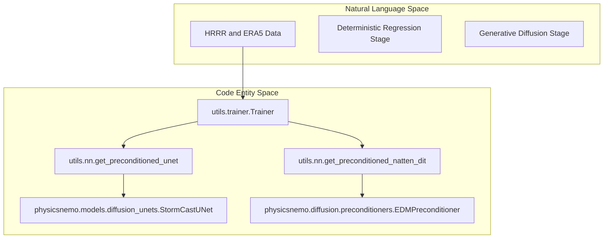

<!-- source: DeepWiki mcp.deepwiki.com · repo NVIDIA/physicsnemo · extra page StormCast and Regional Weather Diffusion · fetched 2026-11-04 -->

# StormCast and Regional Weather Diffusion

<details>
<summary>Relevant source files</summary>

The following files were used as context for generating this wiki page:

- [examples/weather/regional_weather_diffusion/utils/logging.py](examples/weather/regional_weather_diffusion/utils/logging.py)
- [examples/weather/regional_weather_diffusion/utils/nn.py](examples/weather/regional_weather_diffusion/utils/nn.py)
- [examples/weather/regional_weather_diffusion/utils/parallel.py](examples/weather/regional_weather_diffusion/utils/parallel.py)
- [examples/weather/regional_weather_diffusion/utils/trainer.py](examples/weather/regional_weather_diffusion/utils/trainer.py)
- [examples/weather/stormcast/README.md](examples/weather/stormcast/README.md)

</details>


StormCast is a high-resolution regional weather forecasting framework designed to emulate Convection-Allowing Models (CAMs) like NOAA's High-Resolution Rapid Refresh (HRRR). It employs a two-stage regression and generative diffusion pipeline to predict atmospheric states at kilometer-scale resolution, leveraging low-resolution background data (e.g., ERA5) as conditioning [examples/weather/stormcast/README.md:1-6](). The implementation resides in the unified `regional_weather_diffusion` recipe directory [examples/weather/stormcast/README.md:4-6]().

## System Overview

The pipeline consists of two primary neural network components managed by the `Trainer` class [examples/weather/regional_weather_diffusion/utils/trainer.py:57-82]():

1.  **Regression Model**: A deterministic `StormCastUNet` model providing an initial estimate of the next high-resolution timestep based on background and state conditions [examples/weather/regional_weather_diffusion/utils/nn.py:36-101]().
2.  **Diffusion Model**: A generative model wrapped in `EDMPreconditioner` (using either `SongUNet`, its variants, or the Neighborhood Attention Diffusion Transformer `DiT`) that takes the regression estimate and previous state to produce a high-fidelity convective correction [examples/weather/regional_weather_diffusion/utils/nn.py:36-158]().

### Architecture Code Entity Mapping

The following diagram bridges natural language functional blocks to concrete code entities within the `regional_weather_diffusion` codebase.


Sources: [examples/weather/regional_weather_diffusion/utils/trainer.py:57-100](), [examples/weather/regional_weather_diffusion/utils/nn.py:36-158]()

## Implementation Details

### Model Setup and Preconditioning
The network creation functions construct preconditioned architectures supporting automatic mixed precision (AMP) and Apex GroupNorm configurations [examples/weather/regional_weather_diffusion/utils/nn.py:36-158]().

| Function / Class | Location | Purpose |
| :--- | :--- | :--- |
| `get_preconditioned_unet` | `utils/nn.py:36` | Instantiates either `StormCastUNet` for regression or an `EDMPreconditioner`-wrapped UNet for diffusion [examples/weather/regional_weather_diffusion/utils/nn.py:36-101](). |
| `get_preconditioned_natten_dit` | `utils/nn.py:103` | Creates a Diffusion Transformer (`DiT`) with Neighborhood Attention (`natten2d`) wrapped in an `EDMPreconditioner` [examples/weather/regional_weather_diffusion/utils/nn.py:103-158](). |
| `build_network_condition_and_target` | `utils/nn.py:160` | Assembles state, background, invariant, and lead-time tensors into model inputs [examples/weather/regional_weather_diffusion/utils/nn.py:160-173](). |

Sources: [examples/weather/regional_weather_diffusion/utils/nn.py:36-173]()

## Distributed Training and Parallelism

Training large kilometer-scale models requires hybrid parallelism combining PyTorch Fully Sharded Data Parallel (FSDP2) and domain parallelism [examples/weather/regional_weather_diffusion/utils/trainer.py:110-155](). The `ParallelHelper` class manages the process mesh creation and data sharding [examples/weather/regional_weather_diffusion/utils/parallel.py:41-79]().

*   **Domain Parallelism**: Partitions the high-resolution spatial dimensions across a sub-mesh of ranks (`domain_parallel_size`). It requires a local per-rank batch size of 1 [examples/weather/regional_weather_diffusion/utils/trainer.py:112-125](), [examples/weather/regional_weather_diffusion/utils/parallel.py:73-76]().
*   **Sharded Dataloader**: `ParallelHelper.sharded_dataloader()` assigns contiguous spatial chunks of the dataset to each rank rather than strided slices, optimizing file caching for weather time-series data [examples/weather/regional_weather_diffusion/utils/parallel.py:105-143]().

### Distributed Mapping to Code Entities

```mermaid
graph LR
    subgraph "Distributed Framework"
        DM[""physicsnemo.distributed.DistributedManager""]
        PH[""utils.parallel.ParallelHelper""]
    end

    subgraph "Execution Pipeline"
        DL[""ParallelHelper.sharded_dataloader""]
        DistModel[""ParallelHelper.distribute_model (FSDP2)""]
        DistTensor[""ParallelHelper.distribute_tensor""]
    end

    DM -->|"Initializes Mesh"| PH
    PH -->|"Creates DataLoader"| DL
    PH -->|"Wraps Net"| DistModel
    PH -->|"Shards Invariants"| DistTensor
```
Sources: [examples/weather/regional_weather_diffusion/utils/trainer.py:110-164](), [examples/weather/regional_weather_diffusion/utils/parallel.py:41-143]()

## Logging and Monitoring

Experiment tracking is centralized via `ExperimentLogger` in `utils/logging.py`, wrapping `RankZeroLoggingWrapper` and `PythonLogger` [examples/weather/regional_weather_diffusion/utils/logging.py:33-41]().

*   **WandB & TensorBoard**: Conditionally logs metrics, scalar losses, and validation figures on rank 0 only [examples/weather/regional_weather_diffusion/utils/logging.py:37-76]().
*   **Automatic Resuming**: Detects existing training checkpoints under `cfg.training.rundir` to seamlessly resume Weights & Biases runs [examples/weather/regional_weather_diffusion/utils/logging.py:43-66]().

Sources: [examples/weather/regional_weather_diffusion/utils/logging.py:33-117]()

## Datasets

The regional weather recipes process atmospheric tensors categorized into distinct roles:
*   `state`: High-resolution target variables (e.g., surface wind components, reflectivity, temperature) [examples/weather/regional_weather_diffusion/utils/trainer.py:160]().
*   `background`: Low-resolution global driving data (e.g., ERA5) [examples/weather/regional_weather_diffusion/utils/nn.py:167]().
*   `invariant`: Static geographical features such as topography, land-sea mask, and Coriolis parameters [examples/weather/regional_weather_diffusion/utils/trainer.py:161]().

Sources: [examples/weather/regional_weather_diffusion/utils/trainer.py:131-164](), [examples/weather/regional_weather_diffusion/utils/nn.py:160-173]()

---

