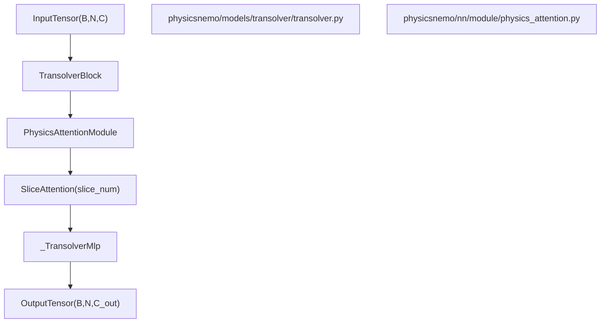
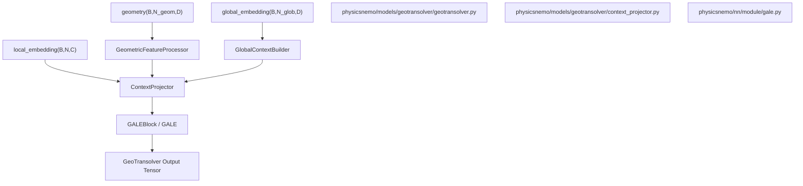

<!-- source: DeepWiki mcp.deepwiki.com · repo NVIDIA/physicsnemo · extra page Transformer Operators: Transolver, GeoTransolver, FLARE · fetched 2026-11-04 -->

# Transformer Operators: Transolver, GeoTransolver, FLARE

Relevant source files

The following files were used as context for generating this wiki page:

- [docs/api/models/flare.rst](docs/api/models/flare.rst)
- [docs/api/models/geotransolver.rst](docs/api/models/geotransolver.rst)
- [examples/cfd/darcy_transolver/README.md](examples/cfd/darcy_transolver/README.md)
- [examples/cfd/darcy_transolver/config.yaml](examples/cfd/darcy_transolver/config.yaml)
- [examples/cfd/darcy_transolver/config_fix.yaml](examples/cfd/darcy_transolver/config_fix.yaml)
- [examples/cfd/darcy_transolver/convert_mat_to_npz.py](examples/cfd/darcy_transolver/convert_mat_to_npz.py)
- [examples/cfd/darcy_transolver/darcy_datapipe_fix.py](examples/cfd/darcy_transolver/darcy_datapipe_fix.py)
- [examples/cfd/darcy_transolver/model/flare.yaml](examples/cfd/darcy_transolver/model/flare.yaml)
- [examples/cfd/darcy_transolver/model/geotransolver.yaml](examples/cfd/darcy_transolver/model/geotransolver.yaml)
- [examples/cfd/darcy_transolver/model/geotransolver_fa.yaml](examples/cfd/darcy_transolver/model/geotransolver_fa.yaml)
- [examples/cfd/darcy_transolver/model/transolver.yaml](examples/cfd/darcy_transolver/model/transolver.yaml)
- [examples/cfd/darcy_transolver/train_transolver_darcy.py](examples/cfd/darcy_transolver/train_transolver_darcy.py)
- [examples/cfd/darcy_transolver/train_transolver_darcy_fix.py](examples/cfd/darcy_transolver/train_transolver_darcy_fix.py)
- [examples/cfd/darcy_transolver/validator_fix.py](examples/cfd/darcy_transolver/validator_fix.py)
- [examples/cfd/external_aerodynamics/active_learning_aero/src/conf/model/geotransolver.yaml](examples/cfd/external_aerodynamics/active_learning_aero/src/conf/model/geotransolver.yaml)
- [examples/cfd/external_aerodynamics/transformer_models/deprecated/conf/train_surface.yaml](examples/cfd/external_aerodynamics/transformer_models/deprecated/conf/train_surface.yaml)
- [examples/cfd/external_aerodynamics/transformer_models/src/conf/model/geotransolver.yaml](examples/cfd/external_aerodynamics/transformer_models/src/conf/model/geotransolver.yaml)
- [examples/cfd/external_aerodynamics/transformer_models/src/conf/model/transolver.yaml](examples/cfd/external_aerodynamics/transformer_models/src/conf/model/transolver.yaml)
- [examples/cfd/external_aerodynamics/unified_external_aero_recipe/conf/model/domino_volume.yaml](examples/cfd/external_aerodynamics/unified_external_aero_recipe/conf/model/domino_volume.yaml)
- [examples/cfd/external_aerodynamics/unified_external_aero_recipe/conf/model/flare_surface.yaml](examples/cfd/external_aerodynamics/unified_external_aero_recipe/conf/model/flare_surface.yaml)
- [examples/cfd/external_aerodynamics/unified_external_aero_recipe/conf/model/flare_volume.yaml](examples/cfd/external_aerodynamics/unified_external_aero_recipe/conf/model/flare_volume.yaml)
- [examples/cfd/external_aerodynamics/unified_external_aero_recipe/conf/model/geotransolver_surface.yaml](examples/cfd/external_aerodynamics/unified_external_aero_recipe/conf/model/geotransolver_surface.yaml)
- [examples/cfd/external_aerodynamics/unified_external_aero_recipe/conf/model/geotransolver_volume.yaml](examples/cfd/external_aerodynamics/unified_external_aero_recipe/conf/model/geotransolver_volume.yaml)
- [examples/cfd/external_aerodynamics/unified_external_aero_recipe/conf/model/geotransolver_volume_highlift.yaml](examples/cfd/external_aerodynamics/unified_external_aero_recipe/conf/model/geotransolver_volume_highlift.yaml)
- [examples/cfd/external_aerodynamics/unified_external_aero_recipe/conf/model/transolver_volume.yaml](examples/cfd/external_aerodynamics/unified_external_aero_recipe/conf/model/transolver_volume.yaml)
- [examples/cfd/external_aerodynamics/unified_external_aero_recipe/tests/test_synthetic_configs.py](examples/cfd/external_aerodynamics/unified_external_aero_recipe/tests/test_synthetic_configs.py)
- [physicsnemo/experimental/models/flare/__init__.py](physicsnemo/experimental/models/flare/__init__.py)
- [physicsnemo/experimental/models/flare/flare.py](physicsnemo/experimental/models/flare/flare.py)
- [physicsnemo/experimental/models/geotransolver/__init__.py](physicsnemo/experimental/models/geotransolver/__init__.py)
- [physicsnemo/experimental/models/geotransolver/context_projector.py](physicsnemo/experimental/models/geotransolver/context_projector.py)
- [physicsnemo/experimental/models/geotransolver/gale.py](physicsnemo/experimental/models/geotransolver/gale.py)
- [physicsnemo/experimental/models/geotransolver/geotransolver.py](physicsnemo/experimental/models/geotransolver/geotransolver.py)
- [physicsnemo/experimental/nn/__init__.py](physicsnemo/experimental/nn/__init__.py)
- [physicsnemo/experimental/nn/flare_attention.py](physicsnemo/experimental/nn/flare_attention.py)
- [physicsnemo/models/transolver/__init__.py](physicsnemo/models/transolver/__init__.py)
- [physicsnemo/models/transolver/transolver.py](physicsnemo/models/transolver/transolver.py)
- [physicsnemo/nn/module/physics_attention.py](physicsnemo/nn/module/physics_attention.py)
- [test/experimental/models/__init__.py](test/experimental/models/__init__.py)
- [test/models/flare/test_flare.py](test/models/flare/test_flare.py)
- [test/models/geotransolver/test_geotransolver.py](test/models/geotransolver/test_geotransolver.py)
- [test/models/transolver/test_transolver.py](test/models/transolver/test_transolver.py)

## Purpose and Scope

This page documents the physics-attention transformer operator family in PhysicsNeMo, including **Transolver**, **GeoTransolver** (incorporating Geometry-Aware Latent Embeddings, GALE, and context project mechanisms), **FLARE attention** (Fast Low-rank Attention Routing Engine), and their configuration patterns within unified aerodynamics and CFD recipes. 

---

## 1. Transolver Architecture & Physics Attention

Transolver replaces standard quadratic self-attention with a physics-informed attention mechanism that projects inputs onto learned physical slices (or "slices" across spatial domains) before computing attention.

The core implementation defines transformer encoder blocks (`TransolverBlock`) [physicsnemo/models/transolver/transolver.py:142-190]() coupled with a state-dict compatible multi-layer perceptron (`_TransolverMlp`) [physicsnemo/models/transolver/transolver.py:81-140]() and backend attention extractors for irregular meshes (`PhysicsAttentionIrregularMesh`), structured 2D grids (`PhysicsAttentionStructuredMesh2D`), and structured 3D grids (`PhysicsAttentionStructuredMesh3D`) [physicsnemo/models/transolver/transolver.py:56-60]().

### Data Flow and Execution

*Figure 1: Natural Language to Code Entity Mapping for Transolver Architecture.*

Sources: `physicsnemo/models/transolver/transolver.py`, `physicsnemo/nn/module/physics_attention.py`

---

## 2. GeoTransolver and GALE

**GeoTransolver** extends Transolver by integrating Geometry-Aware Latent Embeddings (GALE) and dedicated context projectors. It supports cross-attention to geometry and global context variables alongside physical slice attention.

### Key Components

*   `GeoTransolver`: Main model class handling initialization, forward pass routing, and optional return of embedding states [test/models/geotransolver/test_geotransolver.py:30-33]().
*   `ContextProjector` & `StructuredContextProjector`: Handle multi-scale feature extraction for point clouds and structured grids [physicsnemo/experimental/models/geotransolver/context_projector.py:19-25]().
*   `GeometricFeatureProcessor` & `GlobalContextBuilder`: Process geometric coordinates and global boundary/physics parameters [physicsnemo/experimental/models/geotransolver/context_projector.py:19-25]().

*Figure 2: Natural Language to Code Entity Mapping for GeoTransolver Pipeline.*

### Activation Checkpointing

GeoTransolver supports configurable activation checkpointing during training (`activation_checkpointing=True`) [docs/api/models/geotransolver.rst:18-28](). The `checkpointing_ratio` parameter controls the fraction of GALE blocks checkpointed evenly across the stack. Component boundaries are selectable via `activation_checkpointing_components` (supporting `"context"`, `"preprocess"`, `"blocks"`, and `"output"`) [docs/api/models/geotransolver.rst:29-35]().

Sources: `physicsnemo/models/geotransolver/geotransolver.py`, `docs/api/models/geotransolver.rst`, `test/models/geotransolver/test_geotransolver.py`

---

## 3. FLARE Attention (Fast Low-rank Attention Routing Engine)

**FLARE** (`FLARE`) provides an alternative high-efficiency attention backend for large-scale meshes [docs/api/models/geotransolver.rst:90-104](). 

By setting `attention_type="GALE_FA"` in GeoTransolver, the architecture swaps the standard physics-attention slice mechanism for FLARE while retaining geometry- and context-aware cross-attention [docs/api/models/geotransolver.rst:90-104](). This reduces memory overhead and quadratic scaling bottlenecks on large meshes.

Sources: `physicsnemo/experimental/nn/flare_attention.py`, `docs/api/models/geotransolver.rst`

---

## 4. Configuration in Unified Aerodynamics Recipes

Unified workflows configure Transolver, GeoTransolver, and FLARE variants via Hydra configurations and runtime factories [examples/cfd/darcy_transolver/config_fix.yaml:23-26]().

### Model Target Dispatching

Training scripts inspect model targets (`_target_`) at startup to construct appropriate keyword arguments for forward execution, differentiating between GeoTransolver inputs (`local_embedding`, `geometry`) and Transolver/FLARE inputs (`fx`, `embedding`) [examples/cfd/darcy_transolver/train_transolver_darcy_fix.py:60-93]().

| Model Variant | Hydra Target String | Primary Inputs | Attention Backend |
| :--- | :--- | :--- | :--- |
| **Transolver** | `physicsnemo.models.transolver.Transolver` | `fx`, `embedding` | `PhysicsAttentionIrregularMesh` / Structured |
| **GeoTransolver** | `physicsnemo.models.geotransolver.GeoTransolver` | `local_embedding`, `geometry` | `GALE` |
| **GeoTransolver (FA)** | `physicsnemo.models.geotransolver.GeoTransolver` (with `attention_type="GALE_FA"`) | `local_embedding`, `geometry` | `GALE_FA` (FLARE) |
| **FLARE** | `physicsnemo.models.flare.FLARE` | `fx`, `embedding` | `FLARE` |

Sources: `examples/cfd/darcy_transolver/config_fix.yaml`, `examples/cfd/darcy_transolver/train_transolver_darcy_fix.py`

---

