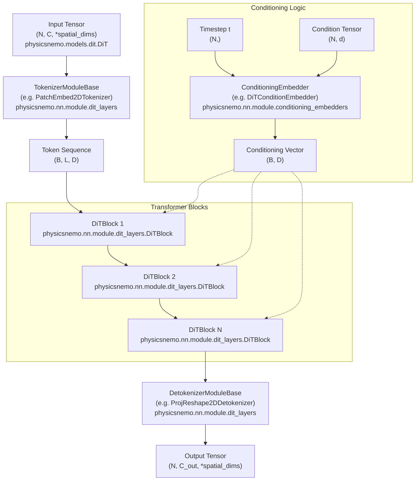
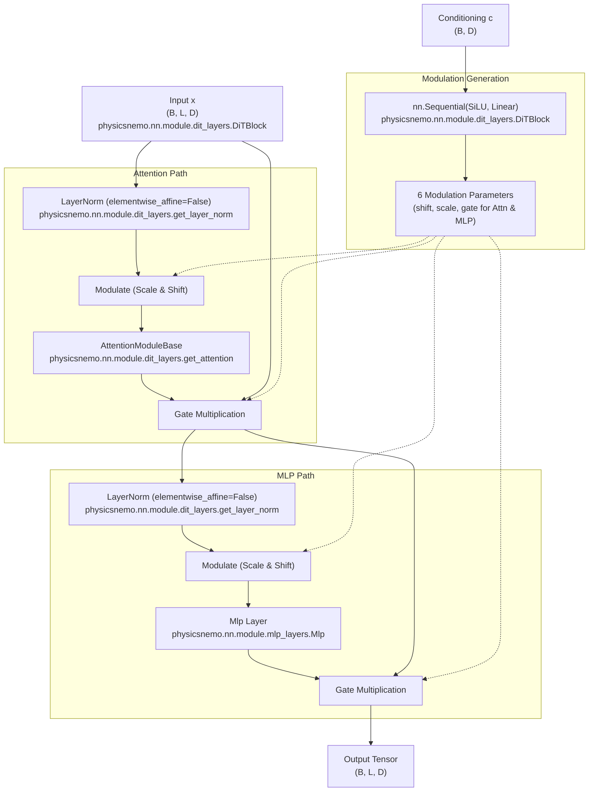
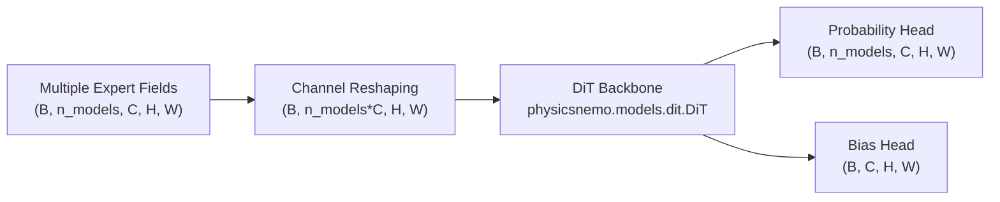

<!-- source: DeepWiki mcp.deepwiki.com · repo NVIDIA/physicsnemo · extra page DiT (Diffusion Transformer) · fetched 2026-11-04 -->

# DiT (Diffusion Transformer)

Relevant source files

The following files were used as context for generating this wiki page:

- [docs/api/nn/layers/rope.rst](docs/api/nn/layers/rope.rst)
- [docs/api/physicsnemo.nn.layers.rst](docs/api/physicsnemo.nn.layers.rst)
- [physicsnemo/models/dit/dit.py](physicsnemo/models/dit/dit.py)
- [physicsnemo/nn/__init__.py](physicsnemo/nn/__init__.py)
- [physicsnemo/nn/module/__init__.py](physicsnemo/nn/module/__init__.py)
- [physicsnemo/nn/module/dit_layers.py](physicsnemo/nn/module/dit_layers.py)
- [physicsnemo/nn/module/rope.py](physicsnemo/nn/module/rope.py)
- [test/models/dit/test_dit.py](test/models/dit/test_dit.py)
- [test/nn/module/test_dit_layers.py](test/nn/module/test_dit_layers.py)
- [test/nn/module/test_rope.py](test/nn/module/test_rope.py)

## Purpose and Scope

This page documents the Diffusion Transformer (DiT) architecture implementation in PhysicsNeMo, serving as a transformer-based backbone for diffusion models. DiT replaces conventional U-Net architectures with vision transformer blocks, utilizing adaptive layer normalization (adaLN-Zero) for conditioning. The implementation is housed within the core `physicsnemo.nn` package and supports multiple attention backends (timm, Transformer Engine, NATTEN, and NATTEN with axial RoPE), flexible tokenization schemes, and conditional generation.

For general diffusion model concepts and preconditioning schemes, see [Preconditioning and Samplers](#3.3.3). For U-Net-based diffusion architectures, see [SongUNet and Variants](#3.3.1). For an application utilizing DiT, see [MoWE (Mixture of Weather Experts)](#3.4.2).

**Note**: As part of the v2.0 refactor, DiT layers and conditioning embedders have migrated from `physicsnemo.models.dit` to `physicsnemo.nn.module` [physicsnemo/models/dit/dit.py:28-38](), `[physicsnemo/nn/module/dit_layers.py:1-86]()`. Backward-compatibility shims exist but are deprecated.

---

## Architecture Overview

DiT adapts the vision transformer paradigm for spatial diffusion modeling, replacing encoder-decoder structures with a uniform sequence of transformer blocks. The data flow proceeds through three principal stages:

1. **Tokenization**: Converts spatial inputs into a sequence of flat tokens via `TokenizerModuleBase` implementations.
2. **Transformer Processing**: Processes tokens through stacked `DiTBlock` layers modulated by time and conditioning embeddings.
3. **Detokenizer**: Reconstructs spatial grids from token sequences using `DetokenizerModuleBase` implementations.

### Data Flow and Code Entities

The following diagram bridges the conceptual stages of the DiT forward pass to the concrete code entities in the codebase.

Sources: `[physicsnemo/models/dit/dit.py:58-150]()`, `[physicsnemo/nn/module/dit_layers.py:39-86]()`, `[physicsnemo/nn/module/conditioning_embedders.py:50-57]()`

---

## Core Components

### DiT Class

The `DiT` class acts as the primary model interface inheriting from `physicsnemo.core.Module` [physicsnemo/models/dit/dit.py:58-58]().

| Parameter | Type | Description |
|-----------|------|-------------|
| `input_size` | `Union[int, Tuple[int]]` | Spatial dimensions of the input grid [physicsnemo/models/dit/dit.py:64-66]() |
| `in_channels` | `int` | Number of input channels [physicsnemo/models/dit/dit.py:67-68]() |
| `patch_size` | `Union[int, Tuple[int]]` | Patch size for tokenization (default: `(8, 8)`) [physicsnemo/models/dit/dit.py:69-71]() |
| `tokenizer` | `Union[str, Module]` | Tokenizer type identifier or custom module [physicsnemo/models/dit/dit.py:72-74]() |
| `detokenizer` | `Union[str, Module]` | Detokenizer type identifier or custom module [physicsnemo/models/dit/dit.py:75-77]() |
| `hidden_size` | `int` | Transformer embedding dimensionality (default: `384`) [physicsnemo/models/dit/dit.py:80-81]() |
| `depth` | `int` | Number of stacked transformer blocks (default: `12`) [physicsnemo/models/dit/dit.py:82-83]() |
| `attention_backend` | `Literal` | Attention implementation backend [physicsnemo/models/dit/dit.py:88-89]() |
| `layernorm_backend` | `Literal` | Normalization backend (`"torch"` or `"apex"`) [physicsnemo/models/dit/dit.py:90-91]() |
| `condition_dim` | `Optional[int]` | Conditioning feature dimensionality [physicsnemo/models/dit/dit.py:92-93]() |

Sources: `[physicsnemo/models/dit/dit.py:58-120]()`

---

### DiTBlock: Transformer with Adaptive Layer Norm

The `DiTBlock` class implements a transformer block utilizing adaptive layer normalization zero (adaLN-Zero) [physicsnemo/nn/module/dit_layers.py:72](). It accepts input tokens and a conditioning vector, generating scale, shift, and gate modulation parameters.

Sources: `[physicsnemo/nn/module/dit_layers.py:68-86]()`, `[physicsnemo/nn/module/mlp_layers.py:133-133]()`

---

### Attention Backend Options

`get_attention` instantiates specific attention modules depending on the configuration parameter `attention_backend`:

1. **`"timm"`**: Instantiates `TimmSelfAttention`, utilizing `timm.layers.Attention` backed by PyTorch's scaled dot-product attention [physicsnemo/nn/module/dit_layers.py:86-125]().
2. **`"transformer_engine"`**: Instantiates `TESelfAttention`, using NVIDIA Transformer Engine multi-head attention kernels [physicsnemo/nn/module/dit_layers.py:126-133]().
3. **`"natten2d"` / `"natten2d_rope"`**: Instantiates `Natten2DSelfAttention` or `RopeNatten2DSelfAttention`, providing windowed neighborhood attention via NATTEN with optional 2D axial rotary position embeddings [physicsnemo/nn/module/dit_layers.py:134-149](), `[physicsnemo/nn/module/rope.py:30-45]()`.

Sources: `[physicsnemo/nn/module/dit_layers.py:86-153]()`, `[physicsnemo/nn/module/rope.py:30-51]()`

---

### Tokenization and Conditioning Embedders

#### Tokenizers and Detokenizers
Spatial tensors are mapped to and from sequences via abstract interfaces:
- **`TokenizerModuleBase`**: Base interface for tokenizers, including `PatchEmbed2DTokenizer` for grid patch extraction `[physicsnemo/nn/module/dit_layers.py:74-81]()`.
- **`DetokenizerModuleBase`**: Base interface for detokenizers, including `ProjReshape2DDetokenizer` and `ConvDetokenizer` for projection and reshaping `[physicsnemo/nn/module/dit_layers.py:70-83]()`.

#### Conditioning Embedders
`get_conditioning_embedder` resolves conditioning inputs through [physicsnemo/nn/module/conditioning_embedders.py:50-57]():
- **`DiTConditionEmbedder`**: Processes timesteps and auxiliary labels [physicsnemo/nn/module/conditioning_embedders.py:53-53]().
- **`EDMConditionEmbedder`**: Adapts embedding specifically for Elucidated Diffusion Models (EDM) [physicsnemo/nn/module/conditioning_embedders.py:54-54]().
- **`ZeroConditioningEmbedder`**: Emits zero-filled conditioning vectors for unconditional models [physicsnemo/nn/module/conditioning_embedders.py:55-55]().

Sources: `[physicsnemo/nn/module/dit_layers.py:68-86]()`, `[physicsnemo/nn/module/conditioning_embedders.py:50-57]()`

---

## Downstream Application: MoWE

The **Mixture of Weather Experts (MoWE)** model exemplifies DiT usage in complex multi-model weather forecasting scenarios by wrapping `DiT` to ingest multi-source expert inputs [examples/weather/mixture_of_experts/mowe_model.py:23-29]().

Sources: `[examples/weather/mixture_of_experts/mowe_model.py:23-110]()`

---

## Technical Implementation Details

### Module Migration
DiT layers reside in `physicsnemo.nn.module.dit_layers` and conditioning embedders in `physicsnemo.nn.module.conditioning_embedders`. Shims remain for backward compatibility with `physicsnemo.models.dit` [physicsnemo/models/dit/dit.py:28-38]().

### Precision Control
`force_tokenization_fp32` forces spatial tokenization and de-tokenization steps to execute in `float32` precision while transformer blocks run in mixed precision (e.g., `bf16`), mitigating precision degradation at grid boundaries [physicsnemo/models/dit/dit.py:110-111]().

### Metadata and Optimization
The `MetaData` dataclass associated with `DiT` declares support for `bf16` and `amp_gpu` execution modes [physicsnemo/models/dit/dit.py:41-56]().

Sources: `[physicsnemo/models/dit/dit.py:26-114]`, `[physicsnemo/nn/module/dit_layers.py:38-86]()`

---

