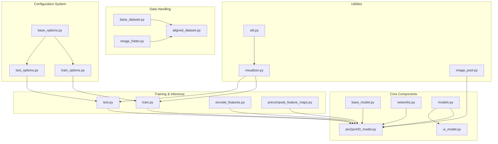
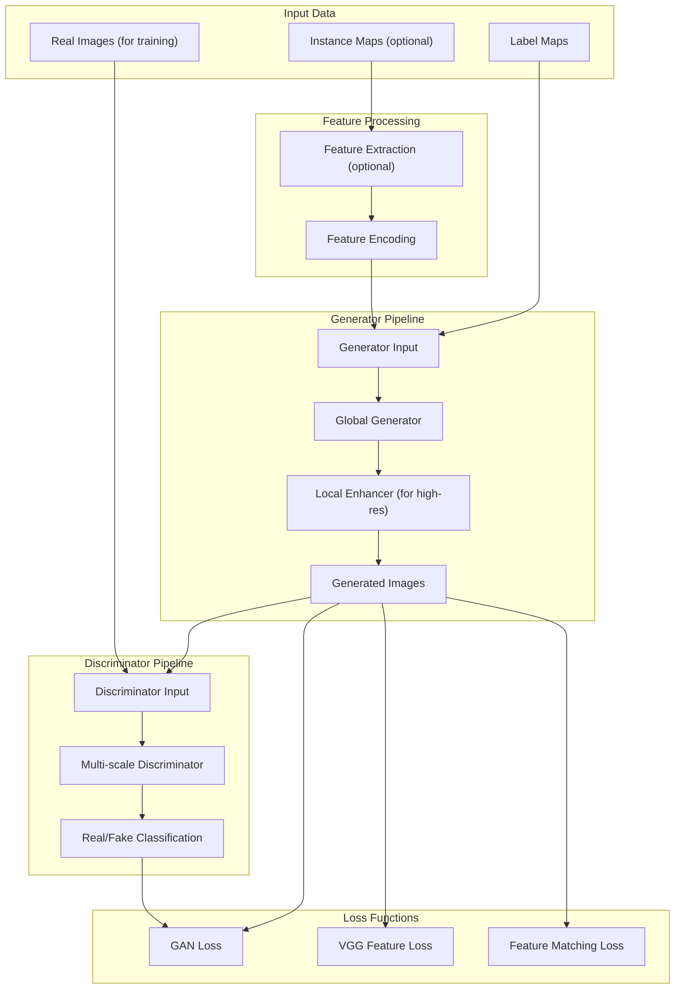

<!-- source: DeepWiki mcp.deepwiki.com · repo NVIDIA/pix2pixHD · page 1 Overview · fetched 2026-10-26 -->

# Overview

<details>
<summary>Relevant source files</summary>

The following files were used as context for generating this wiki page:

- [README.md](README.md)
- [util/util.py](util/util.py)

</details>


This document provides an introduction to the pix2pixHD repository, a PyTorch implementation for high-resolution photorealistic image-to-image translation using conditional GANs. For detailed information about specific components, please refer to the corresponding wiki pages linked throughout this document.

## What is pix2pixHD?

pix2pixHD is a framework for high-resolution (up to 2048×1024) photorealistic image-to-image translation. It extends the original pix2pix model with new capabilities for generating higher resolution outputs and incorporating instance information. The model is specifically designed for:

1. Converting semantic label maps into photo-realistic images
2. Synthesizing portraits from face label maps
3. Interactive image editing and manipulation

Sources: [README.md:5-11]()

## Key Capabilities

pix2pixHD features several key capabilities that make it powerful for high-resolution image synthesis:

1. **High-Resolution Output**: Capable of generating images at 2048×1024 resolution
2. **Instance-Level Control**: Uses instance maps for more precise object control
3. **Multi-Scale Architecture**: Employs a coarse-to-fine generator architecture
4. **Feature Encoding**: Enables appearance control and style transfer
5. **Interactive Editing**: Supports real-time image manipulation tools

The system demonstrates these capabilities primarily in two domains:
- Street scene generation from semantic labels (Cityscapes dataset)
- Portrait generation from face label maps

Sources: [README.md:13-50]()

## System Architecture Overview

The following diagram illustrates the high-level architecture of the pix2pixHD framework:



Sources: [README.md:5-11]()

## Model Architecture

The pix2pixHD model consists of several key neural network components:

```mermaid
classDiagram
    class "Pix2PixHDModel" {
        +netG: Generator
        +netD: Discriminator
        +netE: Encoder (optional)
        +forward()
        +inference()
        +encode_features()
    }
    
    class "Generator" {
        +GlobalGenerator
        +LocalEnhancer
    }
    
    class "Discriminator" {
        +MultiscaleDiscriminator
        +NLayerDiscriminator
    }
    
    class "Encoder" {
        +encode()
        +sample_features()
    }
    
    "Pix2PixHDModel" --> "Generator"
    "Pix2PixHDModel" --> "Discriminator"
    "Pix2PixHDModel" --> "Encoder"
```

Sources: [README.md:5-11]()

## Data Flow During Training and Inference

The following diagram illustrates the data flow during training and inference:



Sources: [util/util.py:10-100](), [README.md:72-79]()

## Basic Workflow

The typical workflow for using pix2pixHD consists of the following steps:

### Training
1. Prepare dataset (label maps, instance maps, and real images)
2. Configure training options
3. Run training script
4. Monitor results via web interface or TensorBoard

### Testing/Inference
1. Load pre-trained model
2. Provide input label maps (and instance maps if applicable)
3. Generate high-resolution output images

### Interactive Editing (UI Model)
1. Load trained model
2. Modify semantic labels interactively
3. Apply style from reference images
4. Generate real-time results

Sources: [README.md:72-124]()

## System Requirements and Setup

pix2pixHD requires:
- Linux or macOS operating system
- Python 2 or 3
- NVIDIA GPU (11GB+ memory recommended, 24GB for full resolution training)
- PyTorch and CUDA with cuDNN
- Python libraries including `dominate`

For accelerated training, the system supports:
- Multi-GPU training
- Automatic Mixed Precision (AMP) via NVIDIA Apex

Sources: [README.md:52-56](), [README.md:57-68]()

## Wiki Organization

This wiki is organized into the following main sections:

1. **Overview** (current page): Introduction to pix2pixHD
2. **System Architecture** [System Architecture](#2): Detailed explanation of system components
3. **Models** [Models](#3): Core model implementations and neural networks
4. **Training** [Training](#4): Training process and configuration
5. **Testing and Inference** [Testing and Inference](#5): Testing process and inference
6. **Data Handling** [Data Handling](#6): Dataset management and processing
7. **Configuration System** [Configuration System](#7): Options management
8. **Visualization** [Visualization](#8): Visualization utilities
9. **Running the System** [Running the System](#9): Practical usage guides

Each section provides detailed information about specific aspects of the pix2pixHD framework.

---

