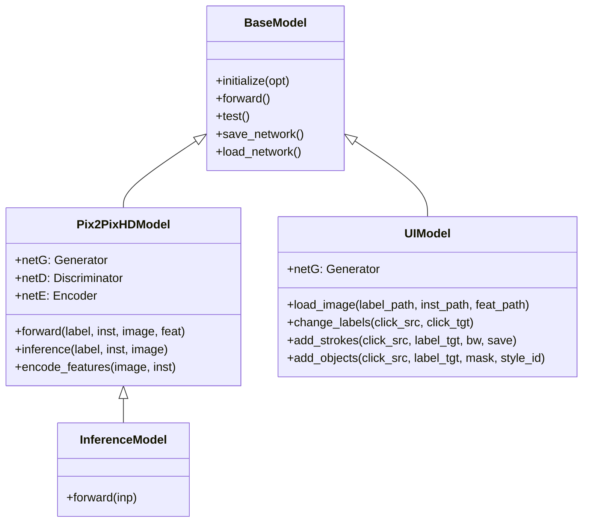
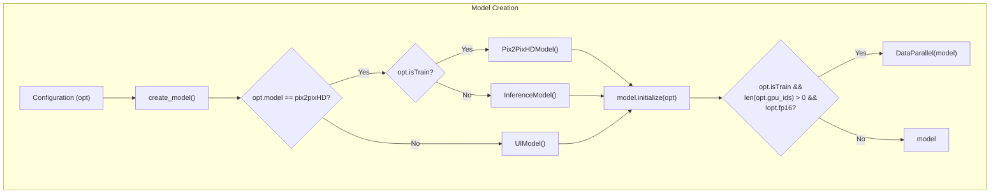
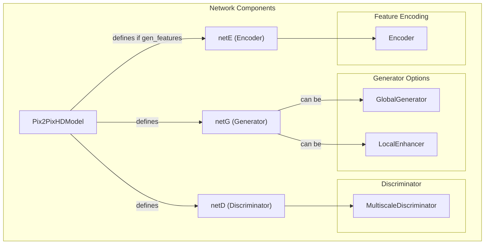
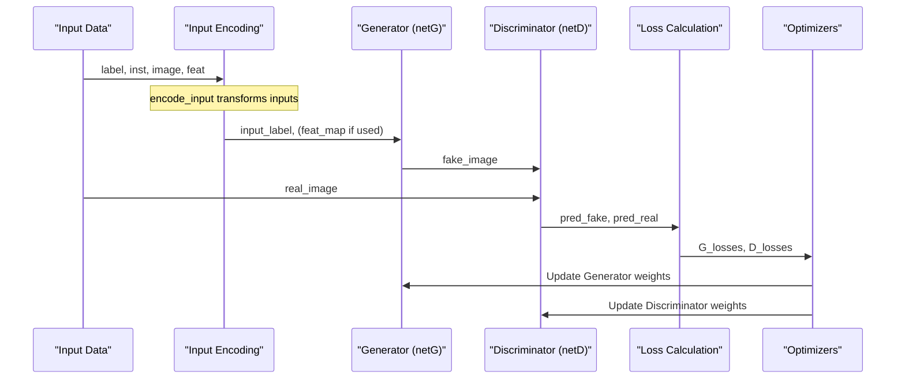
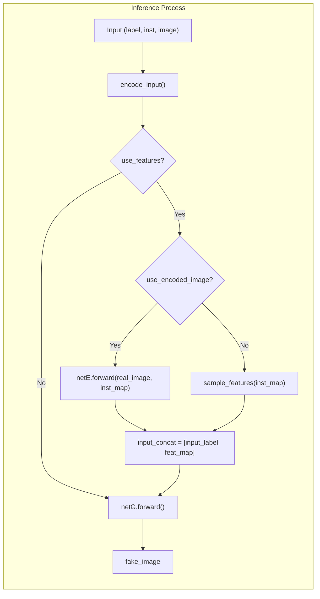
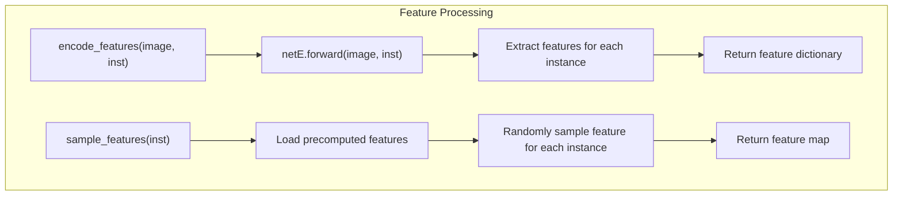
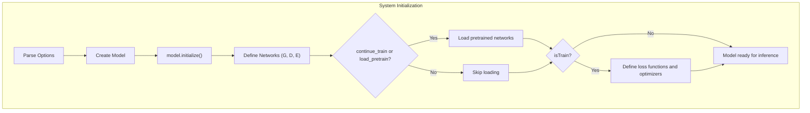

<!-- source: DeepWiki mcp.deepwiki.com · repo NVIDIA/pix2pixHD · page 2 System Architecture · fetched 2026-10-26 -->

# System Architecture

<details>
<summary>Relevant source files</summary>

The following files were used as context for generating this wiki page:

- [README.md](README.md)
- [models/base_model.py](models/base_model.py)
- [models/models.py](models/models.py)
- [models/pix2pixHD_model.py](models/pix2pixHD_model.py)
- [models/ui_model.py](models/ui_model.py)
- [util/util.py](util/util.py)

</details>


This document provides a detailed overview of the pix2pixHD system architecture, explaining the core components, their relationships, and data flow within the system. It covers the model hierarchy, network components, and the architecture patterns used in the implementation.

For an introduction to the pix2pixHD system's purpose and capabilities, see [Overview](#1). For specific details about the model implementation, see [Models](#3).

## Core System Components

The pix2pixHD system is built around a hierarchical model structure that follows object-oriented design principles. The architecture uses inheritance to define specialized models for different purposes while sharing common functionality.



Sources: [models/base_model.py](), [models/pix2pixHD_model.py:9-111](), [models/pix2pixHD_model.py:299-302](), [models/ui_model.py:11-37]()

The class hierarchy shows the main model classes in the system. `BaseModel` defines the common interface, `Pix2PixHDModel` implements the core functionality for training and inference, `InferenceModel` provides a simplified interface for inference, and `UIModel` adds interactive capabilities.

## Model Factory

The system uses a factory pattern to create appropriate model instances based on configuration:



Sources: [models/models.py:3-20]()

The model factory determines which model class to instantiate based on the provided configuration options. For the `pix2pixHD` model type, it creates either a `Pix2PixHDModel` for training or an `InferenceModel` for inference. For other model types (e.g., interactive usage), it creates a `UIModel`.

## Network Architecture

The pix2pixHD system uses several neural network architectures for different purposes:



Sources: [models/pix2pixHD_model.py:29-51]()

The system defines three main network components:
1. **Generator (netG)**: Can be either a `GlobalGenerator` or a `LocalEnhancer` based on configuration. It generates the output images from the input label maps.
2. **Discriminator (netD)**: A `MultiscaleDiscriminator` that evaluates the realism of generated images during training.
3. **Encoder (netE)**: Used when generating features from images, allows for feature encoding.

## Data Flow During Training

The following diagram illustrates the data flow during the training process:



Sources: [models/pix2pixHD_model.py:152-193]()

During training, the system:
1. Encodes the input data (label maps, instance maps, images, features) using `encode_input`
2. Passes the encoded input through the generator to produce a fake image
3. Evaluates both the real and fake images with the discriminator
4. Calculates several losses (GAN loss, feature matching loss, VGG loss)
5. Updates the generator and discriminator weights

## Data Flow During Inference

The inference process is simpler as it only requires the generator:



Sources: [models/pix2pixHD_model.py:195-217]()

During inference, the system:
1. Encodes the input data
2. If using features:
   a. Either encodes the real image using the encoder
   b. Or samples features from precomputed feature clusters
3. Passes the input (and features if used) through the generator
4. Returns the generated image

## Feature Processing

The system has specialized handling for features, allowing it to encode features from images and sample from feature clusters:



Sources: [models/pix2pixHD_model.py:219-261]()

The feature processing includes:
1. **Feature Encoding**: Extracts features from real images using the encoder
2. **Feature Sampling**: Samples from precomputed feature clusters for specific instances

## UI Model Architecture

The `UIModel` extends the system with interactive capabilities:

```mermaid
flowchart TD
    subgraph "UI Model Components"
        load["load_image()"] --> inputs["Process inputs (label, inst, feat)"]
        
        change["change_labels()"] --> update1["Update label and instance maps"]
        update1 --> forward1["Generate new image"]
        
        strokes["add_strokes()"] --> update2["Update maps in stroke region"]
        update2 --> forward2["Generate new image"]
        
        objects["add_objects()"] --> update3["Add object with selected style"]
        update3 --> forward3["Generate new image"]
        
        style["style_forward()"] --> check{"click_pt is None?"}
        check -->|Yes| simple["Generate image with current maps"]
        check -->|No| multiple["Generate multiple style options"]
    end
```

Sources: [models/ui_model.py:41-286]()

The UI model provides several interactive features:
1. **Loading Images**: Processes label maps, instance maps, and feature data
2. **Changing Labels**: Allows switching labels between regions
3. **Adding Strokes**: Enables painting with different labels
4. **Adding Objects**: Inserts new objects with selected styles
5. **Style Variations**: Generates different style options for selected objects

## System Initialization Flow

The following diagram shows the initialization process for the system:



Sources: [models/pix2pixHD_model.py:19-110]()

During initialization, the system:
1. Parses command-line options
2. Creates the appropriate model type
3. Initializes the model by defining networks
4. Optionally loads pretrained networks
5. Sets up loss functions and optimizers if in training mode

## Summary

The pix2pixHD system architecture is designed with modularity and flexibility in mind. It uses inheritance to share functionality between different model types, factory patterns for model creation, and specialized handling for various inputs and features.

The core components work together to enable both training and inference of high-resolution image-to-image translation models, with additional features for interactive usage through the UI model.

The system can be configured through extensive options, allowing it to adapt to different datasets and tasks while maintaining the same overall architecture.

Sources: [models/pix2pixHD_model.py](), [models/base_model.py](), [models/models.py](), [models/ui_model.py]()

---

