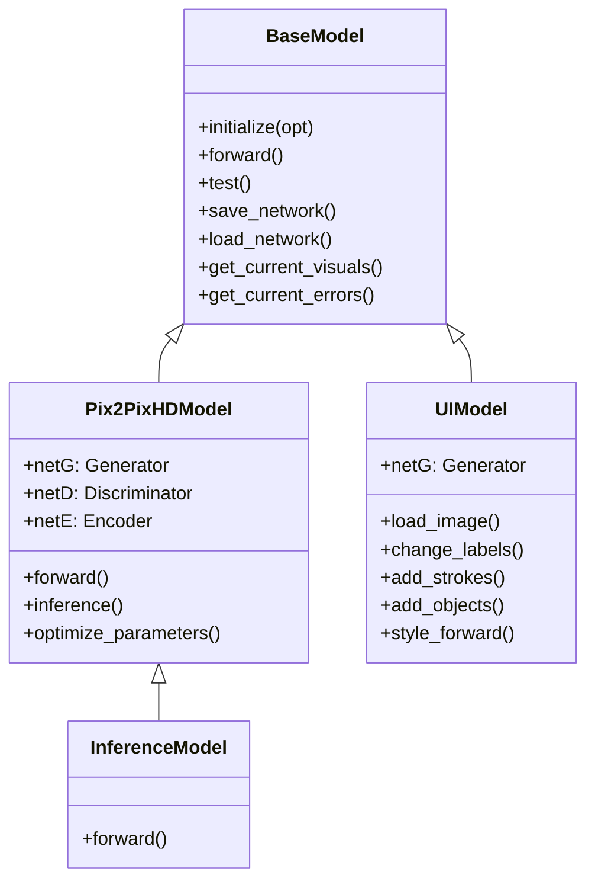
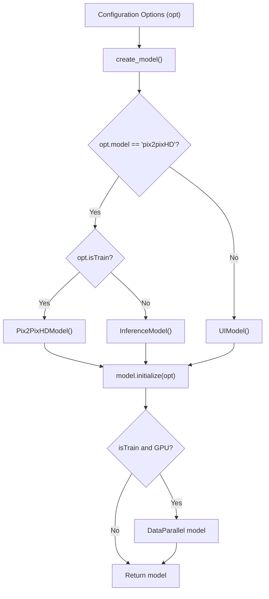
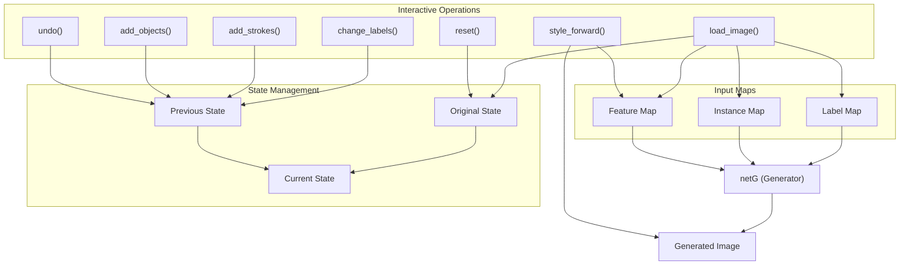
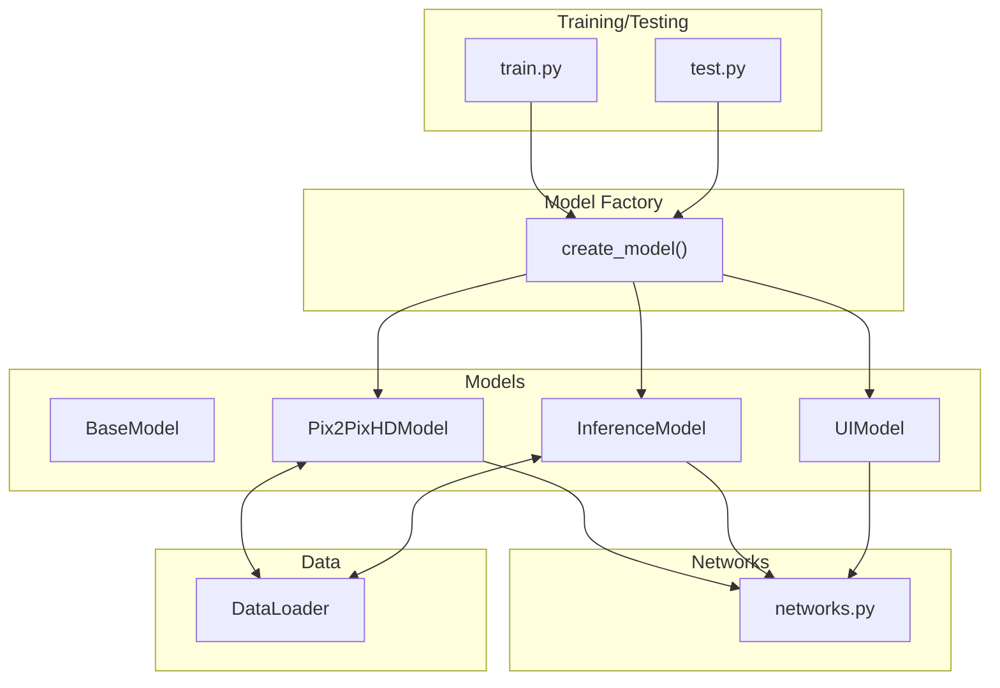

<!-- source: DeepWiki mcp.deepwiki.com · repo NVIDIA/pix2pixHD · page 3 Models · fetched 2026-10-26 -->

# Models

Relevant source files

The following files were used as context for generating this wiki page:

- [models/base_model.py](models/base_model.py)
- [models/models.py](models/models.py)
- [models/ui_model.py](models/ui_model.py)

This document provides an overview of the model architecture within the pix2pixHD system, explaining how different models are created, organized, and used. For detailed information about specific model implementations, see [Pix2PixHD Model](#3.1), [Neural Network Architectures](#3.2), and [UI Model](#3.3).

## Model System Overview

The pix2pixHD system employs a modular approach to models with a well-defined hierarchy and factory pattern for model creation. This design enables different operational modes (training, inference, and interactive) with appropriate model implementations for each use case.

Sources: [models/base_model.py:5-91](), [models/models.py:3-20](), [models/ui_model.py:11-347]()

## Model Factory Pattern

The model system uses a factory pattern to instantiate the appropriate model based on configuration options. This pattern is implemented in the `create_model` function in `models.py`:

The factory produces one of three model types:
1. `Pix2PixHDModel` - Used for training
2. `InferenceModel` - Used for efficient testing/inference
3. `UIModel` - Used for interactive applications

After creating the model, the factory initializes it with the provided options and optionally wraps it with `DataParallel` for multi-GPU training.

Sources: [models/models.py:3-20]()

## BaseModel

The `BaseModel` class serves as the foundation for all model implementations, providing common functionality and interfaces that specific models must implement:

| Method | Purpose |
|--------|---------|
| `initialize(opt)` | Configure the model with options |
| `forward()` | Perform forward pass (abstract) |
| `test()` | Run inference without gradient calculation |
| `get_current_visuals()` | Return current visual outputs |
| `get_current_errors()` | Return current error metrics |
| `save_network()` | Save network weights to disk |
| `load_network()` | Load network weights from disk |
| `update_learning_rate()` | Update learning rate (during training) |

The `BaseModel` implements robust network loading functionality that handles:
- Loading weights with exact matches
- Loading weights with partial matches (some layers missing)
- Loading weights with mismatched layer sizes

Sources: [models/base_model.py:5-91]()

## Model Implementations

### Pix2PixHDModel

The main model used for training the pix2pixHD system. While not shown in the provided files, the factory pattern indicates it includes:
- A generator network (netG)
- A discriminator network (netD)
- An optional encoder network (netE)
- Methods for forward/backward passes and optimization

### InferenceModel

A simplified version of `Pix2PixHDModel` optimized for inference, containing only the components necessary for generating images (without training-related components).

### UIModel

The `UIModel` extends `BaseModel` to provide interactive capabilities for manipulating and generating images in real-time:

Key features of the `UIModel` include:
- Loading and processing input maps (label maps, instance maps, feature maps)
- Interactive editing operations:
  - Changing object labels
  - Adding strokes with specified labels
  - Adding objects with specific styles
  - Applying different style variations
- State management for undo/reset functionality
- Real-time image generation using the generator network

Sources: [models/ui_model.py:11-347]()

## Model Integration with the System

Models in pix2pixHD integrate with other system components through well-defined interfaces:

Training and testing scripts use the model factory to create appropriate model instances, which in turn utilize network definitions to construct their neural network components. The models interact with data loaders to process input data and generate outputs according to their specific purposes.

Sources: [models/models.py:3-20]()

## Summary

The pix2pixHD model system employs an object-oriented design with:
- A common base class providing shared functionality
- Specialized model implementations for different use cases
- A factory pattern for model creation and configuration
- Clear interfaces for integration with other system components

This architecture enables the system to operate in different modes (training, inference, interactive) while maintaining consistent interfaces and sharing common functionality across model implementations.

---

